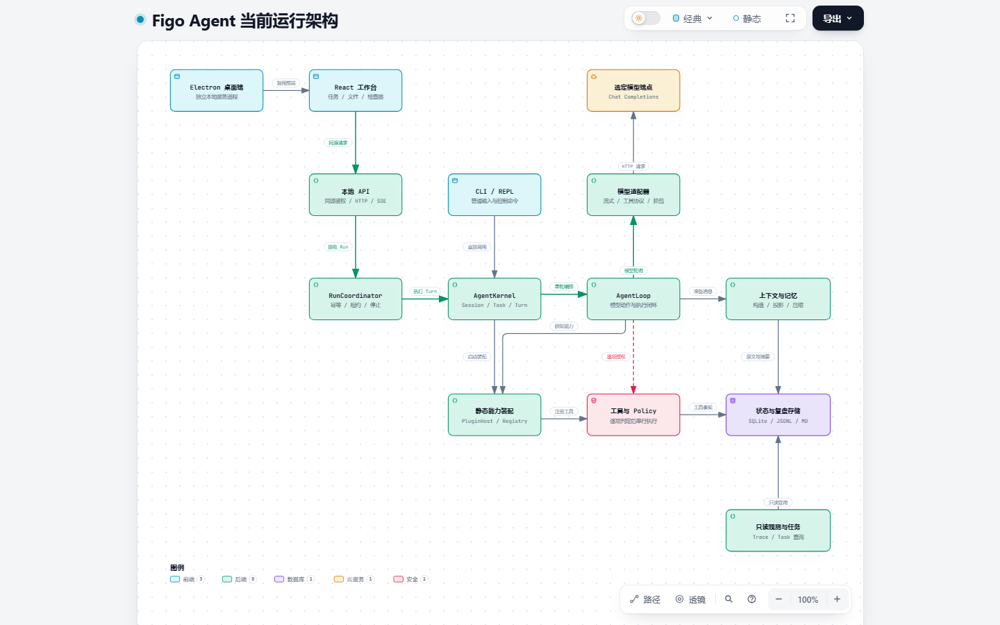
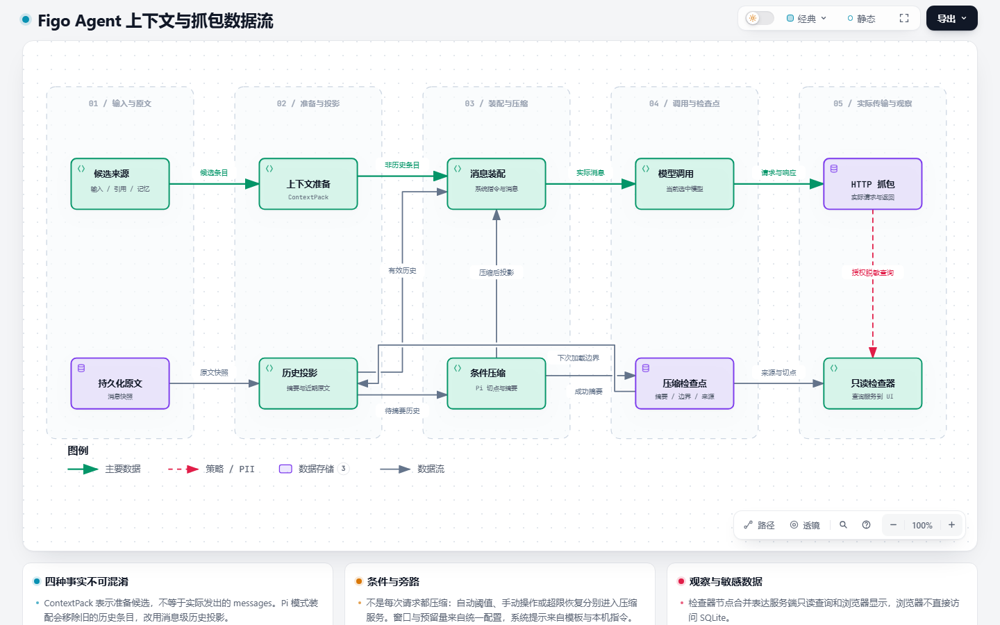

# Archify 当前项目架构分析

## 1. 结论与基线

当前项目已经从 CLI 小内核发展为共享 Agent 应用层的本地工作台：CLI、Web、Electron 复用 AgentKernel / AgentLoop，执行结果、上下文原文、压缩检查点与 HTTP 抓包具有各自的持久化记录；新版 Trace Inspector 和跨 Session Task 目录以只读投影呈现这些事实。

架构方向与项目目标一致，但“插件注册完整”还不等于“核心完全依赖抽象”。目前主要演进压力在具体类耦合、UI/执行编排集中，以及本地完整抓包的敏感数据保护。尚未实现 Goal / Verifier 目标验收闭环，不应将模型返回最终答复等同于任务验收通过。

| 项目 | 本次范围 |
| --- | --- |
| 分析日期 | 2026-10-18，上海时间 |
| 源码基线 | `677cba5426e6f9115ac543b1bad3f931da6b21e3`，`master` |
| 工作区初始状态 | 干净 |
| 仓库身份 | `git@gitee.com:hfqf1234/figo-agent.git` |
| 依据 | `AGENTS.MD`、`readme.md`、模块文档与当前自有源码 |
| 工具 | [Archify 官方仓库](https://github.com/tt-a1i/archify)，3.1.0，上游固定提交 `68be1e0971208ef0b1550ec3b29f3d4d177f3cd6` |
| 排除项 | 真实模型密钥、运行配置内容、本机提示词、运行 SQLite / JSONL、`figo-kiwi` 子模块内部 |

本报告是静态架构分析和图产物验证，不是业务功能验收、渗透测试或真实模型容量验证。历史验收结果不作为本次测试结果；不恢复 Pi 压缩专项实验，不自动实施下文建议。

## 2. 可交互图与预览

### 2.1 当前运行架构

[打开交互式架构总览](assets/2026-10-18-archify/architecture.html)

主要阅读路径：React 工作台 → 本地 API → RunCoordinator → AgentKernel → AgentLoop；CLI 直接调用同一 Kernel，Electron 启动独立本地服务进程并加载 Web 界面。静态能力装配、模型适配、工具授权、上下文与存储作为分支表达。

图中节点是逻辑职责，不意味着每个节点都有独立进程。图省略 HTTP/SSE 返回线及部分持久化支线；不能因省略箭头而推断某个模块不落盘。底部查询箭头表示服务端读取，不表示浏览器直接查询 SQLite。

### 2.2 上下文与抓包数据流

[打开交互式上下文数据流](assets/2026-10-18-archify/context.html)

必须分清四种事实：

1. `ContextPack`：准备了哪些候选信息及其来源、原因和估算。
2. `context_messages`：运行时实际追加的可重建消息原文。
3. 历史投影与压缩检查点：摘要、保留边界及边界之后的近期原文。
4. `llm_http_captures`：真正发送和收到的 HTTP 请求、响应。

图主要表达启用 Pi 消息级压缩时的路径；条件压缩不是每次请求的必经节点。摘要调用也经过当前模型 Provider 并产生抓包，该调用支线在图中省略。检查器节点合并表达服务端查询与浏览器展示，不能据此合并它们的安全边界。

### 2.3 执行泳道图状态

执行泳道图保留了工具回环、协议修复、超限恢复和失败出口，但候选仍未通过 Archify 的几何校验，**不交付为已完成的 HTML 图**。当前失败是 `retry-protocol` 的显式路径与最终节点端口不构成正交线段，属于图布局问题，不是源码执行错误。

[候选 JSON](assets/2026-10-18-archify/loop.candidate.json)与[失败回执](assets/2026-10-18-archify/loop.finalize-summary.json)保留排查过程；执行语义见下节。不删除回环关系来换取图形校验通过。

## 3. 职责与边界

| 模块 | 当前职责 | 源码依据 |
| --- | --- | --- |
| CLI | 普通输入、控制命令、终端输出适配 | [main.ts](../../code/src/cli/main.ts#L10) |
| Electron | 桌面窗口与独立本地服务生命周期，不复制 Loop | [service-host.ts](../../code/src/desktop/service-host.ts#L21) |
| 本地 API | 同源鉴权、参数校验、路由与适配 | [local-api.ts](../../code/src/ui/local-api.ts#L107) |
| RunCoordinator | 幂等提交、运行租约、异步执行、停止和状态事件 | [run-coordinator.ts](../../code/src/ui/run-coordinator.ts#L59) |
| AgentKernel | 启动装配、Session / Task / Turn 生命周期、模型选择 | [agent-kernel.ts](../../code/src/kernel/agent-kernel.ts#L45) |
| AgentLoop | 上下文、显式 Skill、模型响应、工具回环及异常收敛 | [agent-loop.ts](../../code/src/loop/agent-loop.ts#L65) |
| PluginHost | 静态注册、生命周期和能力检索 | [plugin-host.ts](../../code/src/plugin/plugin-host.ts#L48) |
| Context | 候选构造、消息原文、历史投影、安全切点与滚动摘要 | [context-builder.ts](../../code/src/context/context-builder.ts#L30)、[compaction-service.ts](../../code/src/context/compaction-service.ts#L71) |
| Tool / Policy | 每次工具动作先授权，再执行并记录结果 | [tool-registry.ts](../../code/src/tools/tool-registry.ts#L58) |
| LLM | OpenAI-compatible 适配、协议处理、抓包 | [openai-compatible-provider.ts](../../code/src/llm/openai-compatible-provider.ts#L40) |
| Storage / Trace | 状态落盘、结构化事实、JSONL 审计 | [trace-recorder.ts](../../code/src/trace/trace-recorder.ts#L28) |
| Reporter | 从现有事实生成给人阅读的 Markdown 产物 | [markdown-reporter.ts](../../code/src/reporter/markdown-reporter.ts#L19) |
| Task 目录 | 当前工作区跨 Session 查询、首条输入标题、分页搜索 | [task-list-query-service.ts](../../code/src/ui/task-list-query-service.ts#L39) |
| Trace Inspector | 带归属校验、分页和字段约束的只读事实查询与展示 | [trace-inspector-query-service.ts](../../code/src/ui/trace-inspector-query-service.ts#L53) |

工作区任务目录不是新的执行管理器，历史 Task 展示也不代表恢复执行。文件浏览是人的观察；只有显式引用经过 API 校验后，才进入 ContextBuilder 的候选条目。视图恢复由工作区隔离的浏览器偏好控制，不改变运行事实。

## 4. 一轮执行如何工作

1. Web 提交经 RunCoordinator 校验幂等键、活跃运行和 SQLite 租约，再创建 Turn / Run；CLI 通过 Kernel 取得同类工作区运行租约。
2. Loop 从 PluginHost 获取当前 Provider、ContextBuilder、Skill 和 Reporter。内置项目理解 Skill 只在显式选择时执行，普通“分析项目”意图不会自动激活。
3. ContextBuilder 保存准备信息；启用 Pi 路径后，消息装配去掉 ContextPack 中的旧历史项，改用“摘要 + 保留消息原文”，并追加当前输入及有效系统指令。
4. 模型返回最终答复或工具动作。原生 `tool_calls` 与文本工具协议分开解释，合法原生调用可以携带说明正文。
5. ToolCallingRuntime 按批串行执行，ToolRegistry 对每项先做 Policy 判断；拒绝也生成结果。原始工具记录与回填模型的预算化结果预览分开保存。
6. 运行时落库消息快照，将工具反馈回填模型；根据无新增指纹检测、协议修复额度、超限恢复条件决定继续或失败。
7. 最终答复产生报告和完成状态；停止信号产生 interrupted，异常产生 failed。进程遗留的运行可标记中断，不等于自动重放。

依据：[Loop 消息准备](../../code/src/loop/agent-loop.ts#L165)、[调用与恢复](../../code/src/loop/agent-loop.ts#L238)、[响应判定](../../code/src/loop/agent-loop.ts#L318)、[结果回填与无新增检测](../../code/src/loop/agent-loop.ts#L425)、[运行终态](../../code/src/ui/run-coordinator.ts#L188)。

当前工具循环没有固定总轮数上限。协议修复和无新增检测是局部收敛机制，不等于总时长、总 token 或总费用预算；持续产生不同工具结果的长任务不必然触发重复检测。这是执行管理扩展点，不是本次已经复现的故障。

## 5. 上下文、压缩与观测

### 5.1 压缩不是删历史

`context_messages` 在事务中校验消息的 Task / Turn 归属并保存实际消息快照；省略失败尝试修改投影标记，不删除原文。历史投影读取最新消息级检查点，按 `firstKeptSourceRef` 重建摘要和保留消息。

压缩服务负责窗口判断、触发和安全切点，摘要调用成功之后才追加检查点。未知窗口如实记录；失败不推进成功摘要。原始抓包与实际用量记录继续保留，不能用估算替代 Provider 未返回的实际值。

依据：[消息快照](../../code/src/context/context-message-store.ts#L8)、[历史投影](../../code/src/context/conversation-projection.ts#L13)、[压缩执行](../../code/src/context/compaction-service.ts#L71)、[检查点事务](../../code/src/context/compaction-store.ts#L64)。本轮未对压缩算法重新验收，不改变 2026-10-16 阶段收尾结论。

### 5.2 新版 Trace 的正确位置

Inspector 读取 Trace、模型抓包、工具、ContextPack、消息和压缩事实的引用关系，服务端承担归属验证和响应裁剪，前端只消费 DTO。它适合回答“准备了什么、发出了什么、压缩了哪段、执行了什么”，不能表达模型隐藏思维链，也不能按相邻时间编造来源关系。

因此后续上下文实现可以继续调整，但应稳定维护消息来源引用、检查点边界、调用用途和抓包关联。观测页应跟随事实契约演进，不反过来参与压缩策略或变成状态源。

## 6. SOLID 与风险评估

以下为静态分析建议，未实施；优先级表示建议关注顺序，不是已经发生事故的严重性定级。

| 优先级 | 观察 | 依据与建议 |
| --- | --- | --- |
| P1 | 抓包正文直接序列化入库，页面脱敏不能保护落盘正文 | [capture-store 第 67 行起](../../code/src/llm/llm-http-capture-store.ts#L67)只对 headers 调用脱敏，body 直接 JSON.stringify。应明确本机文件权限、保留周期、导出脱敏和是否需要存储加密；在保留抓包真实性的同时验证敏感值过滤。不能据此宣称已有密钥泄露，本轮未读取数据库。 |
| P1 | Agent 工具策略和人工终端是不同信任边界 | [terminal-service 第 37 行起](../../code/src/ui/terminal-service.ts#L37)直接启动 shell，`cd` 可切到工作区外，不经过 ToolRegistry。当前应按可信本机操作者解释；不得宣传为统一沙箱。若未来开放远程访问，必须先独立审查该入口。 |
| P2 | Kernel 依赖 UI 目录中的运行租约，职责方向反转 | [agent-kernel 第 21 行](../../code/src/kernel/agent-kernel.ts#L21)、[第 134 行](../../code/src/kernel/agent-kernel.ts#L134)。租约是 CLI/Web 共享的应用执行约束，宜迁移到共享应用层或以窄接口注入；不需要为此引入通用服务总线。 |
| P2 | PluginHost 隔离了装配，但多处核心仍依赖具体类 | [agent-loop 第 10 行起](../../code/src/loop/agent-loop.ts#L10)与[第 80 行起](../../code/src/loop/agent-loop.ts#L80)使用具体 ContextBuilder / Skill / Reporter；[ContextBuilder 构造器](../../code/src/context/context-builder.ts#L22)依赖具体 SqliteMemoryStore。应在出现第二种实现时优先抽出实际所需的窄契约，而不是把静态注册称为完全解耦。 |
| P2 | UI 和 Loop 的编排集中，后续修改容易跨职责 | TraceInspector 1009 行，local-api 631 行，App 621 行，agent-loop 564 行。行数只是调查信号；更重要的是路由/工作区替换/模型设置以及查询/选择/分页等变化点集中。按拥有的状态与生命周期渐进拆分，不按行数机械拆文件。 |
| P2 | Trace 的 SQLite 与 JSONL 双写并非原子提交 | [trace-recorder 第 44 行起](../../code/src/trace/trace-recorder.ts#L44)先写 SQLite，再创建目录并追加 JSONL。磁盘写失败时可能产生不一致；可记录补写状态并按 event id 校验/修复，或将 JSONL 明确视为可再生审计副本。本轮未做故障注入。 |
| P2 | 执行收敛尚不等同于任务级验收 | [Loop 循环](../../code/src/loop/agent-loop.ts#L238)与[重复检测](../../code/src/loop/agent-loop.ts#L465)。未来在引入 Goal/Verifier 时再统一设计任务预算和验证结果；本次不提前扩大内核。 |
| P3 | 文档入口存在删除后的悬空链接 | [readme 第 13 行](../../readme.md#L13)仍引用已删除的 `module-flows/figo-agent/`；10 月 17 日 Archify 报告引用的本地产物也已不存在。建议后续加入文档链接检查；本次只记录，不覆盖历史结论或修补无关页面。 |

已有的良好边界应继续保留：模型输出与 Policy 授权分离；CLI / Web 不复制 Loop；Reporter 不成为状态源；原文、派生摘要和审计事实分开；任务目录与 Inspector 保持只读。

不建议因为这次分析启动“大重构”、动态插件市场或新压缩策略。应优先结合真实使用反馈，以窄变更改善上述边界。

## 7. 静态规模与依赖

统计由本机现有 TypeScript 解析器读取自有 TS/TSX 的静态 import / export，未安装依赖。可复核[统计结果](assets/2026-10-18-archify/metrics.json)和[分析脚本](assets/2026-10-18-archify/analyze.mjs)。附件脚本已适配独立存放，从仓库根目录运行 `node docs/agent/assets/2026-10-18-archify/analyze.mjs`，结果写入脚本所在目录。

| 指标 | 结果 |
| --- | --- |
| `code/src` TypeScript 文件 | 95 |
| `code/web/src` TS/TSX 文件 | 28 |
| 两者源码总行数 | 15553，含注释和空行，不含文件末尾换行产生的虚拟行 |
| `code/tests` 测试文件 | 93；不是通过数或测试用例数 |
| 排除类型边后的多文件强连通分量 | 0 |
| 包含类型边的多文件强连通分量 | 2 |
| 未纳入依赖图的动态加载调用点 | 3 |
| 未解析的相对静态导入 | 0 |

两组含类型边的环分别为 StorageManager / CaptureStore / TokenUsageStore，以及 TraceInspectorDetails / TraceInspectorFlow。不能将类型环直接称为运行时循环；也不能根据静态图没有运行时环，推断动态加载、回调和运行时行为均无循环。

| 主要目录 | 文件数 | 行数 |
| --- | --- | --- |
| Web 前端 | 28 | 4667 |
| 本地 UI 服务 | 17 | 2579 |
| Context | 13 | 1725 |
| Tool | 7 | 977 |
| Loop | 5 | 953 |
| Config | 8 | 810 |
| Electron | 10 | 572 |
| Contracts | 4 | 523 |
| Storage | 3 | 468 |
| LLM | 3 | 440 |
| Kernel | 3 | 423 |

前端和本地 UI 服务合计 7246 行，约占本轮自有 TS/TSX 的 46.6%。这说明当前增量复杂度已不只在 Agent 算法，也在交互状态和观察查询；不是要求削减 UI，而是提醒为 UI 查询契约和状态边界保留独立测试。

## 8. 产物验证与复现边界

| 产物 | Schema / 布局 | Deliver | HTML Check | Chrome Browser Check |
| --- | --- | --- | --- | --- |
| 运行架构 | 通过 | 通过 | 通过 | 通过 |
| 上下文数据流 | 通过 | 通过 | 通过 | 通过 |
| 执行泳道候选 | 未通过 | 未运行 | 未运行 | 未运行 |

两张完成图都使用 `--quality showcase --repo-root .` 完整 finalize，所有主节点均绑定当前 Git 基线的源码引用。随后 visual-check 在 1440×900、2048×1320 的浅色/深色桌面视口执行自动测量并捕获截图；本次另行实际查看了两张 1440×900 浅色截图。未将自动截图成功等同于所有主题、移动端或业务页面的人工视觉验收。

数据流回执有一处回环交叉和一处绕路的可读性提示。查看截图后，主路径、回流边界和压缩输出仍可区分，保留原关系，不宣称图中零交叉。运行架构图没有该提示。

已保存的 [架构回执](assets/2026-10-18-archify/architecture.finalize-summary.json)、[数据流回执](assets/2026-10-18-archify/context.finalize-summary.json)和相应 browser-check 记录可复核自动门禁。回执中的绝对路径指向本机原始 `.archify` 产物，不是其他机器的可访问地址。

正式阅读产物位于 `docs/agent/assets/2026-10-18-archify/`；HTML 是原始已校验文件的逐字节副本，不依赖工作台服务，直接用 Chrome 打开即可。源码 JSON 的 `meta.output` 保留原始交付路径，以便复现；本次没有为移动副本篡改回执或重新声明独立校验。

原始产物目录：`.archify/architecture-figo-agent-20261018-095258/`。工具仅放于系统临时目录，未修改项目依赖。静态分析源文件指纹：`119ce05248b1a77d636ec3b5413fee24349d653bd64c7ff6f3f00631f8722f99`。

本次没有运行 `npm test`、业务 typecheck/build 或真实模型请求，没有启动或重启工作台；交互图的浏览器校验不能替代这些验证。未修改业务代码、运行参数或既有文档；未执行 Git 提交、合并或推送。
