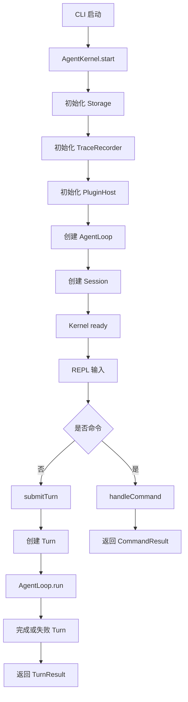
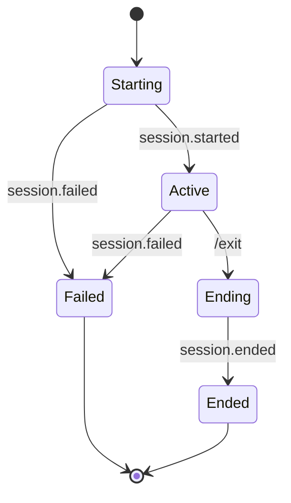
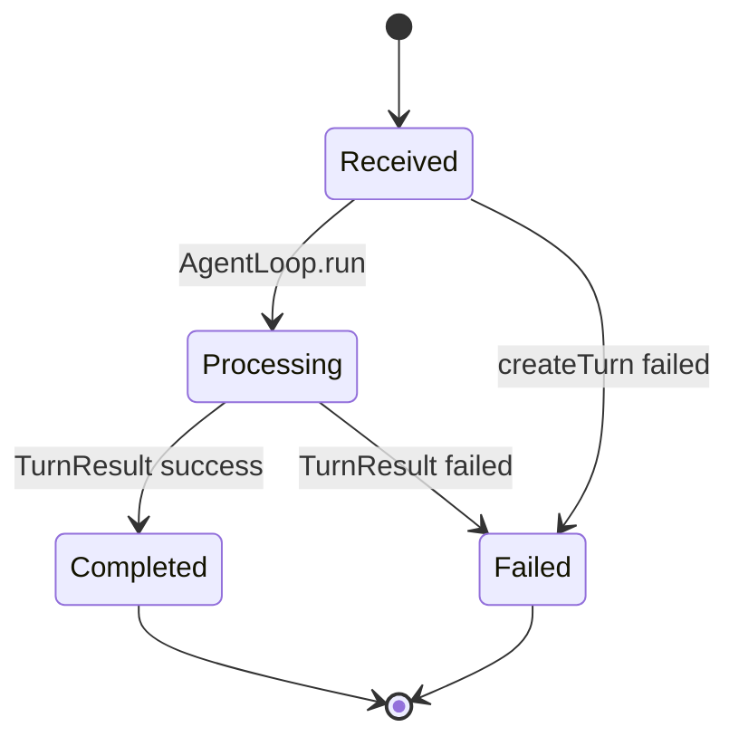
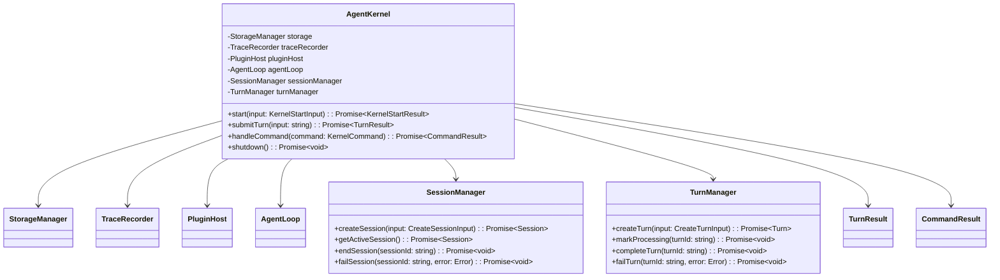

# Agent Kernel 模块设计

## 文档索引信息

- 背景：本文档位于 `docs/agent/modules/agent-kernel/`，用于沉淀 Agent Kernel 小内核设计。
- 目标：讲清 AgentKernel 如何装配 Storage、Trace、PluginHost、AgentLoop，并管理 Session、Turn 生命周期。
- 标签：Agent Kernel、小内核、Session、Turn、启动装配、生命周期、TraceRecorder。
- 适用范围：V1 CLI 交互模式、REPL 输入、Session/Turn 状态管理、AgentLoop 调用边界。
- 后续可用方向：Goal、任务恢复、多 Agent、长任务执行、运行时治理。

## 1. 模块定位

AgentKernel 是 V1 的运行时小内核。

它负责把以下模块装配成一个可运行系统：

1. Storage。
2. TraceRecorder。
3. PluginHost。
4. AgentLoop。
5. SessionManager。
6. TurnManager。

AgentKernel 不负责具体智能能力。它是启动、装配、生命周期和入口边界。

## 2. 设计动机

小内核的价值不是“更聪明”，而是让系统稳定、有边界、可演进。

AgentKernel 的设计动机：

1. 把启动流程集中在一个地方。
2. 把 Session 和 Turn 生命周期集中管理。
3. 把 Storage、Trace、PluginHost、AgentLoop 的依赖顺序固定下来。
4. 让 CLI 只负责输入输出，不直接碰业务模块。
5. 让 AgentLoop 只负责编排一轮 Turn，不负责启动和会话管理。

没有 AgentKernel，CLI 会直接创建 Storage、PluginHost、AgentLoop、Reporter，启动逻辑会散落在入口文件里。

## 3. 小内核边界

AgentKernel 是稳定层。插件能力是变化层。

```text
CLI / REPL
  -> AgentKernel
    -> SessionManager
    -> TurnManager
    -> TraceRecorder
    -> PluginHost
    -> AgentLoop
      -> Context / LLM / Skill / Tool / Reporter
```

边界结论：

1. CLI 不直接调用 AgentLoop。
2. CLI 不直接访问 Storage。
3. AgentLoop 不创建 Session。
4. AgentLoop 不初始化 PluginHost。
5. PluginHost 不管理 Turn。
6. Storage 不理解业务生命周期。

## 4. 职责边界

AgentKernel 负责：

1. 启动系统。
2. 初始化 Storage。
3. 初始化 TraceRecorder。
4. 初始化 PluginHost。
5. 创建 AgentLoop。
6. 创建 Session。
7. 结束 Session。
8. 创建 Turn。
9. 调用 AgentLoop 执行 Turn。
10. 更新 Turn 状态。
11. 更新 Session 状态。
12. 处理 REPL 命令。
13. 返回 TurnResult 或 CommandResult。

AgentKernel 不负责：

1. 不实现 Tool。
2. 不实现 Skill。
3. 不选择 ContextItem。
4. 不调用 LLM。
5. 不生成 Markdown 正文。
6. 不保存 TraceEvent 细节。
7. 不决定插件能力实现。
8. 不做 Goal 管理。
9. 不做任务规划。

## 5. 输入输出

输入：

1. CLI 启动参数。
2. 工作区路径。
3. REPL 普通文本输入。
4. REPL 内置命令。
5. 静态插件列表。

输出：

1. KernelStartResult。
2. Session。
3. TurnResult。
4. CommandResult。
5. TraceEvent。
6. Artifact 路径摘要。
7. CLI 可展示的错误摘要。

AgentKernel 对 CLI 输出结构化结果，不直接打印业务内容。

## 6. 启动流程

```text
AgentKernel.start()
  -> resolve workspaceRoot
  -> StorageManager.init()
  -> TraceRecorder.init()
  -> SessionManager.init()
  -> PluginHost.registerAll(staticPlugins)
  -> PluginHost.setupAll(pluginContext)
  -> create AgentLoop(dependencies)
  -> create Session
  -> record session.started
  -> return KernelStartResult
```

启动顺序不可随意调整。

原因：

1. TraceRecorder 依赖 Storage。
2. PluginHost setup 需要 Storage、Trace 和 Policy。
3. AgentLoop 依赖 PluginHost 提供能力。
4. Session 创建后才能进入 REPL 普通 Turn。

## 7. 运行流程图



## 8. submitTurn 时序图

```mermaid
sequenceDiagram
  participant CLI as CLI / REPL
  participant Kernel as AgentKernel
  participant Session as SessionManager
  participant Turn as TurnManager
  participant Trace as TraceRecorder
  participant Loop as AgentLoop

  CLI->>Kernel: submitTurn(input)
  Kernel->>Session: getActiveSession()
  Session-->>Kernel: Session
  Kernel->>Turn: createTurn(sessionId, input)
  Turn-->>Kernel: Turn
  Kernel->>Trace: turn.received
  Kernel->>Loop: run(session, turn)
  Loop-->>Kernel: TurnResult
  alt success
    Kernel->>Turn: completeTurn(turnId)
    Kernel->>Trace: turn.completed
  else failed
    Kernel->>Turn: failTurn(turnId, error)
    Kernel->>Trace: turn.failed
  end
  Kernel-->>CLI: TurnResult
```

说明：AgentLoop 内部也会记录阶段事件。Kernel 记录生命周期事件，Loop 记录执行阶段事件。

## 9. 状态机

### 9.1 Session 状态机



### 9.2 Turn 状态机



Session 状态和 Turn 状态必须写入 SQLite。

## 10. UML / 类图



## 11. 核心数据结构

### 11.1 KernelStartInput

```ts
interface KernelStartInput {
  workspaceRoot: string;
  plugins: Plugin[];
}
```

### 11.2 KernelStartResult

```ts
interface KernelStartResult {
  session: Session;
  workspaceRoot: string;
  ready: boolean;
}
```

### 11.3 Session

```ts
interface Session {
  id: string;
  cwd: string;
  status: "active" | "ended" | "failed";
  startedAt: string;
  endedAt?: string;
}
```

### 11.4 Turn

```ts
interface Turn {
  id: string;
  sessionId: string;
  input: string;
  status: "received" | "processing" | "completed" | "failed";
  createdAt: string;
  completedAt?: string;
}
```

### 11.5 TurnResult

```ts
interface TurnResult {
  sessionId: string;
  turnId: string;
  status: "completed" | "failed";
  message: string;
  artifacts: Artifact[];
  error?: KernelError;
}
```

### 11.6 CommandResult

```ts
interface CommandResult {
  command: string;
  status: "completed" | "failed";
  message: string;
  artifacts?: Artifact[];
  error?: KernelError;
}
```

### 11.7 KernelError

```ts
interface KernelError {
  code: string;
  message: string;
  stage: KernelStage;
}
```

### 11.8 KernelStage

```ts
type KernelStage =
  | "storage.init"
  | "trace.init"
  | "plugin.register"
  | "plugin.setup"
  | "session.create"
  | "turn.create"
  | "turn.run"
  | "turn.complete"
  | "session.end"
  | "shutdown";
```

## 12. Session 生命周期

Session 是 CLI 交互会话。

生命周期：

1. CLI 启动后创建 Session。
2. Session 保存 cwd、status、startedAt。
3. 每个普通输入创建一个 Turn。
4. `/exit` 结束 Session。
5. 不可恢复错误标记 Session failed。

Session 进入：

1. SQLite `sessions` 表。
2. TraceEvent。
3. report.md 基本信息。

## 13. Turn 生命周期

Turn 是一次用户普通文本输入的执行单元。

生命周期：

1. CLI 接收输入。
2. AgentKernel 创建 Turn。
3. Turn 状态为 `received`。
4. AgentKernel 调用 AgentLoop。
5. AgentLoop 开始后 Turn 状态为 `processing`。
6. AgentLoop 返回成功后 Turn 状态为 `completed`。
7. AgentLoop 返回失败后 Turn 状态为 `failed`。

REPL 命令不创建普通 Turn。命令走 `handleCommand`。

## 14. REPL 命令处理

V1 命令：

```text
/exit
/context
/memory
/report
/help
```

处理边界：

1. `/exit` 调用 `shutdown()`。
2. `/context` 查询最近 ContextPack 摘要。
3. `/memory` 查询 Memory 摘要。
4. `/report` 调用 Reporter 生成或读取当前 Session 报告。
5. `/help` 返回命令帮助。

命令不经过 AgentLoop，除非命令语义明确要求生成报告。

## 15. TraceEvent 设计

AgentKernel 记录生命周期事件：

```text
session.started
session.ended
session.failed
turn.received
turn.failed
error.occurred
```

AgentLoop 记录执行阶段事件：

```text
turn.processing
context.build.started
context.build.completed
llm.called
llm.completed
skill.activated
skill.completed
tool.called
tool.completed
artifact.created
turn.completed
```

边界：

1. Kernel 记录生命周期。
2. Loop 记录执行阶段。
3. TraceRecorder 负责落盘。

## 16. SQLite 写入

AgentKernel 直接或通过 Manager 写入：

1. `sessions`
2. `turns`

AgentKernel 不直接写入：

1. `context_packs`
2. `context_items`
3. `skill_runs`
4. `tool_calls`
5. `trace_events`
6. `artifacts`

TraceEvent 通过 TraceRecorder 写入。Artifact 通过 Reporter 和 Storage 写入。

## 17. 启动失败处理

| 失败位置 | 原因 | V1 行为 | TraceEvent |
| --- | --- | --- | --- |
| workspace 解析 | 路径无效 | 启动失败 | `error.occurred` |
| Storage 初始化 | `.figo-agent` 或 SQLite 不可用 | 启动失败 | 终端错误 |
| Trace 初始化 | TraceRecorder 创建失败 | 启动失败 | 终端错误 |
| Plugin 注册 | manifest 无效 | 启动失败 | `plugin.failed` |
| Plugin setup | 必需插件初始化失败 | 启动失败 | `plugin.failed` |
| Session 创建 | SQLite 写入失败 | 启动失败 | `session.failed` |
| AgentLoop 创建 | 必需能力缺失 | 启动失败 | `capability.lookup.failed` |

启动失败时不进入 REPL。

## 18. Turn 失败处理

| 失败位置 | 原因 | V1 行为 | TraceEvent |
| --- | --- | --- | --- |
| Turn 创建 | SQLite 写入失败 | 返回错误给 CLI | `turn.failed` |
| AgentLoop 执行 | Context、LLM、Skill、Tool、Reporter 失败 | 标记 Turn failed | `turn.failed` |
| Turn 完成写入 | SQLite 更新失败 | 返回错误给 CLI | `error.occurred` |
| Trace 写入 | TraceRecorder 写入失败 | 返回时附带错误摘要 | Storage 错误 |
| Report 生成 | Artifact 写入失败 | 返回控制台摘要 | `error.occurred` |

Turn 失败不结束 Session。Session 是否失败由 Kernel 根据错误级别决定。

V1 错误级别：

1. Turn 级错误：当前 Turn failed，Session 继续。
2. Session 级错误：Session failed，REPL 退出。
3. Startup 级错误：不进入 REPL。

## 19. 与 CLI / REPL 的关系

CLI 负责：

1. 启动参数解析。
2. 读取用户输入。
3. 展示结果。
4. 展示错误。
5. 退出进程。

AgentKernel 负责：

1. 启动运行时。
2. 管理 Session。
3. 管理 Turn。
4. 处理命令。
5. 返回结构化结果。

CLI 不直接访问 SQLite，不直接操作 PluginHost，不直接调用 AgentLoop。

## 20. 与 Storage 的关系

AgentKernel 启动时初始化 Storage。

依赖关系：

1. SessionManager 使用 Storage 写 `sessions`。
2. TurnManager 使用 Storage 写 `turns`。
3. TraceRecorder 使用 Storage 写 `trace_events` 和 `trace.jsonl`。
4. Reporter 使用 Storage 写 Markdown Artifact。

AgentKernel 不拼接 `.figo-agent/` 路径。

## 21. 与 Trace 的关系

AgentKernel 使用 TraceRecorder 写生命周期事件。

Kernel 不直接写 `trace_events` 表，不直接写 `trace.jsonl`。

Trace 事件必须带：

1. sessionId。
2. turnId。
3. type。
4. source = `AgentKernel`。
5. payload。

## 22. 与 PluginHost 的关系

AgentKernel 创建并初始化 PluginHost。

流程：

1. 注册静态插件。
2. 执行 setup。
3. 校验必需能力。
4. 把能力传给 AgentLoop。

AgentKernel 不 new 具体插件内部对象。

## 23. 与 AgentLoop 的关系

AgentKernel 调用 AgentLoop。

AgentKernel 提供：

1. Session。
2. Turn。
3. PluginHost 已准备好的能力。

AgentLoop 返回：

1. TurnResult。
2. Artifact 列表。
3. 错误摘要。

AgentKernel 负责把 AgentLoop 结果落到 Turn 状态。

## 24. 与 Reporter 的关系

AgentKernel 不直接生成 Markdown。

两种报告触发方式：

1. 普通 Turn 完成时，AgentLoop 触发 Reporter。
2. 用户输入 `/report` 时，AgentKernel 通过 Reporter 生成当前 Session 报告。

Reporter 仍通过 Storage 写 Artifact。

## 25. V1 实现范围

V1 AgentKernel 实现：

1. KernelStartInput。
2. KernelStartResult。
3. AgentKernel。
4. SessionManager。
5. TurnManager。
6. KernelError。
7. KernelStage。
8. Storage 初始化。
9. TraceRecorder 初始化。
10. PluginHost 初始化。
11. AgentLoop 创建。
12. Session 创建和结束。
13. Turn 创建、完成和失败。
14. `/exit` 命令。
15. `/context` 命令。
16. `/memory` 命令。
17. `/report` 命令。
18. `/help` 命令。
19. 生命周期 TraceEvent。
20. 启动失败处理。

V1 AgentKernel 不实现：

1. Goal。
2. 多 Session 并行。
3. Session 恢复。
4. 后台任务。
5. 多 Agent。
6. 任务队列。
7. 远程执行。
8. WebSocket。
9. UI 状态同步。
10. 插件热插拔。

## 26. V2/V3 扩展点

V2 扩展：

1. GoalManager。
2. Session 恢复。
3. Turn 重试。
4. Verifier 装配。
5. CommandRunner 装配。
6. Git 工具装配。
7. TokenUsageCollector 装配。
8. 权限确认流程。

V3 扩展：

1. 多 Agent Kernel。
2. 多 Session 管理。
3. 后台任务队列。
4. 动态插件加载。
5. 远程执行模式。
6. Web UI 运行状态同步。
7. 长期自优化调度。

## 27. SOLID 映射

1. 单一职责：AgentKernel 只负责启动装配和生命周期，不负责具体能力。
2. 开闭原则：新增能力通过 PluginHost 接入，不修改 Kernel 主流程。
3. 里氏替换：AgentLoop、Reporter、Policy、MemoryStore 可替换实现。
4. 接口隔离：SessionManager、TurnManager、PluginHost、AgentLoop 分离。
5. 依赖倒置：Kernel 依赖接口，不依赖具体插件类。

## 28. 设计取舍

### 28.1 为什么 V1 不引入 Goal

V1 的主线是交互式 REPL 和单轮 Turn 闭环。

Goal 会引入：

1. 任务级状态。
2. 暂停恢复。
3. 多 Turn 归属。
4. 完成条件。
5. 验证闭环。

这些能力进入 V2。V1 先用 Session 和 Turn 打通小内核。

### 28.2 为什么 CLI 不直接调用 AgentLoop

CLI 直接调用 AgentLoop 会让入口层承担生命周期职责。

问题：

1. CLI 要知道 Session。
2. CLI 要知道 Turn。
3. CLI 要处理 Trace。
4. CLI 要处理 PluginHost。

AgentKernel 把这些职责收回来，让 CLI 保持轻量。

### 28.3 为什么 Kernel 不直接执行业务能力

Kernel 如果直接执行 Tool、Skill、Reporter，会和插件层耦合。

V1 让 Kernel 只装配和调度，具体能力由 PluginHost 提供。

## 29. 验收标准

V1 AgentKernel 模块验收标准：

1. 启动时初始化 Storage。
2. 启动时初始化 TraceRecorder。
3. 启动时初始化 PluginHost。
4. 启动时创建 AgentLoop。
5. 启动时创建 Session。
6. Session 写入 SQLite。
7. Session 写入 `session.started`。
8. 普通文本输入创建 Turn。
9. Turn 写入 SQLite。
10. Turn 写入 `turn.received`。
11. AgentKernel 调用 AgentLoop。
12. AgentLoop 成功后 Turn 状态为 completed。
13. AgentLoop 失败后 Turn 状态为 failed。
14. `/exit` 结束 Session。
15. 启动失败不进入 REPL。
16. CLI 不直接访问 Storage、PluginHost、AgentLoop。

## 30. 可沉淀的文章观点

1. AgentKernel 是 agent harness 的运行时骨架，不是智能本体。
2. 小内核的关键是稳定生命周期和装配边界。
3. CLI、Kernel、Loop 三层要分开：输入输出、生命周期、执行编排各司其职。
4. Session/Turn 是 V1 的最小状态模型，Goal 是 V2 的任务管理层。
5. Kernel 越少知道具体能力，插件化越真实。
6. 好的 agent 架构不是一个巨大 `run()`，而是一组清晰生命周期对象协作。

## 31. 个人经验提炼

1. 写 agent 时最容易把 CLI、Loop、Tool 调用塞到一个入口函数里。
2. AgentKernel 的存在，就是防止入口函数膨胀成上帝对象。
3. Session/Turn 先站稳，后面再加 Goal 才有承载点。
4. 启动顺序要明确，Storage、Trace、PluginHost、AgentLoop 不能混在一起初始化。
5. 小内核要克制，但不能缺少生命周期、Trace 和插件装配。
