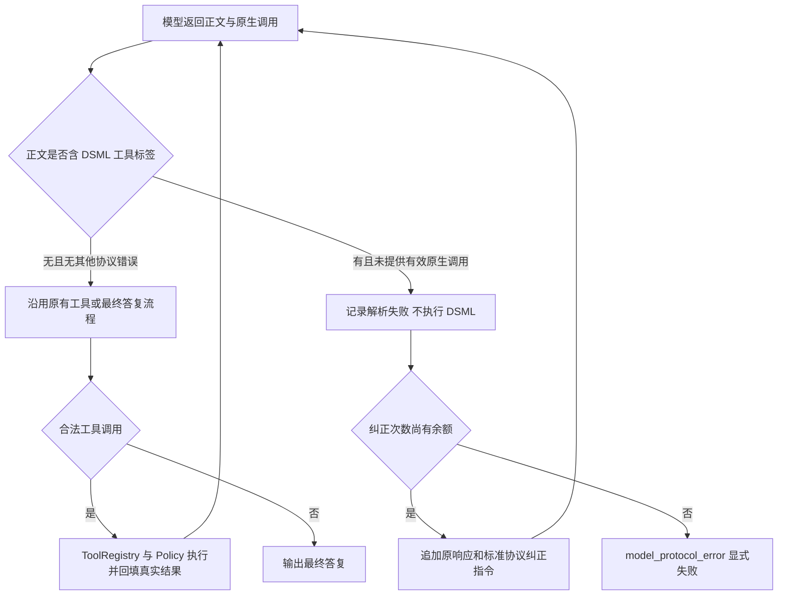

# DeepSeek DSML 工具标记误完成修复验收

## 问题和直接证据

用户在 macOS App 中收到 `<｜｜DSML｜｜ calls>`、`invoke` 和 `parameter` 标签，任务没有继续执行。

查询当前工作区 `.figo-agent/figo-agent.db` 得到：

| 项目 | 原始事实 |
| --- | --- |
| Task | `task_8c44d97c-8402-49a7-947b-13e7792cb64c` |
| 原始 Turn | `turn_d2938864-c48c-4e84-b303-5c988a9272e0`，输入“深度分析当前项目” |
| 故障请求 | `llm_req_fb16f11c-3418-4094-bf96-cb0aadb1259d` |
| 模型与协议 | `deepseek-flash`；桌面配置为 `toolCallingMode: text` |
| 请求 | 未携带 API 原生 `tools`；此前两轮按文本 JSON 协议调用了 3 项和 4 项工具 |
| 故障响应 | HTTP 200，1510 ms，`finish_reason: stop`，正文为 DSML，无原生 `tool_calls` |
| 错误裁决 | 第 2 轮记录 `tool_call.parse.completed`、`callCount: 0`，Turn 为 `completed` |
| 后续追问 | `turn_7b9138f2-0a3a-439c-9060-16c8102e45c3` 再次出现 DSML，并再次被误完成 |

根因是协议识别缺口：解析器已有普通 XML 拦截，没有识别带 DSML 命名空间的标签，返回 `kind: none`；Loop 把它当最终答复。原生模式的流式前缀判断也没有覆盖 DSML。问题位于共享内核，不是 macOS 文件权限或 HTTP 请求失败。

## 修复范围

产品代码仅修改 `tool-call-parser.ts`、`final-answer-stream.ts`，新增 5 行：

1. 识别半角/全角竖线、单/双竖线形式的 DSML `calls`、`tool_calls`、`invoke`、`parameter` 标签，包括残缺的调用块和闭合标签；返回 `unsupported_dsml_tool_calls`。
2. 原生流式输出遇到以竖线开头的标签前缀先缓冲，由完整响应的协议裁决决定后续处理；普通答复仍正常流式输出。
3. 复用已有协议纠正、次数上限、Trace、工具执行和失败流程，不直接解析执行 DSML，不增加第三种可执行协议。

本轮没有改模型、密钥、工具权限、文本/原生模式配置、压缩参数或 `agent.protocolRepairAttempts`。默认仍只允许一次协议纠正。



## 自动化验收

先加入用户原文与回归测试：修复前 **15 失败、42 通过**，失败内容包括误完成和分片标签提前流出。应用修复后，定向 **57/57** 通过；全量 **93 个文件、1029 项测试**通过，类型检查和构建通过。

覆盖用户原文四项调用、标签变体、带 `FINAL` 或思考块的违规内容、残缺调用块、逐字符分片、文本/原生模式纠正成功，以及连续违规两次后失败。纠正成功场景验证真正执行 `read_file` 并将文件内容送入下一次模型请求，而不是仅检查固定成功文本。

## ZIP 中真实 DeepSeek 验收

使用桌面本机配置的 `deepseek-flash` 和文本协议，工作区、配置与数据库均隔离。临时本地代理只向真正的模型端点添加密钥，App 测试配置只含占位密钥；抓包检查未发现真实密钥。

| 场景 | Turn | 请求耗时（ms） | 协议纠正 | 成功工具 | 结果 |
| --- | --- | --- | --- | --- | --- |
| DSML 注入后真实纠正 | `turn_f97f6892-869e-4115-977e-cca09c0d8233` | 3 / 918 / 879 | 1 | `read_file` × 1 | completed |
| 全真实文件查询 | `turn_1568b340-e518-4bb1-b49a-aeb43afec761` | 792 / 755 | 0 | `read_file` × 1 | completed |

第一场景的首条响应由代理注入 DSML，3 ms **不计作真实模型耗时**；后两次响应来自真实模型。第二场景全部来自真实模型。总计 4 次真实远程请求，均 HTTP 200，两个答案都包含从 README 读取的随机标记 `DSML-VERIFIED-29e72560-39ff-413b-a3cb-f553076df772`。最终测试进程退出码为 0。

执行命令（工作目录 `code/`）：

```bash
npm test
npm run typecheck
npm run desktop:make
npm run desktop:verify:package
npm run desktop:test:dsml:package  # 受控响应，不调用真实模型
FIGO_DSML_REAL_CONFIG='/Users/points/Library/Application Support/Figo Agent/data/figo-agent.config.json' npm run desktop:test:dsml:package
```

脚本为 `e2e/desktop-dsml.pw.mjs`。JSON 结果和截图写入系统临时目录的 `figo-desktop-dsml-result.json`、`figo-desktop-dsml.png`。临时测试数据库与工作区在退出时删除，原始用户数据库不改写。

## 交付与边界

- 新 macOS arm64 ZIP：`code/out/make/zip/darwin/arm64/Figo Agent-darwin-arm64-0.1.0.zip`。
- SHA-256：`0c2b96b6ab24e83024506b2a07ffaa7781e4cb8ef4a2673f7b9f1c6168294289`。
- ZIP 解压烟测通过；包内 154 个条目、114 个文本文件扫描，无本地配置、用户数据及真实密钥，确认包含 DSML 修复。
- 修复收益是防止假完成、恢复工具闭环和保留可查询的失败原因，不是提升模型本身的协议遵循能力。只有发生违规才增加纠正请求；普通任务不新增请求。
- 本次真实测试不证明模型永不输出 DSML，不保证任意长任务一次纠正就成功；再次违规仍显式失败。没有执行原用户长 Task 的原地重放，原有错误 Turn 不改写。
- 安装包仍未正式签名和公证；之前活动任务退出专项测试的 SQLite 锁问题不属于本轮修复，也不宣称通过。
