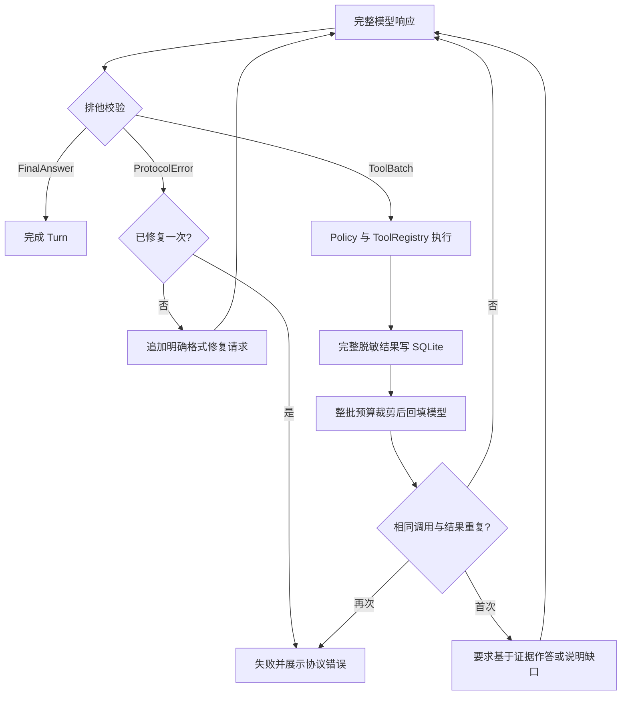
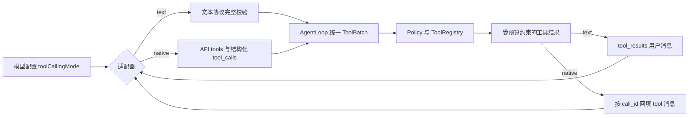

# Tool Calling Loop 协议修复与真实模型验收

## 目标与实现

本轮按 `模型响应 -> 统一动作解析与校验 -> AgentLoop -> 工具结果预算 -> 下一轮或结束` 实施。Parser 对整条响应做排他分类；ToolBatch 只能有一个完整 JSON 块，FinalAnswer 不得夹带工具调用。ProtocolError 不执行工具，允许一次格式修复；再次违规以可见错误结束。AgentLoop 不设置固定总轮数，但识别连续相同工具、参数、结果的空转。工作区根目录进入系统消息，轮内压缩始终带原始任务目标。完整脱敏 ToolResult 存 SQLite，模型只收到有整批预算的预览。

## 原事故回放：纵向证据

原始工作区 `figo-wiki` 的 Turn `turn_ad318750-dd45-4751-9264-7c667e974794`：旧执行记录有 7 次 Turn LLM 发起、6 轮工具批次、17 次工具调用、4 次轮内压缩；12 条计量记录合计 133,478 tokens（含压缩请求）。最终 Turn 被中断，没有完成项目分析。将同一 Turn 的成功响应抓包送入新解析器，轮次 0、1 的重复工具块及轮次 5 的“工具块 + 正文”均判为 ProtocolError；旧解析器会取首块继续执行。这是**相同抓包的确定性前后对照**，证明不会再静默丢弃响应后半段；它不证明模型能完成任务。

## 三模型同任务横向实测

2026-10-13 在独立临时工作区构造同一 Atlas CLI 根项目和 `examples/dashboard` 演示子项目，向三个当前已启用的模型提交相同任务：“分析当前项目：说明根项目的用途、入口、运行方式，并区分 examples/dashboard 与根项目。”临时工作区互不共享 Session、Task 或 SQLite。统计来自各自 `trace_events`、`tool_calls` 和 `token_usage`，没有把模型输出当作工具执行证据。

| 模型 | Turn | LLM 请求 | 工具调用 | 协议修复 | 压缩 | 已报告 tokens | 耗时 | 结论 |
| :--- | :--- | ---: | ---: | ---: | ---: | ---: | ---: | :--- |
| GPT 中转 `gpt-6.1-sol` | failed | 2 | 0 | 1 | 0 | 4,968 | 134.8 秒 | 首次多个工具块，修复后工具块与 `FINAL` 混用，拒绝执行 |
| DeepSeek `deepseek-flash` | completed | 3 | 3 | 0 | 0 | 3,273 | 6.8 秒 | 读取根项目证据，正确区分演示子项目 |
| MiniMax `MiniMax-M3` | completed | 3 | 5 | 0 | 0 | 3,322 | 17.1 秒 | 读取根项目证据，正确区分演示子项目 |

第一次 GPT 响应包含连续拼接的多个 `tool_calls` JSON 对象和一段“无法分析”的正文；修复响应先给工具代码块，紧接 `FINAL`。两次响应均不满足排他协议，真实工具调用数为 0。加强系统提示与修复提示后，以几乎相同的隔离项目复测 GPT：2 次 LLM、0 次工具、1 次修复、3,924 tokens、75.6 秒，仍以 `model_protocol_error` 失败，原因依次为 `multiple_tool_call_blocks`、`mixed_tool_call_response`。提示词加强没有解决 GPT 中转兼容性。

## 第二阶段：GPT 中转原生工具协议修复

真实接口探针证实 `gpt-6.1-sol` 中转接受 Chat Completions 的 `tools` / `tool_choice`，响应包含结构化 `message.tool_calls` 和 `finish_reason: "tool_calls"`；将对应 `assistant.tool_calls` 与 `role: "tool"`、`tool_call_id` 回填后，中转返回正常最终答复。原文本协议下连续多个 JSON 块不是传输层损坏，而是当前接入方式未使用该中转实际支持的原生工具通道。

配置项 `llm[].toolCallingMode` 选择 `text` 或 `native`，当前 GPT 中转设置为 `native`，MiniMax 和 DeepSeek 保持 `text`。模型适配器负责原生请求、SSE 工具参数分片重组和结构化响应校验；AgentLoop 仍只处理统一的 ToolBatch / FinalAnswer / ProtocolError，并把原生工具结果逐条写成带 `tool_call_id` 的消息。Policy、ToolRegistry、完整 SQLite 抓包与 Trace 均未绕过。工作台保存已有模型时保留此配置。

同一隔离 Atlas CLI 任务真实回归：GPT 中转 **completed**，3 次模型请求、2 轮工具批次、5 次实际工具调用、8,549 个已报告 tokens、77.6 秒。工具依次为 `workspace_summary`、`list_files`、`git_status`、`read_many_files`、`path_stat`。第三次请求抓包包含前两轮共 5 条 `role: "tool"` 消息，最终答复准确说明根项目用途、`src/index.js` 入口、运行脚本，以及 `examples/dashboard` 的演示子项目身份。此数据与前述文本协议失败样本是不同接入方式的同任务对照，不把 token 增加解释为性能退化或提升。

当前代码对另外两条文本协议路径的重新实测：DeepSeek 4 次模型请求、7 次工具调用、4,538 tokens、7.7 秒；MiniMax 3 次请求、2 次工具调用、3,452 tokens、15.6 秒。两者均完成，答复均正确指向 Atlas CLI 根项目并区分 dashboard 子项目。两次独立实测的轮数不同，属于模型实际输出差异，不视为控制逻辑回归。

## 验收结论与边界

- **安全与可观测性通过**：非法响应不再取首块执行，失败可见且 Trace 可还原；其他两模型实际完成该任务。
- **GPT 中转文本协议未通过，原生工具协议真实验收通过**：保留文本失败抓包作为复盘证据；当前配置走原生通道并成功完成隔离项目分析。不能把一次成功样本解释为所有任务均稳定完成。
- 横向实测各只有一次成功样本，不能据此推导稳定性能排序；原事故与隔离项目不同，133,478 tokens 不与隔离测试 tokens 直接作节省率比较。

## 工程经验

动作协议的正确性与模型遵从率是两个独立指标。Parser 必须完整校验响应并拒绝含糊动作；Provider Adapter 负责模型差异。原生工具协议能让模型意图与工具结果使用 API 的结构化关联，避免依赖模型遵守 fenced JSON 文本约定。失效时仍须显式失败，不能先执行一部分工具、丢弃另一部分意图，然后把未经核实的正文当作最终结论。

## DeepSeek XML 工具文本误判补充（2026-10-13）

工作区 `figo-wiki` 的 Turn `turn_b4639c03-e4da-4bc3-bfbc-f2d9ed2f7ac4`，用户输入“深度分析当前项目”。抓包显示第 1 次模型响应为合法 JSON 工具批次，`list_files` 和 `read_many_files` 均实际执行；第 2 次响应是 `<tool_calls><invoke name="read_many_files">...` XML 文本。旧 Parser 只拒绝 `<function_calls>`，把该 XML 分类为 `none`，Trace 随即写入 `tool_call.parse.completed`、`callCount=0` 和 `turn.completed`，Turn 输出就是 XML；第 2 次 `read_many_files` 没有执行。

修复后，文本和原生模式都将 XML 工具标签分类为 `ProtocolError`：非法响应中的工具不执行，最多发起一次格式修复，重发合法动作后继续 Loop；原生模式的流式通道先暂存 XML 工具前缀，避免校验前显示。中文系统提示与修复提示明确禁止 XML 工具标签。自动化测试覆盖原始“合法工具轮次 -> XML -> 修复后工具调用 -> 最终答复”顺序，并断言最终答复不是 XML。

隔离工作区真实 DeepSeek `deepseek-v4-pro` 回归：3 次模型请求、1 次格式修复、1 次 `read_many_files` 实际执行，Turn 为 `completed`，最终答复引用 `AGENTS.MD`、`VERSION.md`、`知识库/VERSION.md` 和 `changelog/README.md` 的内容。该次首轮实际违规为“JSON 工具块后附加正文”，不是 XML；它证明格式修复与继续执行链路可工作，XML 分类的确定性证据来自自动化测试。隔离测试 Turn 为 `turn_7aa3ff6c-393d-472b-b731-a4616a2d1f90`，原历史 Turn 不重放、不改写。
