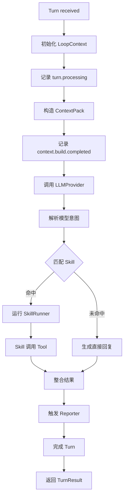
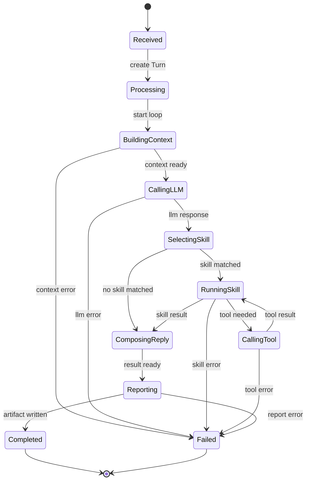
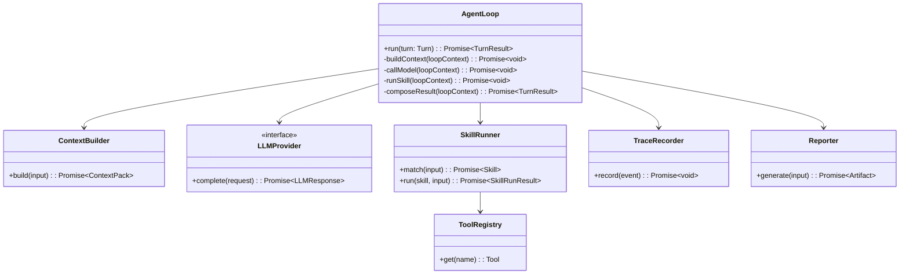
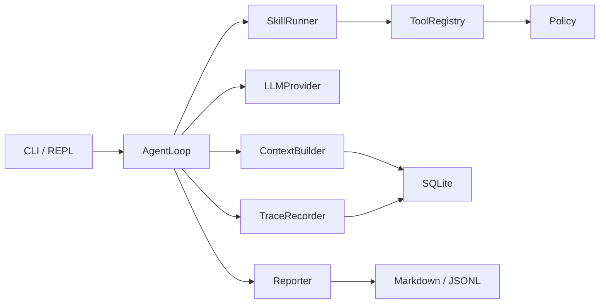

# AgentLoop 模块设计

## 文档索引信息

- 背景：本文档位于 `docs/agent/modules/agent-loop/`，用于沉淀 Figo Agent V1 的 AgentLoop 机制设计。
- 目标：讲清 AgentLoop 如何组织一轮 Turn 的上下文构造、模型调用、Skill 激活、Tool 调用、Trace 记录和报告生成。
- 标签：AgentLoop、agent harness、控制循环、状态机、ReAct、Trace、Skill、Tool。
- 适用范围：V1 核心循环实现、后续 Goal 扩展、执行闭环设计、文章讲解素材。
- 后续可用方向：受控执行、Verifier、Goal 生命周期、多 Agent 编排和持续自优化。

## 1. 模块定位

AgentLoop 是 Figo Agent 的核心控制循环。它不负责具体能力实现，只负责编排一次 Turn 从输入到输出的全过程。

V1 的 AgentLoop 不是完整自主规划系统。V1 的 AgentLoop 是一个受控、可追踪、可复盘的单轮执行循环。

## 2. 设计动机

Coding agent 的核心不是单次模型调用，而是围绕用户输入完成以下闭环：

```text
输入
  -> 上下文构造
  -> 模型判断
  -> Skill 选择
  -> Tool 执行
  -> 结果整合
  -> Trace 记录
  -> Artifact 输出
```

AgentLoop 把这些步骤组织成稳定机制。这样后续替换 LLM、增加 Tool、扩展 Skill、引入 Goal，都不破坏主流程。

## 3. 职责边界

AgentLoop 负责：

1. 接收 Turn。
2. 驱动 ContextBuilder 生成 ContextPack。
3. 调用 LLMProvider 获取本轮意图、计划或回复。
4. 匹配并激活 Skill。
5. 通过 SkillRunner 间接调用 Tool。
6. 汇总 Skill、Tool、LLM 的执行结果。
7. 写入关键 TraceEvent。
8. 触发 Reporter 生成 Artifact。
9. 返回 TurnResult。

AgentLoop 不负责：

1. 不直接读写文件。
2. 不直接实现 Tool。
3. 不直接实现 Skill。
4. 不直接操作 SQLite 表。
5. 不直接生成 Markdown 内容。
6. 不做 Goal 生命周期管理。

## 4. 输入输出

输入：

1. 当前 Session。
2. 当前 Turn。
3. PluginHost 提供的 ContextBuilder、LLMProvider、SkillRunner、ToolRegistry、Reporter。
4. TraceRecorder。

输出：

1. TurnResult。
2. ContextPack。
3. LLMResponse。
4. SkillRunResult。
5. ToolResult 列表。
6. TraceEvent。
7. Artifact 列表。

## 5. V1 AgentLoop 机制总览

V1 AgentLoop 是单轮受控循环，不做无限自主循环。

```text
Turn 输入
  ↓
初始化 LoopContext
  ↓
构造 ContextPack
  ↓
调用 LLMProvider
  ↓
选择 Skill
  ↓
执行 Skill
  ↓
Skill 调用 Tool
  ↓
整合结果
  ↓
生成 Artifact
  ↓
完成 Turn
```

## 6. 运行流程图



## 7. 时序图

```mermaid
sequenceDiagram
  participant CLI as CLI / REPL
  participant Loop as AgentLoop
  participant Ctx as ContextBuilder
  participant LLM as LLMProvider
  participant Skill as SkillRunner
  participant Tool as ToolRegistry
  participant Trace as TraceRecorder
  participant Reporter as Reporter

  CLI->>Loop: run(turn)
  Loop->>Trace: turn.processing
  Loop->>Ctx: build(turn)
  Ctx-->>Loop: ContextPack
  Loop->>Trace: context.build.completed
  Loop->>LLM: complete(LLMRequest)
  LLM-->>Loop: LLMResponse
  Loop->>Trace: llm.completed
  Loop->>Skill: matchAndRun(turn, contextPack, llmResponse)
  Skill->>Tool: execute(toolInput)
  Tool-->>Skill: ToolResult
  Skill-->>Loop: SkillRunResult
  Loop->>Trace: skill.completed
  Loop->>Reporter: generate(reportInput)
  Reporter-->>Loop: Artifact
  Loop->>Trace: turn.completed
  Loop-->>CLI: TurnResult
```

## 8. 状态机



## 9. 核心数据结构

### 9.1 LoopContext

`LoopContext` 是 AgentLoop 内部的运行态对象，用于在一轮 Turn 中传递上下文。

```ts
interface LoopContext {
  session: Session;
  turn: Turn;
  contextPack?: ContextPack;
  llmResponse?: LLMResponse;
  selectedSkill?: SkillManifest;
  skillResult?: SkillRunResult;
  toolResults: ToolResult[];
  artifacts: Artifact[];
}
```

### 9.2 TurnResult

```ts
interface TurnResult {
  sessionId: string;
  turnId: string;
  status: "completed" | "failed";
  output: string;
  artifacts: Artifact[];
  error?: AgentLoopError;
}
```

### 9.3 AgentLoopError

```ts
interface AgentLoopError {
  type: "context_error" | "llm_error" | "skill_error" | "tool_error" | "report_error";
  message: string;
  source: string;
  recoverable: boolean;
}
```

## 10. 类图



## 11. AgentLoop 分阶段设计

### 11.1 阶段一：接收 Turn

输入：

1. `Session`
2. `Turn`

动作：

1. 创建 `LoopContext`。
2. 写入 `turn.processing` TraceEvent。

输出：

1. 初始化后的 `LoopContext`。

### 11.2 阶段二：构造 ContextPack

输入：

1. `LoopContext`
2. 当前 Turn
3. 最近对话
4. 项目规则
5. Memory

动作：

1. 调用 ContextBuilder。
2. 收集 ContextItem。
3. 写入 ContextDecision。
4. 记录 `context.build.completed`。

输出：

1. `ContextPack`

失败处理：

1. 读取部分上下文失败时，记录排除原因。
2. 关键规则缺失时，进入 `context_error`。

### 11.3 阶段三：调用 LLMProvider

输入：

1. `ContextPack`
2. 当前 Turn

动作：

1. 组装 LLMRequest。
2. 调用 LLMProvider。
3. 记录 `llm.called` 和 `llm.completed`。

输出：

1. `LLMResponse`

失败处理：

1. 模型调用失败时返回 `llm_error`。
2. V1 不记录 TokenUsage。

### 11.4 阶段四：选择 Skill

输入：

1. 当前 Turn。
2. ContextPack。
3. LLMResponse。
4. SkillRegistry。

动作：

1. 遍历静态注册 Skill。
2. 调用 `canHandle`。
3. 选择一个 Skill。
4. 记录 `skill.activated` 或 `skill.skipped`。

输出：

1. `SkillManifest`

V1 限制：

1. V1 不做多 Skill 编排。
2. V1 只允许 `project-understanding-skill`。

### 11.5 阶段五：运行 Skill

输入：

1. SkillManifest。
2. ContextPack。
3. 允许的 Tool 列表。

动作：

1. 调用 SkillRunner。
2. SkillRunner 根据流程调用 Tool。
3. Tool 调用经过 Policy。
4. 记录 `tool.called`、`tool.completed`、`skill.completed`。

输出：

1. `SkillRunResult`
2. `ToolResult[]`

失败处理：

1. Tool 失败时保留错误摘要。
2. Skill 失败时写入 `skill.failed` 和 `error.occurred`。

### 11.6 阶段六：生成结果和 Artifact

输入：

1. ContextPack。
2. LLMResponse。
3. SkillRunResult。
4. ToolResult。
5. TraceEvent。

动作：

1. 汇总本轮输出。
2. 调用 Reporter。
3. 生成 `context.md` 和 `report.md`。
4. 记录 `artifact.created` 和 `turn.completed`。

输出：

1. `TurnResult`
2. Artifact 列表

## 12. 循环控制策略

V1 不做无限循环。V1 的循环控制规则是：

1. 每个 Turn 最多执行一次 Context 构造。
2. 每个 Turn 最多调用一次 LLMProvider。
3. 每个 Turn 最多激活一个 Skill。
4. 每个 Skill 可以调用多个只读 Tool。
5. Tool 调用数量由 Skill 内部流程控制。
6. AgentLoop 不自动追加新 Turn。

这组规则让 V1 行为稳定、可追踪、易复盘。

## 13. AgentLoop 与 ReAct 的关系

V1 借鉴 ReAct 的“Reason + Act + Observe”思想，但不实现开放式多轮自主循环。

V1 对应关系：

| ReAct 概念 | V1 对应模块 |
| :--- | :--- |
| Reason | LLMProvider 读取 ContextPack 后输出意图 |
| Act | SkillRunner 调用 Tool |
| Observe | ToolResult 写入 Trace 和报告 |
| Continue | V1 不自动继续，由用户下一轮输入驱动 |

V1 的设计重点是可控，不是自主。

## 14. Trace 点设计

AgentLoop 必须记录以下 TraceEvent：

1. `turn.processing`
2. `context.build.started`
3. `context.build.completed`
4. `llm.called`
5. `llm.completed`
6. `skill.activated`
7. `skill.skipped`
8. `skill.completed`
9. `skill.failed`
10. `tool.called`
11. `tool.completed`
12. `tool.failed`
13. `artifact.created`
14. `turn.completed`
15. `turn.failed`
16. `error.occurred`

TraceEvent 是事实记录，不写空泛评价。

## 15. 停止条件

V1 AgentLoop 停止条件：

1. TurnResult 生成成功。
2. 出现不可恢复错误。
3. Policy 拒绝关键操作。
4. Reporter 生成失败且无法返回有效结果。

V1 不做：

1. 自动重试策略。
2. 自主继续执行。
3. 多轮反思。
4. Verifier 回路。

这些能力进入 V2/V3。

## 16. 失败处理矩阵

| 失败位置 | 错误类型 | V1 行为 | TraceEvent |
| :--- | :--- | :--- | :--- |
| ContextBuilder | `context_error` | 返回失败结果，保留已收集上下文 | `context.build.failed` |
| LLMProvider | `llm_error` | 返回模型错误摘要 | `llm.failed` |
| SkillRunner | `skill_error` | 返回 Skill 失败摘要 | `skill.failed` |
| Tool | `tool_error` | 返回 Tool 错误摘要 | `tool.failed` |
| Reporter | `report_error` | 返回控制台摘要，保留 SQLite 事实 | `artifact.failed` |

## 17. 与其他模块的协作关系



## 18. V1 实现范围

V1 AgentLoop 实现：

1. 单 Turn 执行。
2. 单次 ContextPack 构造。
3. 单次 LLMProvider 调用。
4. 单 Skill 激活。
5. 只读 Tool 调用。
6. 关键链路 Trace。
7. Markdown Artifact 输出。

V1 AgentLoop 不实现：

1. Goal。
2. 多 Skill 编排。
3. 自动重试。
4. 多轮反思。
5. Verifier。
6. TokenUsage。
7. 自主继续执行。

## 19. V2/V3 扩展点

V2 扩展：

1. 引入 Goal 后，AgentLoop 绑定 Goal 生命周期。
2. 增加 `apply_patch` 和 `run_command` 后，AgentLoop 增加写入和命令权限判断。
3. 引入 Verifier 后，AgentLoop 增加验证回路。
4. 引入 TokenUsage 后，AgentLoop 记录模型和上下文成本。

V3 扩展：

1. 增加多 Skill 编排。
2. 增加多 Agent 协作。
3. 增加失败模式分析。
4. 增加持续自优化建议。

## 20. 可沉淀的文章观点

1. AgentLoop 是 agent harness 的心脏，不是简单 while 循环。
2. AgentLoop 的价值在于稳定组织上下文、模型、技能、工具、轨迹和产物。
3. V1 不追求自主循环，先追求可控、可追踪、可复盘。
4. ReAct 思想可以借鉴，但工程实现要加边界、状态、错误和产物。
5. 好的 AgentLoop 要让每一步都有输入、输出、状态和 Trace。

## 21. 个人经验提炼

从工程角度看，AgentLoop 最容易写成一个巨大的 `run()` 函数。V1 要避免这个问题：

1. `run()` 只做编排。
2. 具体能力交给 ContextBuilder、LLMProvider、SkillRunner、ToolRegistry、Reporter。
3. 每个阶段单独成私有方法。
4. 每个阶段都写 Trace。
5. 每个阶段都有明确失败类型。

这就是把 agent 从“脚本”做成“harness”的关键一步。
