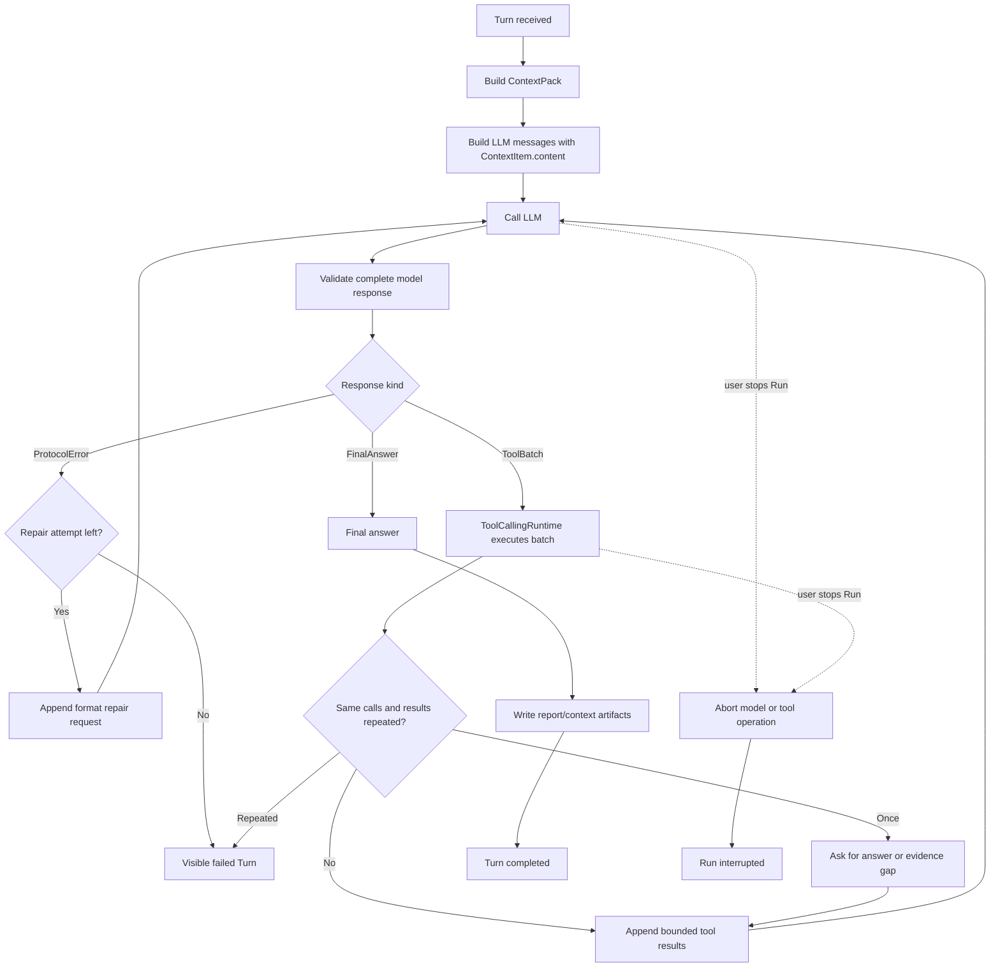
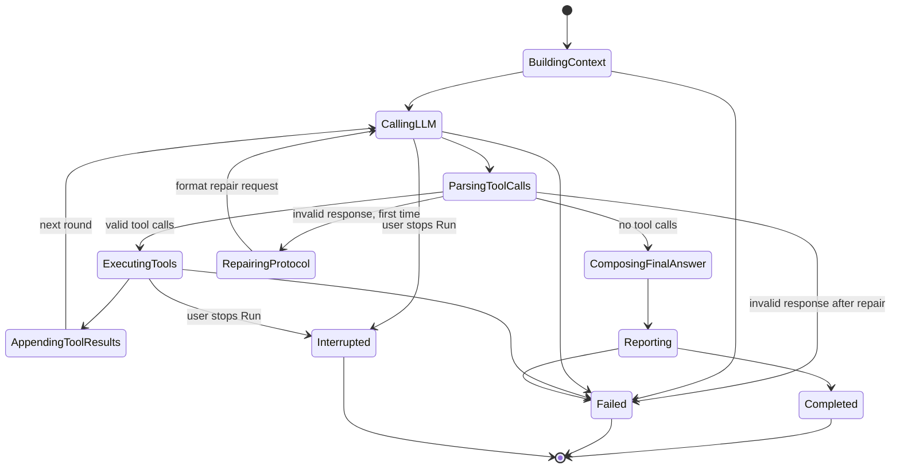
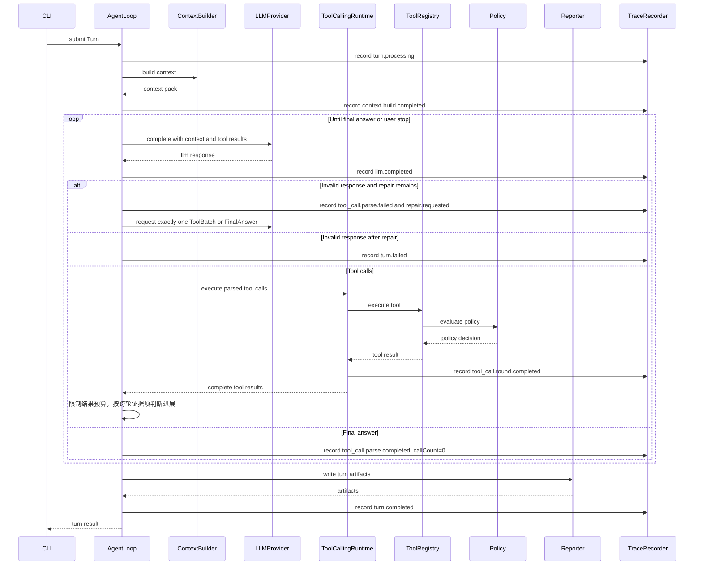

# AgentLoop Tool Calling Loop 设计

## 1. 设计定位

Tool Calling Loop 是 AgentLoop 的核心执行循环，用于把模型的工具调用意图转化为受控、可追踪、可复盘的真实动作。

本设计遵循 Pi 式小内核思路：

```text
AgentLoop 只管理循环状态和执行边界
ToolCallingRuntime 只管理工具调用协议
ToolRegistry + Policy 是唯一动作执行面
```

模型输出不是授权。模型只能提出 ToolIntent，Policy 允许后 ToolRegistry 执行动作。

多模型入口由 `llm[].toolCallingMode` 控制：`text` 使用完整文本响应的排他校验；`native` 使用 Chat Completions 原生 `tools` 和结构化 `tool_calls`。两种入口汇合到同一个 AgentLoop 动作状态机；原生模式的 ToolResult 按 `tool_call_id` 回填，文本模式回填 `tool_results` 用户消息。模型适配器不执行工具，Policy 边界不变。真实 GPT 中转验收见 [2026-10-13 实测记录](./PROTOCOL_REPAIR_2026-10-13.md)。

## 2. 设计目标

1. 解决模型输出伪 `<function_calls>` 文本但系统未执行 Tool 的问题。
2. 解决 ContextPack 已存储历史内容，但 LLM 请求只发送摘要的问题。
3. 建立由最终答复或用户停止驱动的工具调用循环，支持 LLM -> Tool -> LLM 的闭环。
4. 保持 AgentLoop 小内核，不把工具细节塞入主循环。
5. 每一轮 LLM 调用、ToolCall、PolicyDecision、ToolResult 都有 Trace 证据。
6. 为后续 Wireshark 风格大模型交互解析界面提供稳定事件链。

## 3. 核心原则

1. AgentLoop 不直接执行工具。
2. AgentLoop 不解析具体工具参数语义。
3. ToolCallingRuntime 解析工具调用协议并组织工具批次。
4. ToolRegistry 是唯一工具执行入口。
5. Policy 是唯一权限判断入口。
6. ContextItem 的 `content` 必须进入 LLM 请求。
7. ToolResult 进入下一轮 LLM 前必须摘要化和截断。
8. 不使用固定工具轮次上限；工作台用户可手动停止当前 Run。
9. 所有循环状态迁移必须写入 Trace。

## 4. 架构分层

```text
AgentLoop
  - 管理 Turn 级状态机
  - 调用 ContextBuilder
  - 调用 LLMProvider
  - 调用 ToolCallingRuntime
  - 调用 Reporter

ToolCallParser
  - 将完整响应排他分类为 ToolBatch、FinalAnswer 或 ProtocolError
  - 校验 callId 和工具批次形状

ToolCallingRuntime
  - 调用 ToolRegistry
  - 汇总 ToolResult

LLMMessageBuilder
  - 将 ToolResult 裁剪为有总预算的模型消息

ToolRegistry
  - 查找 Tool
  - 调用 Policy
  - 执行 Tool
  - 记录 tool / policy Trace

Policy
  - 判断 action 是否允许
  - 判断资源边界
  - 判断危险命令
  - 返回 PolicyDecision
```

## 5. 总流程



## 6. 状态机



## 7. 时序图



## 8. ToolIntent 协议

第一版使用模型无关的 JSON 协议。提示词要求模型只输出一个 fenced JSON 工具批次；解析器也接受完整 `<think>` 块后紧跟单个内联 JSON。一个响应只能有一种动作：单个 ToolBatch、FinalAnswer 或 ProtocolError。

```json
{
  "type": "tool_calls",
  "calls": [
    {
      "id": "call_1",
      "name": "system_info",
      "input": {}
    }
  ]
}
```

解析规则：

1. 只解析 `type = "tool_calls"` 的 JSON。
2. 只接受单个 fenced JSON 代码块或单个完整内联 JSON 对象；多个块或 JSON 与正文混用均拒绝。
3. `<function_calls>`、`<tool_calls>` 和 `<invoke>` XML 标签判为协议错误，不执行，也不作为最终答复展示。
4. 不从自然语言中抽取命令。
5. `id`、`name`、`input` 缺失时返回解析失败。
6. 同一轮内 `id` 必须唯一。
7. 内联 JSON 不完整或格式错误时返回解析失败，不把“正在查询”当作最终答复。
8. `FINAL` 后不得夹带工具调用；非法批次不执行任何工具，最多请求一次格式修复。

## 9. ToolResult 回填协议

ToolResult 进入下一轮 LLM 时使用结构化消息：

```json
{
  "type": "tool_results",
  "results": [
    {
      "id": "call_1",
      "name": "system_info",
      "status": "completed",
      "output": {
        "platform": "darwin",
        "arch": "arm64",
        "cpuCount": 10
      }
    }
  ]
}
```

回填规则：

1. 完整脱敏输出写入 SQLite 的 `tool_calls.output_json`；发给模型的每项预览和整批消息分别受 `toolResultPreviewChars`、`toolResultBatchChars` 约束。
2. 截断记录保留 `path` / `paths` 与 `originalChars`，`stdout`、`stderr` 在模型消息中截断。
3. 敏感字段进入 LLM 前脱敏。
4. failed / denied 结果也要回填给 LLM。
5. 工具调用、结果追加和模型请求在 Trace 与 HTTP 抓包中关联；Trace 不重复存放整段 ToolResult。

## 10. 循环伪代码

```ts
const messages = buildInitialMessages(input, contextPack);

for (let round = 0; ; round++) {
  signal.throwIfAborted();
  const response = await llm.complete({ messages, signal });
  const parsed = toolCallParser.parse(response.content);

  if (parsed.kind === "none") {
    return response.content;
  }

  if (parsed.kind === "invalid") {
    if (repairUsed) throw new ProtocolResponseError();
    messages.push(response, protocolRepairPrompt);
    repairUsed = true;
    continue;
  }

  const toolResults = await toolCallingRuntime.executeBatch(parsed.calls, { ...toolContext, signal }, round);
  messages.push(buildAssistantToolCallMessage(parsed.calls));
  messages.push(buildToolResultMessage(toolResults, perItemLimit, batchLimit));
  if (sameToolIntentAndResultRepeated()) {
    if (repeatLimitReached()) throw new NoProgressError();
    messages.push(noProgressGuidance);
  }
}
```

## 11. Trace 事件

新增事件类型建议：

```text
tool_call.parse.started
tool_call.parse.completed
tool_call.parse.failed
tool_call.repair.requested
tool_call.round.started
tool_call.round.completed
tool_call.no_progress
tool_call.result.appended
turn.interrupted
```

每次 `tool_call.parse.started` 均以 `tool_call.parse.completed` 或 `tool_call.parse.failed` 结束。普通最终答复记录 `tool_call.parse.completed`，其中 `callCount = 0`。

沿用事件：

```text
llm.called
llm.completed
llm.failed
policy.evaluated
policy.denied
tool.called
tool.completed
tool.failed
tool.denied
turn.completed
turn.failed
```

关键 payload：

```ts
{
  round: number;
  callId: string;
  toolName: string;
  status: "completed" | "failed" | "denied";
  inputSummary: Record<string, unknown>;
  outputSummary: Record<string, unknown>;
}
```

## 12. 失败处理

### 12.1 ToolCall 解析失败

处理方式：

1. 记录 `tool_call.parse.failed`。
2. 不执行任何工具。
3. 首次失败发起一次格式修复请求；再失败则 Turn 标记 `failed`，展示可见错误，不生成完成报告。
4. 原始请求与返回保留在 SQLite HTTP 抓包，Trace 记录解析原因。

### 12.2 Tool 被 Policy 拒绝

处理方式：

1. ToolRegistry 记录 `policy.denied` 和 `tool.denied`。
2. ToolCallingRuntime 将 denied 结果回填给 LLM。
3. LLM 基于拒绝原因生成最终回答。

### 12.3 Tool 执行失败

处理方式：

1. ToolRegistry 记录 `tool.failed`。
2. ToolCallingRuntime 将失败摘要回填给 LLM。
3. LLM 生成解释和下一步建议。

### 12.4 用户停止当前 Run

处理方式：

1. 工作台调用 `POST /api/v1/runs/:runId/stop`，接口沿用同源和 CSRF 校验。
2. `RunCoordinator` 中止当前模型请求或工具操作；ToolCallingRuntime 不再启动下一项工具。
3. Run 和 Turn 均记录为 `interrupted`，执行中的 Turn 在 Trace 中记录 `turn.interrupted`；不生成“任务已完成”的最终回答。

## 13. 安全边界

1. 自然语言中的 shell 命令不执行。
2. `<function_calls>` 不执行。
3. JSON 协议解析失败不执行。
4. ToolRegistry 不允许绕过 Policy。
5. `run_command` 必须限制 cwd 在 workspace 内。
6. `run_command` 必须有 timeout 和输出截断。
7. 网络、浏览器、写文件、Git 写操作进入 Tool Loop 时必须保留完整 Trace。
8. 后续增加用户确认时，确认逻辑属于 Policy profile，不属于 AgentLoop。

## 14. V1.2 落地范围

第一阶段接入以下工具：

1. `system_info`
2. `path_stat`
3. `read_file`
4. `read_many_files`
5. `workspace_summary`
6. `run_command`

第二阶段接入以下工具：

1. `write_file`
2. `apply_patch`
3. `git_add`
4. `git_commit`
5. `network_fetch`
6. `browser_open`
7. `browser_snapshot`

说明：第二阶段工具已存在于 Tool 层，进入自动 Tool Calling Loop 前需要补齐更细的风险等级、输入摘要和验收测试。

## 15. 验收标准

必须通过：

1. LLM 请求中包含 `ContextItem.content`，不是只包含 `summary`。
2. 模型返回合法 tool call JSON 时，Trace 出现 `tool_call.parse.completed`。
3. 工具执行前出现 `policy.evaluated`。
4. 工具执行成功后出现 `tool.called` 和 `tool.completed`。
5. ToolResult 进入第二轮 LLM 请求。
6. MiniMax 返回说明文字加内联 JSON 时，工具先执行，模型再生成最终答复。
7. 最终回复使用 ToolResult，不再停在“命令正在执行中”。
8. 非法 `<function_calls>` / `<tool_calls>` XML 不触发工具执行；最多请求一次格式修复。
9. 连续 5 轮 ToolCall 后仍能继续执行，并以模型最终答复完成 Turn。
10. 用户停止运行后，模型请求和正在执行的 shell 命令被中断，Run 状态为 `interrupted`。
11. `turn_0db...` 类追问场景中，LLM 请求能看到历史 Turn 内容。

## 16. 测试用例

1. `buildMessages` 包含历史 turn 内容。
2. `ToolCallParser` 解析合法 JSON。
3. `ToolCallParser` 拒绝 `<function_calls>` / `<tool_calls>` XML，AgentLoop 不把它们写成已完成答复。
4. `ToolCallingRuntime` 执行 `system_info` 并返回结构化 ToolResult。
5. `AgentLoop` 在一轮 tool call 后进行第二次 LLM 调用。
6. `AgentLoop` 在无 tool call 时直接返回最终回答。
7. `AgentLoop` 允许连续多轮有效工具调用；按工具结果的证据项判定进展，文件读取按路径和内容去重，批量与单文件读取共用同一证据标识。整轮没有新增证据时提示收敛，连续达到配置阈值后显式失败，不设置固定总轮数。
8. `read_many_files` 逐文件返回 `files` 与 `errors`，单个缺失文件不抹掉同批已读取内容；越界路径在读取前整体拒绝。
9. `run_command` 仍经过 ControlledToolPolicy。
10. 当前事故回归测试：用户要求查询本机配置，最终报告包含真实 ToolResult。

## 17. 后续演进

1. 接入模型厂商 native tool calling adapter。
2. 增加 Policy profile 和风险等级。
3. 增加用户确认节点。
4. 评估按工具类型生成更有语义的 ToolResult 摘要，保留现有总预算与完整落库。
5. 在现有 `tool_calls` SQLite 记录上扩展更细粒度的动作关联查询。
6. 增加 Wireshark 风格 UI 所需的调用链查询接口。

## 18. 故障复盘：内联 JSON 被当成最终答复

`ses_853d48cd-2f64-45b4-9c53-cce219280445` 的 `turn_712b6f32-80c5-490d-845d-36b576cb196a` 已标记 `completed`。LLM 返回说明文字及内联 `browser_open`、`system_info` 调用，但 Trace 只有 `tool_call.parse.started`，没有工具执行事件。原解析器只读取 fenced JSON，因此将该响应判定为普通答复，终端停在“先获取信息”的提示。

经验：工具调用协议既要约束模型输出，也要按实际模型响应验收解析器。`parse.started` 必须有终态事件，才能从 Trace 区分“没有工具调用”“解析失败”和“工具仍在执行”。已完成的 Turn 不会在后台继续执行；修复后需发起新 Turn 验证。
