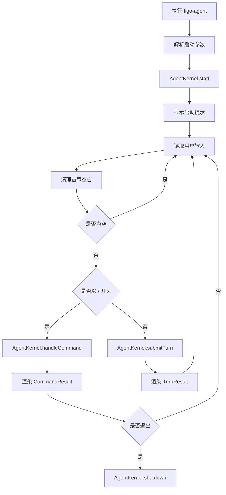
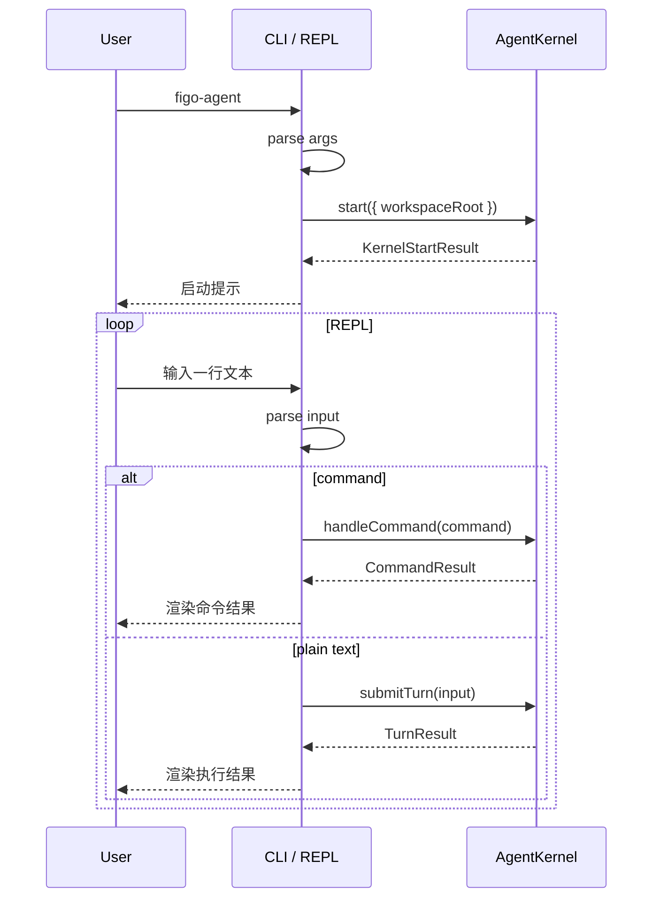
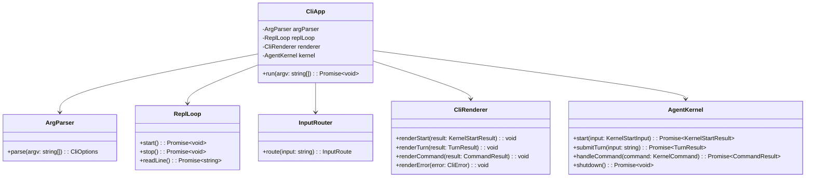
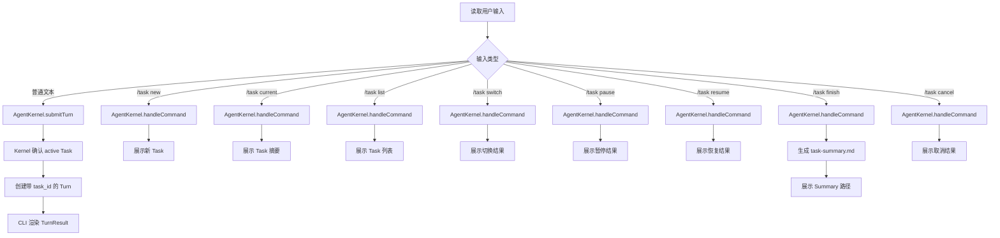

# CLI / REPL 模块设计

## 文档索引信息

- 背景：本文档位于 `docs/agent/modules/cli-repl/`，用于沉淀 CLI / REPL 模块设计。
- 目标：讲清命令行入口如何启动 AgentKernel、接收用户输入、分流普通文本和内置命令，并展示中文结果。
- 标签：CLI、REPL、用户交互、命令解析、Session、Turn、AgentKernel。
- 适用范围：V1 命令行入口、交互体验、命令体系、错误展示。
- 后续可用方向：TUI、命令补全、历史搜索、交互式调试、Web UI。

## 1. 模块定位

CLI / REPL 是 Figo Agent V1 的用户入口层。

它只负责三件事：

1. 启动 agent。
2. 接收用户输入。
3. 展示结构化结果。

CLI 不负责 agent 的智能能力，不负责上下文构造，不负责工具执行。

## 2. 设计动机

V1 先做命令行交互模式，是为了把注意力集中在 agent harness 本身：

1. AgentKernel。
2. AgentLoop。
3. Context。
4. Memory。
5. Skill。
6. Tool。
7. Trace。
8. Reporter。

CLI 越轻，内核边界越清楚。V1 的 CLI 是入口适配层，不是业务中枢。

## 3. CLI / Kernel / Loop 三层边界

```text
CLI / REPL
  -> 负责输入输出
AgentKernel
  -> 负责启动装配和 Session / Turn 生命周期
AgentLoop
  -> 负责编排单轮 Turn 执行
```

边界规则：

1. CLI 不直接访问 SQLite。
2. CLI 不直接访问 Storage。
3. CLI 不直接访问 PluginHost。
4. CLI 不直接调用 AgentLoop。
5. CLI 不直接调用 Tool。
6. CLI 不构造 ContextPack。
7. CLI 不生成 Markdown Artifact。

CLI 只调用 AgentKernel。

## 4. 职责边界

CLI / REPL 负责：

1. 解析启动命令。
2. 解析启动参数。
3. 启动 AgentKernel。
4. 启动 REPL 循环。
5. 读取用户输入。
6. 区分普通文本和内置命令。
7. 调用 `AgentKernel.submitTurn()`。
8. 调用 `AgentKernel.handleCommand()`。
9. 渲染 TurnResult。
10. 渲染 CommandResult。
11. 渲染错误摘要。
12. 响应退出。

CLI / REPL 不负责：

1. 不管理 Session 状态。
2. 不管理 Turn 状态。
3. 不执行 AgentLoop。
4. 不调用 LLM。
5. 不执行 Tool。
6. 不运行 Skill。
7. 不检索 Memory。
8. 不写 TraceEvent。
9. 不写 SQLite。
10. 不写 Markdown。

## 5. 输入输出

输入：

1. 终端启动命令。
2. 启动参数。
3. 用户普通文本。
4. 用户内置命令。
5. Ctrl-C / EOF。

输出：

1. 启动提示。
2. 命令帮助。
3. Turn 执行摘要。
4. Artifact 路径。
5. 错误摘要。
6. 退出提示。

CLI 输出是面向用户的简短中文反馈。完整事实进入 Trace、SQLite 和 Markdown Artifact。

## 6. 启动命令

V1 启动命令：

```bash
figo-agent
```

V1 不设计复杂参数。

可保留的最小参数：

```bash
figo-agent --cwd <path>
figo-agent --help
figo-agent --version
```

参数说明：

| 参数 | 作用 |
| --- | --- |
| `--cwd <path>` | 指定工作区路径 |
| `--help` | 输出帮助 |
| `--version` | 输出版本 |

不在 V1 引入：

1. `--model`。
2. `--config`。
3. `--profile`。
4. `--debug`。
5. `--json`。
6. `--no-trace`。

## 7. REPL 命令

V1 支持命令：

```text
/exit       退出当前 Session
/context    查看当前 ContextPack 摘要
/memory     查看当前 Memory 摘要
/report     生成当前 Session 报告
/help       查看命令帮助
```

命令规则：

1. 以 `/` 开头的输入按命令解析。
2. 不以 `/` 开头的输入按普通 Turn 处理。
3. 空输入忽略。
4. 未知命令展示 `/help` 摘要。
5. V1 命令不支持复杂参数。

## 8. 输入分流流程

```text
read line
  -> trim
  -> empty: continue
  -> startsWith("/"): handleCommand
  -> otherwise: submitTurn
```

分流结果：

| 输入类型 | 处理方式 | 是否创建 Turn |
| --- | --- | --- |
| 空输入 | 忽略 | 否 |
| `/exit` | `handleCommand` | 否 |
| `/context` | `handleCommand` | 否 |
| `/memory` | `handleCommand` | 否 |
| `/report` | `handleCommand` | 否 |
| `/help` | 本地或 Kernel command | 否 |
| 普通文本 | `submitTurn` | 是 |

普通文本必须进入 AgentKernel，由 AgentKernel 创建 Turn。

## 9. 运行流程图



## 10. 时序图



## 11. UML / 类图



## 12. 核心数据结构

### 12.1 CliOptions

```ts
interface CliOptions {
  cwd: string;
  showHelp: boolean;
  showVersion: boolean;
}
```

### 12.2 InputRoute

```ts
type InputRoute =
  | { type: "empty" }
  | { type: "command"; command: KernelCommand }
  | { type: "turn"; input: string };
```

### 12.3 KernelCommand

```ts
type KernelCommand =
  | { name: "exit" }
  | { name: "context" }
  | { name: "memory" }
  | { name: "report" }
  | { name: "help" }
  | { name: "unknown"; raw: string };
```

### 12.4 CliError

```ts
interface CliError {
  code: string;
  message: string;
  hint?: string;
}
```

## 13. 命令契约

### 13.1 /exit

行为：

1. 调用 `AgentKernel.shutdown()`。
2. 结束当前 Session。
3. 展示退出提示。
4. 停止 REPL。

输出示例：

```text
已退出当前 Session。
```

### 13.2 /context

行为：

1. 调用 `AgentKernel.handleCommand({ name: "context" })`。
2. 读取最近 ContextPack 摘要。
3. 展示 `context.md` 路径。

输出示例：

```text
当前 ContextPack：12 个条目，估算 8400 tokens。
产物：.figo-agent/artifacts/sessions/<session-id>/context.md
```

### 13.3 /memory

行为：

1. 调用 `AgentKernel.handleCommand({ name: "memory" })`。
2. 读取 Memory 摘要。
3. 展示 memory scope 统计。

输出示例：

```text
Memory 摘要：project 6 条，user 2 条，agent 3 条，knowledge 1 条。
```

### 13.4 /report

行为：

1. 调用 `AgentKernel.handleCommand({ name: "report" })`。
2. 触发 Reporter 生成当前 Session 报告。
3. 展示 `report.md` 路径。

输出示例：

```text
报告已生成：.figo-agent/artifacts/sessions/<session-id>/report.md
```

### 13.5 /help

行为：

1. 展示命令列表。
2. 不访问 Storage。
3. 不创建 Turn。

输出示例：

```text
/exit       退出当前 Session
/context    查看当前 ContextPack 摘要
/memory     查看当前 Memory 摘要
/report     生成当前 Session 报告
/help       查看命令帮助
```

## 14. 输出渲染规则

CLI 输出规则：

1. 使用中文。
2. 默认只展示摘要。
3. Artifact 展示相对路径。
4. 错误展示 code、message、hint。
5. 不展示完整 Trace payload。
6. 不展示大段文件内容。
7. 不展示 API Key、token、secret。
8. 不把 Markdown 报告全文打印到终端。

输出优先级：

1. 用户当前需要知道的结果。
2. 产物路径。
3. 下一步可用命令。
4. 错误摘要。

完整细节在 `report.md`、`context.md`、`trace.jsonl` 和 SQLite 中。

## 15. 错误展示

错误输出模板：

```text
执行失败：<message>
错误码：<code>
排查：查看 report.md 或 trace.jsonl。
```

错误来源：

1. 参数解析错误。
2. AgentKernel 启动失败。
3. 命令处理失败。
4. Turn 执行失败。
5. Ctrl-C / EOF。

CLI 不吞掉错误。它把错误转换成用户可读摘要。

## 16. Ctrl-C / EOF 处理

V1 规则：

1. Ctrl-C 触发 `AgentKernel.shutdown()`。
2. EOF 触发 `AgentKernel.shutdown()`。
3. shutdown 成功后退出进程。
4. shutdown 失败时展示错误摘要。

Ctrl-C 不创建 Turn。

## 17. 与 AgentKernel 的关系

CLI 只依赖 AgentKernel。

调用关系：

1. 启动：`kernel.start()`
2. 普通输入：`kernel.submitTurn(input)`
3. 命令：`kernel.handleCommand(command)`
4. 退出：`kernel.shutdown()`

CLI 不感知 AgentKernel 内部如何初始化 Storage、Trace、PluginHost 和 AgentLoop。

## 18. 与 AgentLoop 的关系

CLI 不直接调用 AgentLoop。

普通文本路径：

```text
CLI
  -> AgentKernel.submitTurn
  -> TurnManager.createTurn
  -> AgentLoop.run
  -> TurnResult
  -> CLI render
```

这样保证所有普通输入都经过 Session/Turn 生命周期。

## 19. 与 Trace 的关系

CLI 不直接写 Trace。

Trace 由 AgentKernel 和 AgentLoop 写入：

1. AgentKernel 记录生命周期事件。
2. AgentLoop 记录执行阶段事件。
3. Tool、Skill、Context、Reporter 记录各自事实事件。

CLI 只展示 Trace 产物路径或错误摘要。

## 20. 与 Reporter 的关系

CLI 不直接调用 Reporter。

`/report` 路径：

```text
CLI /report
  -> AgentKernel.handleCommand
  -> Reporter.generate
  -> report.md
  -> CommandResult
  -> CLI render
```

CLI 只展示报告路径。

## 21. 与 Memory / Context 的关系

CLI 不直接查询 Memory 或 Context。

`/memory` 和 `/context` 都走 AgentKernel：

1. AgentKernel 负责读取结构化摘要。
2. CLI 负责展示摘要。

这样避免入口层知道内部表结构。

## 22. 失败处理矩阵

| 失败位置 | 原因 | V1 行为 | 结果 |
| --- | --- | --- | --- |
| 参数解析 | 参数未知 | 展示帮助和错误 | 不启动 Kernel |
| Kernel 启动 | Storage 或 PluginHost 失败 | 展示错误摘要 | 不进入 REPL |
| 输入读取 | stdin 关闭 | shutdown | 退出 |
| 命令解析 | 未知命令 | 展示 `/help` 摘要 | 继续 REPL |
| submitTurn | Kernel 返回失败 | 展示 Turn 错误摘要 | 继续 REPL |
| handleCommand | Kernel 返回失败 | 展示命令错误摘要 | 继续 REPL |
| shutdown | Session 结束失败 | 展示错误摘要 | 退出进程 |

CLI 不做重试策略。

## 23. V1 实现范围

V1 实现：

1. `figo-agent` 启动命令。
2. `--cwd` 参数。
3. `--help` 参数。
4. `--version` 参数。
5. CliApp。
6. ArgParser。
7. ReplLoop。
8. InputRouter。
9. CliRenderer。
10. AgentKernel 启动调用。
11. 普通文本提交。
12. `/exit`。
13. `/context`。
14. `/memory`。
15. `/report`。
16. `/help`。
17. Ctrl-C / EOF 处理。
18. 中文摘要输出。
19. Artifact 路径输出。
20. 错误摘要输出。

V1 不实现：

1. TUI。
2. Web UI。
3. 自动补全。
4. 历史搜索。
5. 多窗口。
6. 多 Session 切换。
7. JSON 输出模式。
8. Debug 模式。
9. 主题配置。
10. 交互式权限弹窗。

## 24. V2/V3 扩展点

V2 扩展：

1. Goal 相关命令。
2. `/status`。
3. `/diff`。
4. `/verify`。
5. `/tokens`。
6. `/resume`。
7. 权限确认交互。
8. 命令执行进度展示。

V3 扩展：

1. TUI。
2. Web UI。
3. 命令补全。
4. 历史搜索。
5. 多 Session 切换。
6. Trace 浏览界面。
7. 插件管理命令。

## 25. SOLID 映射

1. 单一职责：CLI 只负责输入输出和入口适配。
2. 开闭原则：新增命令通过 CommandRouter 扩展。
3. 里氏替换：Renderer 可以替换为 TUI Renderer。
4. 接口隔离：ArgParser、InputRouter、Renderer、ReplLoop 分离。
5. 依赖倒置：CLI 依赖 AgentKernel 接口，不依赖具体内核实现细节。

## 26. 设计取舍

### 26.1 为什么 V1 先做 CLI

CLI 让 V1 快速验证 agent harness 主链路：

1. 输入。
2. Session。
3. Turn。
4. AgentLoop。
5. Context。
6. Memory。
7. Skill。
8. Tool。
9. Trace。
10. Report。

Web UI 和 TUI 会引入额外状态管理。V1 不需要这些复杂度。

### 26.2 为什么命令不创建 Turn

命令是对当前 Session 的控制操作，不是用户给 agent 的任务输入。

如果命令创建 Turn，会混淆两类数据：

1. 用户任务输入。
2. 交互控制命令。

V1 让普通文本创建 Turn，让命令走 CommandResult。

### 26.3 为什么 CLI 不打印完整报告

完整报告适合 Markdown 阅读，不适合终端刷屏。

CLI 展示摘要和路径，用户通过 `report.md` 复盘细节。

## 27. 验收标准

V1 CLI / REPL 模块验收标准：

1. 执行 `figo-agent` 可以启动 REPL。
2. 启动时调用 AgentKernel。
3. 空输入不会创建 Turn。
4. 普通文本调用 `submitTurn`。
5. 普通文本创建 Turn。
6. `/exit` 调用 shutdown。
7. `/context` 不创建 Turn。
8. `/memory` 不创建 Turn。
9. `/report` 不创建 Turn。
10. `/help` 不创建 Turn。
11. 未知命令展示帮助摘要。
12. TurnResult 能以中文摘要展示。
13. Artifact 路径能展示。
14. Kernel 错误能以中文摘要展示。
15. Ctrl-C 触发 shutdown。
16. CLI 不直接访问 Storage、PluginHost、AgentLoop、Tool、Reporter。

## 28. 可沉淀的文章观点

1. CLI 是 agent harness 的入口适配层，不是核心智能层。
2. 入口层越轻，内核越容易演进。
3. 普通文本和控制命令要分开，否则 Turn 数据会变脏。
4. CLI 只展示摘要，Trace 和 Markdown 承担复盘细节。
5. V1 先用 CLI 打通闭环，比一开始做 UI 更利于理解 agent 架构。

## 29. 个人经验提炼

1. 很多项目的入口文件会慢慢膨胀成业务中心，CLI 必须克制。
2. REPL 的价值是快速验证交互闭环，不是承载全部功能。
3. 命令体系第一版要少，保留退出、查看上下文、查看记忆、生成报告即可。
4. 输出越克制，用户越容易知道下一步看哪里。
5. CLI 只和 Kernel 对话，这条边界能保护整个架构。

## 30. V1.1 Task Context Boundary

Task 引入后，CLI 仍然只做输入输出，但命令体系增加任务边界控制。

新增命令：

```text
/task new <标题>  创建 Task，并切换为 current task
/task current     查看当前活跃 Task
/task list        列出 active / paused Task
/task switch <id> 切换到 active 或 paused Task
/task pause       暂停当前 Task
/task resume <id> 恢复 paused Task，并切换为 current task
/task finish      结束当前 Task，生成 task-summary.md
/task cancel      取消当前 Task，保留运行证据
```

命令分流规则：

1. 普通文本必须归属到当前活跃 Task。
2. 没有活跃 Task 时，AgentKernel 创建默认 Task。
3. `/task new` 不创建 Turn。
4. `/task current` 不创建 Turn。
5. `/task list` 不创建 Turn。
6. `/task switch` 不创建 Turn。
7. `/task pause` 不创建 Turn。
8. `/task resume` 不创建 Turn。
9. `/task finish` 不创建 Turn。
10. `/task cancel` 不创建 Turn。
11. Task 命令全部转交 AgentKernel。

### 30.1 CLI Task 命令流程图



### 30.2 CLI 输出要求

Task 相关输出保持短反馈：

1. 当前 Task id。
2. Task 状态。
3. 关联 Turn 数量。
4. Task Summary 路径。
5. 失败摘要。

完整生命周期证据进入 SQLite、Trace 和 Markdown Artifact。
