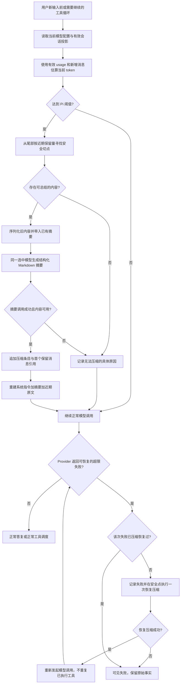

# Pi 上下文压缩对齐实施计划

> 2026-10-16 用户确认阶段完结，先实际使用再反馈，不把本计划或容量未验证项作为自动续做任务。当前进度与后续恢复入口见 [阶段收尾记录](./2026-10-16-Pi压缩与原生工具协议阶段收尾.md)。本文保留当时实施与实验记录。

> 日期：2026-10-15。任务1–5及小范围协议/验收收尾已执行，最终回归74文件705项通过。真实三模型三次配对18/18后续分支通过，14/14摘要与可见原文核对通过；中转真实窗口未知，最终partial，未授予实际容量整体放行，未证明普遍净收益。首轮历史保留在验收记录第八节，最新结果见第九节及[收尾实施](./2026-10-15-原生工具协议与压缩配对验收实施.md)。下列勾选表示实施和实验执行，不替代各项放行条件。

**目标：** 采用 Pi 的公开本地压缩算法与默认参数，在现有 Node.js、Task、SQLite、CLI/Web 架构中保持同等核心行为。

**架构：** 模型配置提供窗口和输出能力，压缩模块负责估算、切点与摘要，AgentLoop 负责安全时点与恢复，SQLite 保存原始记录、来源边界和压缩条目。复用现有 Provider、Trace 和抓包。

**技术栈：** TypeScript、Node.js、SQLite、Vitest、现有 OpenAI-compatible Provider；核心算法优先直接参考并移植固定版本的 Pi 源码，在宿主边界做适配，不引入整个 Pi Agent 运行时依赖。

## 1. 上游基准与适配边界

固定参考 Pi 提交 **`6a1f799b675c8cb98320b71ff7ee44f160fe8d66`**，避免验收期间跟随 `main` 改变语义。主要证据分别来自：

- [压缩文档](https://github.com/earendil-works/pi/blob/6a1f799b675c8cb98320b71ff7ee44f160fe8d66/packages/coding-agent/docs/compaction.md)：生命周期、配置、条目与扩展。
- [压缩源码](https://github.com/earendil-works/pi/blob/6a1f799b675c8cb98320b71ff7ee44f160fe8d66/packages/coding-agent/src/core/compaction/compaction.ts)：估算、触发、切点、摘要输出预算。
- [摘要工具源码](https://github.com/earendil-works/pi/blob/6a1f799b675c8cb98320b71ff7ee44f160fe8d66/packages/coding-agent/src/core/compaction/utils.ts)：摘要序列化与文件操作信息。
- [模型接入文档](https://github.com/earendil-works/pi/blob/6a1f799b675c8cb98320b71ff7ee44f160fe8d66/packages/coding-agent/docs/models.md)：模型目录与自定义端点配置。

“完全参考 Pi”指本轮压缩的决策和处理过程以上述实现为基准。SQLite 代替 Pi 的会话条目存储，Task 继续作为本项目上下文边界；这些是宿主适配，不重新设计压缩策略。Pi 的 `/tree` 分支导航不是当前产品能力，不在本轮新增。

用户已明确同意核心算法代码直接参考 Pi。估算、触发、切点、摘要序列化和滚动更新优先移植可独立复用的上游代码；改动集中在消息类型、Provider、SQLite 和 Trace 接口。移植时保留版权与许可证说明，记录上游提交、文件路径及必要适配差异；改变算法行为的差异必须说明原因并通过上游符合性测试。中国化文案进入本项目中文资源，不把开发文档装入最终用户上下文。

## 2. 核心行为对照

| 环节 | 对齐目标 | 当前项目要改的内容 |
| :--- | :--- | :--- |
| 触发 | `contextTokens > contextWindow - reserveTokens`，严格大于 | 替换 Turn/字符两个自动触发条件，不能同时保留成隐藏的“或”条件 |
| 估算 | 有效的最近响应 usage 加之后新增消息的估算；无有效 usage 则估算当前投影 | 将请求级 usage 提供给压缩判断；不使用 Task 累计用量 |
| 近期保留 | `keepRecentTokens=20000`，从尾部寻找安全切点 | 替换“保留最近 5 个 Turn”；数量由消息 token 与切点决定 |
| 长工具循环 | 在同一用户交互内也能选切点 | 支持消息级来源位置，不能只对完整旧 Turn 落检查点 |
| 摘要输入 | 对话序列化为文本，移除思考块；工具结果预览 2000 字符并标记截断 | 预览只用于摘要请求，SQLite 原记录不截断、不改写 |
| 摘要输出 | 目标、约束、进度、决策、后续步骤、关键上下文及文件信息 | 新格式使用结构化 Markdown，来源范围在 SQLite 元数据保存 |
| 输出预算 | 普通历史摘要上限为 `min(floor(0.8 * reserveTokens), model.maxTokens)` | Provider 支持按请求传递输出上限；分割用户交互的辅助摘要按上游对应分支核对 |
| 滚动压缩 | 旧摘要与新进入压缩区的消息接续更新 | 使用上次保留边界，不重复将全部原始历史再次输入 |
| 正常触发点 | 用户新输入前；工具返回且确需下一次助手调用时 | 先准备当前投影，覆盖首轮与工具循环；已结束的任务不为下一轮预先压缩 |
| 手动入口 | `/compact [instructions]` 复用相同准备和摘要路径 | CLI 解析可选关注点，命令不创建普通 Turn |
| 超限恢复 | 对符合上游条件的超限/最终长度失败选择一次压缩后重新调用 | 保留失败事实；不能把普通长度截断或带工具调用的响应一律当作上下文超限 |

上表为本轮实现基准，具体通过范围以配套验收记录为准。估算量和 Provider 实际用量必须分字段记录。Pi 的字符估算同样不保证精确计数；采用它不等于保证零超限。

## 3. 配置与模型参数

所有参数保存在 `code/figo-agent.config.json`。新压缩配置采用 Pi 命名；以下为当前配置结构；本机 JSON 已迁移到这些字段：

```json
{
  "context": {
    "compaction": {
      "enabled": true,
      "reserveTokens": 16384,
      "keepRecentTokens": 20000,
      "summaryToolResultMaxChars": 2000,
      "modelOverrides": {}
    }
  }
}
```

`summaryToolResultMaxChars` 将上游序列化常量配置化，默认仍为 2000，以符合本项目参数统一进 JSON 的原则。`modelOverrides` 按当前配置的 `providerId/modelId` 精确匹配，只覆盖 Pi 的预留量、近期保留量。缺省逐项回退全局值；非法值明确报错。

每个 `llm` 条目增加 `contextWindow` 和 `maxTokens` 元数据。它们分别表示当前端点的有效窗口与最大输出能力，不是每次请求都使用最大输出。切换模型后重新读取该模型配置，已经开始的调用保留原选中条目。

| 模型参数 | 来源规则 | 未知时的行为 |
| :--- | :--- | :--- |
| 官方模型窗口与最大输出 | 查询官方资料或现成模型目录，核对具体 Provider 和 Model，再保存本机 JSON | 保留未知，不从相似型号猜值 |
| GPT 中转窗口 | 使用中转明确声明或已核实的端点能力；官方模型卡仅供对照 | 不自动套用 OpenAI 官方窗口 |
| 预留量与近期保留量 | 首先使用 Pi 默认值；明确覆盖才改变 | 不引入在线调参或统计学习 |

当前配置中的 MiniMax-M3.1-Flash-Preview 与 DeepSeek-V4-Pro 窗口有官方公开资料；中转 `gpt-6.1-sol` 的实际端点窗口尚未核实。实施任务 1 必须把实际取值和来源补入验收记录；拿不到时记录未知并关闭该条目的阈值自动判断，不能报告该模型自动压缩验收通过。手动入口、普通聊天和失败提示仍可使用。这是本项目对未知端点的显式适配边界。

不增加 `maxEstimatedInputTokens` 作为第二套容量语义，不叠加 90% 比例、最少 Turn、旧前缀大于摘要上限、预计回本等额外执行门槛。压缩前后大小记录为观测证据，不把成本预测放入运行控制。

## 4. 运行流程



上图描述自动压缩和超限恢复。手动 `/compact` 从准备切点开始，成功后保存并重建上下文，返回命令结果；不自动创建普通 Turn 或继续一次普通助手调用。

失败或取消不写成功条目。正常自动压缩失败后保留已有有效投影；能否继续由调用结果和当前生命周期决定，不宣称回退原文就能解决超限。恢复中的失败助手尝试只从模型投影排除，抓包、成本、Trace 与原始记录仍可查询。

## 5. 最小数据与代码边界

当前 `task_compaction_checkpoints` 使用完整 Turn 的 `from_seq/through_seq`，不能表达当前 Turn 中间的切点。仅换触发公式并继续使用这个边界，不能称为已对齐 Pi。

实施复核补充：新增轻量 `context_messages` 消息快照表。证据是反馈作为切点且随后取消时没有下一抓包可反推，以及两项大工具结果运行时合计 12000 字符、逐项默认重建变成 16254 字符。仅靠抓包推断不能保证相同投影。该表以稳定来源为主键，追加原始消息、usage/作用域与省略标记；Trace 只记录引用，不把脱敏日志作为原文。没有快照的存量历史走明确标注的兼容读取，不宣称恢复未知的自定义预览预算。

新增 `context_compactions` 保存新格式，原表只保留旧数据兼容。新增条目至少包括 `id`、`task_id`、递增 `seq`、`base_entry_id`、`first_kept_source_ref`、覆盖的消息来源引用、`summary_markdown`、`details_json`、`tokens_before`、`request_id`、上海毫秒时间。`details_json` 记录读过和修改过的文件，来源范围与摘要文字分开存储。按 Task 和 seq 建索引，同一 Task 追加时事务复核 base。

消息来源使用已有原始数据生成稳定引用：用户消息来自 `turn.id`，助手响应来自 `llm_http_captures.request_id`，工具结果来自 `tool_calls.id`，原生调用的 `tool_call_id` 继续保留。相同请求反复携带的旧上下文不重复导入；不得仅以文本相同作为消息相同的判断依据。这一步补齐当前 `TaskHistoryReader` 只提取最终回答和部分工具结果的限制。

旧 JSON 检查点继续用旧解析器读取，首次新压缩将其作为已有摘要输入。新 Markdown 不经过旧 JSON 来源字段校验，也不增加“所有源码 import 路径必须复述”的规则。恢复已存 Task 后应重建相同的保留边界；旧数据无法恢复中间消息时，记录实际兼容状态并使用现有可重建历史，不能伪造缺失消息。

| 责任 | 文件范围 | 交付内容 |
| :--- | :--- | :--- |
| 配置与模型选择 | `code/src/config/runtime-config.ts`、`model-settings.ts`、`model-catalog.ts` | Pi 配置、模型元数据、切换后匹配与保存；模型 ID 列表接口不擅自改变原返回契约 |
| 估算与切点 | `code/src/context/compaction-policy.ts`；新增 `compaction-preparation.ts`；`code/src/token-usage/estimate-message-tokens.ts` | 纯函数，输入当前投影和当前模型参数，输出估算、切点及待摘要内容 |
| 消息来源与持久化 | `code/src/context/task-history-reader.ts`、`compaction-store.ts`、`code/src/storage/schema.ts` | 稳定来源、增量迁移、新旧摘要兼容、消息级切点 |
| 摘要与重建 | `code/src/context/compaction-service.ts`、`compaction-summary.ts`、`round-compaction.ts`、`context-builder.ts` | 统一准备规则、Markdown 摘要、滚动更新和来源留痕 |
| 调用与恢复 | `code/src/loop/agent-loop.ts`、`llm-message-builder.ts`、`code/src/contracts/types.ts`、`code/src/llm/openai-compatible-provider.ts`、`code/src/kernel/agent-kernel.ts` | usage 与输出上限契约、两个正常检查点、一次超限恢复、完整抓包 |
| 文案与说明 | `code/locales/zh-CN.json`、`code/src/i18n/catalog.ts`、本模块 README 和验收文件 | 中文消息与摘要模板；所有数值来自 JSON |

遵循 SOLID：Loop 只调度，准备函数不调 LLM，Service 不识别厂商名称，Store 不决定阈值。复用现有 TokenUsage 与 Trace，不新增质量评分平台、影子实验、自优化调度或原生 opaque 压缩分支。

## 6. 实施顺序与独立交付

### 任务 1：配置、模型参数与纯判断

- [x] 在 `code/tests/config/runtime-config.test.ts`、`model-settings.test.ts`、`model-catalog.test.ts` 中先补失败测试，覆盖旧配置升级、新字段保存、切换模型、非法覆盖值及未知窗口。
- [x] 实现 Pi 配置解析与模型参数；旧字段不再参与新策略。原文件仍可读取，转换结果必须可见；数值型窗口不能写成无依据的默认值。
- [x] 纯函数判断只使用下式，不追加任何策略条件：

```ts
return settings.enabled && contextTokens > contextWindow - settings.reserveTokens;
```

- [x] 验证窗口 128000、预留 16384 时：111616 不触发，111617 触发；`enabled=false` 不触发。新增值不写死在 Provider 分支。
- [x] 执行 `npm --prefix code test -- tests/config/runtime-config.test.ts tests/config/model-settings.test.ts tests/config/model-catalog.test.ts tests/context/compaction-policy.test.ts`，通过后再进入任务 2。

### 任务 2：消息投影、token 估算与安全切点

- [x] 在新增 `code/tests/context/compaction-preparation.test.ts` 和现有 `task-history-reader.test.ts` 写失败测试：native/text 两种工具协议、重复抓包、相同文本的两次独立结果、当前 Turn 多轮往返。
- [x] 实现稳定消息引用与有效 usage 判断。usage 所属模型或投影已变化时回到当前投影估算，不复用旧累计数字。
- [x] 依 Pi 顺序从尾部选择近期原文，测试 20000 token 附近边界，切点不落在 tool result；超长单次用户交互能拆出早期前缀。
- [x] 新增 `code/tests/context/pi-compaction-conformance.test.ts`，使用固定上游版本的边界样例，对照相同规范化消息下的阈值、估算、切点和分割结果；原生协议与文本协议的宿主转换单独测试，不能混成算法一致性证明。
- [x] 执行 `npm --prefix code test -- tests/context/compaction-preparation.test.ts tests/context/pi-compaction-conformance.test.ts tests/context/task-history-reader.test.ts tests/loop/llm-message-builder.test.ts`，逐条来源和工具配对正确才进入任务 3。

### 任务 3：Markdown 摘要与消息级检查点

- [x] 在 `code/tests/storage/compaction-store.test.ts`、`code/tests/context/compaction-summary.test.ts`、`compaction-service.test.ts`、`context-builder.test.ts` 写失败测试，覆盖新表迁移、整 Turn 和 Turn 内切点、滚动摘要、旧 JSON 兼容、并发 base 冲突、取消和重启读取。
- [x] 新摘要采用 Pi 六类段落和文件操作信息；默认摘要序列化工具预览为 2000 字符，测试截断标记和原始存储不变。
- [x] 在 `LLMRequest` 与 Provider 中传递摘要输出上限和使用量；普通摘要默认输出预算为 13107 token，若模型最大输出更小则夹紧到模型值。
- [x] 新压缩条目必须覆盖实际参与生成的来源，重建后最近原文逐项一致，不重复拼接旧摘要和旧工具结果。
- [x] 执行 `npm --prefix code test -- tests/storage/compaction-store.test.ts tests/context/compaction-summary.test.ts tests/context/compaction-service.test.ts tests/context/context-builder.test.ts`，落盘与重启投影一致才进入任务 4。

### 任务 4：AgentLoop、手动压缩与一次恢复

- [x] 在 `code/tests/loop/agent-loop-tool-calling.test.ts`、`code/tests/context/round-compaction.test.ts`、`code/tests/e2e/task-context-compaction.test.ts` 补失败测试，覆盖首轮、工具返回后、最终答复不额外压缩和手动关注点。
- [x] 移除 Loop 中旧字符阈值、预计收益判断与重复轮内压缩路径，全部调用同一套 Pi 准备机制。
- [x] 测试明确的上下文超限、最终长度失败、普通输出截断、长度响应带工具调用四种分支；只有上游定义的恢复路径执行一次压缩后模型重试，任何分支都不重放已成功的外部工具。
- [x] 更新 Kernel 装配、CLI `/compact` 和必要国际化文案。工作台沿用现有事件与抓包视图，不新增配置页面工程。
- [x] 执行 `npm --prefix code test -- tests/loop/agent-loop-tool-calling.test.ts tests/context/round-compaction.test.ts tests/e2e/task-context-compaction.test.ts`，生命周期与取消通过才进入任务 5。

### 任务 5：真实三模型与最终放行

- [x] 新增 `code/e2e/pi-compaction-real.ts`，使用本机启用条目、独立测试 Task/SQLite 和同一真实任务前缀；报告每模型的参数来源、触发、切点、摘要请求、重建请求和后续行为。
- [x] 每模型分别执行默认参数的真实长任务、显式缩小测试窗口后的自动触发、手动压缩；测试窗口明确标注，不冒充真实模型容量。默认已知窗口未到阈值，中转窗口未知；不能据此声称实际窗口自然触发通过。
- [x] 按配套验收表完成三模型可追溯记录。未知中转窗口与超时对照保留未通过，不影响已完成的代码检查，也不能写成三模型全部放行。
- [x] 执行 `npm --prefix code test`、`npm --prefix code run typecheck`、`npm --prefix code run build`；若改变前后端共享契约，再运行 `npm --prefix code run web:typecheck` 与 `npm --prefix code run web:build`。
- [x] 更新本模块 README、IMPLEMENTATION、ACCEPTANCE 的实际状态和旧文档索引，避免旧字符阈值被读成新逻辑。只在用户要求时提交或推送；提交前按现有规则清理模型密钥。

任务5说明：真实脚本、预检、SQLite 留痕、受控 Provider 集成测试与独立类型检查已完成。经用户指出，在本地历史提交 `b92e8d51dd0a` 找到三个匹配条目的凭据，已完成隔离真实验收并清理凭据。150622字符真实源码分10个前缀Turn，R=16384、K=20000不变；12个场景中11个完成，GPT关闭对照超时。三模型6个压缩后续分支完成，8条摘要均进入下一请求、原历史保留后缀逐条一致。完整机器报告为 `.figo-agent/acceptance/pi-history-concise-1792074103943/report.json`，最终status=failed，未授予整体放行。MiniMax最大输出、中转容量保持未知；净成本与普遍质量收益未获证明。此前空密钥判断只适用于工作区配置，不适用于整个本机历史。

后续收尾已纠正合法原生正文误判，将正常测试窗口显式设为49152，三模型各三次配对。最新只读复核报告为 `.figo-agent/acceptance/pi-paired-1792076809706/reviewed-report.json`：18/18分支通过、14条摘要注入与可见原文保留通过、109次真实请求全部HTTP200。原始报告保留其公式判定假阴性，新报告明确修正来源且未重发模型。最终功能passed、用量记录complete、容量unknown、总体partial；当前三组样本开启后的累计输入和耗时中位数均增加，不报告性能优化成功。生产Pi核心和R/K未改。

## 7. 预期受益与边界

| 变化 | 可验证的收益 | 本轮不宣称的结果 |
| :--- | :--- | :--- |
| Pi 窗口触发替换固定消息数/字符数 | 同样的聊天规模在不同窗口配置下得到符合公式的决策 | 每种任务都达到最低成本 |
| token 尾部保留与消息级切点 | 超长工具循环可压缩旧往返，近期工具协议仍完整 | 摘要没有语义遗漏 |
| 同一套准备与摘要流程 | 首轮、轮内、手动路径的配置和切点规则可统一测试 | 引入完整 Pi 分支导航能力 |
| 原文和新条目分别存储 | 重启后可复建，Trace 能定位压缩前后实际请求 | 存储留痕自动证明答案正确 |
| 一次超限恢复 | 单次误估仍有明确恢复路径；二次失败终结可见 | 所有 Provider 错误都能自动解决 |

代码、自动化、真实三模型节点及同历史对照数值见配套验收记录第八、九节；数值未证明三家普遍净收益，也没有完成旧版12轮/24000字符策略与新版的纵向对照。按Pi参考仍保留摘要有损、估算误差、压缩调用增加延迟的事实；本轮不新增参数自优化闭环。
