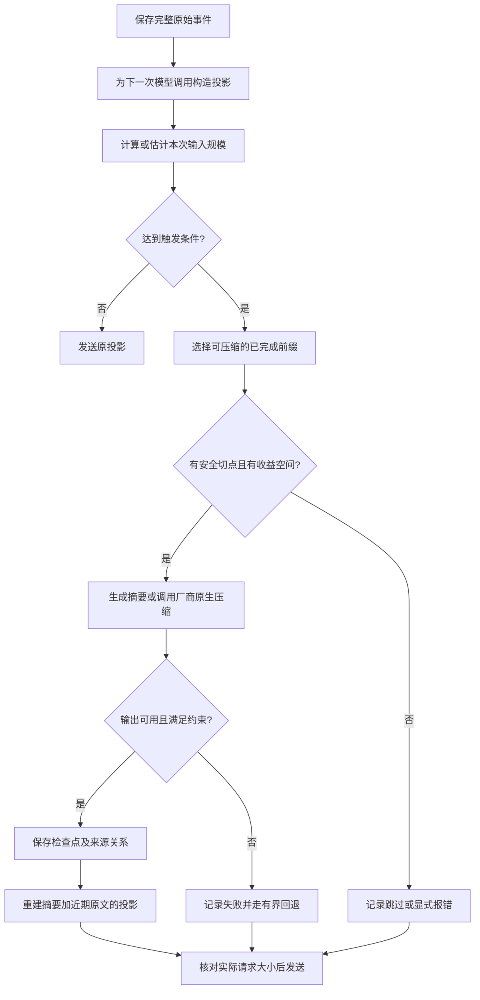

# 上下文压缩机制与主流实现对照

> 知识点文档，2026-10-15。本文解释机制和公开实现，不改变本项目的压缩策略或配置。厂商行为以文末所列公开文档、源码为准；本项目实验结论以本机验收记录为准。

## 先建立一个准确的心智模型

LLM 每次调用只能看到这一次请求构造出的上下文。Agent 保存过的完整对话、工具结果和文件，不会自动成为模型的“记忆”。上下文压缩解决的是：当**下一次请求需要携带的历史**逐渐占满模型窗口时，如何用更短的表示继续任务。

```text
不可变事实层：用户输入、模型响应、工具调用与结果、文件与抓包
                     |
                     v
派生层：可丢弃并重建的摘要 / 检查点 / 文件引用 / 检索索引
                     |
                     v
投影层：本次实际发送给模型的系统指令 + 摘要 + 近期原文 + 当前输入
```

**压缩不是删除历史。**理想情况下，原始记录仍可审计；变化的是后续请求的投影。摘要是有损派生物，不能当作原文的真值副本。“有检查点”只说明保存了摘要，“请求变短”只说明节省了输入，两者都不能单独证明任务质量没有下降。

### 几个不能混为一谈的量

| 量 | 定义 | 常见误读 |
| :--- | :--- | :--- |
| `W`，上下文窗口 | 该模型单次推理能够处理的 token 容量 | 把模型宣传的窗口直接当作全部可放历史的空间 |
| `P`，当前投影 | 下一次调用组装后的输入 token，包含固定指令、历史、工具定义、当前输入等 | 用“Task 累计 token”代替单次输入量 |
| `R`，余量 | 预留给输出、工具协议和估算误差的空间 | 以为到 `W` 才需要处理 |
| `T`，触发点 | 达到何种条件时开始压缩 | 和保留近期原文的数量混为一谈 |
| `K`，保留尾部 | 压缩后仍原样留在投影中的近期内容 | 以为最近 `K` 条不会消耗窗口 |
| `B`，摘要预算 | 摘要本身允许使用的空间 | 以为摘要越短越好 |

`Turn` 是产品层的一次用户交互；一次 Turn 内还能有多轮模型调用和大量工具结果。`字符数` 与 `token 数`没有固定换算率，中文、代码、JSON、路径、不同模型 tokenizer 都会改变比例。因此 `12 Turn`、`24,000 字符`、`20,000 token` 无法直接互相比较。

## 完整处理链路



实际设计有两个触发位置：**用户下一轮开始前**检查 Task 历史；**同一 Turn 的工具循环内**检查刚加入的工具结果和模型消息。只检查前者，会漏掉一次工具调用吐出大文件的情况。压缩请求本身也必须能容纳它要处理的材料；等到原文已经超过模型窗口再调用摘要模型，通常来不及。[Pi 的说明](https://github.com/earendil-works/pi/blob/main/packages/coding-agent/docs/compaction.md)也把正常触发、用户新输入前检查和溢出恢复区分开。

## 各家公开做法：相同目标，不同边界

| 实现 | 公开触发依据 | 压缩后保留什么 | 压缩产物与可见性 |
| :--- | :--- | :--- | :--- |
| [Codex](https://github.com/openai/codex/blob/main/codex-rs/protocol/src/openai_models.rs) | 当前源码中，模型窗口已知时自动触发上限默认为**解析出的窗口的 90%**；配置值受这个上限约束 | 系统/开发者上下文与压缩后的历史项；具体投影由 Codex 运行时构造 | 可走 [Responses 原生压缩或本地摘要路径](https://github.com/openai/codex/blob/main/codex-rs/core/src/tasks/compact.rs)，取决于所用模型/端点能力 |
| [Pi](https://github.com/earendil-works/pi/blob/main/packages/coding-agent/docs/compaction.md) | `contextTokens > contextWindow - reserveTokens`；默认 `reserveTokens=16,384` | 默认保留最近 `20,000 token` 原文，较早内容由摘要替代 | 人可读摘要与会话压缩节点，原会话条目仍在存储中；允许按模型覆盖参数 |
| [Claude Code](https://code.claude.com/docs/en/model-config) | 接近模型上下文限制自动压缩；具体默认窗口随模型/接入方式而定，可配置自动压缩窗口 | [系统指令继续生效，磁盘规则/记忆/计划重新注入，部分文件重新读取](https://code.claude.com/docs/en/context-window) | 对话摘要加重新装配的外部上下文；并非“旧消息全部变成一段摘要” |
| [OpenAI Responses API](https://developers.openai.com/api/docs/guides/compaction) | 应用显式设置 `compact_threshold`，按服务端渲染后的 token 数触发；文档的 `200,000` 是**示例值** | 最近一次压缩项和 API 返回的其他必要项；链式调用按对应 API 规则继续 | 服务端返回不供人阅读的加密压缩项；另有显式 `/responses/compact` |

这里必须区分 **产品默认策略** 与 **底层 API 能力**。Codex 是一个 Agent 产品；Responses compaction 是供应用调用的 API。不能把 Responses 示例中的 `200,000` 说成 Codex 默认值，也不能把 Pi 的 `16,384` 说成所有模型的统一余量。

### Codex：按模型窗口算比例，而不是按消息条数算

[Codex 源码](https://github.com/openai/codex/blob/main/codex-rs/protocol/src/openai_models.rs)里 `auto_compact_token_limit()` 取解析出的上下文窗口的 `9/10`，有自定义上限时取两者较小值。它另有“可用上下文窗口”的预留比例；**90% 是相对于解析出的窗口，不是相对于可用窗口再乘一次 90%**。这说明触发阈值与最后的硬容量边界是两个量。

[OpenAI 对 Codex Agent Loop 的说明](https://openai.com/index/unrolling-the-codex-agent-loop/)展示了在接近阈值时借助 Responses compaction 将较长历史替换为更短上下文的路径。当前源码也保留对不支持远端压缩能力的本地摘要路径。对我们的启发是：**核心 Loop 可以只认“压缩后投影”这个接口，具体产物由 Provider 能力决定**；但原生 opaque 产物和人可读摘要的审计能力不同，不能声称它们完全等价。

### Pi：触发余量与近期原文是两套预算

[Pi 的公开文档](https://github.com/earendil-works/pi/blob/main/packages/coding-agent/docs/compaction.md)写得最直观：触发条件为 `contextTokens > contextWindow - reserveTokens`，默认预留 `16,384 token`；压缩时默认留下最近 `20,000 token` 不摘要。前者回答“**何时开始**”，后者回答“**压完仍保留什么**”。Pi 用安全切点避免从一个工具结果中间切开，摘要保留已知文件操作等任务状态；原会话条目留存。它还支持按精确的 `provider/modelId` 覆盖预算，而不是把模型名硬编码进 Loop。

举例：假设模型窗口是 `200,000 token`，采用 Pi 的这两个默认数，正常触发线约为 `183,616 token`，而近期原文目标约为 `20,000 token`。两者不是 `183,616 - 20,000` 这种关系；摘要、固定指令、当前输入仍要占空间。例子只演示计算，**不是 Pi 对每个模型的固定窗口**。

### Claude Code：压缩后“重注入”同样重要

[Claude Code 文档](https://code.claude.com/docs/en/context-window)逐类说明压缩之后的上下文：系统指令和输出风格继续生效，项目根目录的 `CLAUDE.md`、自动记忆、计划等从磁盘重新注入；读过或编辑过的文件会按规则重新读取一部分；仍在运行的后台任务保留并提示模型。这个设计把**可重建的外部状态**与**必须摘要的会话状态**分开处理。它还提供 `/compact` 手动指定关注点、`/clear` 清理无关任务、子 Agent 隔离大量文件读取等不同手段；它们不是同一个“自动摘要开关”。[模型配置文档](https://code.claude.com/docs/en/model-config)说明自动压缩窗口依模型和接入方式变化，网关或自定义模型 ID 下窗口元数据还需要校正。因此不能从单一截图推断 Claude Code 的通用百分比。

### OpenAI API：原生压缩降低应用实现负担，但牺牲可解释性

[Responses API 文档](https://developers.openai.com/api/docs/guides/compaction)提供两种路径：请求中设置 `context_management` 自动压缩；或者显式调用 `/responses/compact`，把返回的**整个**规范化窗口用于下一次请求。服务端会生成加密的 opaque compaction item，应用不能检查其内部摘要内容。无状态数组链式调用可以在追加输出后裁剪最近压缩项之前的旧项；使用 `previous_response_id` 时不应手动做相同裁剪。这是 API 契约，不应照搬到其他 Provider。

## 真正难的不是“写个摘要”

### 1. 选哪些内容压缩

一次安全的切分至少要保住：当前用户目标和未完成约束、近期原始对话、待处理的工具调用与结果成对关系、仍有效的文件路径与修改状态。已经结束的旧工具输出可以改写成“结论 + 来源引用”；尚未返回的工具调用不能被压成“已经完成”。若最大的一段是**当前用户单条长输入**，压缩旧历史无助于解决容量问题。先限制工具输出投影、按需读取文件片段、把可检索原文留在存储里，通常比盲目总结整段更可控；这是本文的架构推论，不是任何厂商的统一默认。

### 2. 摘要要保留什么语义

Coding Agent 的摘要至少覆盖：任务目标、已确认约束、已完成修改及文件位置、验证结果、失败原因、尚未完成的工作和需要继续调用的证据。可复查的路径、行号、Turn/工具结果 ID 比没有来源的“已经修复”更有用。但**来源 ID 校验只能证明引用指向某个合法记录，不能证明自然语言事实为真**；要证明事实，还需对原始证据做核验。

摘要上限也是容量约束，不是质量目标。把 `B` 一味压低会丢必要事实；把 `B` 设得接近原文会失去压缩收益。滚动摘要还会反复“摘要的摘要”，使旧事实逐层变形。关键事实应能从原始 Turn、工具结果或文件重新取回，不应只剩一个不断改写的文本副本。

### 3. 什么才叫“有收益”

对某个检查点，先比较压缩前后的**实际模型请求体**，再看后续有多少次请求复用它。只在一次请求上省了少量历史，却额外调用一次昂贵的摘要模型，净成本并不下降。可以用下面的账本作分析，但它是**分析口径，不是产品触发公式**：

```text
净 token 差额 = 后续各次请求中被省掉的输入 token 之和
             - 压缩调用自身消耗的输入与输出 token

收益验收 = 净成本 + 端到端延迟 + 任务完成率 + 答案/工具行为质量
```

上式仅是粗粒度 token 账本：后续回答长短和工具路径也会变化，不能先假定两组输出相同。不同供应商的 input/output 价格、缓存命中、计费方式不同，精确成本应按实际价格和账单另算。中转服务报告的 token 与缓存口径不一致时，**相同请求体的 token 差不能直接归因为压缩**。还有一个常被忽略的数量：`可压缩前缀长度`。总历史已经很长，但为了保留近期原文，若只有极短前缀可压，压缩调用很难回本。

### 4. 失败路径必须是产品行为的一部分

至少区分 `未触发`、`无安全切点`、`摘要请求失败`、`摘要结构或来源校验失败`、`已存检查点但新投影仍超限`。失败后保留原文是数据安全要求；但“回退为原文”并不保证模型还能接受请求。应把不可继续的情况显式告知用户，并避免在每轮工具循环里重复做同一失败压缩。手动压缩的错误也应可见，而不是静默当作成功。

## 回到本项目：12 Turn / 24,000 字符到底处于什么位置

[原实施计划](./COMPACTION_IMPLEMENTATION.md)明确把 `turnThreshold=12`、`charThreshold=24000`、`summaryMaxChars=12000` 定义为**内部初值**，并没有证明它们等价于任何模型窗口。`maxTaskHistoryTurns=5` 是保留最近 5 个原始 Turn 的目标，不是触发阈值。两个触发条件采用“或”，故只要字符数先到，12 Turn 根本不会参与当次决策。

[2026-10-15 真实长任务 A/B 验收](./2026-10-15-真实长任务压缩AB验收.md)给出具体反例：三模型在只有 **6 个前序 Turn** 时，历史内容已分别达到 MiniMax `28,721`、DeepSeek `29,837`、GPT 中转 `28,599` 字符，于是由 `24,000` 字符线触发。保留最近 5 个原始 Turn 后，**只有最早 1 个 Turn 能压缩**。三家的摘要请求均返回 HTTP 200，却都被 `missing_literal_anchor` 校验拒绝；检查点数为 0，后续最终请求体与关闭压缩的对照组相同。这一轮**证明了触发过早且本场景没有实现压缩收益**，不证明 `12 Turn` 单独触发有问题，也不证明其它任务一定同样失败。

验收还记录：DeepSeek 多消耗报告的 `14,835` 摘要 token、GPT 中转 `18,027`；MiniMax 两次开启组因摘要开销加上最终请求耗时未在整轮时限内完成。GPT 中转对逐字相同的最终请求体报告过不同的输入和缓存 token，故这里以请求体、检查点和端到端结果判断“有没有压缩”，不拿报告差额宣称节省。上述都是**本次实验数据**，不是厂家特性。

对当前三个数字，证据结论分别是：

| 参数 | 现有证据能说明什么 | 仍然不知道什么 |
| :--- | :--- | :--- |
| `turnThreshold=12` | 是计数保险线；本次由字符条件先触发 | 单独达到 12 Turn 时的质量、成本与时机 |
| `charThreshold=24000` | 在本次长源码任务中，6 Turn、仅 1 Turn 可压时已经触发，且未产生可用检查点 | 换成 token 窗口比例后，哪一档对每个模型最合适 |
| `summaryMaxChars=12000` | 是输出上限；本次失败原因是字面路径锚点，不是已证实的上限过小 | 成功摘要应保留多长，才能兼顾质量和净收益 |

这回答了“默认值是不是太小”：**至少 `24,000 字符` 在本次任务里过早地启动了压缩尝试**；不能凭这一次测试给出一个新的通用数字。厂商公开实现也没有为 `12 Turn/24,000 字符/12,000 字符摘要` 这组三值提供背书。

## 如何形成适用于多模型的判断框架

这部分是基于公开实现和本项目证据的**架构推论**，不是本轮实施决定：

1. 先确定每个已配置模型/端点的实际上下文窗口和输出余量；中转模型的窗口未知时，明确记为未知，不从名字猜。不同模型共享策略接口，但阈值计算读取模型画像。
2. 触发依据优先使用**下一次投影的 token 规模与窗口余量**；没有可靠 tokenizer 时，字符估算只能作为保守预警，并记录估算误差与实际 usage。Turn 数只做兜底或运营观测，不当容量单位。
3. 在触发之外增加**可压缩前缀与预计节省**门槛：最近原文保留后，剩下的前缀不足以覆盖摘要成本时不自动调用模型。需要读大工具结果时，先控制投影和提供可取回引用。
4. 压缩方式由能力适配层决定：结构化可审计摘要适合本地 SQLite 留痕；厂商原生 opaque 压缩适合其专属 API，但必须在抓包/审计界面标记“内容不可直接核验”。无论哪种，Loop 都只消费“新的上下文投影”。
5. 评估时把**触发、成功落盘、请求缩减、长期净成本、任务质量**分成独立验收项；做同模型同历史快照 A/B，观察多个真实长任务。只看摘要 HTTP 200、压缩率或单次 token usage，都不足以宣布优化成功。

一句话总结：**业界主流方向不是寻找神奇的固定消息条数，而是用模型窗口约束触发、保留近期原文、把旧历史变成可继续工作的状态，并保留可审计的原始证据。** 对本项目，当前最有价值的知识结论是先让“是否值得压、压后是否真正用于下一次请求”可证明，再讨论新阈值数字。

## 一手资料

- [Codex 模型窗口与自动压缩阈值源码](https://github.com/openai/codex/blob/main/codex-rs/protocol/src/openai_models.rs)、[Codex 压缩任务路径源码](https://github.com/openai/codex/blob/main/codex-rs/core/src/tasks/compact.rs)、[OpenAI 对 Codex Agent Loop 的说明](https://openai.com/index/unrolling-the-codex-agent-loop/)。
- [Pi 压缩设计与配置](https://github.com/earendil-works/pi/blob/main/packages/coding-agent/docs/compaction.md)。
- [Claude Code 上下文窗口与压缩后的内容](https://code.claude.com/docs/en/context-window)、[模型与自动压缩窗口配置](https://code.claude.com/docs/en/model-config)。
- [OpenAI Responses API 压缩指南](https://developers.openai.com/api/docs/guides/compaction)。
- 本项目：[压缩原实施计划](./COMPACTION_IMPLEMENTATION.md)、[真实长任务 A/B 验收](./2026-10-15-真实长任务压缩AB验收.md)。

> 厂商文档与 `main` 分支源码会变化；上述对照以 2026-10-15 查阅版本为时间截面。具体运行行为仍须按所部署版本复核。
