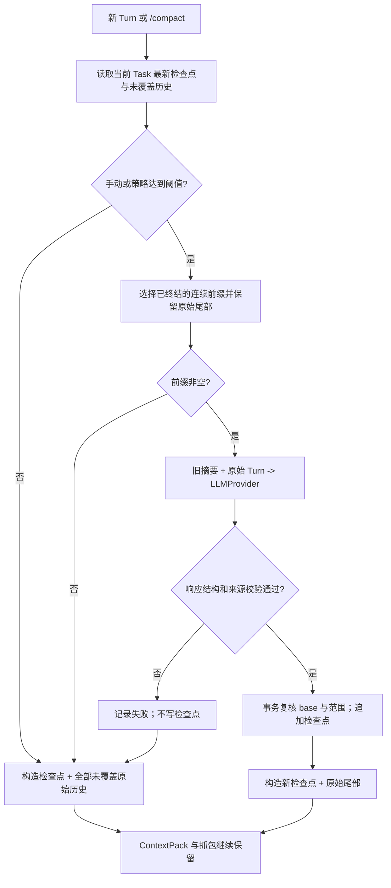

# Task 上下文压缩实施计划

> 本计划已获确认并实施。每个任务先写失败测试，再实现、复测；验收记录见 [COMPACTION_ACCEPTANCE.md](./COMPACTION_ACCEPTANCE.md)。

**目标：** 用可追溯的 Task 检查点替代「只取最近 5 个 Turn」的静默丢弃，并提供 `/compact` 与由 agent 内部控制的自动压缩。

**架构：** `CompactionPolicy` 判断时机，`CompactionService` 组织摘要，`LLMProvider` 只负责生成，`CompactionStore` 在 SQLite 中保存检查点。`ContextBuilder` 按「最新检查点 + 未覆盖的原始 Turn + 当前输入」构造 ContextPack；原始 Turn、工具结果、LLM 抓包均不删除。

**技术栈：** TypeScript、Node `node:sqlite`、Vitest、现有 `LLMProvider`、TraceRecorder。运行配置只读取 `code/figo-agent.config.json`。

## 全局约束

1. 不按 MiniMax、GPT 等厂商名称分支决定压缩时机，不依赖模型报上下文超限才触发。
2. 不引入 TokenUsage 或独立 ContextBudget 作为前置条件；第一版使用 agent 计算的字符量与 Turn 数，真实 token 数据只供后续观测。
3. 压缩是派生记录，不替代或改写 `turns`、`llm_http_captures`；失败时仍能从原始记录构造上下文。
4. 手动命令不能创建普通用户 Turn；自动压缩不能把尚未结束的 Turn 纳入持久检查点。
5. 开发文档不控制运行流程；所有阈值和开关来自统一 JSON 配置。沿用现有插件与构造注入边界，不把策略塞入 Provider。
6. 本计划的完成条件以 [COMPACTION_ACCEPTANCE.md](./COMPACTION_ACCEPTANCE.md) 为准。

## 现状与改动边界

| 位置 | 当前事实 | 计划改动 |
| :--- | :--- | :--- |
| `src/context/context-builder.ts` | SQL `LIMIT context.maxTaskHistoryTurns`，超出部分直接不进入 ContextPack | 改为检查点 + 全部未覆盖原始历史；不能无摘要截断 |
| `src/loop/agent-loop.ts` | 构造一次 ContextPack 后进入多轮 LLM/Tool 循环 | 在首轮请求前做 Task 历史压缩判断；后续轮次做输入增长检查 |
| `src/storage/schema.ts` | 无 Task 顺序号、压缩检查点、抓包用途字段 | 增量迁移、索引、唯一约束 |
| `src/cli/input-router.ts`、`src/kernel/agent-kernel.ts` | 无 `/compact` | 命令复用同一 CompactionService，不创建普通 Turn |
| `src/config/runtime-config.ts` | `maxTaskHistoryTurns=5` 直接限制查询 | 保留此字段，重新定义为检查点之后的原始尾部保留数；增加压缩策略参数 |

本改动不做向量检索、跨 Task 摘要、厂商原生 opaque compaction、摘要自动写入 Memory，也不更改既有 Task 生命周期命令。当前 `AgentKernel.start()` 每次创建新 Session 和默认 Task，`TaskManager.getCurrent()` 按 Session 查找；CLI 重启后续接旧 Task 不属于本计划。检查点的重启持久化仅通过重开 SQLite 读取验证。

## 数据契约

### Task 顺序与检查点

`turns.task_seq INTEGER` 表示同一 Task 内稳定递增的 Turn 顺序。迁移时按现有 `created_at, rowid` 回填；此顺序仅用于迁移一次。新 Turn 在事务中分配下一序号，并创建 `UNIQUE(task_id, task_seq)` 索引。Task 间序号独立；本计划不改变 Task 与 Session 的归属关系。

新增 `task_compaction_checkpoints`：

| 字段 | 类型与约束 | 作用 |
| :--- | :--- | :--- |
| `id` | `TEXT PRIMARY KEY` | 检查点 ID |
| `task_id` | `TEXT NOT NULL` | 唯一归属 Task |
| `base_checkpoint_id` | `TEXT NULL` | 增量滚动摘要引用的上一个检查点 |
| `from_seq`、`through_seq` | `INTEGER NOT NULL` | 本次新纳入的原始 Turn 闭区间 |
| `source_turn_ids_json` | `TEXT NOT NULL` | 本次新纳入的 Turn ID 列表 |
| `summary_json` | `TEXT NOT NULL` | 经校验的结构化摘要 |
| `request_id` | `TEXT NOT NULL` | 与 LLM 抓包关联 |
| `created_at` | `TEXT NOT NULL` | 生成时间 |

约束：`UNIQUE(task_id, through_seq)`；`through_seq >= from_seq`；同一 Task 的新检查点必须以当前最新检查点为 base，`from_seq = base.through_seq + 1`，且 `[from_seq, through_seq]` 内全部 Turn 均已终结。检查点只追加，最新检查点按 `through_seq DESC` 读取。保存前在事务内复核 base 与覆盖范围；并发冲突放弃当前生成结果，不覆盖已有检查点。

摘要 JSON 固定结构如下。`goal` 和每条摘要事实都带来源 Turn ID；顶层 `sourceTurnIds` 只列摘要实际引用的 ID，完整覆盖范围由检查点链保存，不随滚动摘要反复展开。允许引用的 ID 集合为旧摘要已引用的来源 ID 与本次新纳入的 Turn ID 的并集。解析失败、字段缺失、引用越界、来源 ID 重复或内容为空时拒绝落库。

```ts
interface SourcedStatement {
  text: string;
  sourceTurnIds: string[];
}

interface CompactionSummary {
  goal: SourcedStatement;
  facts: SourcedStatement[];
  decisions: SourcedStatement[];
  completedWork: SourcedStatement[];
  openIssues: SourcedStatement[];
  constraints: SourcedStatement[];
  sourceTurnIds: string[];
}
```

旧检查点摘要与新原始 Turn 一同输入模型，形成新完整摘要。`summary_json` 最大 12000 字符；超长摘要判失败，不静默截断。保留源列表、请求抓包和原始记录，方便人工核查摘要是否遗漏事实。

在 `llm_http_captures` 增加 `purpose TEXT NOT NULL DEFAULT 'turn'`，允许 `turn`、`task_compaction`、`round_compaction`。压缩 LLM 调用沿用当前 Task 最新已终结 Turn 作为抓包锚点，`request_id` 关联检查点；`LLMRequest.contextPackId` 调整为可选，压缩请求不冒用普通 Turn 的 ContextPack。普通历史的工具结果与助手回答均仅读取 `purpose='turn'`，避免把摘要当成该 Turn 的结果。没有可用锚点时 `/compact` 返回无需压缩，不发送 LLM 请求。

### 配置契约

`context.maxTaskHistoryTurns` 保留现有默认值 5，改为压缩后希望保留的原始尾部 Turn 数；未触发压缩时，未覆盖历史必须全部进入 ContextPack。

在 `context.compaction` 增加：

```json
{
  "autoEnabled": true,
  "turnThreshold": 12,
  "charThreshold": 24000,
  "summaryMaxChars": 12000
}
```

策略在每个新 Turn 首轮 LLM 请求前检查当前 Task 尚未覆盖的历史。`count >= turnThreshold` 或重建历史内容总字符数 `>= charThreshold` 时触发；配置值均须为正整数，无效值回退默认。若配置的 `turnThreshold <= maxTaskHistoryTurns`，有效阈值调整为 `maxTaskHistoryTurns + 1`，避免达到阈值却没有可压缩前缀。`autoEnabled=false` 只关闭自动触发，不禁用 `/compact`。这些默认值是内部策略初值，不声明与任何模型窗口大小等价。

自动压缩保留最近 5 个原始 Turn，压缩更老的已终结连续前缀。手动 `/compact` 至少保留最近 1 个原始 Turn；未覆盖历史不足 2 个 Turn 时返回「无需压缩」。单个超大最新 Turn 无可压缩前缀时保留原文并记录 `compaction.skipped`，不丢数据。

## 流程与状态



自动触发发生在 `ContextBuilder.build` 之前，由协调层调用服务；ContextBuilder 只读取已经提交的检查点，不调用 LLM。`/compact` 走同一服务，但没有用户 Turn。首轮压缩失败时，自动流程继续构造原始历史并记录失败；若原始输入仍超过模型可处理范围，普通 LLM 调用按现有错误路径失败，不能删历史冒充成功。手动命令明确返回失败原因。LLM 的本地占位响应不满足摘要格式，不能写检查点。

Kernel 在完成插件初始化后按 `activeModelId` 获取已启用的 `LLMProvider`，组装一个 `CompactionService` 实例，并注入 AgentLoop；`/compact` 复用该实例。服务输入为 `{sessionId, taskId, mode: "manual" | "auto", keepRawTurns}`，输出为 `{status: "completed" | "skipped" | "failed", checkpointId?, coveredTurnIds, reason}`。策略是纯判断函数，输入历史统计与统一配置，输出是否触发及原因；服务不读取 Provider 名称。摘要请求的 `model` 取选中 `llm` 条目的 `model`，不写死 `MiniMax-M3`。ContextBuilder 只依赖 CompactionStore 的读取接口。

同一 Turn 的工具循环内，压缩策略在每次 `llm.complete` 前重新计算完整 `messages` 字符量。超过 `charThreshold` 时，先尝试把更早的 assistant/tool 往返压成**仅本 Turn 有效**的轮次摘要，最新一轮工具结果与当前用户输入保持原文；轮次摘要不更新 Task 检查点，抓包标记 `round_compaction`。若没有可压缩的旧往返，保留原文并记录跳过；不可通过删除工具消息规避阈值。

## 实施任务

### 任务 1：存储与顺序号

**文件：** `src/storage/schema.ts`、`src/storage/storage-manager.ts`、`src/kernel/turn-manager.ts`、`src/context/compaction-store.ts`；测试 `tests/storage/compaction-store.test.ts`、`tests/kernel/turn-manager.test.ts`。

- [x] 先写失败测试：旧数据库升级后 Turn 序号稳定、同 Task 新 Turn 顺序递增、跨 Task 独立；重启后检查点可读取；同一覆盖范围不能重复写；并发 base 变化时拒绝提交。
- [x] 实现增量迁移、事务分配序号、检查点读写与约束；不改变已有 Turn/抓包内容。
- [x] 运行 `npm test -- --run tests/storage/compaction-store.test.ts tests/kernel/turn-manager.test.ts`；全部通过才继续。

### 任务 2：历史快照与摘要校验

**文件：** `src/context/task-history-reader.ts`、`src/context/compaction-summary.ts`、`src/context/context-builder.ts`、`src/llm/llm-http-capture-store.ts`；测试 `tests/context/task-history-reader.test.ts`、`tests/context/compaction-summary.test.ts`、`tests/context/context-builder.test.ts`。

- [x] 先写失败测试：重建历史包含用户输入、工具结果、最终回答和 Turn 状态；不同 Task/Session 不串数据；`purpose=task_compaction` 不成为历史工具结果或助手答复。
- [x] 将现有 ContextBuilder 中的历史提取迁入共享读取器；只允许已终结的连续前缀成为持久摘要来源。
- [x] 校验摘要字段、来源 ID、长度；无效摘要拒绝保存，原始历史仍完整可读。
- [x] 运行 `npm test -- --run tests/context/task-history-reader.test.ts tests/context/compaction-summary.test.ts tests/context/context-builder.test.ts`。

### 任务 3：CompactionService 与手动命令

**文件：** `src/context/compaction-service.ts`、`src/cli/input-router.ts`、`src/kernel/agent-kernel.ts`、`src/contracts/types.ts`；测试 `tests/context/compaction-service.test.ts`、`tests/cli/input-router.test.ts`、`tests/kernel/agent-kernel.test.ts`。

- [x] 先写失败测试：`/compact` 不创建普通 Turn；摘要请求使用当前配置的 LLMProvider；无候选时不调用模型；成功后只追加检查点；无效响应、HTTP 错误、事务冲突均不推进覆盖边界。
- [x] 服务依赖 `LLMProvider`、HistoryReader、CompactionStore 和 TraceRecorder；Kernel 只协调当前 Task 与命令返回，CLI 只负责路由。
- [x] 补充 `compaction.requested/started/completed/skipped/failed` Trace；记录策略原因、源范围、检查点 ID、请求 ID、摘要长度，不把 API key 写入 Trace。
- [x] 运行 `npm test -- --run tests/context/compaction-service.test.ts tests/cli/input-router.test.ts tests/kernel/agent-kernel.test.ts`。

### 任务 4：ContextPack 拼接与自动策略

**文件：** `src/context/compaction-policy.ts`、`src/context/context-builder.ts`、`src/loop/agent-loop.ts`、`src/config/runtime-config.ts`、`src/plugin/builtin-plugins.ts`、本机 `code/figo-agent.config.json`；测试 `tests/context/compaction-policy.test.ts`、`tests/context/context-builder.test.ts`、`tests/config/runtime-config.test.ts`、`tests/loop/agent-loop-tool-calling.test.ts`。

- [x] 先写失败测试：阈值前所有未覆盖历史都进入 ContextPack；达到任一阈值触发一次；ContextPack 同时含最新摘要与未覆盖原始 Turn；自动关闭时不触发但也不丢历史。
- [x] 内部策略只读取配置和当前历史快照，不读取 Provider 类型；AgentLoop 首轮构造 ContextPack 前调用服务。旧 `maxTaskHistoryTurns` 配置仍能加载。
- [x] ContextItem 为摘要使用 `sourceType=task_compaction`、`sourceRef=task.compaction:<checkpoint_id>`，`reason` 写明来源序号区间；原始尾部仍按 `task_turn` 记录，`sourceRef` 改为稳定的 `task.turn:<turn_id>`，避免压缩后序号变化导致复盘引用漂移。
- [x] 运行 `npm test -- --run tests/context/compaction-policy.test.ts tests/context/context-builder.test.ts tests/config/runtime-config.test.ts tests/loop/agent-loop-tool-calling.test.ts`。

### 任务 5：工具循环增长保护与闭环验收

**文件：** `src/loop/agent-loop.ts`、`src/context/round-compaction.ts`、`src/contracts/types.ts`、`src/trace/trace-recorder.ts`；测试 `tests/loop/agent-loop-tool-calling.test.ts`、`tests/e2e/task-context-compaction.test.ts`。

- [x] 先写失败测试：第二次及以后 LLM 调用前重新计算消息量；超阈值仅压缩旧的 assistant/tool 往返；最新 ToolResult 不丢；轮次摘要只在当前 Turn 生效；摘要请求可在抓包中识别。
- [x] 将轮次压缩接入现有 `maxToolRounds` 循环；失败时保留完整消息并留下 Trace，不伪称压缩成功。
- [x] 端到端验证：重开 SQLite 后检查点可读、旧检查点滚动更新、`/compact` 幂等、摘要失败回退、抓包可追溯、不同 Task 隔离。
- [x] 运行 `npm test -- --run tests/loop/agent-loop-tool-calling.test.ts tests/e2e/task-context-compaction.test.ts`、`npm test`、`npm run typecheck`、`npm run build`；全部通过后按验收文档人工复核 SQLite/Trace。

## 非目标与复盘点

### 长 Turn ID 的摘要引用协议

真实 GPT 压缩曾因模型将一个 UUID 抄错一位而未生成检查点。修复后，`CompactionService` 在每次请求内为旧检查点引用和本次候选 Turn 分配 `t1`、`t2` 等短引用；发送给模型的 `turns[].id` 和 `previousSummary.sourceTurnIds` 均使用短引用。响应先按短引用白名单校验，再映射回真实 Turn ID，并按原有长度和来源规则二次校验后写入检查点。`compaction.started` Trace 保存本次短引用到真实 Turn ID 的映射，以便与 HTTP 抓包对照；映射不改变 SQLite schema、Trace 来源 ID 或 ContextPack 引用。

未知短引用、无效摘要和检查点并发冲突仍拒绝提交；原始历史保留。滚动压缩会重新映射旧摘要，不要求模型复制历史 UUID。回归测试覆盖首次压缩、滚动检查点、非法引用和真实 ID 持久化。

真实 token 使用量仍按既定规划在 V2 独立实现；压缩策略不依赖它。实施后要对比「被覆盖 Turn 数、原始历史字符量、摘要字符量、额外 LLM 调用次数、关键事实保留率」，记录默认阈值的实测结果，再调整统一 JSON 默认值。压缩成功不等于摘要质量可靠；原始事实与抓包始终是最终审计依据。

实施复盘：检查点的覆盖范围与摘要实际引用来源分开保存，避免滚动摘要反复复制全部历史 ID；模型返回前置 `<think>` 时只剥离完整前缀，不能删除 JSON 正文中的同名文本；检查点一旦提交，后续 Trace 写入失败也不能把已持久化操作报告为失败。上述边界均有回归测试。
