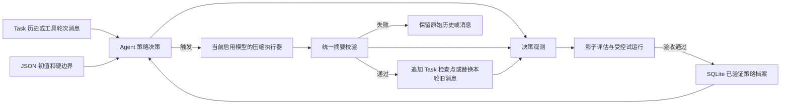
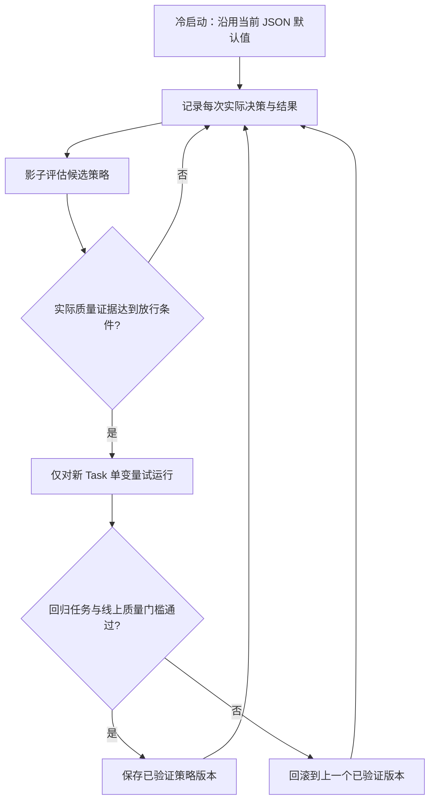

# 上下文压缩策略自优化：讨论记录与后续方案

> 状态：设计讨论已记录，尚未实施。本文不改变运行时行为；实施前须形成独立实施文档和测试验收文档。

## 1. 本轮确认的结论

1. `turnThreshold=12`、`charThreshold=24000`、`summaryMaxChars=12000` 继续作为冷启动默认值。本轮不重新争论这三个初值是否最优。
2. 后续重点是建立有证据、有质量门槛、可回滚的自优化机制，而不是简单地自动增减三个数字。
3. 压缩触发权属于 Agent 内部策略。不得由模型宣告压缩时机，也不得按 GPT、MiniMax 等厂商名称写死触发分支。
4. 多模型差异进入能力适配和独立观测档案；切换模型时不能直接继承另一模型的学习结果。摘要检查点继续使用统一结构。
5. TokenUsage 暂不纳入本方案，也不作为自优化的前置条件。
6. 完整方案属中高复杂度，按阶段建设：先拆分策略与补齐观测、影子评估，再在质量证据充分时开启受控自动优化。

## 2. 当前代码依据与待解决问题

- `code/src/context/compaction-policy.ts`：当前自动策略在未压缩 Task 历史 Turn 数达到阈值，或历史字符数达到阈值时触发。
- `code/src/context/compaction-service.ts`：触发后只压缩已终结的连续前缀；摘要经过结构、来源引用和长度校验，成功后追加检查点，失败时不推进覆盖范围。
- `code/src/loop/agent-loop.ts`：Task 历史压缩发生在构造 ContextPack 之前；同一 Turn 内的工具轮次压缩还复用了 `context.compaction.charThreshold` 和 `summaryMaxChars`。两种压缩的输入增长方式不同，后续调参前必须解耦。
- `code/figo-agent.config.json`：当前阈值与启用模型由统一 JSON 配置；SQLite 已保存历史、检查点、Trace 和模型请求/返回抓包。
- 真实压缩曾暴露长 Turn ID 复制错误；现已使用短引用映射并严格校验。该案例说明 HTTP 成功或摘要文本存在，不等于检查点可用，更不等于关键事实完整。

现有数据不足以证明三个默认值最优，也不足以直接设定可信的自动放行样本量。实施时必须先采集基线，不能把任意数字写成已验证结论。

## 3. 方案取舍

| 方案 | 优点 | 不采用为最终方案的理由 |
| :--- | :--- | :--- |
| 按压缩次数、失败次数直接增减阈值 | 实现简单 | 无法证明摘要保住了关键上下文，也无法区分两个 OR 条件各自的作用 |
| 让模型决定何时压缩 | 可利用模型对文本的判断 | 触发权不再由 Agent 掌控，模型切换后行为不可解释 |
| **受约束的策略学习器** | Agent 决策、全程留痕、质量门槛与回滚明确 | 推荐；分阶段实施，不能跳过质量验收直接开启自动调参 |

## 4. 目标架构与边界

| 模块 | 单一职责 | 不负责 |
| :--- | :--- | :--- |
| `CompactionPolicy` | 根据 Agent 可计算的历史状态、JSON 边界和已验证策略生成触发决定及理由 | 调用模型、评判摘要内容 |
| `CompactionExecutor` | 使用当前启用模型生成摘要；按已验证的端点能力选择输出协议 | 决定何时触发、静默切换模型 |
| `CompactionValidator` | 校验统一摘要结构、来源引用、长度和覆盖范围 | 根据 HTTP 成功推断语义质量 |
| `CompactionObserver` | 记录决策、尝试、结果、策略版本和后续质量证据 | 修改运行配置 |
| `CompactionOptimizer` | 影子评估、单变量试运行、验收、回滚 | 在证据不足时发布新策略 |

JSON 仍是唯一显式运行配置：定义开关、冷启动值、调参边界和放行条件。SQLite 只保存观测、候选和已验证策略状态，不成为第二份人工配置。JSON 显式值优先；配置指纹或摘要协议版本变化时，旧学习结果失效，重新进入观测阶段。优化器不得静默改写 JSON。

## 5. 三个参数的优化规则

### 5.1 触发阈值

`turnThreshold` 与 `charThreshold` 是 OR 关系。每次决策必须记录两个指标、命中的条件、可压缩前缀长度和策略版本。试运行一次只调整一个阈值，否则无法将效果归因到具体变更。Task 历史与工具轮次使用独立策略和配置，不共享同一个自动学习值。

触发前检查是否存在满足原文保留边界的可压缩前缀，避免重复发送无候选内容的压缩请求。`maxTaskHistoryTurns` 暂时保持固定，不加入自动调参。

### 5.2 摘要长度上限

`summaryMaxChars` 与触发阈值分开评估。摘要变短不是质量提升的证据；只有关键事实、约束、已完成工作和未解决问题的保留检查通过，才允许试运行更小的上限。质量证据不足时维持冷启动值。

### 5.3 优先级

按以下顺序验收：上下文连续性与事实保留、摘要/检查点可靠性、无效压缩频率和交互等待时间。不能以调用减少或响应变快换取已知事实丢失。

## 6. 多模型差异的处理

1. 触发流程与模型厂商无关，始终由 Agent 内部策略计算。
2. 以“配置模型 ID、实际端点与模型、摘要提示词版本、摘要结构版本”组成观测档案键。模型切换后先使用 JSON 冷启动值；另一模型的学习状态不自动迁移。
3. 输出协议由适配层按实际验证的端点能力选择。OpenAI 兼容接口本身不能证明中转端点支持全部结构化输出特性。无论采用何种协议，结果都通过同一个 Validator。
4. 摘要检查点保持模型无关的规范结构；旧检查点能够被新模型读取。切换模型不触发静默模型回退，也不改写原始 Turn。
5. 分别观测格式通过率、来源校验失败、关键事实保留和耗时；模型名称只是档案分组，不是硬编码阈值依据。

## 7. 自优化流程与证据

最低观测字段：Task/Turn、策略版本、配置指纹、模型档案键、历史 Turn 数与字符数、可压缩前缀、触发条件、候选阈值、请求与检查点 ID、校验结果/失败原因、耗时、质量评估结果。请求抓包和原始 Turn 仍作为审计依据；新增观测只存必要引用，避免重复保存完整请求或泄露密钥。

影子评估能用历史数据对比“候选策略何时触发、触发多少次”，**不能**据此证明未实际生成的摘要质量。实际质量需抽样核对原始历史中的关键事实、约束、开放问题与摘要的覆盖情况，并用固定回归 Task 验证后续问答。HTTP 200、JSON 合法和来源 ID 合法是必要校验，不是语义完整的充分条件。用户纠错可作为负面信号，但不能仅凭纠错文本自动断定压缩是原因。

受控试运行只作用于新 Task，保持旧策略对照；一次只改变一个参数。放行样本量、候选步长、冷却期和阈值边界须在采集基线后写入实施与验收文档，并由 JSON 管理。出现来源校验失败、关键事实丢失或固定回归退化时撤销候选策略；单次压缩失败时继续使用原始历史，不写失败的检查点。

## 8. 分阶段实施与验收门槛

### 阶段一：策略拆分与可观测影子模式

- 拆分 Task 历史与工具轮次压缩的配置和策略；保持现有真实触发行为。
- 记录每次决策，包括未触发和无可压缩前缀的情况；可按模型档案与策略版本查询。
- 候选策略只计算影子结果，不影响 ContextPack、检查点或 Tool Calling Loop。
- 验收：阈值边界、OR 条件、原文尾部保留、配置优先级、模型切换、失败回退和 Trace/SQLite 一致性通过测试；真实对话行为不回归。

### 阶段二：质量评估与受控自动优化

- 建立固定回归 Task 和人工可复核的关键事实覆盖标准；采集不同启用模型的实际压缩样本。
- 只在质量门槛和样本要求均满足时，对新 Task 启用单变量候选策略；保留对照和回滚入口。
- 验收：摘要语义缺失、格式错误、错误来源、超长摘要、超时、模型切换、配置变更和回滚均有测试；任何质量验收未通过，不放行自动优化。

## 9. 可复用的经验

压缩时机与摘要质量是两个不同问题。字符数和 Turn 数只能描述历史增长，不能替代摘要完整性判断；结构校验与来源校验只能拦截无效输出，不能证明事实未遗漏。自优化若要可信，必须保留原始事实、解释每次策略决策，并允许用真实对照证据撤销错误学习结果。
