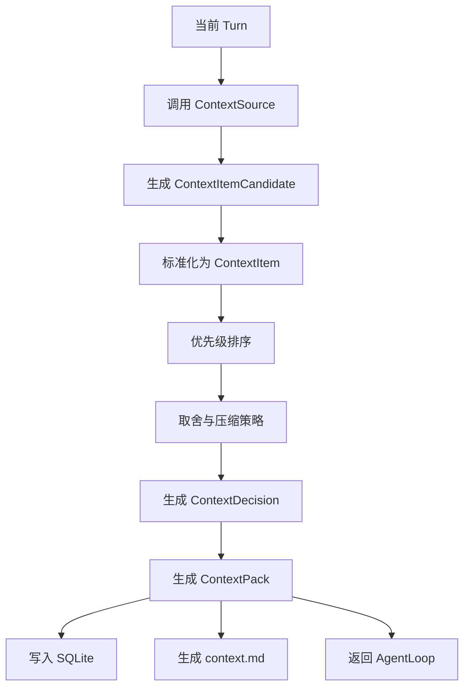
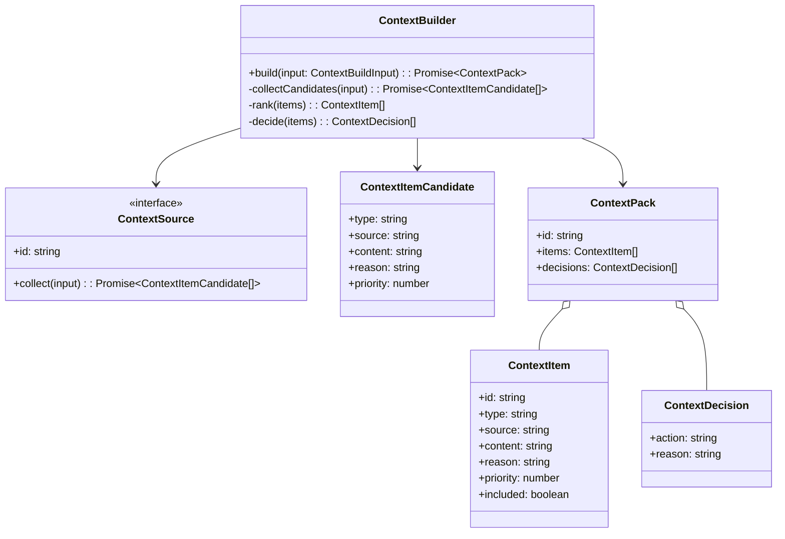
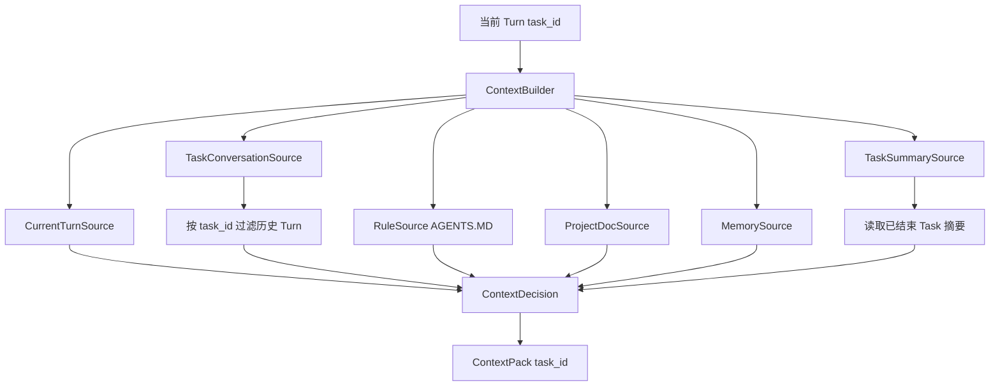

# Context 模块设计

## 文档索引信息

- 背景：本文档位于 `docs/agent/modules/context/`，用于沉淀 Figo Agent V1 的上下文工程设计。
- 目标：讲清 ContextSource、ContextItem、ContextDecision、ContextPack 的职责、生命周期、取舍机制和可复盘设计。
- 标签：上下文工程、ContextPack、ContextSource、上下文取舍、agent harness、Context Engineering。
- 适用范围：V1 上下文构造、后续 TokenUsage、上下文压缩、上下文质量评估和文章素材。
- 后续可用方向：Token 统计、上下文评分、上下文压缩、检索增强、上下文自优化和 AgentLoop 成本治理。
- Task 上下文压缩实施与验收：[COMPACTION_IMPLEMENTATION.md](./COMPACTION_IMPLEMENTATION.md)、[COMPACTION_ACCEPTANCE.md](./COMPACTION_ACCEPTANCE.md)。已实现，验收结果见验收文档。
- 压缩策略自优化讨论记录：[COMPACTION_SELF_OPTIMIZATION.md](./COMPACTION_SELF_OPTIMIZATION.md)。记录分阶段方案、多模型差异和后续验收门槛，尚未实施。
- 压缩策略自优化阶段一：[实施文档](./COMPACTION_SELF_OPTIMIZATION_PHASE1_IMPLEMENTATION.md)、[测试验收文档](./COMPACTION_SELF_OPTIMIZATION_PHASE1_ACCEPTANCE.md)。仅作为后续实施依据，当前未实施、未验收。

## 1. 模块定位

Context 模块负责回答一个核心问题：

```text
当前这一轮 Turn，模型和 Skill 到底需要看到什么？
```

Context 不是聊天记录，也不是 Memory，也不是 Tool 结果集合。Context 是当前 Turn 的模型输入事实包。

V1 的 Context 模块输出 `ContextPack`。`ContextPack` 是当前 Turn 进入 LLMProvider、SkillRunner 和 Reporter 的统一上下文事实源。

## 2. 设计动机

Coding agent 的能力不只取决于模型，还取决于上下文质量。

低质量上下文会造成以下问题：

1. 模型看不到项目规则。
2. 模型读到不相关文件。
3. Memory 污染当前任务。
4. Tool 结果无限回灌导致 token 膨胀。
5. 后续复盘时无法追溯模型当时看到的上下文。

所以 Context 模块必须做到：

1. 有来源。
2. 有理由。
3. 有优先级。
4. 有取舍记录。
5. 有结构化存储。
6. 有人类可读产物。

## 3. 核心边界

```text
Context = 当前 Turn 提供给模型和 Skill 的信息包
Memory = 跨轮、跨会话、跨项目的稳定信息资产
Trace = 本次运行真实发生过的事件流水
Artifact = 给人阅读和复盘的产物
```

Context 模块不把所有历史都塞给模型。Context 模块只负责把当前 Turn 所需信息组织成 `ContextPack`。

V1.2 后，Task 历史不能只包含历史用户输入。上一轮 ToolResult 和最终助手回答属于后续 Turn 判断任务连续性的关键事实，必须随 `task_turn` 历史项进入 ContextPack。

Task 历史项内容结构：

```text
用户输入：
<turn.input>

工具结果：
<tool_results json>

助手回答：
<final assistant answer>
```

这样可以避免“上一轮已经查到系统信息，下一轮又说不知道”的上下文断裂。

## 4. 职责边界

Context 模块负责：

1. 调用 ContextSource 收集候选上下文。
2. 将候选上下文转换为 ContextItem。
3. 按优先级、来源、任务相关性做取舍。
4. 记录 ContextDecision。
5. 生成 ContextPack。
6. 写入 SQLite。
7. 生成 `context.md`。

Context 模块不负责：

1. 不直接执行 Tool。
2. 不直接调用 LLM。
3. 不判断 Skill 是否完成。
4. 不写长期 Memory。
5. 不生成最终用户报告。

## 5. 输入输出

输入：

1. 当前 Session。
2. 当前 Turn。
3. 最近 Turn 列表。
4. 工作区路径。
5. ContextSource 插件集合。
6. MemoryStore 检索结果。

输出：

1. ContextPack。
2. ContextItem。
3. ContextDecision。
4. context_packs、context_items、context_decisions SQLite 记录。
5. `context.md`。
6. Context 相关 TraceEvent。

## 6. V1 ContextSource 分层

V1 使用静态 ContextSource。

| Source | 输入 | 输出 | 优先级 | 说明 |
| :--- | :--- | :--- | :--- | :--- |
| CurrentTurnSource | 当前 Turn | 用户当前输入 | P0 | 必须进入 |
| RuleSource | `AGENTS.MD` | 项目规则 | P1 | 仅在 `context.includeProjectDocs=true` 且路径被配置声明时进入 |
| ConversationSource | 最近 Turn | 对话摘要 | P2 | 控制长度 |
| ProjectDocSource | `readme.md` | 项目说明 | P3 | 仅在 `context.includeProjectDocs=true` 且路径被配置声明时进入 |
| WorkspaceTreeSource | 工作区目录 | 目录结构 | P4 | 限制深度 |
| MemorySource | MemoryStore | 稳定记忆 | P5 | Top 3 - 5 |
| ToolObservationSource | Tool 结果 | 工具摘要 | P6 | V1.2 起随 Task 历史回灌上一轮关键工具观察 |

V1 的 ContextSource 都通过 PluginHost 静态注册。

## 7. Context 生命周期

```text
ContextSource
  -> ContextItemCandidate
  -> ContextItem
  -> ContextDecision
  -> ContextPack
  -> SQLite
  -> context.md
```

每一层职责：

1. `ContextSource`：负责从某个来源收集候选内容。
2. `ContextItemCandidate`：未取舍的候选内容。
3. `ContextItem`：进入上下文流程的结构化条目。
4. `ContextDecision`：记录包含、排除、摘要、截断的原因。
5. `ContextPack`：当前 Turn 的最终上下文包。
6. SQLite：结构化状态源。
7. `context.md`：人类可读复盘产物。

## 8. 运行流程图



## 9. 时序图

```mermaid
sequenceDiagram
  participant Loop as AgentLoop
  participant Builder as ContextBuilder
  participant Sources as ContextSources
  participant Memory as MemoryStore
  participant Store as SQLite
  participant Reporter as Reporter

  Loop->>Builder: build(turn)
  Builder->>Sources: collect(input)
  Sources->>Memory: search(query)
  Memory-->>Sources: MemoryRecord[]
  Sources-->>Builder: candidates
  Builder->>Builder: normalize / rank / decide
  Builder->>Store: save context_pack/items/decisions
  Builder->>Reporter: generate context.md
  Builder-->>Loop: ContextPack
```

## 10. 类图



## 11. 核心数据结构

### 11.1 ContextBuildInput

```ts
interface ContextBuildInput {
  session: Session;
  turn: Turn;
  recentTurns: Turn[];
  workspacePath: string;
}
```

### 11.2 ContextItemCandidate

```ts
interface ContextItemCandidate {
  type: "rule" | "user_input" | "conversation" | "project_doc" | "workspace" | "memory" | "tool_result";
  source: string;
  content: string;
  reason: string;
  priority: number;
}
```

### 11.3 ContextItem

```ts
interface ContextItem {
  id: string;
  contextPackId: string;
  type: "rule" | "user_input" | "conversation" | "project_doc" | "workspace" | "memory" | "tool_result";
  source: string;
  content: string;
  reason: string;
  priority: number;
  included: boolean;
}
```

### 11.4 ContextDecision

```ts
interface ContextDecision {
  id: string;
  contextPackId: string;
  itemId?: string;
  action: "include" | "exclude" | "summarize" | "truncate";
  reason: string;
  createdAt: string;
}
```

### 11.5 ContextPack

```ts
interface ContextPack {
  id: string;
  sessionId: string;
  turnId: string;
  items: ContextItem[];
  decisions: ContextDecision[];
  createdAt: string;
}
```

## 12. V1 取舍策略

V1 不做复杂相关性算法。V1 使用确定性规则取舍。

优先级顺序：

```text
P0 当前 Turn
P1 配置声明的项目规则
P2 最近对话摘要
P3 配置声明的项目文档
P4 目录结构
P5 Memory
P6 Tool 结果摘要
```

包含规则：

1. 当前 Turn 必须进入。
2. 项目文档默认不进入；只有 `code/figo-agent.config.json` 明确开启时进入。
3. 已开启的项目文档只读取 `context.projectDocPaths` 声明路径。
4. 目录结构限制深度。
5. Memory 最多取 3 - 5 条。
6. Tool 结果 V1 只进入 Trace 和 Report，不默认回灌给模型。

排除规则：

1. 与当前 Turn 无关的长文档排除。
2. 重复内容排除。
3. 超出 V1 长度限制的目录项排除。
4. 无证据来源的 Memory 排除。

## 13. V1 长度控制

V1 不实现 TokenUsage，但必须控制上下文规模。

V1 使用字符数和条数控制：

| 类型 | V1 控制 |
| :--- | :--- |
| 当前 Turn | 全量保留 |
| AGENTS.MD | 默认不进入；配置开启后按声明路径进入 |
| readme.md | 默认不进入；配置开启后按声明路径进入 |
| 最近对话 | 最近 N 轮摘要 |
| 目录结构 | 限制深度和条数 |
| Memory | Top 3 - 5 |
| Tool 结果 | 默认不回灌 |

TokenUsage 进入 V2。

## 14. context.md 结构

`context.md` 是 ContextPack 的人类可读产物。

建议结构：

```markdown
# Context Pack

## 当前 Turn

## 已包含上下文

| 类型 | 来源 | 原因 | 优先级 |
| :--- | :--- | :--- | :--- |

## 已排除上下文

| 来源 | 操作 | 原因 |
| :--- | :--- | :--- |

## Memory 命中

## 上下文风险

## 后续建议
```

## 15. 与 AgentLoop 的关系

AgentLoop 调用 ContextBuilder。ContextBuilder 返回 ContextPack。

```text
AgentLoop
  -> ContextBuilder.build(turn)
  -> ContextPack
  -> LLMProvider / SkillRunner / Reporter
```

AgentLoop 不关心具体上下文来源。ContextBuilder 不关心后续 Skill 怎么执行。

这就是依赖倒置：

```text
AgentLoop 依赖 ContextBuilder 抽象
ContextBuilder 依赖 ContextSource 抽象
ContextSource 由插件提供
```

## 16. 与 Memory 的关系

MemorySource 从 MemoryStore 中检索稳定信息。

V1 要求：

1. Memory 必须带 evidence。
2. Memory 命中必须记录来源。
3. Memory 进入 ContextPack 必须写 reason。
4. Memory 不命中也要写 Trace。

Memory 不直接等于 Context。Memory 只有被当前 Turn 选中后，才进入 ContextPack。

## 17. 与 Skill 的关系

Skill 通过 ContextPack 获得执行所需信息。

V1 的 `project-understanding-skill` 需要：

1. 项目规则。
2. README 摘要。
3. 目录结构。
4. 已有项目 Memory。

Skill 不直接自己拼上下文。Skill 只声明需要哪些上下文，由 ContextBuilder 提供。

## 18. 与 Trace 的关系

Context 模块必须写入以下 TraceEvent：

1. `context.build.started`
2. `context.item.candidate`
3. `context.item.included`
4. `context.item.excluded`
5. `context.item.summarized`
6. `context.item.truncated`
7. `context.build.completed`
8. `context.build.failed`

TraceEvent 只记录事实：

1. 来源是什么。
2. 做了什么取舍。
3. 原因是什么。
4. 结果是什么。

## 19. 失败处理矩阵

| 失败位置 | 失败原因 | V1 行为 | TraceEvent |
| :--- | :--- | :--- | :--- |
| RuleSource | `AGENTS.MD` 不存在 | 记录缺失，继续执行 | `context.item.excluded` |
| ProjectDocSource | `readme.md` 不存在 | 记录缺失，继续执行 | `context.item.excluded` |
| WorkspaceTreeSource | 目录读取失败 | 保留当前 Turn 和规则 | `context.build.failed` |
| MemorySource | Memory 查询失败 | 跳过 Memory | `memory.search.failed` |
| ContextBuilder | 候选为空 | 保留当前 Turn | `context.build.completed` |
| Artifact | `context.md` 写入失败 | SQLite 保持状态源 | `artifact.failed` |

## 20. V1 实现范围

V1 实现：

1. ContextBuilder。
2. RuleSource。
3. CurrentTurnSource。
4. ConversationSource。
5. ProjectDocSource。
6. WorkspaceTreeSource。
7. MemorySource。
8. ContextItem。
9. ContextDecision。
10. ContextPack。
11. context.md。

V1 不实现：

1. TokenUsage。
2. 向量检索。
3. 复杂相关性评分。
4. 自动上下文压缩模型调用。
5. 跨项目上下文缓存。

压缩机制的设计边界：agent 内部的 `CompactionPolicy` 决定何时压缩，LLMProvider 只接收摘要生成请求；触发流程不读取模型厂商名称，也不依赖厂商返回的上下文错误。策略参数进入统一 JSON 配置。原始 Turn 与 LLM 抓包保留在 SQLite，压缩摘要记录来源范围并写入 Trace。`/compact`、自动 Task 检查点和工具循环轮次摘要已实现。

## 21. V2/V3 扩展点

V2：

1. 引入 TokenUsage。
2. 增加 agent 内部的 CompactionPolicy 与手动 `/compact` 入口；触发阈值见压缩实施文档，不引入 ContextBudget 作为前置模块。
3. 增加 ContextSource 级别 token 占比。
4. 增加摘要前后 token 对比。

V3：

1. 混合检索。
2. 向量检索。
3. 上下文质量评分。
4. 基于 Trace 的上下文自优化建议。

## 22. 可沉淀的文章观点

1. 上下文工程不是把内容塞进 prompt，而是构造可解释的信息包。
2. Context 和 Memory 必须分开，Memory 只有被选中才进入 Context。
3. 每个上下文条目都要有来源、理由和取舍记录。
4. Tool 结果不默认回灌模型，是控制 token 膨胀的关键。
5. ContextPack 是 agent 复盘的核心证据。

## 23. 个人经验提炼

Context 模块最容易犯两个错误：

1. 把所有资料都塞给模型。
2. 把上下文选择逻辑写死在 AgentLoop 里。

V1 要避免这两个问题：

1. ContextSource 负责收集。
2. ContextBuilder 负责取舍。
3. AgentLoop 只消费 ContextPack。
4. SQLite 保存结构化上下文事实。
5. `context.md` 提供人类复盘入口。

这就是把上下文工程从 prompt 拼接升级为 agent harness 模块的关键。

## 24. V1.1 Task Context Boundary

Task 引入后，ContextBuilder 的历史检索范围从 Session 收窄为当前 Task。

核心规则：

1. 当前 Turn 必须进入 ContextPack。
2. 当前 Task 内最近 Turn 进入 ConversationSource。
3. 同 Session 的其他 Task 不默认进入 ContextPack。
4. Task Summary 可以作为后续 Task 的摘要上下文来源。
5. Memory 仍然是跨 Task 稳定信息，但必须经过 ContextDecision。

### 24.1 Task 内上下文构造流程图



### 24.2 数据结构增量

```ts
interface ContextBuildInput {
  session: Session;
  task: Task;
  turn: Turn;
  recentTaskTurns: Turn[];
  workspacePath: string;
}

interface ContextPack {
  id: string;
  sessionId: string;
  taskId: string;
  turnId: string;
  items: ContextItem[];
  decisions: ContextDecision[];
  createdAt: string;
}
```

### 24.3 取舍规则增量

| 来源 | Task 规则 | 默认动作 |
| --- | --- | --- |
| 当前 Turn | 必须属于当前 Task | include |
| 当前 Task 历史 | 只取相同 `task_id` | include / summarize |
| 其他 Task 明细 | 不直接进入 | exclude |
| 已结束 Task Summary | 按相关性进入 | include / summarize |
| Memory | 跨 Task 可用 | include / exclude |

这让单个任务具备连续上下文，同时避免不同任务的聊天历史互相污染。
