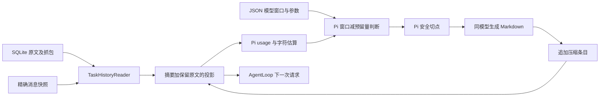
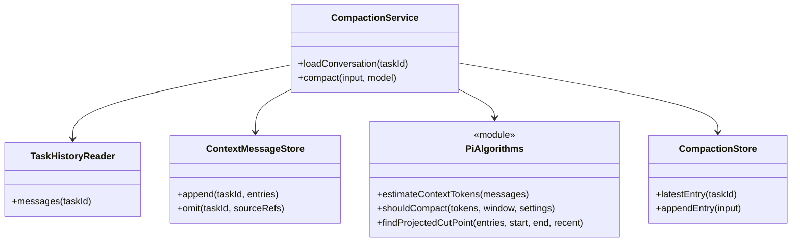
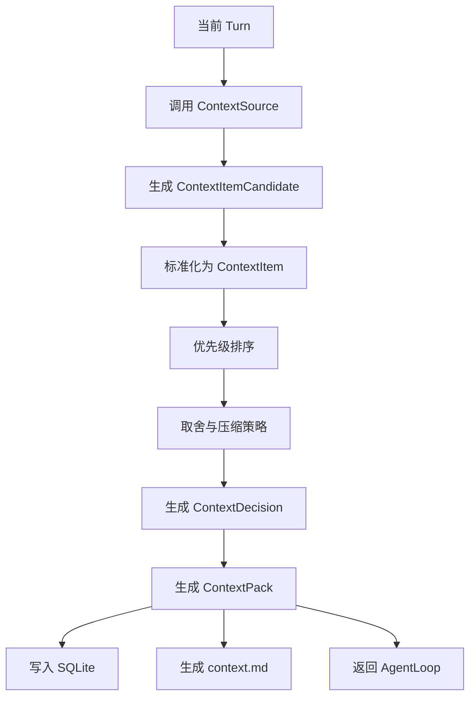
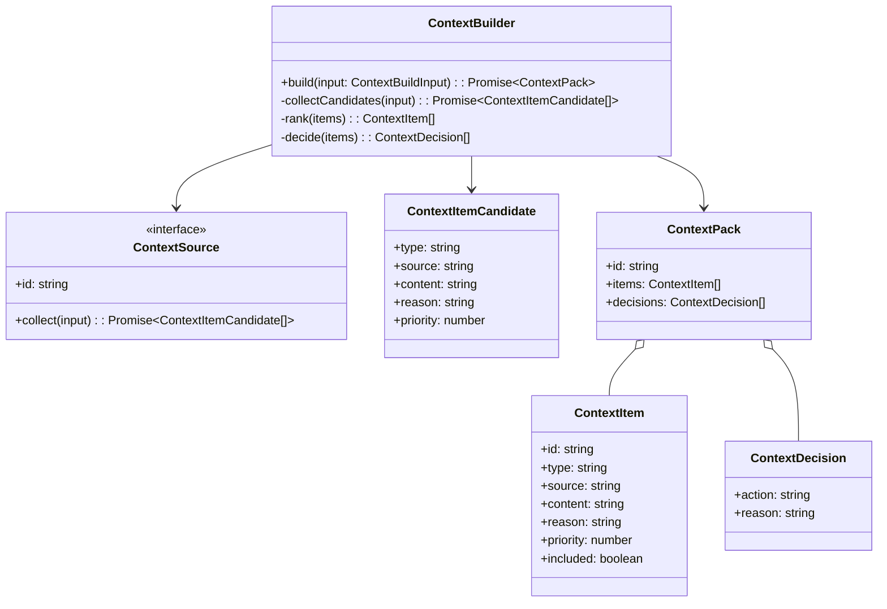
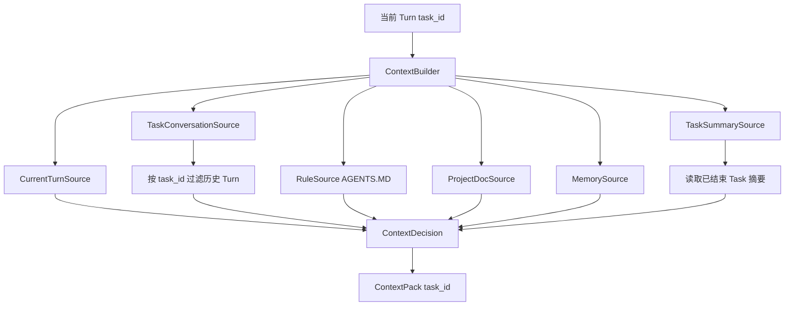

# Context 模块设计

> 2026-10-16 用户确认本阶段完结，进入实际使用与反馈阶段；恢复进度先读 [阶段收尾记录](./2026-10-16-Pi压缩与原生工具协议阶段收尾.md)，不自动续做策略或大窗口实验。当前实现以 [Pi 实施计划](./2026-10-15-Pi上下文压缩对齐实施计划.md) 与 [验收记录](./2026-10-15-Pi上下文压缩对齐测试验收.md) 为准。三模型测试窗口功能验收通过，实际大窗口容量未完整验收。下文 V1 章节保留设计演进，不代表仍使用固定 Turn/字符阈值。

## 当前 Pi 实现

固定移植 Pi 提交 `6a1f799b675c8cb98320b71ff7ee44f160fe8d66` 的纯算法，保留 MIT 许可证，不引入整个 Pi 运行时。源码、保留函数和宿主差异见 [移植说明](../../../../code/third-party/pi/README.md)。

1. **时机**：新用户输入追加前检查历史；工具结果追加且确需下一次模型调用时再检查。最终答复后不预先压缩。
2. **判断**：严格使用 `contextTokens > contextWindow - reserveTokens`。有效请求 usage 加新增消息估算；模型、系统或工具定义变化使旧锚点失效，无有效锚点则估算当前投影、系统和工具定义。Task 累计用量不参与控制。
3. **方法**：本地算法选择安全切点，同一选中模型生成有损 Markdown 摘要。默认预留 16384 token、近期保留约 20000 token、摘要工具预览 2000 字符；全部参数在 JSON。窗口未知不自动猜值，手动仍可用；用户显式配置的官方参考值与中转端点实测能力分开说明。
4. **存储**：`context_messages` 追加保存实际消息、反馈、合成失败结果与 usage 作用域；`context_compactions` 追加保存摘要、首个保留来源、覆盖范围和文件操作。旧 JSON 检查点仅兼容读取，新的 Markdown 不受旧来源 schema 拦截。
5. **恢复**：明确超限和符合 Pi 判定的最终长度失败仅压缩重试一次。失败尝试只从投影省略，原文和成本保留。截断工具调用不执行；摘要失败、取消与基线冲突不写成功条目。

### 当前 GPT 中转容量配置（2026-10-16）

用户明确同意当前中转 `gpt-6.1-sol` 参考同名官方模型。已核对 [OpenAI 官方模型页](https://developers.openai.com/api/docs/models/gpt-6.1-sol)：上下文窗口 1,050,000 Token、最大输出 128,000 Token。本机 JSON 的 `gpt-relay` 条目据此设置 `contextWindow=1050000`、`maxTokens=128000`，`metadataSource` 保存该官方页面。

在自动压缩开启且没有模型覆盖时，使用原有严格公式：`contextTokens > 1050000 - 16384`，即超过 1,033,616 Token 才触发；相等不触发。普通摘要请求上限仍为 `min(floor(0.8 × 16384), 128000) = 13107`，不把模型最大输出直接当作每次请求输出量。

这次仅补充本机模型元数据，不修改 Pi 策略、其他模型、默认模型、密钥或中转的请求字段映射。该端点 `/models` 没有返回容量字段，当前数值为用户授权的官方参考，不是中转端点容量探测结果；此前验收的 `partial` 与实际容量未验证结论不改写。请求协议也不因参考官方容量而自动切换。

本次通过实际配置加载验证：边界 1,033,616 不触发，1,033,617 触发；配置指纹核对确认除 GPT 中转这三项元数据之外，其余配置及密钥未变。`runtime-config`、`model-settings`、`pi-compaction-settings`、`compaction-policy` 共 4 文件 122 项测试通过，未运行大窗口端点容量探测。

### 三模型压缩配置补齐（2026-10-16）

运行配置统一位于 `code/figo-agent.config.json`。各模型的 `llm[]` 均显式配置 `contextWindow`、`maxTokens`、`maxTokensField` 和 `metadataSource`；压缩策略仍由 `context.compaction` 统一控制，不复制三份相同参数。

| 模型配置 ID | 模型 ID | 上下文窗口 `contextWindow` | 最大输出 `maxTokens` | 请求字段 `maxTokensField` | 自动压缩条件 |
| :--- | :--- | ---: | ---: | :--- | :--- |
| `minimax` | `MiniMax-M3.1-Flash-Preview` | 1,000,000 | 524,288 | `max_completion_tokens` | `contextTokens > 983616` |
| `gpt-relay` | `gpt-6.1-sol` | 1,050,000 | 128,000 | `max_tokens` | `contextTokens > 1033616` |
| `deepseek` | `deepseek-v4-pro` | 1,048,576 | 393,216 | `max_tokens` | `contextTokens > 1032192` |

数据依据：[MiniMax 官方接口文档](https://platform.minimax.cn/docs/api-reference/text-chat-openai)、[OpenAI 官方模型页](https://developers.openai.com/api/docs/models/gpt-6.1-sol)、[DeepSeek 官方模型列表](https://api-docs.deepseek.com/api/list-models/)。MiniMax 官方推荐单次输出限制为 131072，但最大上限为 524288；本项目 `maxTokens` 记录最大能力，不把推荐值当作能力上限。GPT 中转继续使用用户授权的官方容量参考，不代表端点容量实测通过。

三个模型共用以下配置：

```json
{
  "enabled": true,
  "reserveTokens": 16384,
  "keepRecentTokens": 20000,
  "summaryToolResultMaxChars": 2000,
  "modelOverrides": {}
}
```

- `contextWindow` 参与触发判断；`maxTokens` 仅限制摘要请求的最大输出，不是压缩阈值。
- 普通历史摘要输出上限为 `min(floor(0.8 × reserveTokens), maxTokens)`，当前三个模型均为 13107 Token；Turn 前缀摘要为 `min(floor(0.5 × reserveTokens), maxTokens)`，均为 8192 Token。
- `maxTokensField` 只处理服务接口字段差异。GPT 中转和 DeepSeek 显式填写此前省略时的 `max_tokens`，不改变原请求行为；不因采用官方容量而切换 GPT 中转协议。
- 当前没有差异化需求，`modelOverrides` 保持空对象。确需覆盖时使用 `<llm.id>/<model>` 作为键，仅覆盖 `reserveTokens`、`keepRecentTokens`，其余继续继承全局配置。
- 本轮不更改 Pi 算法、默认模型、密钥或历史验收结论。手动编辑配置后需重启对应 CLI 或工作台服务，使启动时加载的容量参数生效。

本轮配置验收：实际加载三个模型后分别检查阈值相等不触发、加 1 触发，共 6 个边界断言；普通摘要与前缀摘要上限共 6 个断言通过。配置指纹确认除本轮声明的四处字段变化外，其余配置及密钥未变。`runtime-config`、`model-settings`、`pi-compaction-settings`、`compaction-policy`、`openai-compatible-provider` 共 5 文件 196 项测试通过。确认工作台没有运行中 Run 或终端命令后，已重启本地 4322 服务；`/api/v1/settings/models` 返回三个模型的完整容量、请求字段映射和来源。本轮未执行真实大窗口容量探测。





`ContextPack` 是构建时的可解释记录；每次实际发送的消息、工具定义及轮内压缩结果以抓包为准。它们不是始终不变的同一份请求。脱敏 Trace 仅记消息引用，不作为原文回放源，开发文档不参与控制。

### 收益与边界

| 旧路径 | 新路径 | 可以验证的收益 |
| :--- | :--- | :--- |
| 12 Turn 或 24000 字符 | 所选窗口减预留量 | 不因固定聊天次数而压缩；严格阈值可测试 |
| 完整 Turn 与另一套轮内摘要 | 同一套消息级准备和 Markdown | 长单次工具交互可选切点，近期工具配对保留 |
| 从下一请求反推结果 | 实际消息先落库 | 无下一抓包或取消后仍可重建反馈和批次预览 |
| 摘要必须复述长来源 ID | 来源元数据独立保存 | 不因未复述 ID 拒绝可用 Markdown，程序保留真实来源 |

这些是机制与正确性收益，不自动等于净成本、速度或普遍语义质量改善。最新收尾修复了原生正文误判，真实三模型三次配对18/18后续分支通过，14条摘要进入下一请求，可见保留原文逐条一致；自动化74文件705项通过。中转实际窗口未知，最终partial，不授予容量整体放行。当前样本中三个模型的开启分支累计输入与耗时中位数均增加；生产窗口与R/K未改，测试窗口49152不写回模型能力。首轮失败保留在第八节，最新数值见 [验收记录第九节](./2026-10-15-Pi上下文压缩对齐测试验收.md#九原生协议修复后三次配对验收)。学习资料见 [机制与主流实现对照](./2026-10-15-上下文压缩机制与主流实现对照.md)。

## 文档索引信息

- 背景：本文档位于 `docs/agent/modules/context/`，用于沉淀 Figo Agent V1 的上下文工程设计。
- 目标：讲清 ContextSource、ContextItem、ContextDecision、ContextPack 的职责、生命周期、取舍机制和可复盘设计。
- 标签：上下文工程、ContextPack、ContextSource、上下文取舍、agent harness、Context Engineering。
- 适用范围：V1 上下文构造、后续 TokenUsage、上下文压缩、上下文质量评估和文章素材。
- 后续可用方向：Token 统计、上下文评分、上下文压缩、检索增强、上下文自优化和 AgentLoop 成本治理。
- 旧压缩演进记录：[COMPACTION_IMPLEMENTATION.md](./COMPACTION_IMPLEMENTATION.md)、[COMPACTION_ACCEPTANCE.md](./COMPACTION_ACCEPTANCE.md)。旧固定阈值已被本页顶部 Pi 方案替代。
- 压缩策略自优化讨论记录：[COMPACTION_SELF_OPTIMIZATION.md](./COMPACTION_SELF_OPTIMIZATION.md)。记录分阶段方案、多模型差异和后续验收门槛，尚未实施。
- 压缩策略自优化阶段一：[实施文档](./COMPACTION_SELF_OPTIMIZATION_PHASE1_IMPLEMENTATION.md)、[测试验收文档](./COMPACTION_SELF_OPTIMIZATION_PHASE1_ACCEPTANCE.md)。仅作为后续实施依据，当前未实施、未验收。

## 1. 模块定位

Context 模块负责回答一个核心问题：

```text
当前这一轮 Turn，模型和 Skill 到底需要看到什么？
```

Context 不是聊天记录，也不是 Memory，也不是 Tool 结果集合。Context 是当前 Turn 的模型输入事实包。

V1 的 Context 模块输出 `ContextPack`。`ContextPack` 是当前 Turn 进入 LLMProvider、SkillRunner 和 Reporter 的统一上下文事实源。

## 2. 设计动机

Coding agent 的能力不只取决于模型，还取决于上下文质量。

低质量上下文会造成以下问题：

1. 模型看不到项目规则。
2. 模型读到不相关文件。
3. Memory 污染当前任务。
4. Tool 结果无限回灌导致 token 膨胀。
5. 后续复盘时无法追溯模型当时看到的上下文。

所以 Context 模块必须做到：

1. 有来源。
2. 有理由。
3. 有优先级。
4. 有取舍记录。
5. 有结构化存储。
6. 有人类可读产物。

## 3. 核心边界

```text
Context = 当前 Turn 提供给模型和 Skill 的信息包
Memory = 跨轮、跨会话、跨项目的稳定信息资产
Trace = 本次运行真实发生过的事件流水
Artifact = 给人阅读和复盘的产物
```

Context 模块不把所有历史都塞给模型。Context 模块只负责把当前 Turn 所需信息组织成 `ContextPack`。

V1.2 后，Task 历史不能只包含历史用户输入。上一轮 ToolResult 和最终助手回答属于后续 Turn 判断任务连续性的关键事实，必须随 `task_turn` 历史项进入 ContextPack。

Task 历史项内容结构：

```text
用户输入：
<turn.input>

工具结果：
<tool_results json>

助手回答：
<final assistant answer>
```

这样可以避免“上一轮已经查到系统信息，下一轮又说不知道”的上下文断裂。

## 4. 职责边界

Context 模块负责：

1. 调用 ContextSource 收集候选上下文。
2. 将候选上下文转换为 ContextItem。
3. 按优先级、来源、任务相关性做取舍。
4. 记录 ContextDecision。
5. 生成 ContextPack。
6. 写入 SQLite。
7. 生成 `context.md`。

Context 模块不负责：

1. 不直接执行 Tool。
2. 不直接调用 LLM。
3. 不判断 Skill 是否完成。
4. 不写长期 Memory。
5. 不生成最终用户报告。

## 5. 输入输出

输入：

1. 当前 Session。
2. 当前 Turn。
3. 最近 Turn 列表。
4. 工作区路径。
5. ContextSource 插件集合。
6. MemoryStore 检索结果。

输出：

1. ContextPack。
2. ContextItem。
3. ContextDecision。
4. context_packs、context_items、context_decisions SQLite 记录。
5. `context.md`。
6. Context 相关 TraceEvent。

## 6. V1 ContextSource 分层

当前实现由 ContextBuilder 组装以下来源；项目文档不再依据源工程路径默认注入。

| Source | 输入 | 输出 | 优先级 | 说明 |
| :--- | :--- | :--- | :--- | :--- |
| CurrentTurnSource | 当前 Turn | 用户当前输入 | P0 | 必须进入 |
| TaskHistorySource | 当前 Task 历史与压缩检查点 | 历史事实 | P1 | 不跨 Task；压缩失败回退原始历史 |
| FileReferenceSource | 用户显式引用 | 文件片段 | P2 | 校验版本和行范围 |
| MemorySource | MemoryStore | 稳定记忆 | P3 | 由 `context.includeMemory` 控制 |
| ToolObservationSource | 历史及当前 Tool 结果 | 工具观察 | P1/P2 | 历史走 Task 历史，当前走 Tool Calling Loop |

提示词配置由 AgentLoop 组装到模型消息，不属于 ContextBuilder 的文档来源。

## 7. Context 生命周期

```text
ContextSource
  -> ContextItemCandidate
  -> ContextItem
  -> ContextDecision
  -> ContextPack
  -> SQLite
  -> context.md
```

每一层职责：

1. `ContextSource`：负责从某个来源收集候选内容。
2. `ContextItemCandidate`：未取舍的候选内容。
3. `ContextItem`：进入上下文流程的结构化条目。
4. `ContextDecision`：记录包含、排除、摘要、截断的原因。
5. `ContextPack`：当前 Turn 的最终上下文包。
6. SQLite：结构化状态源。
7. `context.md`：人类可读复盘产物。

## 8. 运行流程图



## 9. 时序图

```mermaid
sequenceDiagram
  participant Loop as AgentLoop
  participant Builder as ContextBuilder
  participant Sources as ContextSources
  participant Memory as MemoryStore
  participant Store as SQLite
  participant Reporter as Reporter

  Loop->>Builder: build(turn)
  Builder->>Sources: collect(input)
  Sources->>Memory: search(query)
  Memory-->>Sources: MemoryRecord[]
  Sources-->>Builder: candidates
  Builder->>Builder: normalize / rank / decide
  Builder->>Store: save context_pack/items/decisions
  Builder->>Reporter: generate context.md
  Builder-->>Loop: ContextPack
```

## 10. 类图



## 11. 核心数据结构

### 11.1 ContextBuildInput

```ts
interface ContextBuildInput {
  session: Session;
  turn: Turn;
  recentTurns: Turn[];
  workspacePath: string;
}
```

### 11.2 ContextItemCandidate

```ts
interface ContextItemCandidate {
  type: "rule" | "user_input" | "conversation" | "project_doc" | "workspace" | "memory" | "tool_result";
  source: string;
  content: string;
  reason: string;
  priority: number;
}
```

### 11.3 ContextItem

```ts
interface ContextItem {
  id: string;
  contextPackId: string;
  type: "rule" | "user_input" | "conversation" | "project_doc" | "workspace" | "memory" | "tool_result";
  source: string;
  content: string;
  reason: string;
  priority: number;
  included: boolean;
}
```

### 11.4 ContextDecision

```ts
interface ContextDecision {
  id: string;
  contextPackId: string;
  itemId?: string;
  action: "include" | "exclude" | "summarize" | "truncate";
  reason: string;
  createdAt: string;
}
```

### 11.5 ContextPack

```ts
interface ContextPack {
  id: string;
  sessionId: string;
  turnId: string;
  items: ContextItem[];
  decisions: ContextDecision[];
  createdAt: string;
}
```

## 12. V1 取舍策略

V1 不做复杂相关性算法。V1 使用确定性规则取舍。

优先级顺序：

```text
P0 当前 Turn
P1 当前 Task 历史与压缩检查点
P2 用户显式文件引用
P3 Memory
```

包含规则：

1. 当前 Turn 必须进入。
2. Agent 源工程文档不作为用户工作区的默认上下文。
3. 用户显式文件引用按工作区路径和文件版本校验后进入。
4. 历史 Tool 结果按 Task 历史构建规则进入，当前 Tool 结果由 Tool Calling Loop 回灌。
5. 自定义系统指令和持久用户指令由运行时提示词配置组装，不由 ContextBuilder 读取源工程文档。

排除规则：

1. 与当前 Turn 无关的长文档排除。
2. 重复内容排除。
3. 超出 V1 长度限制的目录项排除。
4. 无证据来源的 Memory 排除。

## 13. V1 长度控制

V1 不实现 TokenUsage，但必须控制上下文规模。

V1 使用字符数和条数控制：

| 类型 | V1 控制 |
| :--- | :--- |
| 当前 Turn | 全量保留 |
| AGENTS.MD | 默认不进入；配置开启后按声明路径进入 |
| readme.md | 默认不进入；配置开启后按声明路径进入 |
| 最近对话 | 最近 N 轮摘要 |
| 目录结构 | 限制深度和条数 |
| Memory | Top 3 - 5 |
| Tool 结果 | 默认不回灌 |

TokenUsage 进入 V2。

## 14. context.md 结构

`context.md` 是 ContextPack 的人类可读产物。

建议结构：

```markdown
# Context Pack

## 当前 Turn

## 已包含上下文

| 类型 | 来源 | 原因 | 优先级 |
| :--- | :--- | :--- | :--- |

## 已排除上下文

| 来源 | 操作 | 原因 |
| :--- | :--- | :--- |

## Memory 命中

## 上下文风险

## 后续建议
```

## 15. 与 AgentLoop 的关系

AgentLoop 调用 ContextBuilder。ContextBuilder 返回 ContextPack。

```text
AgentLoop
  -> ContextBuilder.build(turn)
  -> ContextPack
  -> LLMProvider / SkillRunner / Reporter
```

AgentLoop 不关心具体上下文来源。ContextBuilder 不关心后续 Skill 怎么执行。

这就是依赖倒置：

```text
AgentLoop 依赖 ContextBuilder 抽象
ContextBuilder 依赖 ContextSource 抽象
ContextSource 由插件提供
```

## 16. 与 Memory 的关系

MemorySource 从 MemoryStore 中检索稳定信息。

V1 要求：

1. Memory 必须带 evidence。
2. Memory 命中必须记录来源。
3. Memory 进入 ContextPack 必须写 reason。
4. Memory 不命中也要写 Trace。

Memory 不直接等于 Context。Memory 只有被当前 Turn 选中后，才进入 ContextPack。

## 17. 与 Skill 的关系

Skill 通过 ContextPack 获得执行所需信息。

V1 的 `project-understanding-skill` 需要：

1. 项目规则。
2. README 摘要。
3. 目录结构。
4. 已有项目 Memory。

Skill 不直接自己拼上下文。Skill 只声明需要哪些上下文，由 ContextBuilder 提供。

## 18. 与 Trace 的关系

Context 模块必须写入以下 TraceEvent：

1. `context.build.started`
2. `context.item.candidate`
3. `context.item.included`
4. `context.item.excluded`
5. `context.item.summarized`
6. `context.item.truncated`
7. `context.build.completed`
8. `context.build.failed`

TraceEvent 只记录事实：

1. 来源是什么。
2. 做了什么取舍。
3. 原因是什么。
4. 结果是什么。

## 19. 失败处理矩阵

| 失败位置 | 失败原因 | V1 行为 | TraceEvent |
| :--- | :--- | :--- | :--- |
| RuleSource | `AGENTS.MD` 不存在 | 记录缺失，继续执行 | `context.item.excluded` |
| ProjectDocSource | `readme.md` 不存在 | 记录缺失，继续执行 | `context.item.excluded` |
| WorkspaceTreeSource | 目录读取失败 | 保留当前 Turn 和规则 | `context.build.failed` |
| MemorySource | Memory 查询失败 | 跳过 Memory | `memory.search.failed` |
| ContextBuilder | 候选为空 | 保留当前 Turn | `context.build.completed` |
| Artifact | `context.md` 写入失败 | SQLite 保持状态源 | `artifact.failed` |

## 20. V1 实现范围

V1 实现：

1. ContextBuilder。
2. RuleSource。
3. CurrentTurnSource。
4. ConversationSource。
5. ProjectDocSource。
6. WorkspaceTreeSource。
7. MemorySource。
8. ContextItem。
9. ContextDecision。
10. ContextPack。
11. context.md。

V1 不实现：

1. TokenUsage。
2. 向量检索。
3. 复杂相关性评分。
4. 自动上下文压缩模型调用。
5. 跨项目上下文缓存。

当前边界见本文顶部：正常触发由 Agent 按模型容量配置判断，明确超限另有一次恢复路径；原始记录和实际消息快照保留在 SQLite。旧的轮内 JSON 摘要路径已经移除。

## 21. V2/V3 扩展点

V2：

1. 引入 TokenUsage。
2. 增加 agent 内部的 CompactionPolicy 与手动 `/compact` 入口；触发阈值见压缩实施文档，不引入 ContextBudget 作为前置模块。
3. 增加 ContextSource 级别 token 占比。
4. 增加摘要前后 token 对比。

V3：

1. 混合检索。
2. 向量检索。
3. 上下文质量评分。
4. 基于 Trace 的上下文自优化建议。

## 22. 可沉淀的文章观点

1. 上下文工程不是把内容塞进 prompt，而是构造可解释的信息包。
2. Context 和 Memory 必须分开，Memory 只有被选中才进入 Context。
3. 每个上下文条目都要有来源、理由和取舍记录。
4. Tool 结果不默认回灌模型，是控制 token 膨胀的关键。
5. ContextPack 是 agent 复盘的核心证据。

## 23. 个人经验提炼

Context 模块最容易犯两个错误：

1. 把所有资料都塞给模型。
2. 把上下文选择逻辑写死在 AgentLoop 里。

V1 要避免这两个问题：

1. ContextSource 负责收集。
2. ContextBuilder 负责取舍。
3. AgentLoop 只消费 ContextPack。
4. SQLite 保存结构化上下文事实。
5. `context.md` 提供人类复盘入口。

这就是把上下文工程从 prompt 拼接升级为 agent harness 模块的关键。

## 24. V1.1 Task Context Boundary

Task 引入后，ContextBuilder 的历史检索范围从 Session 收窄为当前 Task。

核心规则：

1. 当前 Turn 必须进入 ContextPack。
2. 当前 Task 内最近 Turn 进入 ConversationSource。
3. 同 Session 的其他 Task 不默认进入 ContextPack。
4. Task Summary 可以作为后续 Task 的摘要上下文来源。
5. Memory 仍然是跨 Task 稳定信息，但必须经过 ContextDecision。

### 24.1 Task 内上下文构造流程图



### 24.2 数据结构增量

```ts
interface ContextBuildInput {
  session: Session;
  task: Task;
  turn: Turn;
  recentTaskTurns: Turn[];
  workspacePath: string;
}

interface ContextPack {
  id: string;
  sessionId: string;
  taskId: string;
  turnId: string;
  items: ContextItem[];
  decisions: ContextDecision[];
  createdAt: string;
}
```

### 24.3 取舍规则增量

| 来源 | Task 规则 | 默认动作 |
| --- | --- | --- |
| 当前 Turn | 必须属于当前 Task | include |
| 当前 Task 历史 | 只取相同 `task_id` | include / summarize |
| 其他 Task 明细 | 不直接进入 | exclude |
| 已结束 Task Summary | 按相关性进入 | include / summarize |
| Memory | 跨 Task 可用 | include / exclude |

这让单个任务具备连续上下文，同时避免不同任务的聊天历史互相污染。
