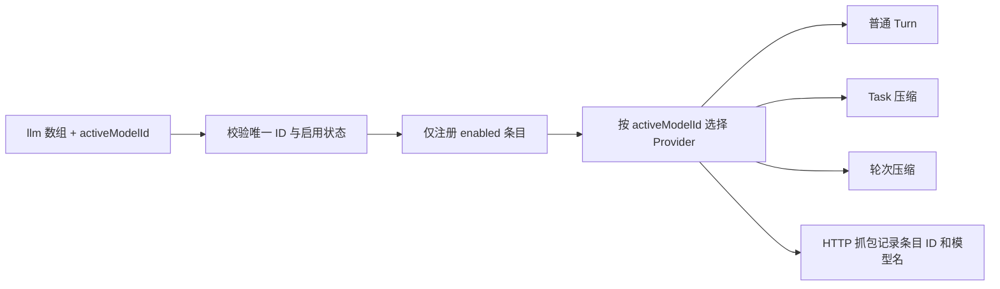
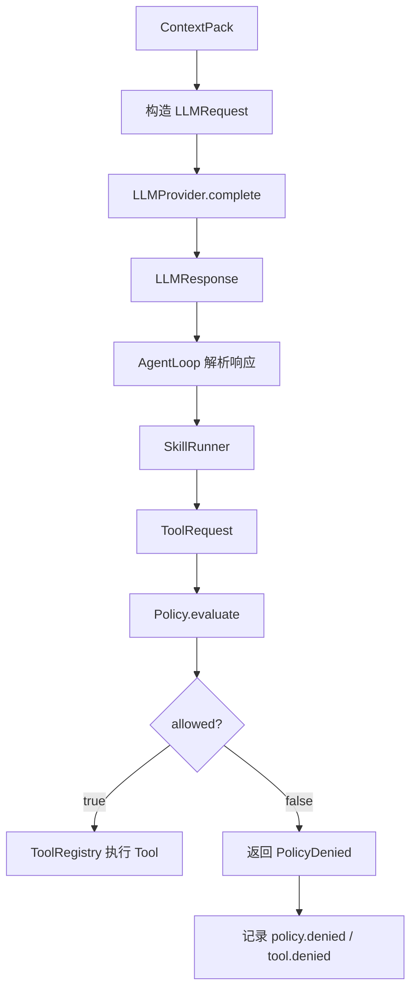
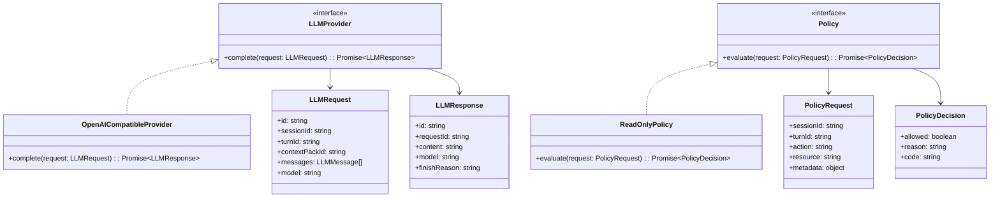
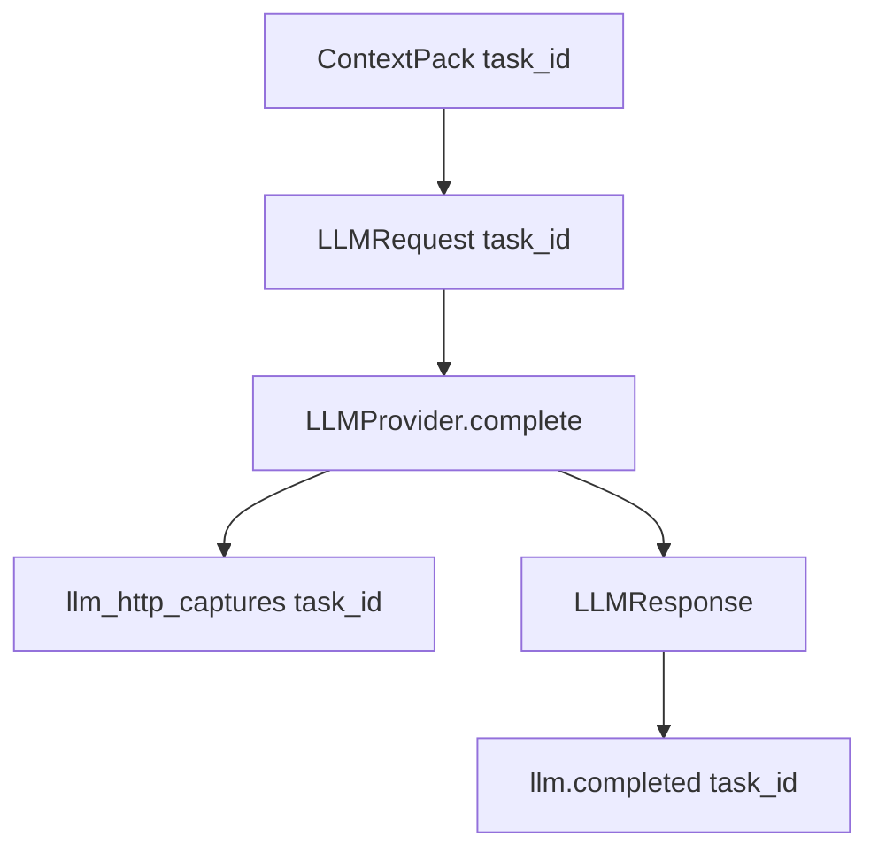

# LLM / Policy 模块设计

## 文档索引信息

- 背景：本文档位于 `docs/agent/modules/llm-policy/`，用于沉淀 LLMProvider 和 Policy 模块设计。
- 目标：讲清模型调用抽象、只读权限边界、Policy 决策、TraceEvent 和 V2 权限升级路径。
- 标签：LLMProvider、Policy、模型抽象、安全边界、只读模式、权限控制。
- 适用范围：V1 模型接入、只读工具调用、AgentLoop 模型阶段、ToolRegistry 权限判断。
- 后续可用方向：多模型适配、权限分级、用户确认、TokenUsage、模型路由、文章素材。

## 1. 模块定位

### 多模型运行配置（V1.2）

`figo-agent.config.json` 的 `llm` 是模型条目数组，每项以唯一 `id` 注册一个 `llmProvider` 能力。`enabled` 控制该能力是否装配；顶层 `activeModelId` 明确指定当前 Session 使用哪一个已启用条目。允许多个条目同时 `enabled=true`，但普通 Turn、Task 压缩与轮次压缩都只调用当前选中条目。修改 JSON 后重启 CLI 生效；当前不提供运行中的切换命令或自动故障回退。

```json
{
  "version": 2,
  "activeModelId": "gpt-relay",
  "llm": [
    { "id": "minimax", "enabled": true, "provider": "openai-compatible", "apiKey": "", "baseUrl": "https://api.minimaxi.com/v1", "model": "MiniMax-M3" },
    { "id": "gpt-relay", "enabled": true, "provider": "openai-compatible", "apiKey": "", "baseUrl": "https://code.aicodeme.xyz/v1", "model": "gpt-5.6-sol" }
  ]
}
```

本机 `figo-agent.config.json` 中的 `apiKey` 填真实密钥；文档中的 JSON 片段保持空值。该文件被 Git 忽略，不能提交到版本库。`provider` 当前只接受 `openai-compatible`，表示调用协议，不是厂商名称。抓包的 `provider` 字段写模型条目 `id`，`model` 字段写实际请求模型名。`activeModelId` 缺失、指向关闭或不存在的条目、重复 ID、未知协议时启动报错，不改用其他模型。旧版单对象 `llm` 仍可读取，映射为 `id=minimax` 的单条启用配置；迁移后应改用数组格式。



LLMProvider 和 Policy 是两个独立变化点。

LLMProvider 负责模型调用：

```text
ContextPack -> LLMRequest -> LLMProvider -> LLMResponse
```

Policy 负责能力边界：

```text
ToolRequest -> Policy.evaluate -> PolicyDecision -> allow / deny
```

模型负责生成推理结果。Policy 负责判断系统能不能执行某个动作。

## 2. 设计动机

agent 的风险不只来自模型回答，还来自模型回答之后系统执行了什么。

LLMProvider 和 Policy 分开设计，有三个原因：

1. 模型供应商会变化。
2. 权限策略会变化。
3. 模型输出不能直接决定系统动作。

当前运行态使用 `ControlledToolPolicy`。V1 的 `ReadOnlyPolicy` 保留为历史兼容实现和测试样例。LLM、Context、Tool 和 Tool Calling Loop 的运行配置统一来自 `figo-agent.config.json`，开发文档不参与默认流程控制。V2 继续补 Policy profile、dry-run、风险评分和审计报告。

## 3. LLM 和 Policy 的边界

| 模块 | 负责 | 不负责 |
| --- | --- | --- |
| LLMProvider | 调用模型，返回结构化响应，记录模型调用事件 | 判断 Tool 是否允许执行 |
| Policy | 判断能力调用是否允许，返回拒绝原因，记录权限事件 | 调用模型或生成回答 |
| AgentLoop | 调用 LLMProvider，读取 Policy 结果 | 绕过 Policy 执行动作 |
| ToolRegistry | 调用 Policy，执行允许的 Tool | 自行决定权限规则 |

结论：模型说“执行某动作”不是权限授权。Policy 允许后才执行。

## 4. 职责边界

LLMProvider 负责：

1. 接收 LLMRequest。
2. 调用模型。
3. 返回 LLMResponse。
4. 记录 `llm.called`。
5. 记录 `llm.completed`。
6. 记录 `llm.failed`。
7. 返回模型错误摘要。
8. 保留 token 统计扩展字段。

LLMProvider 不负责：

1. 不构造 ContextPack。
2. 不选择 Skill。
3. 不执行 Tool。
4. 不判断权限。
5. 不写 Markdown 报告。
6. 不直接操作 Memory。

Policy 负责：

1. 接收 PolicyRequest。
2. 判断 action 是否允许。
3. 判断 Tool 是否在允许列表。
4. 判断路径是否在工作区内。
5. 判断读取长度限制。
6. 判断搜索结果限制。
7. 返回 PolicyDecision。
8. 记录 `policy.evaluated`。
9. 记录 `policy.denied`。

Policy 不负责：

1. 不执行 Tool。
2. 不读文件。
3. 不写文件。
4. 不调用模型。
5. 不修改 ToolResult。
6. 不生成用户回复。

## 5. 输入输出

LLMProvider 输入：

1. LLMRequest。
2. ContextPack。
3. 模型配置。

LLMProvider 输出：

1. LLMResponse。
2. LLMError。
3. llm 相关 TraceEvent。

Policy 输入：

1. PolicyRequest。
2. ToolRequest。
3. 当前 Session。
4. 当前 Turn。
5. workspaceRoot。

Policy 输出：

1. PolicyDecision。
2. policy 相关 TraceEvent。
3. tool denied 相关 TraceEvent。

## 6. 运行流程图



## 7. 时序图

```mermaid
sequenceDiagram
  participant Loop as AgentLoop
  participant LLM as LLMProvider
  participant Skill as SkillRunner
  participant Registry as ToolRegistry
  participant Policy as Policy
  participant Tool as Tool
  participant Trace as TraceRecorder

  Loop->>Trace: llm.called
  Loop->>LLM: complete(LLMRequest)
  LLM-->>Loop: LLMResponse
  Loop->>Trace: llm.completed
  Loop->>Skill: run(LLMResponse)
  Skill->>Registry: call(ToolRequest)
  Registry->>Policy: evaluate(PolicyRequest)
  Policy->>Trace: policy.evaluated
  alt allowed
    Registry->>Tool: execute(input)
    Tool-->>Registry: ToolResult
  else denied
    Policy->>Trace: policy.denied
    Registry->>Trace: tool.denied
    Registry-->>Skill: ToolError
  end
```

## 8. UML / 类图



## 9. 核心数据结构

### 9.1 LLMRequest

```ts
interface LLMRequest {
  id: string;
  sessionId: string;
  turnId: string;
  contextPackId: string;
  messages: LLMMessage[];
  model: string;
  estimatedInputTokens?: number;
}
```

### 9.2 LLMMessage

```ts
interface LLMMessage {
  role: "system" | "user" | "assistant" | "tool";
  content: string;
}
```

### 9.3 LLMResponse

```ts
interface LLMResponse {
  id: string;
  requestId: string;
  content: string;
  model: string;
  finishReason: "stop" | "length" | "error";
  outputLength: number;
  durationMs: number;
  usage?: LLMUsage;
}
```

### 9.4 LLMUsage

```ts
interface LLMUsage {
  inputTokens?: number;
  outputTokens?: number;
  totalTokens?: number;
}
```

V1 只保留 usage 字段，不做精确 TokenUsage 入库。V2 实现 token_usage 表。

### 9.5 PolicyRequest

```ts
interface PolicyRequest {
  sessionId: string;
  turnId: string;
  action: PolicyAction;
  resource: string;
  metadata: Record<string, unknown>;
}
```

### 9.6 PolicyAction

```ts
type PolicyAction =
  | "tool.list_files"
  | "tool.read_file"
  | "tool.search_text"
  | "tool.write_file"
  | "tool.run_command"
  | "tool.git"
  | "tool.network"
  | "tool.browser";
```

### 9.7 PolicyDecision

```ts
interface PolicyDecision {
  allowed: boolean;
  reason: string;
  code:
    | "allowed"
    | "tool_not_allowed"
    | "path_outside_workspace"
    | "read_limit_exceeded"
    | "result_limit_exceeded"
    | "action_not_supported";
}
```

## 10. V1 LLMProvider 设计

V1 使用一个 OpenAI-compatible LLMProvider。

设计要求：

1. AgentLoop 只依赖 LLMProvider 接口。
2. 模型名称来自 `figo-agent.config.json` 或代码默认值。
3. LLMRequest 必须引用 contextPackId。
4. LLMProvider 不保存完整 ContextPack 副本。
5. LLMProvider 失败时返回 LLMError。
6. TraceEvent 只保存摘要，不保存完整 messages。

V1 不做：

1. 多模型路由。
2. fallback 模型。
3. 模型自动选择。
4. 流式输出。
5. 多模态。
6. tool calling 原生协议。
7. 模型结果缓存。

## 11. LLM TraceEvent

LLMProvider 相关事件：

```text
llm.called
llm.completed
llm.failed
```

payload 规则：

| 事件 | payload |
| --- | --- |
| `llm.called` | `model`、`contextPackId`、`estimatedInputTokens` |
| `llm.completed` | `model`、`outputLength`、`durationMs` |
| `llm.failed` | `model`、`errorMessage`、`errorCode` |

Trace 不保存完整 prompt，不保存完整 response。

## 12. V1 ReadOnlyPolicy 设计

V1 只允许三类只读动作：

```text
tool.list_files
tool.read_file
tool.search_text
```

V1 禁止：

```text
tool.write_file
tool.run_command
tool.git
tool.network
tool.browser
```

ReadOnlyPolicy 规则：

1. action 必须在允许列表内。
2. resource 路径必须在 workspaceRoot 内。
3. read_file 读取长度必须在限制内。
4. search_text 结果数量必须在限制内。
5. list_files 排除 `.git`、`node_modules`、`.figo-agent`、`dist`、`build`、`coverage`。

## 13. Policy TraceEvent

Policy 相关事件：

```text
policy.evaluated
policy.denied
tool.denied
```

事件边界：

1. `policy.evaluated`：Policy 完成一次判断。
2. `policy.denied`：Policy 拒绝某动作。
3. `tool.denied`：ToolRegistry 因 Policy 拒绝而没有执行 Tool。

payload 规则：

| 事件 | 来源 | payload |
| --- | --- | --- |
| `policy.evaluated` | Policy | `action`、`resource`、`allowed`、`reason` |
| `policy.denied` | Policy | `action`、`resource`、`reason`、`code` |
| `tool.denied` | ToolRegistry | `toolName`、`reason`、`code` |

## 14. Policy 决策流程

```text
ToolRegistry.call()
  -> build PolicyRequest
  -> Policy.evaluate()
  -> record policy.evaluated
  -> if denied: record policy.denied
  -> if denied: ToolRegistry record tool.denied
  -> if allowed: Tool.execute()
```

Policy 不执行 Tool。ToolRegistry 根据 PolicyDecision 决定下一步。

## 15. 与 AgentLoop 的关系

AgentLoop 调用 LLMProvider。

AgentLoop 负责：

1. 从 ContextPack 组装 LLMRequest。
2. 调用 LLMProvider。
3. 处理 LLMResponse。
4. 处理 LLMError。
5. 把 LLMResponse 交给 SkillRunner。

AgentLoop 不绕过 LLMProvider 调用模型。

## 16. 与 ToolRegistry 的关系

ToolRegistry 调用 Policy。

ToolRegistry 负责：

1. 构造 PolicyRequest。
2. 调用 Policy。
3. 根据 PolicyDecision 执行或拒绝 Tool。
4. 记录 ToolCall。
5. 记录 tool 相关 TraceEvent。

Policy 不写 ToolCall。ToolRegistry 写 ToolCall。

## 17. 与 SkillRunner 的关系

SkillRunner 可以发起 Tool 调用，但不能绕过 ToolRegistry。

路径：

```text
SkillRunner
  -> ToolRegistry.call
  -> Policy.evaluate
  -> Tool.execute / ToolError
```

SkillRunner 不直接调用 Policy，也不直接执行 Tool。

## 18. 与 PluginHost 的关系

LLMProvider 和 Policy 都是插件能力。

PluginHost 提供：

1. `getLLMProvider()`
2. `getPolicy()`

V1 静态插件：

1. `builtin-llm-plugin`
2. `builtin-policy-plugin`

AgentLoop 和 ToolRegistry 依赖能力接口，不依赖具体插件类。

## 19. 与 TokenUsage 的关系

V1 不实现精确 TokenUsage。

V1 保留：

1. `estimatedInputTokens`。
2. `outputLength`。
3. `usage?: LLMUsage`。
4. llm TraceEvent 中的估算字段。

V2 实现：

1. token_usage 表。
2. LLMProvider 实际用量记录。
3. ContextPack token 汇总。
4. Session token 汇总。

## 20. 失败处理矩阵

| 失败位置 | 原因 | V1 行为 | TraceEvent |
| --- | --- | --- | --- |
| LLMRequest 构造 | ContextPack 缺失 | Turn failed | `llm.failed` |
| LLMProvider 调用 | 模型 API 错误 | 返回 LLMError | `llm.failed` |
| LLMResponse 解析 | 响应为空 | 返回 LLMError | `llm.failed` |
| Policy 判断 | action 不在允许列表 | 拒绝执行 | `policy.denied` |
| Policy 判断 | 路径越界 | 拒绝执行 | `policy.denied` |
| Policy 判断 | 读取超限 | 拒绝执行 | `policy.denied` |
| ToolRegistry | Policy 拒绝 | 不执行 Tool | `tool.denied` |

V1 不做用户二次确认。V1.2 引入写入、命令、Git、网络和浏览器权限后，先通过 Policy、Trace、超时、输出截断和危险操作拦截控制风险。V2 再增加项目级 Policy profile 和二次确认。

## 21. V1 实现范围

V1 实现：

1. LLMProvider 接口。
2. OpenAICompatibleProvider。
3. LLMRequest。
4. LLMMessage。
5. LLMResponse。
6. LLMError。
7. `llm.called`。
8. `llm.completed`。
9. `llm.failed`。
10. Policy 接口。
11. ReadOnlyPolicy。
12. PolicyRequest。
13. PolicyDecision。
14. `policy.evaluated`。
15. `policy.denied`。
16. `tool.denied`。
17. workspaceRoot 路径边界判断。
18. V1 只读 action 白名单。

V1 不实现：

1. 多模型路由。
2. 流式输出。
3. 原生 tool calling。
4. 模型 fallback。
5. prompt 缓存。
6. 精确 TokenUsage 入库。
7. 写文件权限。
8. 命令执行权限。
9. Git 权限。
10. 网络权限。
11. 浏览器权限。
12. 用户二次确认。

## 22. V2/V3 扩展点

V2 扩展：

1. 项目级 Policy profile。
2. 用户二次确认。
3. PolicyDecision 审计报告。
4. TokenUsage 精确记录。
5. CommandPolicy。
6. GitPolicy。
7. WriteFilePolicy。
8. VerifierPolicy。

V3 扩展：

1. 多模型路由。
2. fallback 模型。
3. 模型能力画像。
4. Policy profile。
5. 插件级权限声明。
6. MCP 工具权限适配。
7. 远程执行权限。
8. 组织级策略。

## 23. SOLID 映射

1. 单一职责：LLMProvider 只负责模型调用，Policy 只负责权限判断。
2. 开闭原则：新增模型和权限策略通过插件扩展。
3. 里氏替换：不同 LLMProvider 实现同一 complete 契约。
4. 接口隔离：LLMProvider、Policy、ToolRegistry 独立接口。
5. 依赖倒置：AgentLoop 和 ToolRegistry 依赖抽象，不依赖具体模型或策略类。

## 24. 设计取舍

### 24.1 为什么模型和权限分开

模型输出是建议，Policy 决策是执行边界。

如果模型输出直接触发动作，系统就把安全边界交给了自然语言生成结果。

V1 把执行边界放在 Policy 中，ToolRegistry 只执行允许的动作。

### 24.2 为什么 V1 只做只读 Policy

V1 的目标是项目理解和架构研究。只读 Tool 已经能支撑：

1. 读取项目结构。
2. 读取文档。
3. 搜索文本。
4. 生成理解报告。

写文件、命令、Git、网络和浏览器会显著增加权限、验证和回滚设计。它们进入 V1.2，因为验证闭环需要这些能力；V1.2 必须用 ControlledToolPolicy、Trace、超时、输出截断和危险操作拦截兜住风险。

### 24.3 为什么不使用模型原生 tool calling 作为 V1 主机制

V1 要研究 agent harness 的内部边界。

手动设计 LLMProvider、SkillRunner、ToolRegistry、Policy 能更清楚地观察：

1. 模型意图。
2. Skill 选择。
3. Tool 调用。
4. Policy 拦截。
5. Trace 记录。

原生 tool calling 可以在 V2/V3 接入，但 V1 先保留 harness 的可解释结构。

## 25. 验收标准

V1 LLM / Policy 模块验收标准：

1. AgentLoop 通过 LLMProvider 调用模型。
2. LLMRequest 引用 contextPackId。
3. LLM 调用写入 `llm.called`。
4. LLM 成功写入 `llm.completed`。
5. LLM 失败写入 `llm.failed`。
6. ToolRegistry 执行 Tool 前调用 Policy。
7. `list_files` 被允许。
8. `read_file` 被允许。
9. `search_text` 被允许。
10. 写文件动作被拒绝。
11. 命令动作被拒绝。
12. 路径越界被拒绝。
13. Policy 判断写入 `policy.evaluated`。
14. Policy 拒绝写入 `policy.denied`。
15. Tool 被拒绝写入 `tool.denied`。

## 26. 可沉淀的文章观点

1. 模型能力和执行权限必须分开。
2. agent 的安全边界不能交给模型输出。
3. V1 只读 Policy 是研究型 coding agent 的稳健起点。
4. Policy 不是附属功能，它是 agent harness 的核心控制面。
5. LLMProvider 抽象解决模型变化，Policy 抽象解决权限变化。
6. 先把权限事件结构化记录下来，后续才能做权限审计和自优化。

## 27. 个人经验提炼

1. 做 coding agent 时，最危险的设计是模型说什么系统就做什么。
2. Tool 调用前必须有 Policy，这条边界越早建立越好。
3. V1 只读不是保守，是为了先把 harness 结构打稳。
4. LLMProvider 要薄，AgentLoop 和 Skill 才能保持清晰。
5. PolicyDecision 要结构化，不能只返回一句错误文本。

## 28. V1.1 Task Context Boundary

Task 引入后，LLMRequest、LLM HTTP Capture 和 PolicyRequest 都必须携带 `taskId`。

### 28.1 LLM 请求链路图



### 28.2 数据结构增量

```ts
interface LLMRequest {
  id: string;
  sessionId: string;
  taskId: string;
  turnId: string;
  contextPackId: string;
  messages: LLMMessage[];
  model: string;
  estimatedInputTokens?: number;
}

interface PolicyRequest {
  sessionId: string;
  taskId: string;
  turnId: string;
  action: string;
  resource: string;
  metadata: object;
}
```

### 28.3 抓包日志边界

LLM HTTP 抓包日志保存完整请求和返回，但密钥字段必须脱敏。

Task 级查询字段：

1. `session_id`
2. `task_id`
3. `turn_id`
4. `context_pack_id`
5. `request_body`
6. `response_body`
7. `status_code`
8. `duration_ms`

这为后续 Wireshark 风格界面提供稳定数据结构：用户先选 Task，再展开每一轮 LLM 请求、上下文输入、返回内容和 Trace 证据。
