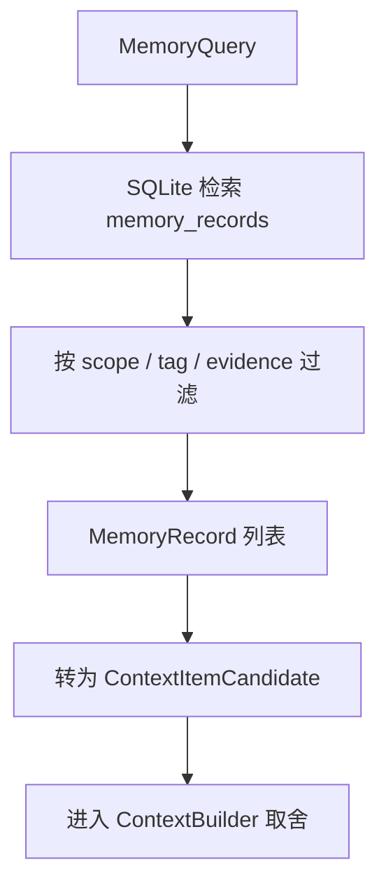
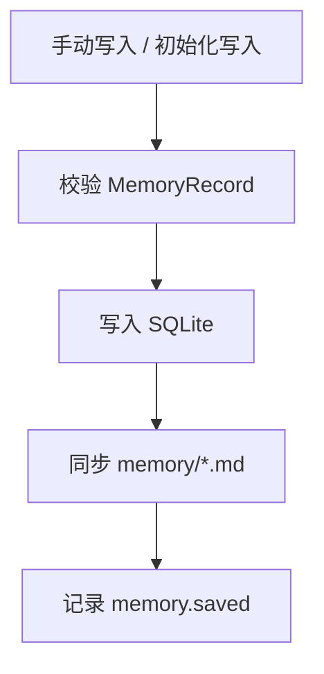
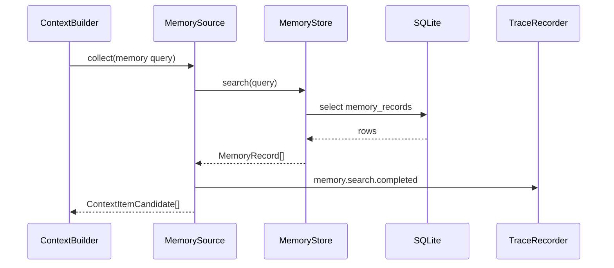
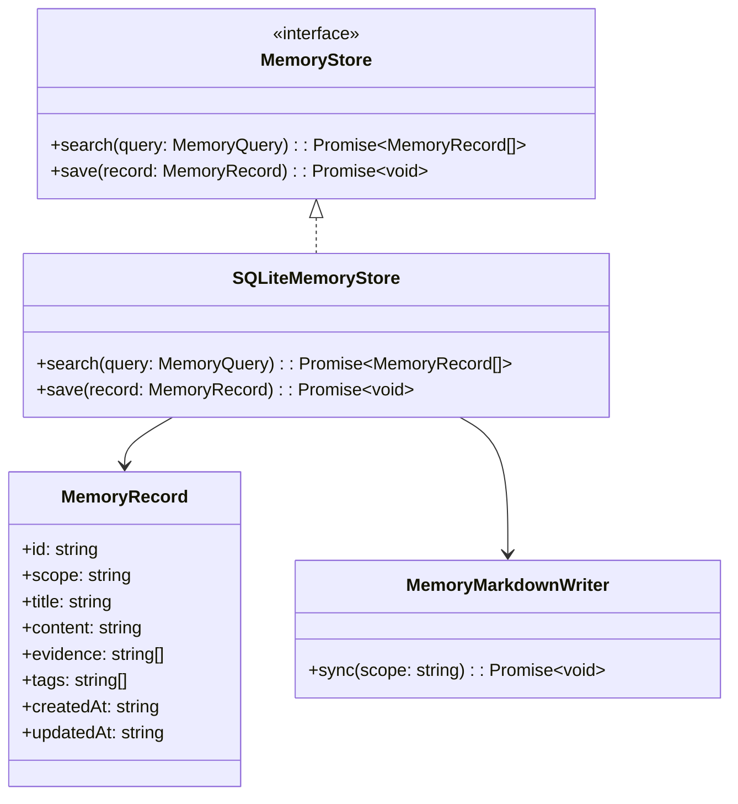

# Memory 模块设计

## 文档索引信息

- 背景：本文档位于 `docs/agent/modules/memory/`，用于沉淀 Figo Agent V1 的记忆体系设计。
- 目标：讲清 MemoryRecord、记忆分层、读写路径、SQLite 与 Markdown 协作关系，以及 Memory 和 Context 的边界。
- 标签：Memory、长期记忆、项目记忆、用户偏好、SQLite、Markdown、agent harness。
- 适用范围：V1 记忆体系、后续候选记忆、人工确认、长期治理和文章素材。
- 后续可用方向：候选记忆、人工确认、长期治理、向量检索、混合检索和持续自优化。

## 1. 模块定位

Memory 是跨轮、跨会话、跨项目可复用的稳定信息资产。

Memory 不是聊天记录。聊天记录是历史流水，Memory 是经过筛选后能长期复用的事实、偏好、规则和经验。

V1 Memory 的目标是建立最小可用的结构化记忆体系，为 ContextPack 提供稳定输入。

## 2. 设计动机

没有 Memory 的 agent 每次都从零开始。Memory 的价值是让 agent 在后续任务中复用已经确认的项目信息、用户偏好和工程经验。

但 Memory 也会带来风险：

1. 旧信息污染当前任务。
2. 没有证据的总结被长期复用。
3. 聊天记录被误当成稳定事实。
4. 记忆过多导致上下文膨胀。
5. 自动写入导致长期记忆质量下降。

所以 V1 的 Memory 设计要克制：

1. 支持结构化保存。
2. 支持可读 Markdown。
3. 支持 Context 检索。
4. 不做自动写入。
5. 不做向量检索。
6. 不做长期治理。

## 3. 核心边界

```text
Memory = 稳定信息资产
Context = 当前 Turn 选中的信息包
Trace = 运行事实流水
Artifact = 给人阅读的产物
```

Memory 只有被当前 Turn 检索并选中后，才进入 ContextPack。

## 4. 职责边界

Memory 模块负责：

1. 保存 MemoryRecord。
2. 查询 MemoryRecord。
3. 按 scope 区分记忆类型。
4. 为 ContextBuilder 提供记忆候选。
5. 生成 `memory/*.md`。
6. 写入 Memory 相关 TraceEvent。

Memory 模块不负责：

1. 不自动判断所有内容是否值得记忆。
2. 不替代 Trace。
3. 不替代 Context。
4. 不做向量检索。
5. 不做长期记忆治理。
6. 不直接调用 LLM。

## 5. 输入输出

输入：

1. MemoryQuery。
2. 手动写入的 MemoryRecord。
3. 初始化写入的项目规则或用户偏好。
4. 后续 V2 的 CandidateMemory。

输出：

1. MemoryRecord 列表。
2. memory_records SQLite 记录。
3. `memory/project.md`。
4. `memory/user.md`。
5. `memory/agent.md`。
6. `memory/knowledge.md`。
7. Memory 相关 TraceEvent。

## 6. Memory 分层

V1 采用四类记忆：

| Scope | 内容 | 来源 | 用途 |
| :--- | :--- | :--- | :--- |
| project | 项目结构、技术栈、命令、架构约定 | 当前项目资料 | 项目内上下文复用 |
| user | 用户偏好、表达规则、协作习惯 | 用户明确指令 | 跨项目协作一致性 |
| agent | agent 运行经验、失败模式、有效命令 | Trace 和人工确认 | 改善后续执行 |
| knowledge | 可复用方法论、架构原则、文章观点 | 设计文档和复盘 | 知识沉淀和文章素材 |

V1 只实现结构和读写，不做自动分类。

## 7. 读路径



读路径说明：

1. ContextBuilder 发起 MemoryQuery。
2. MemoryStore 查询 SQLite。
3. MemoryStore 返回 MemoryRecord。
4. MemorySource 转换为 ContextItemCandidate。
5. ContextBuilder 决定是否进入 ContextPack。

## 8. 写路径

V1 写路径只支持手动写入或初始化写入。



V1 不做自动 Memory 写入。

V2 才引入：

```text
Trace / Report
  -> CandidateMemory
  -> 人工确认
  -> MemoryRecord
```

## 9. 时序图



## 10. 类图



## 11. 核心数据结构

### 11.1 MemoryRecord

```ts
interface MemoryRecord {
  id: string;
  scope: "project" | "user" | "agent" | "knowledge";
  title: string;
  content: string;
  evidence: string[];
  tags: string[];
  createdAt: string;
  updatedAt: string;
}
```

### 11.2 MemoryQuery

```ts
interface MemoryQuery {
  workspacePath?: string;
  scopes: Array<"project" | "user" | "agent" | "knowledge">;
  keywords: string[];
  tags?: string[];
  limit: number;
}
```

### 11.3 CandidateMemory（V2）

```ts
interface CandidateMemory {
  id: string;
  sourceTraceEventIds: string[];
  scope: "project" | "user" | "agent" | "knowledge";
  title: string;
  content: string;
  evidence: string[];
  reason: string;
  status: "pending" | "accepted" | "rejected";
}
```

V1 不实现 CandidateMemory，只保留 V2 方向。

## 12. SQLite 设计

V1 使用 `memory_records` 表：

```sql
CREATE TABLE memory_records (
  id TEXT PRIMARY KEY,
  scope TEXT NOT NULL,
  title TEXT NOT NULL,
  content TEXT NOT NULL,
  evidence_json TEXT NOT NULL,
  tags_json TEXT NOT NULL,
  created_at TEXT NOT NULL,
  updated_at TEXT NOT NULL
);
```

V2 增加 `candidate_memories` 表。

## 13. Markdown 设计

V1 生成以下文件：

```text
.figo-agent/
  memory/
    project.md
    user.md
    agent.md
    knowledge.md
```

每个 Markdown 文件按 scope 输出：

```markdown
# Project Memory

## 记忆条目

### <title>

- 内容：
- 证据：
- 标签：
- 更新时间：
```

Markdown 是阅读产物，不是状态源。

## 14. Memory 进入 Context 的规则

Memory 不自动进入 ContextPack。

进入规则：

1. scope 与当前任务相关。
2. 关键词命中。
3. evidence 非空。
4. 未超过 V1 Top 3 - 5 限制。
5. ContextBuilder 生成 include 决策。

排除规则：

1. evidence 为空。
2. 与当前 Turn 无关。
3. 内容和项目规则冲突。
4. 内容重复。
5. 超出 V1 上下文长度控制。

## 15. 与 Context 的关系

```text
MemoryStore
  -> MemorySource
  -> ContextItemCandidate
  -> ContextBuilder
  -> ContextPack
```

ContextBuilder 决定 Memory 是否进入 ContextPack。MemoryStore 不做最终取舍。

## 16. 与 Trace 的关系

Memory 模块必须记录：

1. `memory.search.started`
2. `memory.search.completed`
3. `memory.search.failed`
4. `memory.saved`
5. `memory.markdown.synced`
6. `memory.markdown.failed`

V2 增加：

1. `candidate_memory.created`
2. `candidate_memory.accepted`
3. `candidate_memory.rejected`

## 17. 与 Reporter 的关系

Reporter 可以读取 MemoryRecord，用于生成：

1. 本轮命中的记忆。
2. 项目稳定约定。
3. 后续建议。
4. V2 候选记忆清单。

Reporter 不直接写 Memory。

## 18. 失败处理矩阵

| 失败位置 | 失败原因 | V1 行为 | TraceEvent |
| :--- | :--- | :--- | :--- |
| SQLite 查询 | 数据库错误 | ContextPack 不包含 Memory | `memory.search.failed` |
| SQLite 写入 | 写入失败 | 返回结构化错误 | `memory.save.failed` |
| Markdown 同步 | 文件写入失败 | SQLite 保持状态源 | `memory.markdown.failed` |
| Memory 查询为空 | 无命中 | 返回空列表 | `memory.search.completed` |
| evidence 为空 | 证据不足 | 排除该条 Memory | `context.item.excluded` |

## 19. V1 实现范围

V1 实现：

1. MemoryRecord。
2. MemoryQuery。
3. MemoryStore 接口。
4. SQLiteMemoryStore。
5. memory_records 表。
6. MemorySource。
7. `memory/*.md` 生成。
8. Memory 查询 Trace。

V1 不实现：

1. 自动写入 Memory。
2. CandidateMemory。
3. 人工确认流程。
4. 去重治理。
5. 过期治理。
6. 向量检索。
7. 评分系统。

## 20. V2/V3 扩展点

V2：

1. CandidateMemory。
2. 人工确认写入。
3. Memory 变更报告。
4. 按 Trace 生成候选记忆。
5. 记忆冲突提示。

V3：

1. 去重。
2. 过期。
3. 评分。
4. 归档。
5. 向量检索。
6. 混合检索。
7. 长期记忆质量分析。

## 21. 可沉淀的文章观点

1. 记忆不是聊天记录，记忆是稳定资产。
2. 没有 evidence 的记忆不能长期复用。
3. Memory 只有被 Context 选中后才影响当前推理。
4. SQLite 负责机器查询，Markdown 负责人类复盘。
5. 自动写入记忆是高风险能力，V1 不做。

## 22. 个人经验提炼

Memory 模块最容易犯三个错误：

1. 把所有对话都当记忆。
2. 自动写入未经确认的总结。
3. 让 Memory 绕过 Context 直接影响模型。

V1 的设计取舍是：

1. Memory 先结构化。
2. 写入先克制。
3. evidence 必须保留。
4. ContextBuilder 负责最终选择。
5. Markdown 让人能直接复盘。

这套设计让记忆体系从一开始就可控、可查、可解释。
