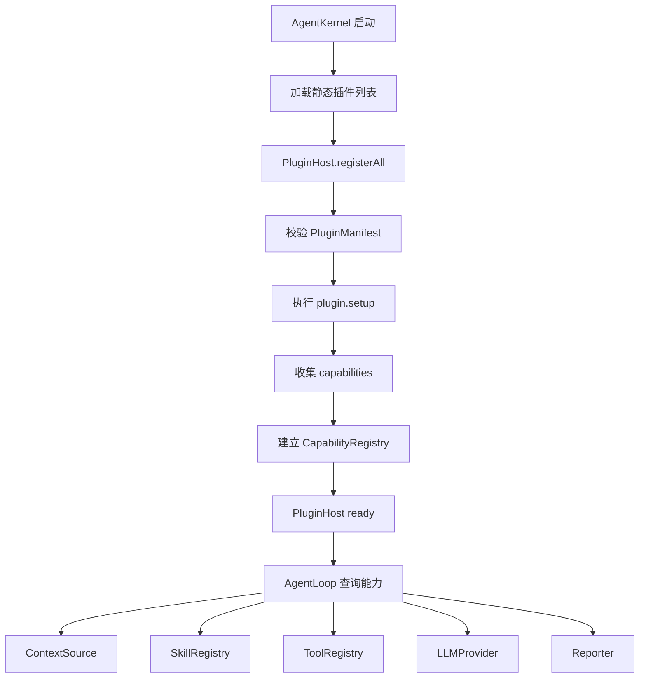
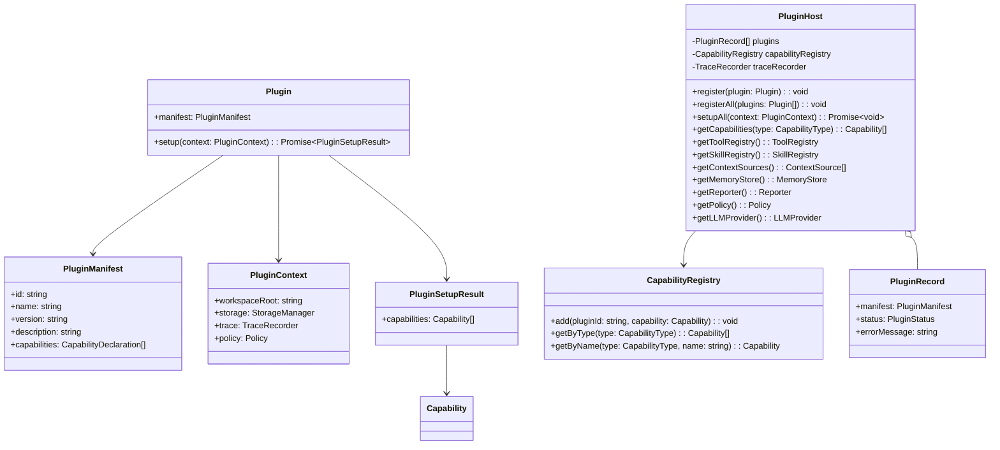

# PluginHost 模块设计

## 文档索引信息

- 背景：本文档位于 `docs/agent/modules/plugin-host/`，用于沉淀 PluginHost 模块设计。
- 目标：讲清静态插件注册、能力发现、生命周期管理、能力边界和后续动态插件演进方式。
- 标签：PluginHost、插件架构、静态注册、能力发现、一切皆插件、SOLID。
- 适用范围：V1 CLI 交互模式、AgentKernel、AgentLoop、ContextSource、Skill、Tool、MemoryStore、Reporter、Policy、LLMProvider。
- 后续可用方向：动态插件加载、本地插件包管理、Skill 生态、MCP 接入、插件市场。

## 1. 模块定位

PluginHost 是小内核和具体能力之间的隔离层。

它把 agent 能力分成两部分：

1. Kernel：负责 Session、Turn、AgentLoop、Trace 等运行骨架。
2. Plugin：负责 LLM、Tool、Skill、ContextSource、MemoryStore、Reporter、Policy 等变化点。

V1 PluginHost 只做静态注册，不做动态插件加载。

## 2. 设计动机

本项目明确采用小内核、高内聚、低耦合、一切皆插件的架构思想。

PluginHost 的设计动机：

1. 让内核依赖抽象契约，不依赖具体实现。
2. 让变化点从 AgentLoop 中移出去。
3. 让 V1 先以静态注册验证插件边界。
4. 给 V3 动态插件、本地插件包、MCP 能力接入留下结构空间。

没有 PluginHost，AgentLoop 会直接依赖具体 Tool、Skill、ContextSource 和 Reporter，后续演进会变成持续改内核。

## 3. 插件化范围

V1 按插件能力设计的对象：

| 能力 | V1 形态 | 说明 |
| --- | --- | --- |
| LLMProvider | 静态插件 | 负责模型调用 |
| ContextSource | 静态插件 | 负责候选上下文收集 |
| MemoryStore | 静态插件 | 负责记忆读写 |
| Skill | 静态插件 | 负责可复用任务方法 |
| Tool | 静态插件 | 负责原子动作 |
| Reporter | 静态插件 | 负责 Markdown 产物 |
| Policy | 静态插件 | 负责权限与边界判断 |

V1 不是每类能力都需要多个实现，但每类能力都按契约设计。

## 4. 职责边界

PluginHost 负责：

1. 接收静态插件列表。
2. 校验插件元信息。
3. 执行插件 `setup` 生命周期。
4. 建立能力索引。
5. 提供按能力类型查询接口。
6. 提供按名称查询接口。
7. 记录插件注册和初始化 TraceEvent。
8. 向 AgentKernel 和 AgentLoop 提供统一能力入口。

PluginHost 不负责：

1. 不执行 AgentLoop。
2. 不决定 ContextPack 取舍。
3. 不决定 Skill 是否激活。
4. 不执行 Tool 具体动作。
5. 不直接调用 LLM。
6. 不生成 Markdown 报告。
7. 不做动态插件加载。
8. 不下载插件。
9. 不做插件市场。

## 5. 输入输出

输入：

1. 静态插件列表。
2. PluginContext。
3. 能力查询请求。
4. 能力名称查询请求。

输出：

1. 已初始化插件集合。
2. CapabilityRegistry。
3. ToolRegistry。
4. SkillRegistry。
5. ContextSource 列表。
6. MemoryStore 实例。
7. Reporter 实例。
8. Policy 实例。
9. LLMProvider 实例。
10. 插件相关 TraceEvent。

## 6. V1 插件生命周期

```text
构造静态插件列表
  -> PluginHost.registerAll()
  -> 校验 PluginManifest
  -> PluginHost.setupAll()
  -> 执行 plugin.setup(context)
  -> 收集 capabilities
  -> 建立能力索引
  -> 标记插件 ready
  -> AgentLoop 查询能力
```

V1 插件生命周期只有启动阶段初始化，不做运行时热插拔。

## 7. 运行流程图



## 8. 时序图

```mermaid
sequenceDiagram
  participant Kernel as AgentKernel
  participant Host as PluginHost
  participant Plugin as Plugin
  participant Registry as CapabilityRegistry
  participant Loop as AgentLoop
  participant Trace as TraceRecorder

  Kernel->>Host: registerAll(staticPlugins)
  Host->>Host: validate manifest
  Host->>Trace: plugin.registered
  Kernel->>Host: setupAll(pluginContext)
  Host->>Plugin: setup(context)
  Plugin-->>Host: capabilities
  Host->>Registry: add(capabilities)
  Host->>Trace: plugin.ready
  Loop->>Host: getSkillRegistry()
  Host-->>Loop: SkillRegistry
  Loop->>Host: getToolRegistry()
  Host-->>Loop: ToolRegistry
```

## 9. UML / 类图



## 10. 核心数据结构

### 10.1 Plugin

```ts
interface Plugin {
  manifest: PluginManifest;
  setup(context: PluginContext): Promise<PluginSetupResult>;
}
```

### 10.2 PluginManifest

```ts
interface PluginManifest {
  id: string;
  name: string;
  version: string;
  description: string;
  capabilities: CapabilityDeclaration[];
}
```

### 10.3 CapabilityType

```ts
type CapabilityType =
  | "llmProvider"
  | "contextSource"
  | "memoryStore"
  | "skill"
  | "tool"
  | "reporter"
  | "policy";
```

### 10.4 CapabilityDeclaration

```ts
interface CapabilityDeclaration {
  type: CapabilityType;
  name: string;
  description: string;
}
```

### 10.5 PluginContext

```ts
interface PluginContext {
  workspaceRoot: string;
  storage: StorageManager;
  trace: TraceRecorder;
  policy: Policy;
}
```

### 10.6 PluginSetupResult

```ts
interface PluginSetupResult {
  capabilities: Capability[];
}
```

### 10.7 PluginStatus

```ts
type PluginStatus =
  | "registered"
  | "ready"
  | "failed"
  | "disabled";
```

## 11. 能力注册模型

PluginHost 不直接把所有插件暴露给 AgentLoop，而是暴露能力入口。

```text
Plugin
  -> Capability[]
  -> CapabilityRegistry
  -> AgentLoop / ContextBuilder / SkillRunner
```

这样做的收益：

1. 一个插件可以提供多个能力。
2. AgentLoop 不需要知道能力来自哪个插件。
3. 后续动态插件加载时，能力索引结构保持稳定。

## 12. V1 静态插件清单

V1 至少包含以下静态插件：

| 插件 | 提供能力 |
| --- | --- |
| `builtin-llm-plugin` | LLMProvider |
| `builtin-context-plugin` | project rules、recent turns、memory context sources |
| `builtin-memory-plugin` | SQLiteMemoryStore |
| `builtin-tool-plugin` | `list_files`、`read_file`、`search_text` |
| `builtin-skill-plugin` | `project-understanding-skill` |
| `builtin-reporter-plugin` | MarkdownReporter |
| `builtin-policy-plugin` | ReadOnlyPolicy |

这些插件可以在代码中静态 import 后注册。

V1 不从目录扫描插件。

## 13. Registry 分层

PluginHost 内部维护统一 CapabilityRegistry，对外提供更专门的 Registry。

```text
CapabilityRegistry
  -> ToolRegistry
  -> SkillRegistry
  -> ContextSourceRegistry
```

分层原因：

1. CapabilityRegistry 负责通用索引。
2. ToolRegistry 负责 Tool 查找、Policy 校验、ToolCall 记录。
3. SkillRegistry 负责 Skill 匹配和排序。
4. ContextSourceRegistry 负责上下文来源收集。

PluginHost 不把所有能力塞进一个大对象。

## 14. 插件 Manifest 校验

V1 校验规则：

1. `id` 必填。
2. `name` 必填。
3. `version` 必填。
4. `capabilities` 必填。
5. `id` 不能重复。
6. 同一能力类型下 `name` 不能重复。
7. capability type 必须来自 `CapabilityType`。

校验失败时，启动失败。

V1 是静态插件，不允许静默忽略 manifest 错误。

## 15. TraceEvent 设计

PluginHost 写入以下 TraceEvent：

```text
plugin.registered
plugin.ready
plugin.failed
capability.registered
capability.lookup.failed
```

payload 要包含：

1. pluginId。
2. pluginName。
3. pluginVersion。
4. capabilityType。
5. capabilityName。
6. errorMessage。

说明：`plugin.*` 和 `capability.*` 事件已同步到总架构的 V1 TraceEvent 清单。

## 16. 失败处理矩阵

| 失败位置 | 原因 | V1 行为 | TraceEvent |
| --- | --- | --- | --- |
| manifest 校验 | 缺少字段 | 启动失败 | `plugin.failed` |
| id 冲突 | 插件重复注册 | 启动失败 | `plugin.failed` |
| capability 冲突 | 同类型同名能力重复 | 启动失败 | `plugin.failed` |
| setup 失败 | 插件初始化异常 | 启动失败 | `plugin.failed` |
| 能力缺失 | 查询不到必需能力 | 启动失败或 Turn 失败 | `capability.lookup.failed` |
| 可选能力缺失 | 查询不到可选能力 | 返回空列表 | 无 |

V1 采用严格启动策略。必需插件失败时不进入 REPL。

## 17. 与 AgentKernel 的关系

AgentKernel 负责创建 PluginHost。

启动流程：

1. 初始化 Storage。
2. 初始化 TraceRecorder。
3. 构造 PluginContext。
4. 注册静态插件。
5. 执行 `setupAll`。
6. 获取必需能力。
7. 创建 AgentLoop。

AgentKernel 不直接 new 具体 Tool、Skill、Reporter。

## 18. 与 AgentLoop 的关系

AgentLoop 通过 PluginHost 获取能力。

AgentLoop 需要：

1. LLMProvider。
2. ContextBuilder 或 ContextSourceRegistry。
3. SkillRunner 或 SkillRegistry。
4. ToolRegistry。
5. Reporter。
6. Policy。

AgentLoop 不关心这些能力来自哪个插件。

## 19. 与 Skill 的关系

Skill 通过 PluginHost 静态注册。

V1 Skill 插件提供：

1. SkillManifest。
2. match 逻辑。
3. run 逻辑。
4. 可使用 Tool 列表。
5. 输出结构。

SkillRunner 使用 SkillRegistry 查询和执行 Skill。

## 20. 与 Tool 的关系

Tool 通过 PluginHost 静态注册进入 ToolRegistry。

ToolRegistry 在执行前处理：

1. Tool 查找。
2. 输入校验。
3. Policy 校验。
4. ToolCall 记录。
5. TraceEvent 记录。

PluginHost 不直接执行 Tool。

## 21. 与 Context 的关系

ContextSource 通过 PluginHost 静态注册。

ContextBuilder 通过 ContextSourceRegistry 收集候选上下文：

1. project rules。
2. current turn。
3. recent turns。
4. memory hits。
5. project files summary。

PluginHost 不决定候选上下文是否进入 ContextPack。

## 22. 与 Memory 的关系

MemoryStore 作为插件能力注册。

V1 使用 SQLiteMemoryStore。

后续可扩展：

1. MarkdownMemoryStore。
2. VectorMemoryStore。
3. HybridMemoryStore。

ContextBuilder 和 Reporter 依赖 MemoryStore 抽象，不依赖具体存储实现。

## 23. 与 Reporter 的关系

Reporter 作为插件能力注册。

V1 使用 MarkdownReporter。

后续可扩展：

1. JsonReporter。
2. HtmlReporter。
3. ArticleDraftReporter。

AgentLoop 只依赖 Reporter 接口。

## 24. 与 Policy 的关系

Policy 作为插件能力注册。

V1 使用 ReadOnlyPolicy。

V1 Policy 约束：

1. 允许 `list_files`。
2. 允许 `read_file`。
3. 允许 `search_text`。
4. 禁止写文件。
5. 禁止执行命令。
6. 禁止 Git 操作。
7. 禁止浏览器和外部 API。

ToolRegistry 执行 Tool 前调用 Policy。

## 25. V1 实现范围

V1 实现：

1. Plugin 接口。
2. PluginManifest。
3. PluginContext。
4. PluginSetupResult。
5. CapabilityType。
6. CapabilityDeclaration。
7. CapabilityRegistry。
8. PluginHost。
9. 静态插件注册。
10. Manifest 校验。
11. 插件 setup 生命周期。
12. 能力索引。
13. ToolRegistry 获取。
14. SkillRegistry 获取。
15. ContextSource 列表获取。
16. MemoryStore 获取。
17. Reporter 获取。
18. Policy 获取。
19. LLMProvider 获取。
20. 插件相关 TraceEvent。

V1 不实现：

1. 动态插件加载。
2. 插件目录扫描。
3. 插件热插拔。
4. 插件安装命令。
5. 插件版本解析。
6. 插件依赖解析。
7. 插件隔离沙箱。
8. 插件市场。
9. 远程插件。
10. 第三方插件权限弹窗。

## 26. V2/V3 扩展点

V2 扩展：

1. Verifier 插件。
2. Tokenizer 插件。
3. Command Tool 插件。
4. Git Tool 插件。
5. Memory 候选生成插件。
6. 更完整的 Policy 插件。

V3 扩展：

1. 本地插件目录。
2. 插件包 manifest 文件。
3. 动态加载。
4. 插件依赖声明。
5. 插件版本约束。
6. 插件启用和禁用。
7. MCP 工具适配插件。
8. 插件市场或共享 Skill 生态。

## 27. SOLID 映射

1. 单一职责：PluginHost 只负责插件注册、生命周期和能力索引。
2. 开闭原则：新增能力通过新插件接入，不修改 AgentLoop。
3. 里氏替换：同一 CapabilityType 下的实现遵循同一契约。
4. 接口隔离：Tool、Skill、ContextSource、MemoryStore、Reporter、Policy、LLMProvider 独立接口。
5. 依赖倒置：内核依赖能力契约，不依赖具体插件类。

## 28. 设计取舍

### 28.1 为什么 V1 只做静态注册

动态插件加载需要处理：

1. 插件发现。
2. 插件依赖。
3. 插件版本。
4. 插件权限。
5. 插件隔离。
6. 插件错误恢复。

这些问题会压过 V1 小内核闭环。V1 先用静态注册验证抽象边界。

### 28.2 为什么仍然要设计 PluginHost

V1 即使只有内置能力，也需要 PluginHost。

原因：

1. 能力变化点已经明确。
2. AgentLoop 不该直接依赖具体能力实现。
3. 后续增加 Tool、Skill、Reporter 时不改内核。
4. 插件化边界越早稳定，后续演进成本越低。

### 28.3 为什么不做一个大 AgentService

大 AgentService 会把 LLM、Tool、Context、Memory、Reporter、Policy 聚合到同一个变化点里。

后果：

1. 修改 Tool 影响 AgentLoop。
2. 修改 Reporter 影响 Context。
3. 修改 Memory 影响 Skill。
4. 测试边界变模糊。

PluginHost 把能力收敛到注册和查询，业务执行仍由各模块负责。

## 29. 验收标准

V1 PluginHost 模块验收标准：

1. 能注册静态插件列表。
2. 能校验 PluginManifest。
3. 重复 plugin id 会启动失败。
4. 重复 capability name 会启动失败。
5. 能执行每个插件的 `setup`。
6. 能建立 CapabilityRegistry。
7. AgentLoop 能获取 LLMProvider。
8. ContextBuilder 能获取 ContextSource 列表。
9. SkillRunner 能获取 SkillRegistry。
10. ToolRegistry 能获取 V1 三个只读 Tool。
11. Reporter 能被 AgentLoop 获取。
12. Policy 能被 ToolRegistry 获取。
13. 插件注册和初始化写入 TraceEvent。
14. 必需能力缺失时不进入 REPL。

## 30. 可沉淀的文章观点

1. 小内核不是把功能写少，而是把变化点从内核中拿出去。
2. 一切皆插件的重点不是动态加载，而是依赖抽象和能力边界。
3. V1 可以静态注册插件，但架构上仍然要有 PluginHost。
4. PluginHost 是插件生态的地基，不是插件市场本身。
5. AgentLoop 越少知道具体能力，系统越容易演进。
6. SOLID 在 agent harness 里最直接的体现就是内核依赖契约。

## 31. 个人经验提炼

1. 插件化的第一步不是动态加载，而是先定义稳定契约。
2. V1 做静态注册，能避免过早陷入插件分发和权限细节。
3. PluginHost 要小，只管注册、生命周期和索引。
4. Registry 要分层，不能让所有能力混在一个 Map 里。
5. 动态插件是 V3 的能力，V1 先把内核边界站稳。
