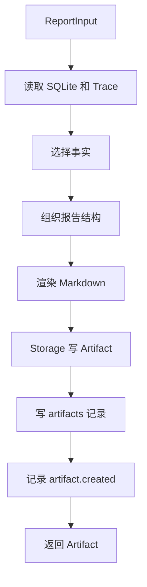
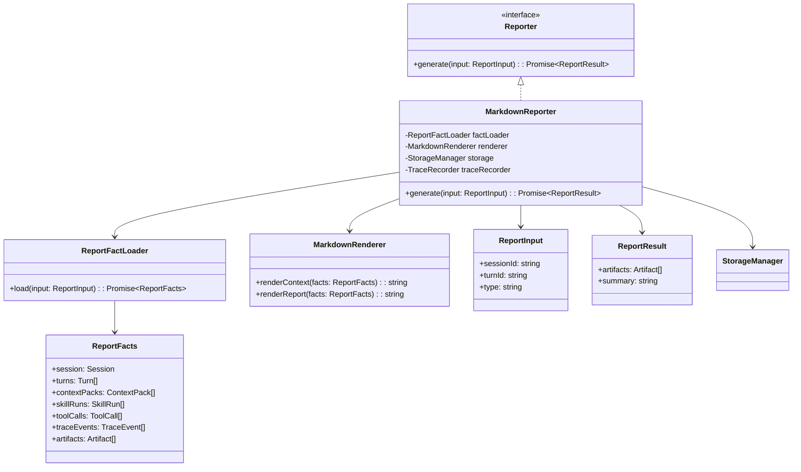

# Reporter 模块设计

## 文档索引信息

- 背景：本文档位于 `docs/agent/modules/reporter/`，用于沉淀 Reporter 模块设计。
- 目标：讲清 Markdown 报告如何从 SQLite、TraceEvent、ContextPack、SkillRun、ToolCall 等结构化事实生成。
- 标签：Reporter、Markdown、Artifact、复盘报告、中文文档、事实到表达。
- 适用范围：V1 `context.md`、`report.md`、CLI `/report`、后续文章素材。
- 后续可用方向：任务报告、验证报告、变更报告、文章草稿生成、运行质量分析。

## 1. 模块定位

Reporter 是“事实到表达”的转换层。

它把结构化事实转换为中文 Markdown，让用户能阅读一次 agent 运行过程：

1. 输入是什么。
2. 使用了哪些上下文。
3. 命中了哪些 Memory。
4. 选择了哪个 Skill。
5. 调用了哪些 Tool。
6. 生成了哪些产物。
7. 哪些步骤失败，失败证据在哪里。

Reporter 不创造事实。Reporter 只选择、组织和表达已经存在的事实。

## 2. 设计动机

本项目有两个目标：

1. 做出 V1 命令行 coding agent。
2. 基于项目过程理解 agent 设计，并沉淀文章素材。

因此，运行结果不能只停留在终端输出。每次运行都要留下可阅读的报告。

Reporter 的设计动机：

1. 降低复盘成本。
2. 让结构化数据对人可读。
3. 让 Trace、Context、Skill、Tool 的事实串成完整故事线。
4. 为后续文章写作保留原始素材。

## 3. Reporter 和其他模块的边界

| 模块 | 定位 | Reporter 关系 |
| --- | --- | --- |
| Context | 构建模型输入事实包 | Reporter 读取 ContextPack 生成 `context.md` |
| Trace | 保存运行事实流水 | Reporter 读取 TraceEvent 生成执行时间线 |
| Storage | 提供落盘能力 | Reporter 通过 Storage 写 Markdown Artifact |
| Memory | 保存长期记忆 | Reporter 引用命中的 Memory 摘要 |
| Skill | 执行任务方法 | Reporter 展示 Skill 选择和执行结果 |
| Tool | 执行原子动作 | Reporter 展示 Tool 调用摘要 |
| AgentLoop | 编排执行流程 | AgentLoop 调用 Reporter |

Reporter 不反向控制这些模块。

## 4. 职责边界

Reporter 负责：

1. 生成 `context.md`。
2. 生成 `report.md`。
3. 从 SQLite 读取结构化事实。
4. 从 TraceStore 读取 TraceEvent。
5. 组织中文 Markdown 结构。
6. 写入 Artifact。
7. 记录 `artifact.created` TraceEvent。
8. 为 CLI `/report` 提供报告路径和摘要。

Reporter 不负责：

1. 不作为状态源。
2. 不直接执行 Tool。
3. 不直接调用 LLM。
4. 不修改 Memory。
5. 不决定 ContextPack 内容。
6. 不决定 Skill 是否激活。
7. 不篡改 TraceEvent。
8. 不隐藏失败事实。

## 5. 输入输出

输入：

1. Session。
2. Turn。
3. ContextPack。
4. ContextItem。
5. MemoryRecord 命中摘要。
6. SkillRun。
7. ToolCall。
8. TraceEvent。
9. Artifact 元数据。

输出：

1. `.figo-agent/artifacts/sessions/<session-id>/context.md`
2. `.figo-agent/artifacts/sessions/<session-id>/report.md`
3. `artifacts` SQLite 记录。
4. `artifact.created` TraceEvent。
5. CLI 可展示的报告摘要。

## 6. 报告类型

V1 只有两类报告：

| 文件 | 定位 | 生成时机 |
| --- | --- | --- |
| `context.md` | ContextPack 的人类可读复盘 | Context 构建完成后 |
| `report.md` | Session 或 Turn 的执行报告 | Turn 完成后或用户执行 `/report` |

V1 不生成：

1. 变更报告。
2. 验证报告。
3. TokenUsage 报告。
4. Goal 报告。
5. 文章草稿。

## 7. 运行流程图



## 8. 时序图

```mermaid
sequenceDiagram
  participant Loop as AgentLoop
  participant Reporter as Reporter
  participant DB as SQLiteStore
  participant Trace as TraceStore
  participant Storage as StorageManager
  participant Recorder as TraceRecorder

  Loop->>Reporter: generate(reportInput)
  Reporter->>DB: query session/turn/context/skill/tool/artifact
  DB-->>Reporter: structured facts
  Reporter->>Trace: query session timeline
  Trace-->>Reporter: TraceEvent[]
  Reporter->>Reporter: render Markdown
  Reporter->>Storage: writeArtifact(report.md)
  Storage-->>Reporter: Artifact
  Reporter->>Recorder: artifact.created
  Reporter-->>Loop: Artifact
```

## 9. UML / 类图



## 10. 核心数据结构

### 10.1 ReportInput

```ts
interface ReportInput {
  sessionId: string;
  turnId?: string;
  type: "context" | "turn-report" | "session-report";
}
```

### 10.2 ReportFacts

```ts
interface ReportFacts {
  session: SessionRecord;
  turns: TurnRecord[];
  contextPacks: ContextPackRecord[];
  contextItems: ContextItemRecord[];
  memoryRecords: MemoryRecord[];
  skillRuns: SkillRunRecord[];
  toolCalls: ToolCallRecord[];
  traceEvents: TraceEvent[];
  artifacts: Artifact[];
}
```

### 10.3 ReportResult

```ts
interface ReportResult {
  artifacts: Artifact[];
  summary: string;
}
```

### 10.4 MarkdownSection

```ts
interface MarkdownSection {
  title: string;
  body: string;
  order: number;
}
```

Renderer 使用 Section 拼装 Markdown，避免报告生成逻辑散落在字符串拼接里。

## 11. context.md 结构

`context.md` 用于解释当前 ContextPack。

V1 结构：

```markdown
# Context Pack

## 基本信息

## 用户输入摘要

## Included Items

## Excluded Items

## Memory 命中

## Token 估算

## Trace 证据
```

章节说明：

| 章节 | 内容 |
| --- | --- |
| 基本信息 | sessionId、turnId、contextPackId、createdAt |
| 用户输入摘要 | 输入长度和摘要 |
| Included Items | 进入 ContextPack 的事实 |
| Excluded Items | 被排除的候选事实和原因 |
| Memory 命中 | 命中的 MemoryRecord 摘要 |
| Token 估算 | V1 估算 token，不做精确统计 |
| Trace 证据 | 相关 TraceEvent id |

## 12. report.md 结构

`report.md` 用于解释一次 Turn 或一个 Session 的执行过程。

V1 结构：

```markdown
# Figo Agent Report

## 基本信息

## 用户目标

## 执行摘要

## 上下文来源

## Skill 执行

## Tool 调用

## 产物

## 失败与风险

## Trace 时间线

## 后续建议
```

报告规则：

1. 所有结论来自结构化事实。
2. 失败事件必须展示。
3. Tool 调用只展示摘要，不展示大段文件内容。
4. Trace 时间线展示关键事件，不铺满全部 payload。
5. 后续建议只能基于 Trace、ToolCall、SkillRun 和 Artifact。

## 13. 事实选择策略

Reporter 不把所有数据都塞进报告。

V1 选择策略：

1. Session 基本信息必选。
2. 当前 Turn 必选。
3. 当前 Turn 的 ContextPack 必选。
4. 当前 Turn 的 SkillRun 必选。
5. 当前 Turn 的 ToolCall 必选。
6. 当前 Turn 的失败事件必选。
7. 当前 Turn 的 Artifact 必选。
8. Trace 时间线只选关键阶段事件。

关键阶段事件：

```text
turn.received
turn.processing
context.build.completed
llm.completed
skill.activated
skill.completed
tool.completed
artifact.created
turn.completed
turn.failed
error.occurred
```

## 14. Markdown 渲染规则

Markdown 渲染要满足：

1. 中文表达。
2. 标题层级稳定。
3. 列表使用短句。
4. 表格用于结构化事实。
5. 代码块用于 JSON、SQL、命令和路径示例。
6. 不输出空章节。
7. 不伪造未知数据。
8. 不把完整文件内容写入报告。

当事实缺失时，报告写：

```text
未记录。
```

不写推测内容。

## 15. Artifact 写入策略

Reporter 通过 Storage 写 Artifact。

流程：

```text
render Markdown
  -> Storage.writeArtifact()
  -> 写入 Markdown 文件
  -> 写入 artifacts 表
  -> TraceRecorder.record(artifact.created)
  -> 返回 Artifact
```

Reporter 不直接使用 `fs.writeFile`。

## 16. 失败处理矩阵

| 失败位置 | 原因 | V1 行为 | TraceEvent |
| --- | --- | --- | --- |
| 事实读取 | SQLite 查询失败 | 返回报告失败 | `error.occurred` |
| Trace 查询 | trace_events 查询失败 | 生成不含 Trace 时间线的报告 | `error.occurred` |
| Markdown 渲染 | 数据结构缺字段 | 该字段显示“未记录” | `error.occurred` |
| Artifact 写入 | 文件不可写 | 返回报告失败 | `error.occurred` |
| Artifact 元数据 | SQLite 写入失败 | 返回报告失败 | `error.occurred` |
| artifact.created 记录 | Trace 写入失败 | 报告文件保留 | Storage 错误结果 |

Reporter 失败不能删除已存在的 SQLite 事实。

## 17. 与 AgentLoop 的关系

AgentLoop 在 Turn 后段调用 Reporter。

AgentLoop 负责：

1. 提供 sessionId 和 turnId。
2. 处理 Reporter 返回的 Artifact。
3. 将 Artifact 路径放入 TurnResult。

Reporter 负责：

1. 读取事实。
2. 渲染 Markdown。
3. 写入 Artifact。

AgentLoop 不拼接 Markdown。

## 18. 与 Trace 的关系

Reporter 从 Trace 读取事实，并向 Trace 写入 Artifact 创建事件。

读事件：

1. `turn.*`
2. `context.*`
3. `memory.*`
4. `skill.*`
5. `tool.*`
6. `llm.*`
7. `error.occurred`

写事件：

1. `artifact.created`

Reporter 可以解释 Trace，但不能修改 Trace。

## 19. 与 Context 的关系

Reporter 生成 `context.md` 时读取 ContextPack。

ContextPack 决定内容是否进入模型输入。Reporter 只解释它的组成：

1. included item。
2. excluded item。
3. source。
4. reason。
5. estimatedTokens。

Reporter 不重新做上下文筛选。

## 20. 与 Storage 的关系

Reporter 使用 Storage 写入文件和 artifact 元数据。

边界：

1. Reporter 决定 Markdown 正文。
2. Storage 决定路径和写入方式。
3. artifacts 表保存元数据。
4. Markdown 文件保存正文。

## 21. 与 Memory 的关系

Reporter 只展示本次运行命中的 Memory。

V1 不做：

1. 不自动生成 Memory。
2. 不修改 Memory。
3. 不把报告内容写回 Memory。

V2 才基于 Trace 和报告生成候选 Memory。

## 22. 与 Skill 和 Tool 的关系

Reporter 展示 Skill 和 Tool 的执行事实。

Skill 展示字段：

1. skillName。
2. status。
3. startedAt。
4. completedAt。
5. errorMessage。

Tool 展示字段：

1. toolName。
2. status。
3. inputSummary。
4. outputSummary。
5. errorMessage。

Reporter 不重复展示 Tool 输出全文。

## 23. V1 实现范围

V1 实现：

1. Reporter 接口。
2. MarkdownReporter。
3. ReportFactLoader。
4. MarkdownRenderer。
5. `context.md` 生成。
6. `report.md` 生成。
7. Artifact 写入。
8. Artifact 元数据记录。
9. `artifact.created` TraceEvent。
10. CLI `/report` 返回报告路径。
11. 中文 Markdown 模板。
12. 失败事件展示。

V1 不实现：

1. LLM 参与报告润色。
2. 自动文章草稿。
3. 多格式导出。
4. PDF 导出。
5. HTML 报告。
6. 图表生成。
7. TokenUsage 精确报告。
8. Goal 报告。

## 24. V2/V3 扩展点

V2 扩展：

1. Goal 报告。
2. Verifier 报告。
3. TokenUsage 报告。
4. 代码变更报告。
5. 命令执行报告。
6. Git 操作报告。
7. Memory 候选报告。

V3 扩展：

1. 文章草稿生成。
2. HTML 报告。
3. Trace 可视化。
4. 多 Session 对比报告。
5. 自优化分析报告。
6. 运行质量趋势报告。

## 25. SOLID 映射

1. 单一职责：Reporter 只做事实到 Markdown 的转换。
2. 开闭原则：新增报告类型通过新 Renderer 扩展。
3. 里氏替换：MarkdownReporter 可被 HtmlReporter、JsonReporter 替换。
4. 接口隔离：FactLoader、Renderer、Storage 分离。
5. 依赖倒置：Reporter 依赖 Store 接口，不依赖具体 SQLite 实现。

## 26. 设计取舍

### 26.1 为什么 V1 不用 LLM 写报告

V1 报告要成为事实复盘产物。直接让 LLM 写报告会引入表达漂移。

V1 使用模板化 Markdown，保证报告稳定、可查、可对比。

### 26.2 为什么 report.md 不保存完整 Tool 输出

完整 Tool 输出会让报告膨胀，阅读效率下降。V1 报告保存摘要、路径、数量、错误和 Trace id。

原始内容保留在源文件或结构化记录中。

### 26.3 为什么 context.md 独立于 report.md

Context 是模型输入事实包，Report 是执行过程复盘。两者服务不同问题。

把它们分开后，用户能单独检查“模型看到了什么”，也能检查“agent 做了什么”。

## 27. 验收标准

V1 Reporter 模块验收标准：

1. 普通 Turn 完成后生成 `context.md`。
2. 普通 Turn 完成后生成 `report.md`。
3. `context.md` 包含 ContextPack 基本信息。
4. `context.md` 包含 included/excluded items。
5. `report.md` 包含执行摘要。
6. `report.md` 包含 SkillRun 摘要。
7. `report.md` 包含 ToolCall 摘要。
8. `report.md` 包含 Artifact 列表。
9. 失败事件出现在 `report.md`。
10. Artifact 元数据写入 `artifacts` 表。
11. Artifact 创建写入 `artifact.created`。
12. Markdown 内容为中文。

## 28. 可沉淀的文章观点

1. Reporter 是 agent harness 中被低估的模块。
2. 好的 agent 不只完成任务，还要留下可复盘证据。
3. 报告必须来自结构化事实，不能靠自然语言自由发挥。
4. `context.md` 解决“模型看到了什么”，`report.md` 解决“agent 做了什么”。
5. 对研究型项目来说，报告本身就是文章素材库。
6. 模板化报告比 LLM 润色更适合作为 V1 基础设施。

## 29. 个人经验提炼

1. 很多 agent 失败不是不会做，而是做完后无法解释过程。
2. Reporter 要离事实近，离想象远。
3. 中文 Markdown 是个人研究项目最实用的复盘格式。
4. 报告结构稳定，后续对比和写文章才省力。
5. 不要把 Reporter 做成另一个决策模块，它只是表达层。
