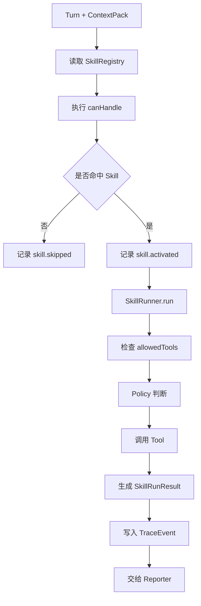
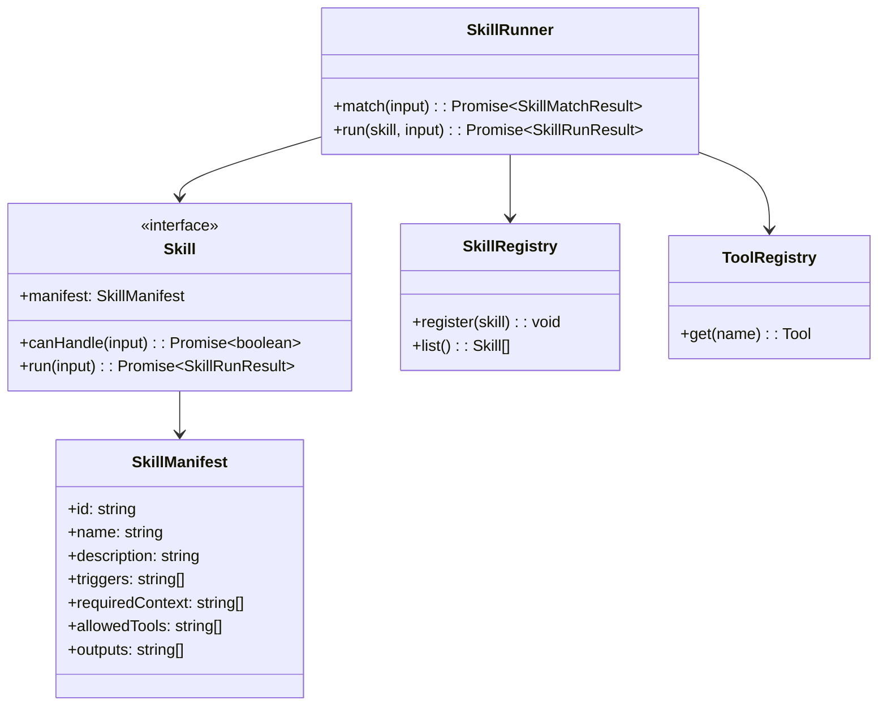
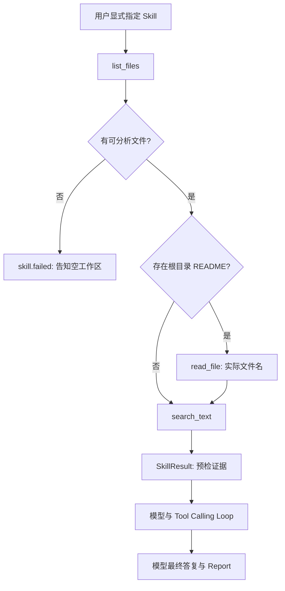

# Skill 模块设计

## 文档索引信息

- 背景：本文档位于 `docs/agent/modules/skill/`，用于沉淀 Figo Agent V1 的 Skill 插件体系设计。
- 目标：讲清 Skill 和 Tool 的边界、SkillManifest、SkillRunner、Skill 生命周期和 V1 内置 Skill 的执行机制。
- 标签：Skill、任务方法、领域经验、插件体系、OPC、智能体能力。
- 适用范围：V1 内置 Skill、后续代码审查 Skill、故障诊断 Skill、文档生成 Skill 和文章素材。
- 后续可用方向：Skill 生态、Skill 编排、经验产品化、个人方法论沉淀和 OPC 输出。

## 1. 模块定位

Skill 是可复用任务方法。

Tool 解决“能做什么动作”，Skill 解决“按什么方法做事”。

在 Figo Agent 中，Skill 用来承载：

1. 任务流程。
2. 领域经验。
3. 上下文要求。
4. 可用工具边界。
5. 输出结构。
6. 验收标准。
7. 失败处理方式。

## 2. 设计动机

如果 agent 只有 Tool，它只是一个工具调用器。

Skill 的价值是把经验封装成稳定方法，让 agent 在不同任务中复用同一套执行路径。

这符合本项目的核心目标：

1. 研究 agent harness。
2. 把个人经验产品化。
3. 把工程方法沉淀成可复用能力。
4. 为后续文章写作提供模块化素材。

## 3. Skill 和 Tool 的边界

| 维度 | Tool | Skill |
| :--- | :--- | :--- |
| 定位 | 原子动作 | 任务方法 |
| 示例 | `read_file`、`search_text` | `project-understanding-skill` |
| 输入 | 结构化参数 | Turn + ContextPack + 可用 Tool |
| 输出 | ToolResult | SkillRunResult |
| 关注点 | 执行动作 | 执行流程 |
| 变化原因 | 能力变化 | 方法变化 |

边界规则：

1. Skill 不绕过 Tool 直接读写文件。
2. Tool 不包含任务流程。
3. Skill 可以组合多个 Tool。
4. Tool 的权限由 Policy 判断。
5. Skill 的执行过程必须写 Trace。

## 4. 职责边界

Skill 模块负责：

1. 定义 SkillManifest。
2. 根据 Turn 和 ContextPack 匹配 Skill。
3. 执行 SkillRunner。
4. 调用允许范围内的 Tool。
5. 生成 SkillRunResult。
6. 写入 Skill 相关 TraceEvent。
7. 为 Reporter 提供结构化结果。

Skill 模块不负责：

1. 不直接构造 ContextPack。
2. 不直接实现 Tool。
3. 不直接操作 SQLite。
4. 不做动态插件加载。
5. 不做多 Skill 编排。
6. 不直接写长期 Memory。

## 5. 输入输出

输入：

1. 当前 Turn。
2. ContextPack。
3. LLMResponse。
4. 已注册 Skill 列表。
5. 可用 Tool 列表。
6. Policy。

输出：

1. SkillMatchResult。
2. SkillRunResult。
3. ToolCall 请求。
4. Skill 相关 TraceEvent。
5. Reporter 可消费的结构化片段。

## 6. Skill 生命周期

```text
注册
  -> 匹配
  -> 激活
  -> 执行
  -> 调用 Tool
  -> 汇总结果
  -> 写 Trace
  -> 返回 SkillRunResult
```

## 7. 运行流程图



## 8. 时序图

```mermaid
sequenceDiagram
  participant Loop as AgentLoop
  participant Registry as SkillRegistry
  participant Runner as SkillRunner
  participant Skill as Skill
  participant Tool as ToolRegistry
  participant Policy as Policy
  participant Trace as TraceRecorder

  Loop->>Registry: list skills
  Registry-->>Loop: Skill[]
  Loop->>Runner: matchAndRun(input)
  Runner->>Skill: canHandle(input)
  Skill-->>Runner: true
  Runner->>Trace: skill.activated
  Runner->>Policy: evaluate(tool request)
  Policy-->>Runner: allow
  Runner->>Tool: execute(input)
  Tool-->>Runner: ToolResult
  Runner->>Skill: compose result
  Skill-->>Runner: SkillRunResult
  Runner->>Trace: skill.completed
  Runner-->>Loop: SkillRunResult
```

## 9. 类图



## 10. 核心数据结构

### 10.1 SkillManifest

```ts
interface SkillManifest {
  id: string;
  name: string;
  description: string;
  triggers: string[];
  requiredContext: string[];
  allowedTools: string[];
  outputs: string[];
}
```

### 10.2 SkillMatchInput

```ts
interface SkillMatchInput {
  turn: Turn;
  contextPack: ContextPack;
  llmResponse?: LLMResponse;
}
```

### 10.3 SkillMatchResult

```ts
interface SkillMatchResult {
  matched: boolean;
  skillId?: string;
  reason: string;
}
```

### 10.4 SkillRunInput

```ts
interface SkillRunInput {
  session: Session;
  turn: Turn;
  contextPack: ContextPack;
  tools: ToolRegistry;
  policy: Policy;
}
```

### 10.5 SkillRunResult

```ts
interface SkillRunResult {
  skillId: string;
  status: "completed" | "failed" | "skipped";
  summary: string;
  toolResults: ToolResult[];
  reportSections: ReportSection[];
  error?: SkillError;
}
```

### 10.6 SkillError

```ts
interface SkillError {
  type: "context_missing" | "tool_denied" | "tool_failed" | "execution_failed";
  message: string;
  recoverable: boolean;
}
```

## 11. SkillManifest 设计

SkillManifest 是 Skill 的自描述文件。

V1 必须包含：

1. `id`：唯一标识。
2. `name`：名称。
3. `description`：说明。
4. `triggers`：触发词。
5. `requiredContext`：需要的上下文类型。
6. `allowedTools`：可用工具白名单。
7. `outputs`：输出内容结构。

示例：

```json
{
  "id": "project-understanding-skill",
  "name": "项目理解 Skill",
  "description": "显式执行项目文件预检，为模型提供事实证据。",
  "triggers": ["/skill project-understanding"],
  "requiredContext": ["rule", "project_doc", "workspace", "memory"],
  "allowedTools": ["list_files", "read_file", "search_text"],
  "outputs": ["项目定位", "直接证据", "当前结构", "后续建议"]
}
```

## 12. Skill 匹配策略

当前实现只接受用户显式输入的 `/skill project-understanding ...`。`分析当前项目`、`理解当前项目` 等普通任务文本不触发 Skill，直接由模型与 Tool Calling Loop 处理。V1 只允许命中一个 Skill；模型输出不会事后自动选择 Skill。

无匹配 Skill 时：

1. 记录 `skill.skipped`。
2. AgentLoop 继续普通 Tool Calling Loop；不执行 Skill Tool。

## 13. V1 内置 Skill：project-understanding-skill

### 13.1 定位

`project-understanding-skill` 是 V1 唯一内置 Skill。

当前职责是模型调用前的可审计项目文件预检：列出实际文件；存在根目录 README 时读取其真实文件名；执行关键词检索；将结果交给模型。Skill 不生成最终答复，`skill.completed` 只表示预检执行完成，不表示用户的分析目标已经完成。

### 13.2 输入

1. 显式指定 Skill 的当前 Turn 与工作区路径。
2. 经 Policy 和 ToolRegistry 执行的 `list_files`、可选 `read_file`、`search_text`。

### 13.3 输出

1. 文件数量与列表。
2. 实际存在的 README 内容摘要；缺失时明确记录缺失。
3. 关键词匹配证据。
4. 空目录或工具失败的明确原因。

项目定位、架构判断和后续建议由模型依据这些证据与后续 ToolResult 形成，Reporter 记录模型最终答复。

### 13.4 执行流程



### 13.5 验收标准

Skill 完成时必须列出实际读取的文件与检索证据；未读取 README 时不得声称已读取。空工作区和 ToolResult 失败不能标记成功。AgentLoop 不得把 Skill 的执行状态文案当成最终答复。

## 14. Skill 与 Context 的关系

当前内置 Skill 不直接拼接 ContextPack。AgentLoop 先构造 ContextPack，再按用户显式指令运行 Skill；Skill 的预检结果作为本轮模型输入的补充证据，不回写 ContextPack。

```text
ContextBuilder
  -> ContextPack
  -> AgentLoop
  -> 显式 Skill 预检
  -> LLM Tool Calling Loop
```

Skill 如果发现上下文不足：

1. 返回 `context_missing`。
2. 写入 `skill.failed`。
3. Reporter 输出缺失上下文说明。

## 15. Skill 与 Tool 的关系

Skill 只能调用 Manifest 中声明的 Tool。

```text
SkillManifest.allowedTools
  -> Policy
  -> ToolRegistry
  -> Tool.execute
```

V1 允许：

1. `list_files`
2. `read_file`
3. `search_text`

V1 禁止：

1. `apply_patch`
2. `run_command`
3. Git 操作
4. 浏览器工具
5. 外部 API 工具

## 16. Skill 与 Memory 的关系

V1 Skill 可以读取 Memory，但不自动写 Memory。

`project-understanding-skill` 可以使用项目 Memory 作为上下文证据。

V2 增加：

1. Skill 生成 CandidateMemory。
2. 用户确认后写入 MemoryRecord。

## 17. Skill 与 Trace 的关系

Skill 模块必须记录：

1. `skill.activated`
2. `skill.skipped`
3. `skill.completed`
4. `skill.failed`
5. `tool.called`
6. `tool.completed`
7. `tool.failed`

TraceEvent 必须包含：

1. skillId。
2. sessionId。
3. turnId。
4. 触发原因。
5. 执行结果摘要。
6. 错误信息。

## 18. 失败处理矩阵

| 失败位置 | 失败原因 | V1 行为 | TraceEvent |
| :--- | :--- | :--- | :--- |
| Skill 匹配 | 无匹配 Skill | 返回普通回复 | `skill.skipped` |
| Context | requiredContext 缺失 | 返回 Skill 失败 | `skill.failed` |
| Policy | Tool 不允许 | 阻止 Tool 调用 | `policy.denied` |
| Tool | Tool 执行失败 | 保留错误摘要 | `tool.failed` |
| SkillRunner | 执行异常 | 返回结构化错误 | `skill.failed` |

## 19. V1 实现范围

V1 实现：

1. Skill 接口。
2. SkillManifest。
3. SkillRegistry。
4. SkillRunner。
5. SkillMatchResult。
6. SkillRunResult。
7. `project-understanding-skill`。
8. Skill 相关 TraceEvent。

V1 不实现：

1. 多 Skill 编排。
2. 动态 Skill 加载。
3. Skill 插件市场。
4. Skill 自动生成 Memory。
5. Skill 版本管理。
6. Skill 评分系统。

## 20. V2/V3 扩展点

V2：

1. 代码审查 Skill。
2. 故障诊断 Skill。
3. 文档生成 Skill。
4. 变更总结 Skill。
5. CandidateMemory 写入流程。

V3：

1. Skill 编排。
2. Skill 插件目录。
3. Skill 包管理。
4. Skill 版本治理。
5. Skill 质量评估。
6. 可共享 Skill 生态。

## 21. 可沉淀的文章观点

1. Tool 是动作，Skill 是方法。
2. Skill 是把个人经验产品化的接口。
3. Skill 让 agent 从“会调用工具”升级到“会按流程做事”。
4. 好的 Skill 要声明触发场景、上下文要求、工具边界、输出结构和失败处理。
5. Skill 是 OPC 思路在 agent 架构里的落点。

## 22. 个人经验提炼

Skill 模块最容易犯三个错误：

1. 把 Skill 写成一个大 prompt。
2. 让 Skill 绕过 Tool 直接执行动作。
3. 不声明上下文和输出结构。

V1 要避免这些问题：

1. SkillManifest 明确声明能力边界。
2. SkillRunner 统一执行。
3. ToolRegistry 统一提供动作。
4. Policy 统一判断权限。
5. Trace 统一记录执行过程。

这就是把经验从“提示词”沉淀成“智能体能力”的关键。
