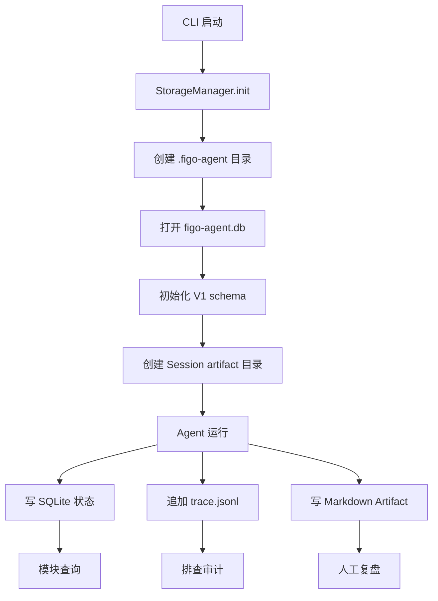
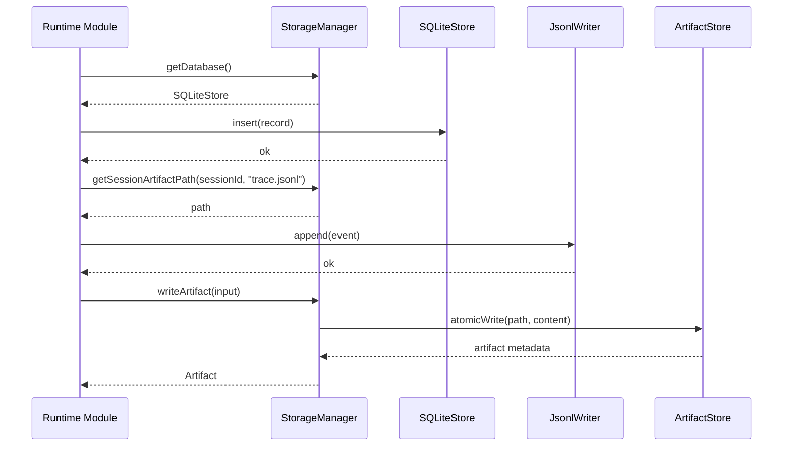
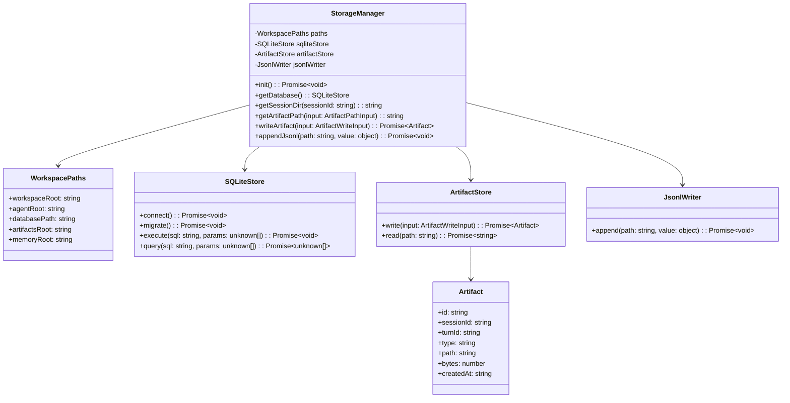
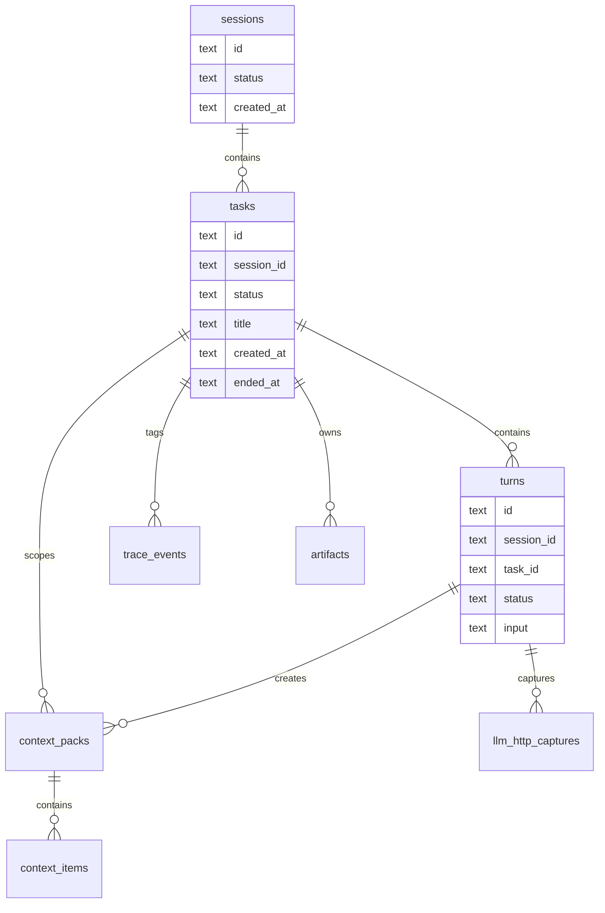

# Storage 模块设计

## 文档索引信息

- 背景：本文档位于 `docs/agent/modules/storage/`，用于沉淀 Storage 模块设计。
- 目标：讲清 SQLite 状态源、JSONL 审计流水、Markdown Artifact 和 `.figo-agent/` 目录结构的职责边界。
- 标签：Storage、SQLite、Markdown、JSONL、状态源、Artifact、目录结构。
- 适用范围：V1 CLI 交互模式、Session、Turn、Context、Memory、Trace、Reporter。
- 后续可用方向：schema migration、备份恢复、统计分析、归档、文章素材。

## 1. 模块定位

Storage 是 agent 本地持久化基础设施。

它保存三类数据：

1. 机器可查询的结构化状态：SQLite。
2. 按时间追加的审计流水：JSONL。
3. 人类可阅读的复盘产物：Markdown Artifact。

Storage 不理解 agent 决策语义。它只保证数据能被可靠保存、读取和定位。

## 2. 设计动机

本项目不是一次性脚本，而是研究型 coding agent。研究型项目需要能反复观察运行过程。

Storage 的价值有四个：

1. 保留状态：Session、Turn、Context、Memory、Trace、SkillRun、ToolCall 都能查询。
2. 支持复盘：Markdown 产物让人直接阅读上下文和报告。
3. 支持排查：JSONL 可以按执行顺序还原事件。
4. 支持演进：后续 TokenUsage、Goal、Verifier、自优化都基于稳定数据层扩展。

SQLite + JSONL + Markdown 是 V1 的三层存储设计。

## 3. 三类存储的边界

| 存储 | 定位 | 适合保存 | 不适合保存 |
| --- | --- | --- | --- |
| SQLite | 状态源 | Session、Turn、Context、Memory、Trace、SkillRun、ToolCall、Artifact 元数据 | 大段 Markdown 正文 |
| JSONL | 审计流水 | TraceEvent 时间线 | 复杂条件查询 |
| Markdown | 阅读产物 | context.md、report.md、memory/*.md | 作为唯一状态源 |

结论：

1. SQLite 是主状态源。
2. JSONL 是审计兜底。
3. Markdown 是阅读入口。

## 4. 职责边界

Storage 负责：

1. 初始化 `.figo-agent/` 目录结构。
2. 初始化 SQLite 数据库。
3. 创建 V1 schema。
4. 提供 SQLite 连接。
5. 提供 JSONL 追加写入。
6. 提供 Artifact 路径生成。
7. 提供 Artifact 原子写入。
8. 提供基础目录查询。
9. 屏蔽底层文件路径细节。

Storage 不负责：

1. 不决定 AgentLoop 流程。
2. 不决定 ContextPack 内容。
3. 不决定 Memory 命中规则。
4. 不定义 TraceEvent 语义。
5. 不生成报告正文。
6. 不做 LLM 调用。
7. 不做业务错误恢复。

## 5. 输入输出

输入：

1. Session 结构化记录。
2. Turn 结构化记录。
3. ContextPack 和 ContextItem。
4. MemoryRecord。
5. TraceEvent。
6. SkillRun。
7. ToolCall。
8. Artifact 写入请求。

输出：

1. `.figo-agent/figo-agent.db`
2. `.figo-agent/artifacts/sessions/<session-id>/trace.jsonl`
3. `.figo-agent/artifacts/sessions/<session-id>/context.md`
4. `.figo-agent/artifacts/sessions/<session-id>/report.md`
5. `.figo-agent/memory/*.md`
6. SQLite 查询结果。

Storage 的输出不能替代模块返回值。模块返回值走内存对象，持久化结果走 Storage。

## 6. 目录结构

V1 目录结构：

```text
.figo-agent/
  figo-agent.db
  artifacts/
    sessions/
      <session-id>/
        context.md
        report.md
        trace.jsonl
  memory/
    project.md
    user.md
    agent.md
    knowledge.md
```

目录说明：

| 路径 | 作用 |
| --- | --- |
| `.figo-agent/figo-agent.db` | SQLite 状态源 |
| `.figo-agent/artifacts/sessions/<session-id>/` | 单个 Session 的产物目录 |
| `context.md` | 当前 Session 或 Turn 的上下文复盘 |
| `report.md` | 中文执行报告 |
| `trace.jsonl` | TraceEvent 审计流水 |
| `.figo-agent/memory/` | 人类可读长期记忆 |

## 7. 初始化流程

```text
CLI 启动
  -> StorageManager.init()
  -> 确认工作区根目录
  -> 创建 .figo-agent/
  -> 创建 artifacts/sessions/
  -> 创建 memory/
  -> 打开 figo-agent.db
  -> 创建 V1 schema
  -> 返回 StorageManager
```

初始化失败时，CLI 启动失败。没有 Storage，V1 不进入交互循环。

## 8. 运行流程图



## 9. 写入时序图



## 10. UML / 类图



## 11. 核心数据结构

### 11.1 WorkspacePaths

```ts
interface WorkspacePaths {
  workspaceRoot: string;
  agentRoot: string;
  databasePath: string;
  artifactsRoot: string;
  memoryRoot: string;
}
```

V1 路径全部基于工作区根目录生成，不使用全局配置目录保存项目状态。

### 11.2 ArtifactPathInput

```ts
interface ArtifactPathInput {
  sessionId: string;
  type: "context" | "report" | "trace";
  fileName?: string;
}
```

V1 默认文件名：

| type | file |
| --- | --- |
| context | `context.md` |
| report | `report.md` |
| trace | `trace.jsonl` |

### 11.3 ArtifactWriteInput

```ts
interface ArtifactWriteInput {
  sessionId: string;
  turnId?: string;
  type: "context" | "report" | "memory";
  path: string;
  content: string;
}
```

### 11.4 Artifact

```ts
interface Artifact {
  id: string;
  sessionId: string;
  turnId?: string;
  type: string;
  path: string;
  bytes: number;
  createdAt: string;
}
```

Artifact 表记录元数据。Markdown 正文保存在文件中。

## 12. SQLite schema 范围

V1 SQLite 保存以下表：

1. `sessions`
2. `turns`
3. `context_packs`
4. `context_items`
5. `memory_records`
6. `skill_runs`
7. `tool_calls`
8. `trace_events`
9. `artifacts`

Storage 模块负责创建表，不负责定义每个业务字段的语义。

## 13. V1 基础 schema

### 13.1 sessions

```sql
CREATE TABLE sessions (
  id TEXT PRIMARY KEY,
  cwd TEXT NOT NULL,
  status TEXT NOT NULL,
  started_at TEXT NOT NULL,
  ended_at TEXT
);
```

### 13.2 turns

```sql
CREATE TABLE turns (
  id TEXT PRIMARY KEY,
  session_id TEXT NOT NULL,
  input TEXT NOT NULL,
  status TEXT NOT NULL,
  created_at TEXT NOT NULL,
  completed_at TEXT,
  FOREIGN KEY (session_id) REFERENCES sessions(id)
);
```

### 13.3 context_packs

```sql
CREATE TABLE context_packs (
  id TEXT PRIMARY KEY,
  session_id TEXT NOT NULL,
  turn_id TEXT NOT NULL,
  estimated_tokens INTEGER NOT NULL,
  created_at TEXT NOT NULL,
  FOREIGN KEY (session_id) REFERENCES sessions(id),
  FOREIGN KEY (turn_id) REFERENCES turns(id)
);
```

### 13.4 context_items

```sql
CREATE TABLE context_items (
  id TEXT PRIMARY KEY,
  context_pack_id TEXT NOT NULL,
  source_type TEXT NOT NULL,
  source_ref TEXT NOT NULL,
  summary TEXT NOT NULL,
  estimated_tokens INTEGER NOT NULL,
  included INTEGER NOT NULL,
  reason TEXT NOT NULL,
  FOREIGN KEY (context_pack_id) REFERENCES context_packs(id)
);
```

### 13.5 memory_records

```sql
CREATE TABLE memory_records (
  id TEXT PRIMARY KEY,
  scope TEXT NOT NULL,
  key TEXT NOT NULL,
  content TEXT NOT NULL,
  source TEXT NOT NULL,
  created_at TEXT NOT NULL,
  updated_at TEXT NOT NULL
);
```

### 13.6 skill_runs

```sql
CREATE TABLE skill_runs (
  id TEXT PRIMARY KEY,
  session_id TEXT NOT NULL,
  turn_id TEXT NOT NULL,
  skill_name TEXT NOT NULL,
  status TEXT NOT NULL,
  started_at TEXT NOT NULL,
  completed_at TEXT,
  error_message TEXT,
  FOREIGN KEY (session_id) REFERENCES sessions(id),
  FOREIGN KEY (turn_id) REFERENCES turns(id)
);
```

### 13.7 tool_calls

```sql
CREATE TABLE tool_calls (
  id TEXT PRIMARY KEY,
  session_id TEXT NOT NULL,
  turn_id TEXT NOT NULL,
  skill_run_id TEXT,
  tool_name TEXT NOT NULL,
  input_json TEXT NOT NULL,
  output_json TEXT,
  status TEXT NOT NULL,
  started_at TEXT NOT NULL,
  completed_at TEXT,
  error_message TEXT,
  FOREIGN KEY (session_id) REFERENCES sessions(id),
  FOREIGN KEY (turn_id) REFERENCES turns(id),
  FOREIGN KEY (skill_run_id) REFERENCES skill_runs(id)
);
```

### 13.8 trace_events

```sql
CREATE TABLE trace_events (
  id TEXT PRIMARY KEY,
  session_id TEXT NOT NULL,
  turn_id TEXT,
  type TEXT NOT NULL,
  source TEXT NOT NULL,
  payload_json TEXT NOT NULL,
  created_at TEXT NOT NULL,
  FOREIGN KEY (session_id) REFERENCES sessions(id),
  FOREIGN KEY (turn_id) REFERENCES turns(id)
);
```

### 13.9 artifacts

```sql
CREATE TABLE artifacts (
  id TEXT PRIMARY KEY,
  session_id TEXT NOT NULL,
  turn_id TEXT,
  type TEXT NOT NULL,
  path TEXT NOT NULL,
  bytes INTEGER NOT NULL,
  created_at TEXT NOT NULL,
  FOREIGN KEY (session_id) REFERENCES sessions(id),
  FOREIGN KEY (turn_id) REFERENCES turns(id)
);
```

## 14. 索引设计

V1 索引围绕 Session、Turn、事件时间线设计：

```sql
CREATE INDEX idx_turns_session_created
ON turns(session_id, created_at);

CREATE INDEX idx_context_packs_turn
ON context_packs(turn_id);

CREATE INDEX idx_trace_events_session_created
ON trace_events(session_id, created_at);

CREATE INDEX idx_trace_events_turn_created
ON trace_events(turn_id, created_at);

CREATE INDEX idx_trace_events_type_created
ON trace_events(type, created_at);

CREATE INDEX idx_artifacts_session_created
ON artifacts(session_id, created_at);
```

V1 不做复杂查询优化。索引只服务报告、排查和常规时间线查询。

## 15. JSONL 写入设计

JSONL 只用于 Trace 审计流水。

写入规则：

1. 一行一个 JSON 对象。
2. 每次 append 后保留换行符。
3. 写入值必须先通过 JSON 序列化。
4. 序列化失败时返回结构化错误。
5. 不把 JSONL 当作业务状态查询入口。

V1 JSONL 文件：

```text
.figo-agent/artifacts/sessions/<session-id>/trace.jsonl
```

## 16. Markdown Artifact 设计

V1 Markdown Artifact 包括：

1. `context.md`
2. `report.md`
3. `.figo-agent/memory/*.md`

Markdown 规则：

1. 文档使用中文。
2. 文件路径写入 `artifacts` 表。
3. 正文保存在文件系统。
4. SQLite 不保存 Markdown 全文。
5. Artifact 写入成功后记录 `artifact.created` TraceEvent。

Markdown 是给人看的，不作为机器状态源。

## 17. 原子写入策略

Artifact 写入采用临时文件替换：

```text
write content to <path>.tmp
  -> fsync
  -> rename tmp to final path
  -> insert artifact metadata
```

收益：

1. 避免写到一半的 Markdown 被读取。
2. 避免报告文件在异常退出时出现半截内容。
3. 保持 artifact 元数据和文件内容关系清晰。

V1 对 JSONL 不使用临时文件替换，因为 JSONL 是追加型流水。

## 18. 路径安全

Storage 必须保证写入路径在工作区 `.figo-agent/` 内。

规则：

1. 所有路径通过 StorageManager 生成。
2. 禁止调用方传入绝对输出路径。
3. 禁止 `../` 跳出 `.figo-agent/`。
4. Artifact 表保存工作区相对路径。
5. CLI 输出路径时使用相对路径。

这条规则让 V1 的文件写入边界清晰。

## 19. 失败处理矩阵

| 失败位置 | 原因 | V1 行为 | 证据 |
| --- | --- | --- | --- |
| 创建 `.figo-agent/` | 权限不足 | CLI 启动失败 | 终端错误 |
| 打开 SQLite | 数据库不可写 | CLI 启动失败 | 终端错误 |
| 创建 schema | SQL 错误 | CLI 启动失败 | 终端错误 |
| SQLite 写入 | 数据库锁 | 返回结构化错误 | `error.occurred` |
| JSONL 追加 | 文件不可写 | 返回结构化错误，SQLite 保持状态 | `trace_events` |
| Artifact 写入 | 文件不可写 | 返回结构化错误 | `error.occurred` |
| Artifact 元数据写入 | SQLite 失败 | 保留文件，返回错误 | 终端错误和文件路径 |
| 路径越界 | 非法路径 | 拒绝写入 | `error.occurred` |

V1 不做后台补偿任务。失败在当前调用中显式返回。

## 20. 与 Trace 的关系

Trace 使用 Storage 提供的两种能力：

1. `TraceStore` 写 SQLite。
2. `JsonlWriter` 追加 `trace.jsonl`。

Trace 定义事件语义，Storage 提供落盘能力。

边界：

1. TraceRecorder 不直接拼接文件路径。
2. JsonlWriter 不理解 TraceEventType。
3. SQLiteStore 不决定事件 payload。

## 21. 与 Context 的关系

ContextBuilder 使用 Storage 保存：

1. `context_packs`
2. `context_items`
3. `context.md`

ContextBuilder 决定哪些内容进入 ContextPack。Storage 只负责保存结果。

## 22. 与 Memory 的关系

MemoryStore 使用 Storage 保存：

1. `memory_records`
2. `.figo-agent/memory/*.md`

V1 Memory 以 SQLite 为状态源，Markdown 为阅读产物。

Storage 不判断一条 Memory 是否值得保存。Memory 模块负责该判断。

## 23. 与 Reporter 的关系

Reporter 使用 Storage 写入：

1. `context.md`
2. `report.md`
3. artifact 元数据。

Reporter 负责报告结构和中文表达。Storage 负责路径、写入和元数据。

## 24. 与 Tool 的关系

V1 Tool 不直接使用 Storage 写文件。

Tool 调用记录进入：

1. `tool_calls`
2. `trace_events`
3. `report.md`

Tool 不绕过 ToolRegistry 写数据库。

## 25. V1 实现范围

V1 实现：

1. `.figo-agent/` 初始化。
2. `.figo-agent/figo-agent.db` 初始化。
3. `.figo-agent/artifacts/sessions/` 初始化。
4. `.figo-agent/memory/` 初始化。
5. V1 SQLite schema 创建。
6. 基础索引创建。
7. SQLiteStore。
8. ArtifactStore。
9. JsonlWriter。
10. StorageManager。
11. Session artifact 目录生成。
12. Artifact 原子写入。
13. JSONL append。
14. 路径越界保护。
15. 基础查询能力。

V1 不实现：

1. schema migration 框架。
2. 数据库版本升级工具。
3. 备份恢复。
4. 加密存储。
5. 远程存储。
6. 多工作区聚合。
7. 数据清理策略。
8. 大文件对象存储。

## 26. V2/V3 扩展点

V2 扩展：

1. `schema_migrations` 表。
2. TokenUsage 表。
3. Goal 表。
4. Verifier 表。
5. CommandRun 表。
6. GitOperation 表。
7. Memory 候选表。
8. 数据导出命令。

V3 扩展：

1. 备份恢复。
2. 归档策略。
3. 统计分析。
4. 向量索引或混合检索。
5. 多项目数据聚合。
6. Trace 查询 UI。
7. 自优化数据集生成。

## 27. SOLID 映射

1. 单一职责：Storage 只处理持久化，不处理业务决策。
2. 开闭原则：新增 Artifact 类型通过 ArtifactStore 扩展，不改 AgentLoop。
3. 里氏替换：SQLiteStore 后续可替换为测试内存实现。
4. 接口隔离：Trace 只依赖 JsonlWriter 和 TraceStore，不依赖完整 StorageManager。
5. 依赖倒置：业务模块依赖仓储接口，不依赖具体文件系统操作。

## 28. 设计取舍

### 28.1 为什么 V1 用 SQLite

SQLite 满足 V1 的关键需求：

1. 单机项目足够稳定。
2. 无需独立服务。
3. 支持结构化查询。
4. 支持事务。
5. 便于后续迁移。

用纯 Markdown 会丢失机器查询能力。用外部数据库会增加部署负担。

### 28.2 为什么 Markdown 不做状态源

Markdown 面向阅读，不面向稳定查询。

把 Markdown 当状态源会带来：

1. 解析成本高。
2. 格式变更影响业务逻辑。
3. 数据一致性差。
4. 自动化分析困难。

V1 让 Markdown 只承担人类复盘。

### 28.3 为什么 V1 不做 migration

V1 schema 仍处于探索阶段。先固定一版 schema，把核心链路跑通。V2 再加入 `schema_migrations` 表和迁移命令。

## 29. 验收标准

V1 Storage 模块验收标准：

1. 启动后存在 `.figo-agent/`。
2. 启动后存在 `.figo-agent/figo-agent.db`。
3. 数据库包含 V1 schema 表。
4. 普通 Turn 可以写入 `sessions` 和 `turns`。
5. Context 构建可以写入 `context_packs` 和 `context_items`。
6. Trace 可以写入 `trace_events`。
7. Trace 可以追加 `trace.jsonl`。
8. Reporter 可以写入 `context.md` 和 `report.md`。
9. Artifact 元数据可以写入 `artifacts`。
10. 非法路径写入被拒绝。
11. Markdown 正文不作为 SQLite 主状态保存。
12. JSONL 可按行解析。

## 30. 可沉淀的文章观点

1. agent 的状态源和阅读产物要分离。
2. SQLite、JSONL、Markdown 是 V1 agent harness 很实用的三件套。
3. 先把事实保存好，后续自优化才有数据基础。
4. Markdown 很适合复盘，但不适合承担机器状态源。
5. 存储层越克制，业务模块边界越清楚。
6. 本地 agent 的第一版不需要数据库服务，SQLite 已经足够支撑研究闭环。

## 31. 个人经验提炼

1. 个人研究项目也要认真设计数据层，否则后续文章和复盘都缺证据。
2. 数据保存要先分清“机器查”和“人阅读”。
3. `.figo-agent/` 是项目运行痕迹的统一入口，能降低排查成本。
4. Storage 不参与业务判断，这是高内聚低耦合的关键。
5. V1 先别急着做迁移系统，把 schema 意图写清楚更重要。

## 32. V1.1 Task Context Boundary

Task 引入后，SQLite schema 增加任务边界字段。Storage 仍然只保存结构化事实，不解释任务语义。

### 32.1 目录结构增量

```text
.figo-agent/
  figo-agent.db
  artifacts/
    sessions/
      <session-id>/
        tasks/
          <task-id>/
            context.md
            report.md
            task-summary.md
        trace.jsonl
```

`trace.jsonl` 仍按 Session 保存时间线，事件内部用 `task_id` 过滤。Task 级 Markdown 产物按 Task 目录保存。

### 32.2 SQLite 关系图



### 32.3 schema 增量

V1.1 必须具备：

1. `tasks` 表。
2. `turns.task_id`。
3. `context_packs.task_id`。
4. `trace_events.task_id`。
5. `artifacts.task_id`。
6. `llm_http_captures.task_id`。

存储验收条件：

1. 普通 Turn 写入时 `task_id` 非空。
2. Task 结束时写入 `ended_at`。
3. Task Summary 的 Artifact 记录包含 `task_id`。
4. 可以通过 SQL 查询单个 Task 的完整 Turn、Context、LLM Capture、Trace 和 Artifact。
