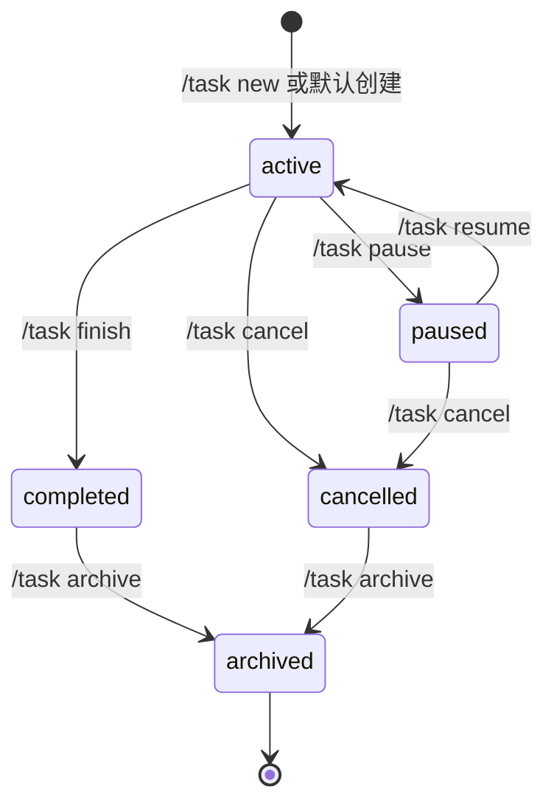
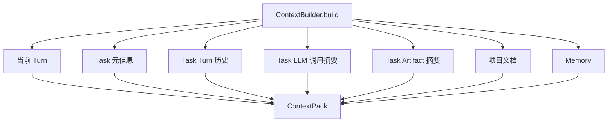
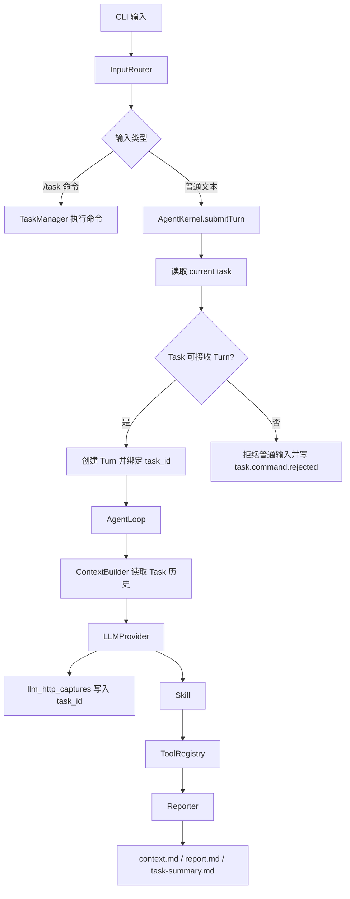
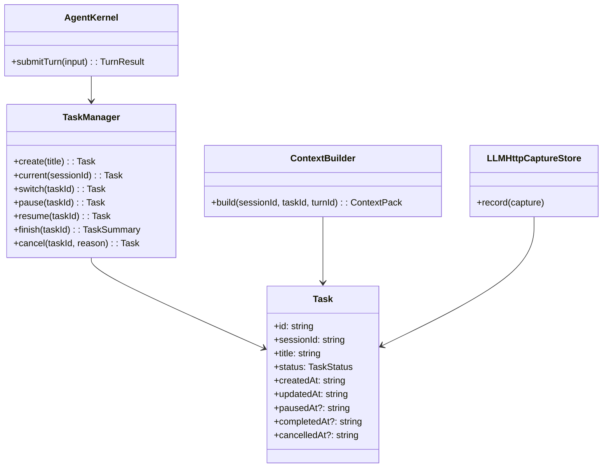

# Task 模块设计

## 文档索引信息

- 背景：本文档位于 `docs/agent/modules/task/`，用于沉淀 V1.1 Task Context Boundary 设计。
- 目标：补齐多轮聊天的任务级上下文边界，让一次连续工作不再被拆成孤立 Turn。
- 标签：Task、Context Boundary、Session、Turn、LLMCall、生命周期、抓包界面。
- 适用范围：V1.1 CLI 交互模式、上下文构造、LLM 抓包、Trace、Task Summary。
- 后续可用方向：Goal、Verifier、任务级看板、Wireshark 风格 LLM 抓包界面。

## 1. 模块定位

Task 是用户连续工作主题的上下文边界。

V1 当前结构是：

```text
Session -> Turn -> ContextPack -> LLMCall
```

这个结构能跑通单轮对话，但不能表达“同一个任务下的多轮聊天”。V1.1 引入 Task 后，结构升级为：

```text
Session -> Task -> Turn -> ContextPack -> LLMCall
```

四个概念的边界：

| 对象 | 含义 | 解决的问题 |
| --- | --- | --- |
| Session | 一次 CLI 运行会话 | 进程启动、退出、运行环境 |
| Task | 一个连续工作主题 | 多轮上下文归属 |
| Turn | 用户的一次输入 | 单轮处理 |
| LLMCall | 一次真实模型调用 | 抓包、请求、响应、耗时 |

Task 是上下文组织单元。Goal 是执行管理单元。V1.1 先做 Task，V2 再做 Goal。

## 2. 设计动机

没有 Task 时，ContextBuilder 只能围绕当前 Turn 构造上下文。连续对话会丢失任务级结构：

1. 多轮输入没有共同主题边界。
2. LLM 抓包只能按 Session 或 Turn 查看。
3. context.md 和 report.md 缺少任务归属。
4. 后续可视化界面无法按任务展开完整交互链路。
5. Task 结束时无法生成任务级复盘产物。

Task 引入后，系统可以回答：

1. 当前 Turn 属于哪个任务。
2. 当前任务已经经历了哪些 Turn。
3. 当前任务发起过哪些 LLM 调用。
4. 当前任务生成过哪些 Artifact。
5. 当前任务在何时暂停、恢复、完成或取消。

## 3. 职责边界

Task 负责：

1. 创建任务级上下文边界。
2. 保存任务状态。
3. 管理 current task。
4. 为 Turn、ContextPack、LLM Capture、Artifact、Trace 提供 `task_id`。
5. 在任务结束时生成 `task-summary.md`。
6. 为后续抓包界面提供任务树。

Task 不负责：

1. 不判断代码实现是否正确。
2. 不执行测试和构建。
3. 不做验收闭环。
4. 不做多 agent 调度。
5. 不替代 Goal。
6. 不替代 Memory。

## 4. Task 生命周期

Task 状态：

```text
active
paused
completed
cancelled
archived
```

生命周期状态机：



状态含义：

| 状态 | 含义 | 普通输入规则 |
| --- | --- | --- |
| active | 当前可接收 Turn | 创建 Turn |
| paused | 暂停接收普通 Turn | 拒绝输入，提示 `/task resume` |
| completed | 正常结束 | 拒绝输入，提示 `/task new` 或 `/task switch` |
| cancelled | 放弃结束 | 拒绝输入，提示 `/task new` 或 `/task switch` |
| archived | 历史归档 | 从默认列表隐藏 |

最小闭环：

```text
new -> active -> finish
new -> active -> cancel
new -> active -> pause -> resume -> finish
```

## 5. CLI 命令

V1.1 必做命令：

| 命令 | 作用 |
| --- | --- |
| `/task new <标题>` | 创建 Task，并切换为 current task |
| `/task current` | 查看当前 Task |
| `/task list` | 列出 active / paused Task |
| `/task switch <id>` | 切换到 active 或 paused Task |
| `/task pause` | 暂停当前 Task |
| `/task resume <id>` | 恢复 paused Task，并切换为 current task |
| `/task finish` | 正常结束当前 Task |
| `/task cancel` | 放弃当前 Task |

V1.1 暂缓命令：

```text
/task archive
/task rename
/task all
```

默认行为：

```text
启动 REPL 时自动创建 default task。
普通文本永远进入 current task。
没有 current task 时自动创建 default task。
```

## 6. Task 结束闭环

`/task finish` 必须执行收口动作：

```text
1. 写 task.finish.requested
2. 聚合当前 Task 的 Turn / LLM Capture / Tool / Artifact 摘要
3. 生成 task-summary.md
4. 写 artifacts 表
5. 状态改为 completed
6. 写 task.completed
7. current task 清空或切换到 default task
```

`/task cancel` 必须执行取消动作：

```text
1. 写 task.cancel.requested
2. 记录取消原因
3. 状态改为 cancelled
4. 写 task.cancelled
5. current task 清空或切换到 default task
```

Task Summary 路径：

```text
.figo-agent/artifacts/sessions/<session-id>/tasks/<task-id>/task-summary.md
```

Task Summary 内容：

```markdown
# Task Summary

## 基本信息
- taskId
- title
- status
- createdAt
- completedAt / cancelledAt

## 用户输入历史
- turn1
- turn2

## LLM 调用
- requestId
- model
- responseStatus
- durationMs

## 产物
- context.md
- report.md

## Trace 摘要
- task.created
- turn.received
- llm.completed
- task.completed
```

## 7. 数据模型

```sql
CREATE TABLE tasks (
  id TEXT PRIMARY KEY,
  session_id TEXT NOT NULL,
  title TEXT NOT NULL,
  status TEXT NOT NULL,
  created_at TEXT NOT NULL,
  updated_at TEXT NOT NULL,
  paused_at TEXT,
  resumed_at TEXT,
  completed_at TEXT,
  cancelled_at TEXT,
  archived_at TEXT,
  close_reason TEXT
);
```

关联字段：

```text
turns.task_id
context_packs.task_id
llm_http_captures.task_id
artifacts.task_id
trace_events.task_id
```

索引：

```sql
CREATE INDEX idx_tasks_session_status_updated ON tasks(session_id, status, updated_at);
CREATE INDEX idx_turns_task_created ON turns(task_id, created_at);
CREATE INDEX idx_llm_http_captures_task_created ON llm_http_captures(task_id, created_at);
```

## 8. 上下文构造流程

Task 引入后，ContextPack 由以下内容构成：

```text
当前 Turn 输入
+ 当前 Task 信息
+ 当前 Task 最近 N 轮 Turn
+ 当前 Task 最近 N 次 LLM 响应摘要
+ 当前 Task 已生成 Artifact 摘要
+ 项目固定上下文：AGENTS.MD / readme.md
+ Memory
```

流程图：



## 9. 运行总流程



## 10. UML / 类图



## 11. Trace 事件

新增事件：

```text
task.created
task.switched
task.paused
task.resumed
task.finish.requested
task.completed
task.cancel.requested
task.cancelled
task.summary.created
task.command.rejected
task.history.loaded
```

Trace payload 必须包含：

```text
sessionId
taskId
turnId
source
createdAt
status
reason
```

## 12. 抓包界面预留结构

后续 Wireshark 风格界面按此层级展示：

```text
Session
  Task
    Turn
      ContextPack
      LLM HTTP Capture
        Request Headers
        Request Body / messages
        Response Headers
        Response Body
      Tool Calls
      Artifacts
      Trace Timeline
```

右侧 Tabs：

```text
Overview
Context
HTTP Request
HTTP Response
Trace
Artifacts
```

## 13. V1.1 实现范围

V1.1 实现：

1. `tasks` 表。
2. `task_id` 关联字段。
3. `TaskManager`。
4. `/task new`、`/task current`、`/task list`、`/task switch`、`/task pause`、`/task resume`、`/task finish`、`/task cancel`。
5. ContextBuilder 引入 Task 历史。
6. LLM 抓包写入 `task_id`。
7. Task 结束生成 `task-summary.md`。
8. Task 生命周期 Trace。

V1.1 不实现：

1. Goal。
2. 自动验收。
3. Verifier。
4. 多 Task 并发执行。
5. Task UI。
6. Task archive 命令。

## 14. 可沉淀的文章观点

1. Session 不是任务边界，Task 才是连续上下文边界。
2. Task 和 Goal 分层后，系统能先解决上下文组织，再解决执行闭环。
3. LLM 抓包以 Task 为维度组织，才能支撑可解释界面。
4. Task Summary 是任务结束的复盘锚点，不是聊天记录的简单拼接。
