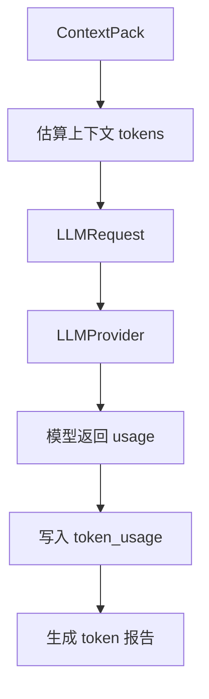
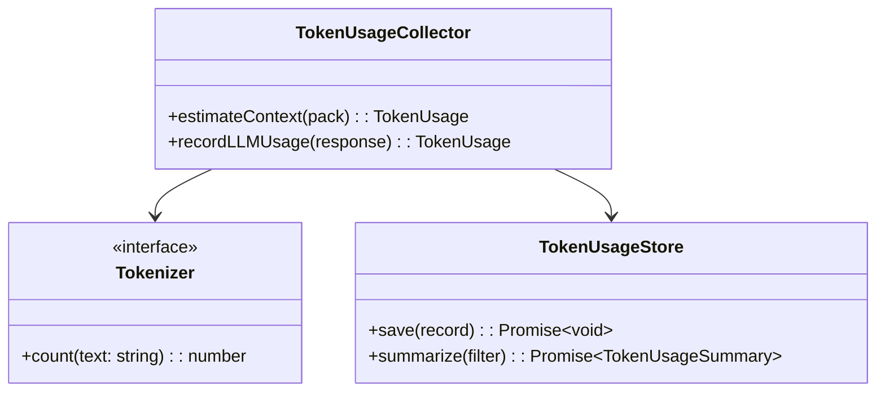

# TokenUsage 模块设计

## 文档索引信息

- 背景：本文档位于 `docs/agent/modules/token-usage/`，用于沉淀 Figo Agent 的 TokenUsage 设计和 token 消耗分析。
- 目标：讲清 V1 token 消耗估算、与主流 AgentLoop 方案的消耗对比，以及 V2 TokenUsage 的统计方向。
- 标签：TokenUsage、token 统计、上下文预算、成本分析、ContextPack、AgentLoop。
- 适用范围：V1 架构评估、V2 TokenUsage 设计、成本优化、文章素材。
- 后续可用方向：实现 token 统计、生成 token 报表、分析上下文压缩效果、沉淀 agent 成本控制方法论。

## 模块定位

TokenUsage 是 Figo Agent 的 token 观测与成本分析模块。

V1 不实现 TokenUsage 统计，只做架构级估算和字段预留。V2 开始实现结构化 token 统计。

## 设计动机

Agent 的 token 消耗不只来自用户输入和模型输出，更多来自上下文构造、工具结果回灌、历史对话、记忆检索和多轮循环。

本项目要研究 agent 设计细节，所以 token 消耗要进入架构评估。否则后续无法回答：

1. ContextPack 到底消耗多少 token。
2. 哪类上下文最贵。
3. Tool 结果是否造成上下文膨胀。
4. Skill 是否带来额外 prompt 成本。
5. 与 ReAct、OpenAI Agents SDK、LangGraph、AutoGPT 类循环相比，当前设计是否克制。

## 职责边界

TokenUsage 模块负责：

1. 估算 ContextPack 的 token 消耗。
2. 记录 LLM 请求和响应的实际 token 用量。
3. 统计 ContextSource、Skill、Tool 对 token 消耗的贡献。
4. 生成 Session、Turn、ContextSource 维度的 token 摘要。
5. 为上下文压缩和成本优化提供数据。

TokenUsage 模块不负责：

1. 不决定 ContextPack 的具体内容。
2. 不执行上下文压缩。
3. 不改变 AgentLoop 执行流程。
4. 不替代 TraceEvent。
5. 不在 V1 实现结构化统计。

## 输入输出

输入：

1. ContextPack。
2. ContextItem。
3. LLMRequest。
4. LLMResponse。
5. ContextSource、Skill、Tool 的结构化标识。

输出：

1. TokenUsage 记录。
2. token_usage SQLite 表。
3. Markdown token 摘要。
4. 按 Session、Turn、ContextSource、Skill、Tool 聚合的统计结果。

## V1 token 消耗估算

以 `project-understanding-skill` 为例，V1 一轮输入大致包括：

| 内容 | 估算 token |
| :--- | :--- |
| `AGENTS.MD` / 项目规则 | 1500 - 3500 |
| 当前用户输入 | 50 - 300 |
| 最近对话摘要 | 500 - 1500 |
| `readme.md` | 2000 - 4000 |
| 目录结构 | 500 - 1500 |
| Memory 摘要 | 300 - 1000 |
| ContextItem reason / metadata | 500 - 1200 |

V1 单轮 `ContextPack` 输入量估算：

```text
保守：5000 - 7000 tokens
正常：7000 - 12000 tokens
偏大：12000 - 18000 tokens
```

V1 输出量估算：

```text
普通项目理解报告：1000 - 2500 tokens
详细架构报告：2500 - 5000 tokens
```

V1 一轮项目理解总消耗估算：

```text
6000 - 23000 tokens
```

## 为什么 V1 消耗不算重

V1 具备以下控制点：

1. 每个 Turn 只调用一次 LLMProvider。
2. 不做 `model -> tool -> model` 的递归循环。
3. Tool 结果先进 Trace 和 SQLite，不默认全部重新塞回模型。
4. Reporter 可以从结构化事实生成 Markdown，不强制再调模型。
5. 不做 Verifier、不跑命令、不做 patch 反复修正。

所以 V1 的 token 消耗主要来自 ContextPack，不来自多轮自主循环。

## 与主流方案对比

| 方案 | Loop 方式 | Token 消耗特点 |
| :--- | :--- | :--- |
| Figo Agent V1 | 单轮受控 loop | 低到中等，主要消耗在 ContextPack |
| ReAct | Reason -> Act -> Observe 多轮循环 | 中到高，每次 Observation 重新进上下文 |
| OpenAI Agents SDK 风格 | model -> tool -> model 直到 final | 中到高，工具调用次数越多消耗越高 |
| LangGraph ReAct Agent | graph 中 model/tools 循环 | 中到高，取决于循环次数和 state 大小 |
| AutoGPT 类自主 agent | propose -> execute -> observe 长循环 | 高，长任务容易快速堆积上下文 |

Figo Agent V1 的结构是：

```text
一次 Turn
一次 ContextPack
一次 LLM
一次 Skill
多个只读 Tool
一次 Report
```

典型 ReAct / Agents SDK 工具循环是：

```text
一次 Turn
多次 LLM
多次 Tool
多次 Observation 回灌
直到模型给 final
```

所以同样做项目理解，Figo Agent V1 的 token 消耗低于开放式 ReAct 循环。

## 最大消耗点

V1 最大消耗点不是 AgentLoop，而是 Context 设计。

容易膨胀的位置：

1. README 全量塞入。
2. 目录结构过深。
3. 最近对话不摘要。
4. Memory 不筛选。
5. Tool 搜索结果原样塞回模型。
6. ContextItem 的 reason 和 metadata 过长。

## V1 控制策略

V1 不实现 TokenUsage，但要控制上下文规模：

1. `AGENTS.MD` 保留关键规则，长文档摘要。
2. `readme.md` 优先摘要，不默认全量。
3. 目录结构限制深度和条数。
4. 最近对话只保留最近 N 轮摘要。
5. Memory 最多取 Top 3 - 5 条。
6. Tool 结果只进报告和 Trace，不默认回灌模型。

## V2 TokenUsage 统计方向

V2 开始实现结构化 TokenUsage。

必须统计：

1. ContextPack 估算 tokens。
2. LLM 输入 tokens。
3. LLM 输出 tokens。
4. 每类 ContextSource 的 token 占比。
5. 压缩前后 token 变化。
6. 本轮总 token 消耗。
7. 每个 Session 累计 token 消耗。
8. 每个 Skill 和 Tool 对 token 消耗的间接贡献。

## V1 实现范围

V1 不实现 TokenUsage 统计。

V1 只保留以下设计约束：

1. ContextPack、ContextItem、LLMRequest、LLMResponse 预留 token 统计扩展位置。
2. Context 模块控制上下文规模。
3. Tool 结果不默认回灌模型。
4. Reporter 输出时保留后续接入 TokenUsage 的结构空间。

## V2/V3 扩展点

V2 实现：

1. TokenUsage 数据结构。
2. token_usage SQLite 表。
3. ContextPack 估算 token。
4. LLMProvider 实际 token 记录。
5. 按 Session、Turn、ContextSource、Skill、Tool 汇总。

V3 扩展：

1. 基于 token 消耗的上下文自动压缩建议。
2. 基于 Trace 的高成本模式识别。
3. 模型选择和成本策略。
4. 长期 token 消耗趋势分析。

## V2 数据结构草案

```ts
interface TokenUsage {
  id: string;
  sessionId: string;
  turnId: string;
  sourceType: "context_pack" | "llm_request" | "llm_response" | "context_source" | "skill" | "tool";
  sourceId: string;
  model?: string;
  estimatedInputTokens?: number;
  actualInputTokens?: number;
  actualOutputTokens?: number;
  totalTokens?: number;
  createdAt: string;
}
```

## V2 SQLite 表草案

```sql
CREATE TABLE token_usage (
  id TEXT PRIMARY KEY,
  session_id TEXT NOT NULL,
  turn_id TEXT NOT NULL,
  source_type TEXT NOT NULL,
  source_id TEXT NOT NULL,
  model TEXT,
  estimated_input_tokens INTEGER,
  actual_input_tokens INTEGER,
  actual_output_tokens INTEGER,
  total_tokens INTEGER,
  created_at TEXT NOT NULL,
  FOREIGN KEY (session_id) REFERENCES sessions(id),
  FOREIGN KEY (turn_id) REFERENCES turns(id)
);
```

## 运行流程图



## UML / 类图



## 设计结论

Figo Agent V1 当前 token 消耗是健康的。

原因：

1. V1 不做多轮模型-工具递归。
2. V1 不做 Verifier 回路。
3. V1 不做自动 patch 和测试修复循环。
4. V1 的 token 成本集中在 ContextPack，便于后续优化。

额外消耗来自 Context、Memory、Trace 的可解释性设计。这部分消耗是必要成本，因为本项目目标是研究 agent harness，不是只追求最低 token。

## 可沉淀的文章观点

1. Agent token 成本的核心不是模型回复，而是上下文工程。
2. 开放式工具循环比单轮受控 loop 更容易造成 token 膨胀。
3. Tool 结果是否回灌模型，是成本控制的关键开关。
4. 先做估算，再做实测，是个人 agent 研究项目更稳的路线。
5. TokenUsage 不只是成本统计，也是上下文质量评估工具。
