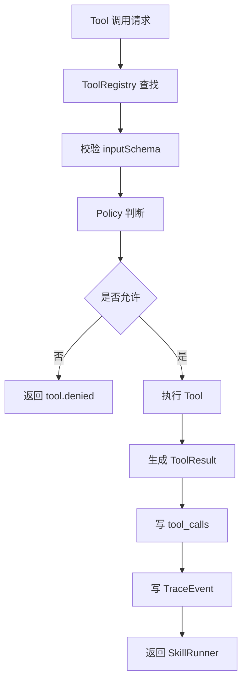
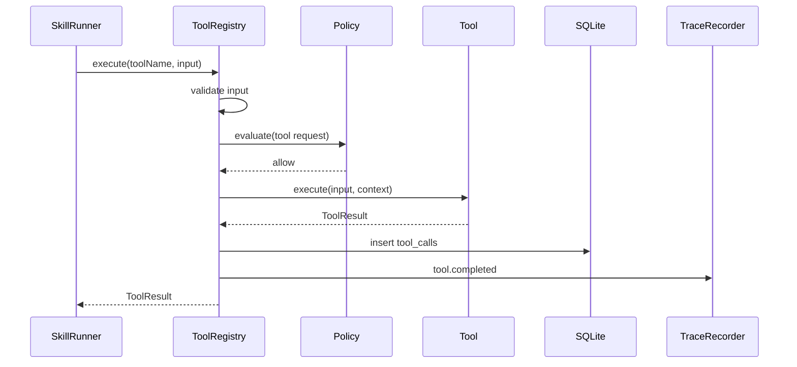
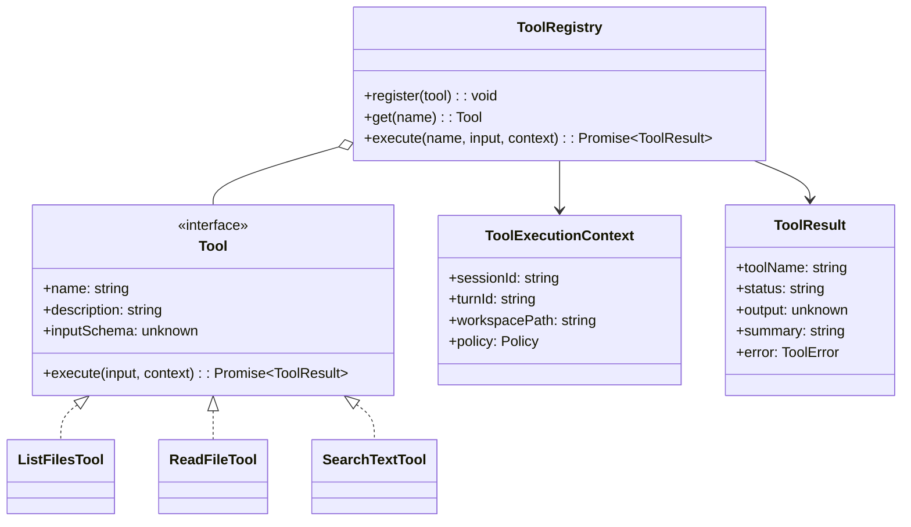

# Tool 模块设计

## 文档索引信息

- 背景：本文档位于 `docs/agent/modules/tool/`，用于沉淀 Figo Agent V1 的 Tool 模块设计。
- 目标：讲清 Tool 的原子能力边界、ToolRegistry、结构化输入输出、Policy 校验、Trace 记录和 V1 最小 Tool 集。
- 标签：Tool、工具调用、原子能力、只读工具、权限边界、Trace。
- 适用范围：V1 Tool 实现、后续 `apply_patch`、`run_command`、Git 工具和受控执行设计。
- 后续可用方向：受控执行、权限策略、工具生态、MCP 工具接入和文章素材。

## 1. 模块定位

Tool 是 agent 可调用的原子动作。

在 V1 中，Tool 只提供只读能力：

1. `list_files`
2. `read_file`
3. `search_text`

Tool 不表达任务方法。任务方法由 Skill 负责。

## 2. 设计动机

Agent 要操作外部世界，必须通过工具。工具设计决定了 agent 的能力边界和风险边界。

Tool 必须小而稳定：

1. 小：每个 Tool 只做一个原子动作。
2. 稳：输入输出结构化。
3. 可控：每次调用经过 Policy。
4. 可查：每次调用写入 Trace 和 SQLite。
5. 可组合：Skill 组合多个 Tool 完成任务。

## 3. Tool 和 Skill 的边界

| 维度 | Tool | Skill |
| :--- | :--- | :--- |
| 定位 | 原子动作 | 任务方法 |
| 示例 | `read_file` | `project-understanding-skill` |
| 控制点 | 参数、权限、执行结果 | 流程、上下文、输出结构 |
| 失败粒度 | 文件不存在、参数错误 | 上下文不足、流程失败 |
| 复用方式 | 被多个 Skill 调用 | 组合多个 Tool |

边界规则：

1. AgentLoop 不直接操作文件系统。
2. Skill 不绕过 Tool 执行动作。
3. Tool 不包含任务流程。
4. Tool 不生成最终报告。
5. ToolResult 必须结构化。

## 4. 职责边界

Tool 模块负责：

1. 定义 Tool 接口。
2. 注册 Tool。
3. 校验 Tool 输入。
4. 调用 Policy。
5. 执行原子动作。
6. 返回 ToolResult。
7. 写入 tool_calls。
8. 写入 Tool 相关 TraceEvent。

Tool 模块不负责：

1. 不决定是否执行某个任务。
2. 不决定上下文取舍。
3. 不直接生成 Markdown 报告。
4. 不直接写 Memory。
5. 不做多步骤计划。

## 5. 输入输出

输入：

1. Tool 名称。
2. 结构化参数。
3. ToolExecutionContext。
4. PolicyDecision。

输出：

1. ToolResult。
2. tool_calls SQLite 记录。
3. Tool 相关 TraceEvent。
4. 给 SkillRunResult 汇总的结果摘要。

## 6. Tool 生命周期

```text
注册
  -> 查询
  -> 参数校验
  -> Policy 校验
  -> 执行
  -> 结构化返回
  -> 写 tool_calls
  -> 写 TraceEvent
```

## 7. 运行流程图



## 8. 时序图



## 9. 类图



## 10. 核心数据结构

### 10.1 Tool

```ts
interface Tool {
  name: string;
  description: string;
  inputSchema: unknown;
  execute(input: unknown, context: ToolExecutionContext): Promise<ToolResult>;
}
```

### 10.2 ToolExecutionContext

```ts
interface ToolExecutionContext {
  sessionId: string;
  turnId?: string;
  skillRunId?: string;
  workspacePath: string;
  policy: Policy;
}
```

### 10.3 ToolResult

```ts
interface ToolResult {
  toolName: string;
  status: "completed" | "failed" | "denied";
  output?: unknown;
  summary: string;
  error?: ToolError;
  startedAt: string;
  completedAt: string;
}
```

### 10.4 ToolError

```ts
interface ToolError {
  type: "invalid_input" | "not_found" | "permission_denied" | "execution_failed";
  message: string;
  recoverable: boolean;
}
```

### 10.5 ToolCallRecord

```ts
interface ToolCallRecord {
  id: string;
  sessionId: string;
  turnId?: string;
  skillRunId?: string;
  toolName: string;
  inputSummary: string;
  outputSummary?: string;
  status: "completed" | "failed" | "denied";
  errorMessage?: string;
  startedAt: string;
  completedAt?: string;
}
```

## 11. V1 最小 Tool 集

### 11.1 list_files

职责：

1. 列出工作区文件。
2. 支持限制深度。
3. 支持排除常见目录。

输入：

```ts
interface ListFilesInput {
  root?: string;
  maxDepth: number;
  includeHidden: boolean;
  exclude?: string[];
}
```

输出：

```ts
interface ListFilesOutput {
  root: string;
  files: string[];
  truncated: boolean;
}
```

V1 默认排除：

```text
node_modules
.git
.figo-agent
dist
build
coverage
```

### 11.2 read_file

职责：

1. 读取文本文件。
2. 限制最大读取长度。
3. 返回内容摘要和截断标记。

输入：

```ts
interface ReadFileInput {
  path: string;
  maxChars: number;
}
```

输出：

```ts
interface ReadFileOutput {
  path: string;
  content: string;
  truncated: boolean;
}
```

V1 只读取工作区内文件。

### 11.3 search_text

职责：

1. 在工作区中搜索文本。
2. 返回匹配文件、行号和片段。
3. 限制结果数量。

输入：

```ts
interface SearchTextInput {
  query: string;
  root?: string;
  maxResults: number;
}
```

输出：

```ts
interface SearchTextOutput {
  query: string;
  matches: Array<{
    path: string;
    line: number;
    preview: string;
  }>;
  truncated: boolean;
}
```

## 12. V1 只读边界

V1 Tool 只读。

V1 禁止：

1. 写文件。
2. 删除文件。
3. 执行命令。
4. Git 操作。
5. 网络访问。
6. 浏览器操作。
7. 外部 API 调用。

V1 允许：

1. 列目录。
2. 读文件。
3. 文本搜索。

## 13. Policy 校验

所有 Tool 调用必须经过 Policy。

V1 Policy 结果：

```ts
interface PolicyDecision {
  allowed: boolean;
  reason: string;
}
```

V1 `ReadOnlyPolicy` 规则：

1. Tool 必须在 V1 允许列表中。
2. 文件路径必须在 workspacePath 内。
3. 读取长度必须在限制内。
4. 搜索结果数量必须在限制内。
5. 禁止写操作和命令操作。

## 14. SQLite 记录

V1 写入 `tool_calls` 表：

```sql
CREATE TABLE tool_calls (
  id TEXT PRIMARY KEY,
  session_id TEXT NOT NULL,
  turn_id TEXT,
  skill_run_id TEXT,
  tool_name TEXT NOT NULL,
  input_summary TEXT NOT NULL,
  output_summary TEXT,
  status TEXT NOT NULL,
  error_message TEXT,
  started_at TEXT NOT NULL,
  completed_at TEXT
);
```

Tool 输入输出不把大内容全量写入摘要字段。大内容进入 Artifact 或 Trace payload 的受控摘要。

## 15. TraceEvent 设计

Tool 模块必须记录：

1. `tool.called`
2. `tool.completed`
3. `tool.failed`
4. `tool.denied`

TraceEvent payload 必须包含：

1. toolName。
2. sessionId。
3. turnId。
4. skillRunId。
5. inputSummary。
6. outputSummary。
7. errorMessage。
8. duration。

## 16. ToolResult 进入 Context 的规则

V1 ToolResult 默认不回灌模型。

ToolResult 进入：

1. Trace。
2. SQLite。
3. Reporter。
4. SkillRunResult。

ToolResult 进入 ContextPack 的条件：

1. ContextBuilder 明确选择。
2. 结果经过摘要。
3. 结果与当前 Turn 强相关。

这个规则用于控制 token 膨胀。

## 17. 与 AgentLoop 的关系

AgentLoop 不直接调用具体 Tool。

```text
AgentLoop
  -> SkillRunner
  -> ToolRegistry
  -> Tool
```

AgentLoop 只接收 SkillRunResult 和 ToolResult 摘要。

## 18. 与 Skill 的关系

Skill 通过 `allowedTools` 声明可用 Tool。

ToolRegistry 执行时必须检查：

1. Tool 是否存在。
2. Tool 是否在 SkillManifest.allowedTools 中。
3. Policy 是否允许。

## 19. 与 Trace 的关系

Tool 是风险和事实的交汇点。每次 Tool 调用都必须有迹可循。

V1 要能回答：

1. 哪个 Skill 调用了 Tool。
2. 调用了哪个 Tool。
3. 输入摘要是什么。
4. 输出摘要是什么。
5. 是否失败。
6. 失败原因是什么。
7. 耗时是多少。

## 20. 失败处理矩阵

| 失败位置 | 失败原因 | V1 行为 | TraceEvent |
| :--- | :--- | :--- | :--- |
| ToolRegistry | Tool 不存在 | 返回 ToolError | `tool.failed` |
| 输入校验 | 参数错误 | 返回 ToolError | `tool.failed` |
| Policy | 权限拒绝 | 不执行 Tool | `tool.denied` |
| list_files | 目录不存在 | 返回 ToolError | `tool.failed` |
| read_file | 文件不存在 | 返回 ToolError | `tool.failed` |
| search_text | 搜索异常 | 返回 ToolError | `tool.failed` |

## 21. V1 实现范围

V1 实现：

1. Tool 接口。
2. ToolRegistry。
3. ToolExecutionContext。
4. ToolResult。
5. ToolError。
6. `list_files`。
7. `read_file`。
8. `search_text`。
9. tool_calls 表写入。
10. Tool 相关 TraceEvent。

V1 不实现：

1. `apply_patch`。
2. `run_command`。
3. Git 工具。
4. 浏览器工具。
5. 外部 API 工具。
6. 网络访问工具。
7. MCP 工具。

## 22. V2/V3 扩展点

V2：

1. `apply_patch`。
2. `run_command`。
3. `git_status`。
4. `git_diff`。
5. `git_log`。
6. Tool 权限分级。
7. Tool dry-run。

V3：

1. 浏览器工具。
2. 外部 API 工具。
3. MCP 工具。
4. Tool 插件目录。
5. Tool 执行统计。
6. Tool 风险评分。

## 23. 可沉淀的文章观点

1. Tool 是 agent 接触外部世界的接口，必须小而可控。
2. Tool 越原子，Skill 组合越灵活。
3. 只读 Tool 是 V1 最稳的起点。
4. ToolResult 不默认回灌模型，是控制 token 和上下文污染的关键。
5. Tool 必须经过 Policy，否则 agent 的能力边界不可控。

## 24. 个人经验提炼

Tool 模块最容易犯三个错误：

1. 把多个动作塞进一个 Tool。
2. 让 Tool 直接写最终报告。
3. 绕过 Policy 执行高风险动作。

V1 要避免这些问题：

1. 每个 Tool 只做一个动作。
2. ToolResult 结构化。
3. Tool 调用必须写 Trace。
4. Tool 执行必须经过 Policy。
5. 写操作和命令操作延后到 V2。

这就是从“脚本能力”走向“agent 工具系统”的关键。
