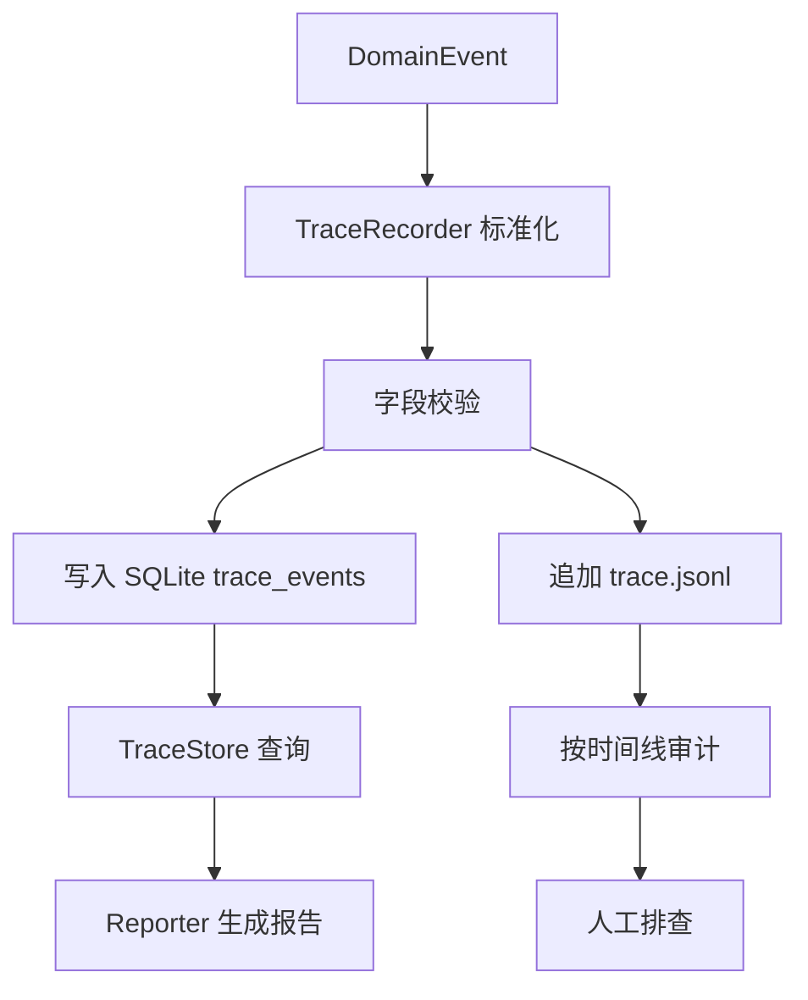
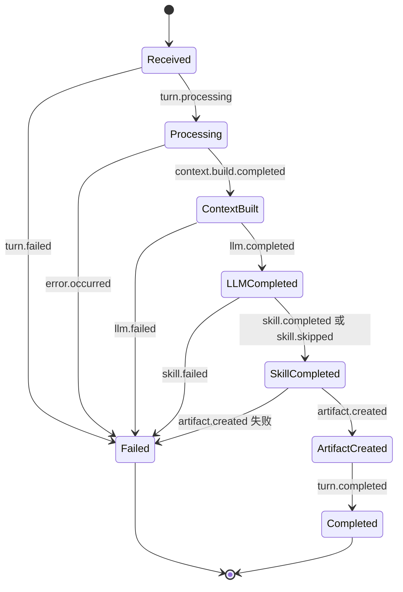
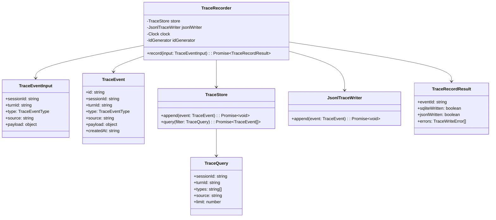

# Trace 模块设计

## 文档索引信息

- 背景：本文档位于 `docs/agent/modules/trace/`，用于沉淀 Trace 模块设计。
- 目标：讲清关键链路结构化 Trace、SQLite、JSONL、排查复盘和持续自优化之间的关系。
- 标签：Trace、可观察性、审计流水、SQLite、JSONL、排查复盘、自优化。
- 适用范围：V1 CLI 交互模式、Session、Turn、AgentLoop、Context、Memory、Skill、Tool、Reporter。
- 后续可用方向：全链路观测、指标系统、运行质量分析、持续自优化、文章素材。

## 1. 模块定位

Trace 是 agent 运行事实流水。

它回答五个问题：

1. 用户输入是什么。
2. 系统进入了哪个阶段。
3. 系统读取了哪些上下文和记忆。
4. 系统调用了哪些 Skill、Tool、LLM。
5. 系统在哪里失败、失败时保留了哪些证据。

V1 Trace 是关键链路结构化事件，不是完整日志平台。

## 2. 设计动机

Coding agent 的输出不是唯一价值。对研究型项目来说，过程证据同样重要。

Trace 的设计动机有四个：

1. 排查：出错时能定位到具体阶段、输入、输出和错误。
2. 复盘：结束后能还原 Session 和 Turn 的实际执行路径。
3. 解释：报告可以引用事实事件，而不是依赖主观总结。
4. 演进：V2/V3 可以基于 Trace 生成 Memory 候选、质量指标和自优化建议。

没有 Trace，agent 只能给出“结果”。有 Trace，agent 才能解释“过程”。

## 3. Trace 和日志的边界

| 对象 | 定位 | V1 是否实现 | 说明 |
| --- | --- | --- | --- |
| TraceEvent | 结构化事实事件 | 是 | V1 核心 |
| JSONL Audit | 按行追加的审计流水 | 是 | 排查兜底 |
| SQLite trace_events | 可查询事件表 | 是 | 状态源的一部分 |
| Console Log | CLI 面向用户输出 | 是 | 只输出必要信息 |
| Debug Log | 临时调试信息 | 否 | V1 不建设 |
| Metrics | 聚合指标 | 否 | V2/V3 建设 |
| OpenTelemetry Span | 分布式追踪 | 否 | V1 不引入 |
| Trace UI | 可视化查询界面 | 否 | V3 建设 |

V1 只做结构化 TraceEvent。它不是把所有 `console.log` 保存起来。

## 4. 职责边界

Trace 负责：

1. 定义 TraceEvent 标准结构。
2. 接收核心模块发出的事件。
3. 标准化事件字段。
4. 写入 SQLite `trace_events`。
5. 追加 JSONL `trace.jsonl`。
6. 为 Reporter 提供事实来源。
7. 为排查问题提供按 Session、Turn、事件类型过滤的查询能力。

Trace 不负责：

1. 不决定 AgentLoop 的流程。
2. 不决定 ContextPack 的内容。
3. 不决定 Memory 是否写入。
4. 不执行 Tool。
5. 不生成报告正文。
6. 不做业务异常恢复。
7. 不做完整全链路日志平台。
8. 不引入 OpenTelemetry。
9. 不提供可视化 UI。

## 5. 输入输出

输入：

1. AgentLoop 阶段事件。
2. Context 构建事件。
3. Memory 检索事件。
4. Skill 选择和执行事件。
5. Tool 调用事件。
6. LLM 请求和响应摘要事件。
7. Artifact 创建事件。
8. Error 事件。

输出：

1. SQLite 表 `trace_events`。
2. JSONL 文件 `.figo-agent/artifacts/sessions/<session-id>/trace.jsonl`。
3. Reporter 可读取的事件列表。
4. CLI 可展示的最近事件摘要。

Trace 输出的是事实，不输出结论。

## 6. 核心设计原则

### 6.1 事件优先

系统运行过程先抽象为事件，再决定写入形式。

```text
DomainEvent
  -> TraceEvent
  -> SQLite
  -> JSONL
  -> Report
```

这样做的收益是：业务模块只关心“发生了什么”，不关心“怎么保存”。

### 6.2 结构化优先

TraceEvent 必须是结构化 JSON，不把关键信息塞进自由文本。

正确示例：

```json
{
  "type": "tool.completed",
  "source": "ToolRegistry",
  "payload": {
    "toolName": "read_file",
    "path": "docs/agent/v1-architecture-design.md",
    "bytes": 18042,
    "durationMs": 18
  }
}
```

不采用的写法：

```text
Tool read_file completed for docs/agent/v1-architecture-design.md in 18ms
```

自由文本可读，但不利于查询、聚合和自优化。

### 6.3 摘要优先

Trace 保存事件事实和关键摘要，不保存大文本全文。

大文本的归属：

1. 文件内容在原始文件中。
2. ContextPack 全量阅读产物在 `context.md`。
3. 报告正文在 `report.md`。
4. Trace payload 保存路径、hash、token 估算、长度和摘要。

这样避免 Trace 变成不可控的大型日志文件。

### 6.4 双写兜底

V1 同时写 SQLite 和 JSONL。

SQLite 提供查询能力，JSONL 提供追加型审计流水。两者不是重复设计，而是面向不同问题：

1. SQLite 适合按条件检索。
2. JSONL 适合按时间顺序还原。
3. SQLite 失败时 JSONL 保留兜底证据。
4. JSONL 失败时 SQLite 保留状态源。

### 6.5 事实和评价分离

Trace 只记录事实，不写主观评价。

Trace 可以记录：

1. `tool.failed`
2. `errorCode`
3. `errorMessage`
4. `durationMs`
5. `inputSummary`

Trace 不记录：

1. “这个错误很奇怪”
2. “模型表现不好”
3. “这个方案更优雅”
4. “需要后续观察”

评价进入 Report 的分析章节，不进入 TraceEvent。

## 7. Trace 生命周期

```text
模块产生 DomainEvent
  -> TraceRecorder.record()
  -> 校验必填字段
  -> 补齐 id / createdAt / source
  -> 标准化 payload
  -> 写入 SQLite
  -> 追加 JSONL
  -> 返回 record 结果
```

Trace 生命周期必须保持短路径。Trace 失败不能反向污染业务模块的正常返回，除非失败发生在启动初始化阶段。

## 8. 运行流程图



## 9. AgentLoop 中的 Trace 时序

```mermaid
sequenceDiagram
  participant User as User
  participant CLI as CLI
  participant Loop as AgentLoop
  participant Trace as TraceRecorder
  participant Context as ContextBuilder
  participant LLM as LLMProvider
  participant Skill as SkillRunner
  participant Tool as ToolRegistry
  participant Report as Reporter

  User->>CLI: 输入普通文本
  CLI->>Trace: turn.received
  CLI->>Loop: runTurn(input)
  Loop->>Trace: turn.processing
  Loop->>Context: build()
  Context->>Trace: context.build.started
  Context->>Trace: context.build.completed
  Loop->>LLM: complete(context)
  Loop->>Trace: llm.called
  LLM-->>Loop: response
  Loop->>Trace: llm.completed
  Loop->>Skill: matchAndRun()
  Skill->>Trace: skill.activated
  Skill->>Tool: call(read_file/search_text/list_files)
  Tool->>Trace: tool.called
  Tool-->>Skill: ToolResult
  Tool->>Trace: tool.completed
  Skill-->>Loop: SkillRunResult
  Skill->>Trace: skill.completed
  Loop->>Report: create()
  Report->>Trace: artifact.created
  Loop->>Trace: turn.completed
```

## 10. 状态机



Trace 不维护业务状态机，但 TraceEvent 可以还原状态迁移。

## 11. UML / 类图



## 12. 核心数据结构

### 12.1 TraceEventType

```ts
type TraceEventType =
  | "session.started"
  | "session.ended"
  | "session.failed"
  | "turn.received"
  | "turn.processing"
  | "turn.completed"
  | "turn.failed"
  | "context.build.started"
  | "context.item.candidate"
  | "context.item.included"
  | "context.item.excluded"
  | "context.build.completed"
  | "memory.search.started"
  | "memory.search.completed"
  | "skill.activated"
  | "skill.skipped"
  | "skill.completed"
  | "skill.failed"
  | "tool.called"
  | "tool.completed"
  | "tool.failed"
  | "tool.denied"
  | "policy.evaluated"
  | "policy.denied"
  | "llm.called"
  | "llm.completed"
  | "llm.failed"
  | "artifact.created"
  | "error.occurred";
```

### 12.2 TraceEvent

```ts
interface TraceEvent {
  id: string;
  sessionId: string;
  turnId?: string;
  type: TraceEventType;
  source: string;
  payload: Record<string, unknown>;
  createdAt: string;
}
```

字段说明：

| 字段 | 说明 | V1 规则 |
| --- | --- | --- |
| id | 事件唯一标识 | 由 TraceRecorder 生成 |
| sessionId | 当前 Session | 必填 |
| turnId | 当前 Turn | Session 级事件为空 |
| type | 事件类型 | 必须来自 TraceEventType |
| source | 事件来源模块 | 必填 |
| payload | 结构化负载 | 必须是 JSON 对象 |
| createdAt | 创建时间 | ISO 8601 字符串 |

### 12.3 TraceEventInput

```ts
interface TraceEventInput {
  sessionId: string;
  turnId?: string;
  type: TraceEventType;
  source: TraceSource;
  payload?: Record<string, unknown>;
}
```

`TraceEventInput` 是业务模块传给 TraceRecorder 的输入。它不要求业务模块生成 `id` 和 `createdAt`。

### 12.4 TraceSource

```ts
type TraceSource =
  | "CLI"
  | "AgentKernel"
  | "AgentLoop"
  | "ContextBuilder"
  | "MemoryStore"
  | "PluginHost"
  | "SkillRunner"
  | "ToolRegistry"
  | "LLMProvider"
  | "Reporter"
  | "Storage";
```

Source 用模块名，不用文件名。这样能保持事件语义稳定。

### 12.5 TraceRecordResult

```ts
interface TraceRecordResult {
  eventId: string;
  sqliteWritten: boolean;
  jsonlWritten: boolean;
  errors: TraceWriteError[];
}
```

V1 业务模块默认不消费 `TraceRecordResult`。它用于内部排查和严重错误处理。

### 12.6 TraceWriteError

```ts
interface TraceWriteError {
  target: "sqlite" | "jsonl";
  message: string;
  code?: string;
}
```

Trace 写入失败要保存目标位置，避免排查时分不清是 SQLite 失败还是 JSONL 失败。

## 13. SQLite 设计

```sql
CREATE TABLE trace_events (
  id TEXT PRIMARY KEY,
  session_id TEXT NOT NULL,
  turn_id TEXT,
  type TEXT NOT NULL,
  source TEXT NOT NULL,
  payload_json TEXT NOT NULL,
  created_at TEXT NOT NULL,
  FOREIGN KEY (session_id) REFERENCES sessions(id),
  FOREIGN KEY (turn_id) REFERENCES turns(id)
);
```

V1 增加索引：

```sql
CREATE INDEX idx_trace_events_session_created
ON trace_events(session_id, created_at);

CREATE INDEX idx_trace_events_turn_created
ON trace_events(turn_id, created_at);

CREATE INDEX idx_trace_events_type_created
ON trace_events(type, created_at);
```

索引用于支撑三类查询：

1. 查看一个 Session 的时间线。
2. 查看一个 Turn 的执行过程。
3. 查看某类事件的失败分布。

## 14. JSONL 设计

路径：

```text
.figo-agent/artifacts/sessions/<session-id>/trace.jsonl
```

一行一个 TraceEvent：

```json
{"id":"trc_001","sessionId":"ses_001","turnId":"turn_001","type":"turn.processing","source":"AgentLoop","payload":{"inputLength":24},"createdAt":"2026-10-10T10:00:00.000Z"}
```

JSONL 规则：

1. 每行必须是完整 JSON 对象。
2. 每行必须包含 `id`、`sessionId`、`type`、`source`、`payload`、`createdAt`。
3. 写入顺序遵循事件发生顺序。
4. 不把多行 Markdown 或文件全文写进 payload。
5. payload 中的大字段使用 `summary`、`path`、`hash`、`bytes` 表示。

## 15. 事件命名规范

事件名采用：

```text
<domain>.<verb>
```

示例：

```text
turn.received
context.build.completed
tool.failed
artifact.created
```

命名规则：

1. domain 使用小写名词。
2. verb 使用过去分词或阶段动作。
3. 事件名表达已经发生的事实。
4. 不使用 `beforeXxx`、`afterXxx`。
5. 不使用带情绪或评价的命名。

## 16. V1 关键事件清单

### 16.1 Session 事件

| 事件 | 来源 | payload |
| --- | --- | --- |
| `session.started` | AgentKernel | `sessionId`、`cwd`、`startedAt` |
| `session.ended` | AgentKernel | `sessionId`、`turnCount`、`endedAt` |
| `session.failed` | AgentKernel | `sessionId`、`errorMessage`、`endedAt` |

### 16.2 Turn 事件

| 事件 | 来源 | payload |
| --- | --- | --- |
| `turn.received` | CLI | `inputLength`、`commandType` |
| `turn.processing` | AgentLoop | `turnId`、`mode` |
| `turn.completed` | AgentLoop | `turnId`、`durationMs`、`artifactCount` |
| `turn.failed` | AgentLoop | `turnId`、`errorMessage`、`failedStage` |

### 16.3 Context 事件

| 事件 | 来源 | payload |
| --- | --- | --- |
| `context.build.started` | ContextBuilder | `turnId` |
| `context.item.candidate` | ContextBuilder | `sourceType`、`sourceId`、`reason` |
| `context.item.included` | ContextBuilder | `sourceType`、`sourceId`、`estimatedTokens` |
| `context.item.excluded` | ContextBuilder | `sourceType`、`sourceId`、`reason` |
| `context.build.completed` | ContextBuilder | `contextPackId`、`itemCount`、`estimatedTokens` |

### 16.4 Memory 事件

| 事件 | 来源 | payload |
| --- | --- | --- |
| `memory.search.started` | MemoryStore | `query`、`scope` |
| `memory.search.completed` | MemoryStore | `resultCount`、`durationMs` |

V1 不做自动 Memory 写入，因此没有 `memory.created`。

### 16.5 Skill 事件

| 事件 | 来源 | payload |
| --- | --- | --- |
| `skill.activated` | SkillRunner | `skillName`、`reason`、`confidence` |
| `skill.skipped` | SkillRunner | `reason` |
| `skill.completed` | SkillRunner | `skillName`、`durationMs`、`toolCallCount` |
| `skill.failed` | SkillRunner | `skillName`、`errorMessage`、`failedStep` |

### 16.6 Tool 事件

| 事件 | 来源 | payload |
| --- | --- | --- |
| `tool.called` | ToolRegistry | `toolName`、`inputSummary` |
| `tool.completed` | ToolRegistry | `toolName`、`outputSummary`、`durationMs` |
| `tool.failed` | ToolRegistry | `toolName`、`errorMessage`、`errorCode` |
| `tool.denied` | ToolRegistry | `toolName`、`reason`、`code` |

### 16.7 Policy 事件

| 事件 | 来源 | payload |
| --- | --- | --- |
| `policy.evaluated` | Policy | `action`、`resource`、`allowed`、`reason` |
| `policy.denied` | Policy | `action`、`resource`、`reason`、`code` |

### 16.8 LLM 事件

| 事件 | 来源 | payload |
| --- | --- | --- |
| `llm.called` | LLMProvider | `model`、`contextPackId`、`estimatedInputTokens` |
| `llm.completed` | LLMProvider | `model`、`outputLength`、`durationMs` |
| `llm.failed` | LLMProvider | `model`、`errorMessage`、`errorCode` |

V1 不实现 TokenUsage 精确统计，LLM 事件只记录估算字段。

### 16.9 Artifact 事件

| 事件 | 来源 | payload |
| --- | --- | --- |
| `artifact.created` | Reporter | `artifactType`、`path`、`bytes` |

### 16.10 Error 事件

| 事件 | 来源 | payload |
| --- | --- | --- |
| `error.occurred` | 任意核心模块 | `stage`、`errorMessage`、`errorCode` |

`error.occurred` 用于保留通用错误事实。具体模块失败仍然要写对应的 `*.failed` 事件。

## 17. Payload 规范

Payload 必须满足：

1. 是 JSON 对象。
2. 字段名使用 camelCase。
3. 不保存密钥、token、完整 API Key。
4. 不保存大段文件内容。
5. 不保存模型完整输出。
6. 错误对象转换为 `errorMessage`、`errorCode`、`stackSummary`。
7. 路径使用相对工作区路径。
8. 用户原始输入只保存长度和摘要，完整输入保存在 Turn 记录中。

示例：

```json
{
  "toolName": "search_text",
  "pattern": "AgentLoop",
  "matches": 12,
  "durationMs": 31
}
```

## 18. 敏感信息处理

Trace 写入前必须做最小脱敏。

V1 脱敏规则：

1. 字段名包含 `apiKey`、`token`、`secret`、`password` 时，值写成 `[REDACTED]`。
2. 绝对路径默认转为工作区相对路径。
3. LLM 输入只记录 `contextPackId` 和估算 token，不写完整 messages。
4. Tool 读取文件只记录 path、bytes、hash、summary，不写全文。

Trace 的价值在于可追溯，不在于复制所有原始数据。

## 19. 写入策略

V1 采用顺序写入策略：

```text
record()
  -> normalize()
  -> writeSQLite()
  -> appendJsonl()
```

顺序写入带来两个好处：

1. SQLite 是主状态源。
2. JSONL 作为审计流水紧随其后。

TraceRecorder 返回写入结果，但业务流程不依赖它继续计算。启动阶段初始化失败除外。

## 20. 失败处理矩阵

| 失败位置 | 原因 | V1 行为 | 后续证据 |
| --- | --- | --- | --- |
| TraceEvent 校验 | 缺少 sessionId/type/source | 拒绝写入，返回 TraceWriteError | CLI 输出开发错误 |
| SQLite 写入 | 数据库锁、schema 错误 | 继续写 JSONL | `trace.jsonl` |
| JSONL 写入 | 文件权限、磁盘错误 | 保留 SQLite 记录 | `trace_events` |
| 双写失败 | 数据库和文件都不可写 | CLI 输出严重错误 | 当前进程错误输出 |
| payload 序列化 | 循环引用、非 JSON 值 | 转成摘要错误 | `error.occurred` |
| 脱敏失败 | payload 包含不可处理值 | 拒绝写入原始 payload | `error.occurred` |

V1 不做后台重试队列。

## 21. 查询能力

TraceStore V1 支持四类查询：

### 21.1 Session 时间线

```ts
query({ sessionId, limit: 200 })
```

用于生成 Session 报告。

### 21.2 Turn 时间线

```ts
query({ sessionId, turnId })
```

用于排查单轮输入发生了什么。

### 21.3 事件类型查询

```ts
query({ sessionId, types: ["tool.failed", "llm.failed"] })
```

用于定位失败事件。

### 21.4 最近事件查询

```ts
query({ sessionId, limit: 20 })
```

用于 CLI `/report` 或调试摘要。

## 22. 与 AgentLoop 的关系

AgentLoop 是 Trace 的最大事件来源。

AgentLoop 必须记录：

1. Turn 开始。
2. Context 构建开始和结束。
3. LLM 调用开始和结束。
4. Skill 选择结果。
5. Tool 调用结果。
6. Artifact 创建结果。
7. Turn 结束或失败。

AgentLoop 不直接写 SQLite，不直接写 JSONL。它只调用 TraceRecorder。

## 23. 与 Context 的关系

ContextBuilder 用 Trace 解释 ContextPack 的来源。

它要记录：

1. 哪些信息成为候选。
2. 哪些信息进入 ContextPack。
3. 哪些信息被排除。
4. 排除原因。
5. 最终估算 token。

Trace 不保存 ContextPack 全文。ContextPack 全文进入 `context.md` 和 SQLite 结构化表。

## 24. 与 Memory 的关系

MemoryStore 用 Trace 记录检索过程。

V1 记录：

1. 查询范围。
2. 命中数量。
3. 检索耗时。
4. 进入 Context 的 memory id。

V1 不做自动写 Memory。V2 基于 Trace 和人工确认生成候选 Memory。

## 25. 与 Skill 的关系

SkillRunner 用 Trace 记录方法选择和执行过程。

重点事件：

1. `skill.activated`
2. `skill.skipped`
3. `skill.completed`
4. `skill.failed`

Skill 的价值不只在最终输出，也在于能解释“为什么选了这个方法”。

## 26. 与 Tool 的关系

ToolRegistry 用 Trace 记录每次原子动作。

V1 Tool 是只读工具，仍然要记录：

1. 调用了哪个 Tool。
2. 输入摘要。
3. 输出摘要。
4. 耗时。
5. 错误。
6. Policy 拒绝原因。

ToolResult 不默认回灌 Context，但 ToolResult 必须进入 Trace 和 SQLite。

## 27. 与 Reporter 的关系

Reporter 读取 Trace 生成人类可读报告。

报告可以包含：

1. Session 时间线。
2. Turn 执行路径。
3. Context 来源统计。
4. Skill 和 Tool 调用摘要。
5. 失败事件列表。
6. 产物路径。

Reporter 可以解释 Trace，但不能篡改 Trace。

## 28. 与 Storage 的关系

Trace 依赖 Storage 提供 SQLite 和 JSONL 写入能力。

边界：

1. TraceRecorder 负责事件语义。
2. TraceStore 负责 SQLite 持久化。
3. JsonlTraceWriter 负责 JSONL 追加。
4. StorageManager 负责目录和数据库初始化。

业务模块不能绕过 TraceRecorder 直接写 `trace_events`。

## 29. V1 实现范围

V1 实现：

1. TraceEventType 枚举。
2. TraceEventInput。
3. TraceEvent 标准结构。
4. TraceRecorder。
5. TraceStore。
6. JsonlTraceWriter。
7. SQLite `trace_events` 表。
8. JSONL `trace.jsonl`。
9. 基础 payload 脱敏。
10. AgentLoop 关键事件。
11. Context 关键事件。
12. Memory 检索事件。
13. Skill 执行事件。
14. Tool 调用事件。
15. LLM 调用摘要事件。
16. Policy 决策事件。
17. Artifact 创建事件。
18. Error 事件。
19. Reporter 基于 Trace 生成报告摘要。

V1 不实现：

1. OpenTelemetry。
2. Span 层级。
3. Metrics 聚合。
4. Trace UI。
5. 后台批量写入。
6. 自动异常归因。
7. 自动优化建议。
8. 远程日志系统。

## 30. V2/V3 扩展点

V2 扩展：

1. Goal 事件。
2. Verifier 事件。
3. TokenUsage 事件。
4. `apply_patch`、`run_command`、Git 工具事件。
5. 更细粒度 Policy profile 事件。
6. Memory 候选生成事件。
7. Trace 到 Report 的失败原因归类。

V3 扩展：

1. Span 层级模型。
2. Metrics 聚合。
3. Trace 查询 UI。
4. 多 Agent 协作事件。
5. MCP 调用事件。
6. 长期运行质量看板。
7. 基于 Trace 的持续自优化。

## 31. 设计取舍

### 31.1 为什么 V1 不做完整全链路

完整全链路追踪需要：

1. Span 模型。
2. TraceId/SpanId/ParentSpanId。
3. 异步上下文传播。
4. 采样策略。
5. 指标聚合。
6. 查询 UI。

这些能力在 V1 会压过命令行 agent 小内核的主线。V1 需要的是关键事实可查，不是建设观测平台。

### 31.2 为什么同时保留 SQLite 和 JSONL

SQLite 解决结构化查询，JSONL 解决时间线审计。两者面向不同使用场景。

只有 SQLite 时，数据库损坏或 schema 迁移出错会影响审计。

只有 JSONL 时，查询失败事件和统计事件成本高。

V1 同时使用两者，复杂度可控，收益明确。

### 31.3 为什么 Trace 不保存全文

Trace 保存全文会带来三个问题：

1. 数据膨胀。
2. 敏感信息扩散。
3. 查询性能下降。

V1 通过路径、hash、bytes、summary 连接原始数据和结构化事实。

## 32. 验收标准

V1 Trace 模块验收标准：

1. 每个 Session 有 `session.started`。
2. 每个普通输入 Turn 有 `turn.received`、`turn.processing`、`turn.completed` 或 `turn.failed`。
3. 每次 Context 构建有 started/completed 事件。
4. 每次 Memory 检索有 started/completed 事件。
5. 每次 Skill 执行有 activated/completed 或 failed 事件。
6. 每次 Tool 调用有 called/completed 或 failed 事件。
7. 每次 Policy 判断有 `policy.evaluated`。
8. 每次 Policy 拒绝有 `policy.denied`。
9. 每次 Tool 被拒绝有 `tool.denied`。
10. 每次 LLM 调用有 called/completed 或 failed 事件。
11. 每个 Artifact 创建有 `artifact.created`。
12. SQLite `trace_events` 可查询 Session 时间线。
13. `trace.jsonl` 可按行解析。
14. payload 中不出现明文密钥字段。
15. Reporter 可以从 Trace 生成执行摘要。

## 33. 可沉淀的文章观点

1. Trace 是 agent 的黑匣子，不是普通日志。
2. 研究型 agent 项目要优先保存过程证据。
3. 结构化事件比文本日志更适合后续自优化。
4. V1 不需要完整观测平台，但必须有关键链路 Trace。
5. SQLite 负责查询，JSONL 负责审计，Markdown 负责阅读。
6. Trace 不保存所有内容，Trace 保存能定位事实的索引和摘要。
7. Agent 的可解释性不是一句自然语言解释，而是每一步都有事件证据。

## 34. 个人经验提炼

1. 做 agent 不能只看最终回答，必须看它走过的路径。
2. Trace 的第一版要小，但字段要稳。
3. 事件命名要克制，后续统计和文章写作都会依赖这些名字。
4. payload 不要贪多，大内容放 Artifact，Trace 放摘要。
5. 排查体验来自事件顺序、阶段名、错误字段和产物路径。
6. 后续自优化不是凭空出现的，它来自今天保存下来的结构化事实。
