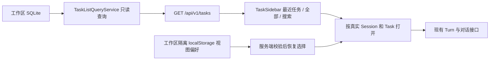

# 任务窗口优化实施与验收

## 目标与边界

用户已确认：参考截图的简洁任务列表；当前工作区跨 Session 展示全部任务；每个 Session 的可读标题来自第一次用户对话。保留右侧列表 / 对话一体面板与固定输入框。

Session 保留运行会话语义，Task 保留上下文边界。列表条目仍代表 Task，任务标题优先显示该 Task 首条用户消息，Session 历史入口使用该 Session 首条用户消息。没有对话时回退已有任务名称或中文空会话名称。不改 SQLite 历史标题，不调用模型生成标题，不迁移 Task，不放开历史写权限，不增加归档生命周期。

## 架构与接口

`GET /api/v1/tasks?page=1&limit=30&q=文本` 返回 `{ tasks, totalCount, page, totalPages, pageSize }`。查询范围限定当前工作区数据库，不按当前运行 Session 过滤。包含旧版 `task_id is null` 的只读合成入口。排除没有 Turn 且名称为 `default` 的占位 Task，保留其他命名空任务；现有数据没有创建来源标记，不将该规则描述成已区分自动创建与手工同名创建。排序按真实最近活动时间，重复毫秒有稳定次序。标题先脱敏，再规范空白与截断。

新增 `web.taskList`：`recentLimit=8`、`pageSize=30`、`maxPageSize=100`、`searchMaxChars=200`、`titleMaxChars=120`、`searchDebounceMs=200`。参数由统一 JSON 控制，中文文案进入 `code/locales/zh-CN.json`。前端没有密钥访问能力。

## Task 1：只读任务目录与配置

文件：新增 `code/src/config/task-list-settings.ts`、`code/src/contracts/task-list.ts`、`code/src/ui/task-list-query-service.ts`；修改 `runtime-config.ts` 与 `workspace-query-service.ts`；测试 `code/tests/ui/task-list-query-service.test.ts`、`code/tests/config/task-list-settings.test.ts`。

接口：`TaskListQueryService(storage, secrets?, settings?).list({ page?, limit?, q? })`；契约导出 `TaskListItem`、`TaskListPage`，条目至少含 `id, sessionId, title, displayTitle, sessionTitle, status, turnCount, updatedAt`。`RuntimeWebConfig.taskList` 为完整配置。现有 `WorkspaceQueryService.sessions()` 增加 `title`，原有字段保持。

- [x] 先写测试并确认失败：多个 Session、首轮而非末轮命名、空会话回退、legacy、隐藏空 default、分页总数、稳定排序、字面搜索、脱敏、非法参数。
- [x] 实现最小只读 SQL 投影，不修改 Schema、TaskManager 或 AgentLoop。
- [x] 运行 `npm --prefix code test -- tests/ui/task-list-query-service.test.ts tests/config/task-list-settings.test.ts` 验证。

## Task 2：任务面板、真实 API 与视图恢复

文件：新增 `code/web/src/TaskSidebar.tsx`、`task-sidebar-state.ts`、`task-sidebar.css`；修改 `App.tsx`、`api.ts`、本地 API 装配及 locale、统一 JSON。

- [x] 先写状态函数测试和 API 测试，确认新 GET 接口尚未存在、状态恢复尚未支持。
- [x] 独立 TaskSidebar 管理最近 / 全部 / 搜索与分页，异步请求切换后丢弃迟到响应。顶栏历史、设置、新建使用带中文 tooltip 的 Lucide 图标；单行标题、相对时间、灰色选中态、悬停操作。
- [x] App 只负责打开真实 Session / Task、既有状态操作和固定输入框，不复制 Agent 流程。历史列表不再依赖当前 Session 过滤。
- [x] 视图偏好以工作区路径隔离，只保存 Task/Session 选择、列表 / 对话、历史展开偏好；刷新后通过已有查询确认归属，失效时回退，不改数据库归属。
- [x] 设置页入口保持唯一的可访问名称，避免顶栏和面板重复名称破坏可访问导航。

## Task 3：验收与收尾

- [x] 真实浏览器：近期列表、查看全部与总数、搜索、分页、Session 首条消息标题、跨会话打开、刷新恢复、历史只读、当前任务发送和新建、键盘焦点、迟到请求隔离。
- [x] 桌面 1440×900、移动端 390×844 截图：无横向溢出，长中文标题省略且 tooltip 保留，行尾时间与操作不挤占标题，固定输入框可见。
- [x] `npm --prefix code test`、`typecheck`、`web:typecheck`、`build`、`web:build` 均通过；本轮不调用收费模型。
- [x] 更新同目录 IMPLEMENTATION / ACCEPTANCE / workspace 文档及 AGENTS.MD 已确认原则；记录实测结果。未通过项不标为放行。

## 禁止放行条件

标题使用后续 Turn 覆盖首条输入；搜索 / 分页统计不一致；历史任务可被普通发送写入；刷新错误串工作区；迟到响应覆盖新选择；配置 / UI 返回密钥；把“当前页”当全部数据；修改 AgentLoop 或 Pi 压缩；浏览器有未处理错误或移动端整体溢出。

## 本轮进度

主体功能及自动化验收完成；独立交互审查发现的三项缺陷已修复，新增回归先复现五项失败，再验证五项通过。最终独立复审通过：另一位审查者检查修复及回归有效性，并单独重跑五项浏览器回归，退出码 0，未发现阻断项。本地 Web 本专项放行，边界见下文。

| 编号 | 复现证据 | 修复与通过的回归 |
| --- | --- | --- |
| F1 | 点击“暂停任务”超时，后续“当前任务2”截获点击 | 移除行级隔离层叠上下文；真实鼠标点击正确执行原任务 pause |
| F2 | switch、resume 后标题均退化为“任务对话” | 统一安装 Session、任务集合、选中 ID 和同步引用；两条回归确认标题、输入权限及存储归属正确 |
| F3 | 两种新建完成后均被迟到响应覆盖为“历史任务” | 所有目标切换共用请求代次；命名新建与列表发送新建释放旧响应后仍选中新任务 |

## 验收数据

| 验证项 | 命令或证据 | 实测结果 |
| --- | --- | --- |
| 全量单测与接口测试 | `npm --prefix code test -- --reporter=json --outputFile=../.figo-agent/task-sidebar-2026-10-17/all-tests.json` | 92 文件、1008 项通过，0 失败 |
| 前后端类型与构建 | `typecheck`、`web:typecheck`、`build`、`web:build` | 全部退出码 0；保留现有 Lucide 指令及大包提示 |
| 专项目录与视图验收 | `npm --prefix code run web:test:tasks` | 11 组通过、6 张运行截图，页面异常 0 |
| 交互边界回归 | `npm --prefix code run web:test:tasks:regressions` | 5 组通过；真实浏览器挂载当前构建，接口使用完全隔离夹具 |
| 原工作台回归 | `npm --prefix code run web:test:e2e` | 通过；含三视口、文件编辑、工具过程、停止、历史读取和工作区切换 |
| 实际工作台只读检查 | `http://127.0.0.1:4330` 的任务目录和 Session 接口 | 18 个目录项、近期 8 条、27 个 Session 均有可读标题字段 |

专项浏览器夹具的关键数据：只读检查前后均为 5 个 Session、18 个数据库 Task、19 个 Turn、0 个 Run、0 条抓包；目录显示 18 条，是隐藏 1 个空 default 并增加 1 个 legacy 入口后的结果。随后一次列表发送增加 1 个 Task、1 个 Turn、1 个 Run、1 条 `LOCAL` 抓包；非 `LOCAL` 请求数为 0。由此分别证明只读目录没有 Agent 副作用，以及发送仍走原运行链路，不能将本次离线响应当真实模型验收。

本轮经验：菜单存在于 DOM 不等于能点击；选择状态需要同时更新 Session、Task 集合与同步引用；搜索防抖不能在空输入初始化时无条件重置页码。对应问题均以真实鼠标操作或受控网络响应补充验收。

审查报告与自动化原始数据位于本机 `.figo-agent/task-sidebar-2026-10-17/`，该目录不提交。测试使用临时 SQLite、离线响应与合成历史数据，不调用真实模型，不修改用户业务数据库。两工作区来回切换后分别恢复历史选择的完整浏览器组合尚未单独验收；已有工作区键隔离单测及原工作台工作区切换回归，不将二者等同于这一组合场景。

桌面安装包未重新打包或验收；本记录仅适用于本地 Web 工作台。未执行 Git 提交或推送。本地 JSON 保留原有密钥，不将密钥写入文档、测试、前端包或验收输出。
