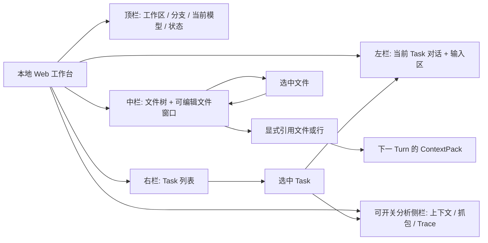
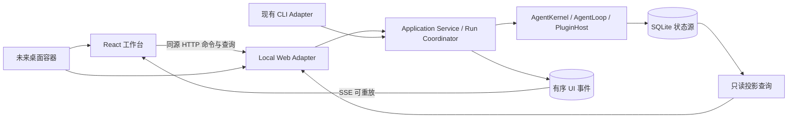

# 本地 Web UI 层设计

> 日期：2026-10-12
> 状态：视觉方向与本地 Web 路线已确认；首期页面已实现并自测，具体覆盖与未实现范围见[验收记录](./ACCEPTANCE.md)。

## 文档索引信息

- 背景：CLI 已具备 Task、上下文、Tool Calling、Trace、LLM 抓包和 TokenUsage，缺少可持续观察与交互的图形界面。
- 目标：定义 Figo Agent 的本地 Web 工作台及其与 Agent 内核的稳定边界，并保留后续桌面封装能力。
- 标签：Agent UI、本地 Web、工作台、文件浏览、上下文、抓包、Trace、SOLID。
- 适用范围：UI 设计、接口设计、实施拆分、视觉验收和后续文章复盘。
- 后续可用方向：据此编写分阶段实施计划、测试矩阵与桌面封装方案。

## 1. 已确认结论

1. 第一交付形态是**仅在本机运行的 Web 工作台**，不是 TUI，也不先做 Electron/Tauri 客户端。
2. UI 与 CLI 共用同一个 Agent 应用层；Web 适配器不重写 AgentLoop、Policy、ContextBuilder 或 SQLite 业务规则。
3. 页面采用三工作区结构：左侧当前 Task 对话、中间文件树与直接可编辑的文件窗口、右侧 Task 列表；上下文、抓包和 Trace 是可开关的分析侧栏。
4. 文件浏览与模型上下文严格分开：点击文件只打开预览；选中行后显式“引用到对话”，并在发送 Turn 时形成可追溯的上下文来源。
5. SQLite 是状态源，Markdown/JSONL 是阅读与审计产物；浏览器不直接读写 SQLite、运行配置或工作区文件。
6. 桌面端只封装同一 Web 前端与本地服务协议；不把 Node.js、SQLite 或 Agent 内核编入浏览器组件。

## 2. 视觉基线与事实边界

| 视图 | 效果图 | 设计含义 |
| :--- | :--- | :--- |
| 工作台与抓包 | [image.png](<../../../../figox/shots/image.png>) | Task、文件树、对话/文件预览、LLM 请求与响应 |
| 上下文检查器 | [image copy.png](<../../../../figox/shots/image copy.png>) | ContextPack 条目、来源、取舍和估算 |
| Trace 检查器 | [image copy 2.png](<../../../../figox/shots/image copy 2.png>) | 程序事件顺序、来源、状态和关联 ID |

效果图只确认视觉密度与交互方向；本次布局调整以实际验收为准。图中的模型名称、代码片段、时间、ID、Token 值、请求内容和事件数量均为示意；真实界面必须从当前配置、SQLite 和运行事件读取，不得硬编码截图数据。模型热切换、逐字流式输出等视觉暗示不能代替运行能力和验收。

## 3. 页面信息架构

界面围绕 `Session -> Task -> Turn` 展开。Task 切换更新左栏对话和分析侧栏查询范围；已打开文件保持原样，不会自动改变当前 Task 或发给模型。分析侧栏检查当前 Turn，不混合不同 Task 的事实。

布局、文件操作和状态细节见[工作台与文件浏览](./workspace.md)；三个检查器的数据语义和关联规则见[证据检查器](./inspector.md)。

### 3.1 视觉规范

沿用效果图的浅色工作界面：中性白/浅灰作为信息底色，深灰正文，青绿色只标识当前选中项与主命令；绿色表示成功，琥珀色表示警告，红色表示错误。面板由细分隔线组织，单个控件圆角保持 4–6px；不使用营销式大标题、浮动装饰卡片或卡片套卡片。正文采用紧凑的系统无衬线字体，代码与 ID 用等宽字体；字号不随视口宽度连续缩放。任务标题、路径、长 ID、错误内容有截断/换行与完整值查看方式。图标按钮使用统一图标库并提供 Tooltip 与可访问名称，关键状态同时有文字，不只靠颜色。

## 4. 技术架构

前端采用 React + TypeScript + Vite；Vite 官方提供 `react-ts` 模板和生产静态构建能力，依赖版本在实施计划中锁定。[Vite 官方指南](https://vite.dev/guide/) 本地 Node.js 服务提供同源 HTTP API、只读查询与 SSE 事件流；生产构建的前端静态资源由本地服务提供。HTTP 框架是适配器实现细节，不进入 Agent 内核契约。

依赖方向是 `UI -> API 契约 -> 应用层 -> Agent 内核`。查询投影只解释已落库事实；写操作只经应用层与 Policy。Web 端不直接调用 Tool，不根据模型文本自行决定授权。接口、事件、并发、断线恢复和本地安全细节见[运行协议](./runtime-protocol.md)。

## 5. 现有实现与新增工作

| 已存在的事实 | 对 UI 的影响 | 待实现的能力 |
| :--- | :--- | :--- |
| `AgentKernel.start()` 创建新 Session；CLI 通过 `readline` 调用内核 | 浏览器刷新可复用存活中的服务 Session；服务重启不能假装自动续接旧 Session | Web 启动/查询适配器；历史 Session 查询；跨进程续接另立阶段 |
| `submitTurn()` 等待整个 AgentLoop 结束后返回 | 不能靠 HTTP 长请求模拟实时进度 | 异步 Run 协调、状态持久化、事件推送与重连 |
| TraceRecorder 写 SQLite 与 JSONL | Trace 有审计事实，但不是现成 SSE | 有序、安全的 UI 事件投影；不把 TraceRecorder 改成页面控制器 |
| `context_packs`、`context_items`、`llm_http_captures`、`token_usage` 已落库 | 三个检查器有事实来源 | 只读查询、关联 ID、脱敏展示与缺失态 |
| `list_files`、`read_file` 是模型 Tool | 文件树不能直接把浏览操作记成模型工具调用 | 独立文件查询服务，复用安全路径规则，不绕过工作区边界 |

以上依据分别见 `code/src/kernel/agent-kernel.ts`、`code/src/cli/main.ts`、`code/src/trace/trace-recorder.ts`、`code/src/storage/schema.ts`、`code/src/tools/read-only-tools.ts`。新增 UI 不改变这些文件的历史事实含义。

## 6. 范围与交付顺序

1. **基础协议与安全**：应用层运行协调、同源本地 API、读模型、事件顺序与重放、工作区文件安全策略。未通过对应验收，不开放浏览器触发 Agent 执行。
2. **可用工作台**：Task 导航、对话提交和进度、文件编辑与显式引用、上下文/抓包/Trace 分析侧栏；首屏就是工作台，不建营销首页。
3. **增强工作流**：交互式授权、真正可取消的执行、逐字模型流、按 Turn 固定的 Diff 与行内评论，均须先补内核协议再显示控件。
4. **桌面封装**：在本地 Web 核心验收后封装 WebView 与本地服务生命周期；沿用 API/事件契约，不创建第二套 AgentLoop。

首期不实现 Goal、多 Agent、远程公开服务、文件编辑器、自动把浏览文件注入上下文，也不把 Trace 呈现为模型思维链。当前 `ControlledToolPolicy` 继续决定 Tool 是否执行；“审批”按钮在审批协议落地前不出现。

## 7. 设计验收与经验

实施顺序见[UI 实施路线](./IMPLEMENTATION.md)，设计验收门槛见[UI 验收文档](./ACCEPTANCE.md)。本项目的可复用经验是：Agent 图形界面不是给 CLI 套皮；需要先把运行、事实查询、事件重放和权限边界变成独立契约，页面才能可靠解释“看到了什么、做了什么、为什么得到这个结果”。
