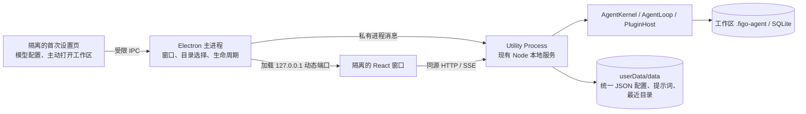
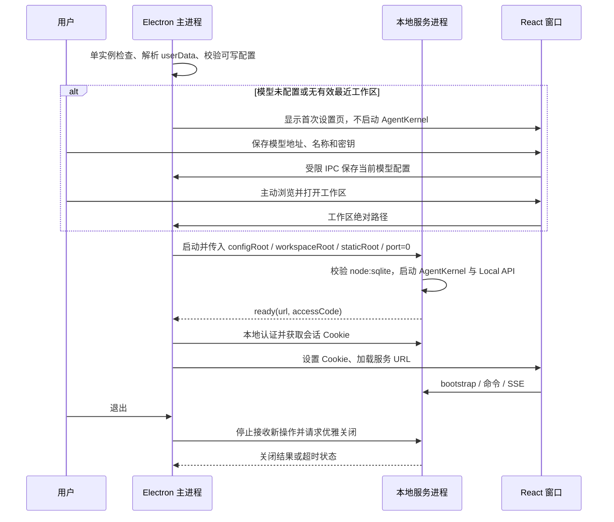

# 桌面端实施文档

> 状态：阶段 A-C 的主体代码和 macOS arm64 内部自测包已落地；未完成的验收门槛仍保持未放行。实测与缺口见[桌面验收](./ACCEPTANCE.md)。

## 文档索引信息

- 目标：把现有本地 Web 工作台封装为可安装的桌面应用，首站 macOS，随后验收 Windows 和 Linux。
- 依据：[UI 设计](../design.md)、[运行协议](../runtime-protocol.md)、[Web 实施路线](../IMPLEMENTATION.md)、[桌面验收](./ACCEPTANCE.md)。
- 边界：桌面端是新的 UI 适配器；AgentKernel、AgentLoop、PluginHost、Context、Policy、SQLite 模式和 HTTP/SSE 事件契约保持单份实现。
- 技术选型：Electron + 现有 React/Vite 前端 + Node.js 本地服务。采用 Electron `utilityProcess` 承载服务，主进程只管理窗口、原生对话框和进程生命周期。

## 1. 目标与非目标

首个可安装版本必须能选工作区、配置模型、完成一轮真实对话、使用文件编辑与终端、查看上下文/抓包/Trace，并在退出重启后读取既有工作区数据。安装包不要求用户另装 Node.js。

本轮不重写 Web 前端，不把 Agent 内核、SQLite 或通用 Shell 暴露给渲染进程；不把自动更新、插件市场、多窗口多内核并发、任务自动恢复、交互式审批或取消执行伪装成桌面封装功能。公开发行前单独完成签名、公证与升级策略。

## 2. 已核对的源码事实

| 事实 | 当前位置 | 对桌面化的影响 |
| :--- | :--- | :--- |
| Web 命令仍以 `process.cwd()` 为配置根，桌面通过 `startWorkbench()` 显式传路径和动态端口 | `code/src/ui/main.ts`、`code/src/ui/start-workbench.ts` | 两种启动方式共用应用层，不在安装包内推导源码目录 |
| `AgentKernel.start({ workspaceRoot, configRoot })` 已允许区分项目与配置根 | `code/src/kernel/agent-kernel.ts` | 核心业务无需改成 Electron API |
| 本地 API 返回 `url`、`accessCode` 和 `close()`，绑定 `127.0.0.1`，支持 `port: 0` | `code/src/ui/local-api.ts` | 可供桌面进程管理；关闭时等待活动 Run 结束，不能假设立即退出 |
| 运行配置是单个 `figo-agent.config.json`；最近工作区和自定义提示词在 `configRoot/.figo-agent/` | `code/src/config/runtime-config.ts`、`code/src/ui/workspace-registry.ts`、`code/src/config/prompt-config.ts` | 桌面用户数据应离开安装目录，现有 CLI 路径保持兼容 |
| Session/Task/Turn 与审计数据在工作区 `.figo-agent/` | `code/src/storage/storage-manager.ts` | 选择同一工作区即可读取旧数据，不搬迁工作区数据库 |
| Web 文件夹选择仍有 macOS `osascript` 兜底；桌面注入 Electron 原生选择器。终端默认 `/bin/sh` | `code/src/ui/local-api.ts`、`code/src/ui/terminal-service.ts` | Windows/Linux 验收前必须更换终端平台适配 |
| 本地 Web 配置关闭访问码；桌面入口强制会话鉴权，Forge 排除源码配置 | `code/src/desktop/service.ts`、`code/forge.config.cjs` | 包内文件扫描与无授权请求仍需持续回归 |

`node:sqlite` 是 Node 内置模块，不引入第三方原生 SQLite 依赖。已知本机 Node v22.22.3 可以创建 `DatabaseSync`；这**不等于** Electron 安装包已通过。Node 官方记录该模块从 v22.5.0 加入，所选 Electron 内置 Node 版本和打包后读写必须以实测为准。[Node SQLite](https://nodejs.org/api/sqlite.html)、[Electron 进程模型](https://www.electronjs.org/docs/latest/tutorial/process-model)。

## 3. 目标架构

1. 主进程不加载业务数据库，不执行 AgentLoop；服务进程继续使用现有 `RunCoordinator`、`startLocalApi()` 和 `AgentKernel`。
2. 服务仍只监听 `127.0.0.1`，由系统分配端口。主进程通过私有消息获取地址与一次性访问码，先完成本地认证，再给桌面专属分区的窗口设置 `HttpOnly`、`SameSite=Strict` 会话 Cookie。分区持久化现有工作台布局；认证 Cookie 不设置持久期限，启动时清除旧 Cookie 后重新认证。访问码、会话 Cookie、CSRF 不进入 URL、前端包、持久化日志或 Trace。现有页面继续通过 `/api/v1/bootstrap` 获得 CSRF；无需新增通用 IPC 数据层。[Electron Cookie API](https://www.electronjs.org/docs/latest/api/cookies)、[Session 分区](https://www.electronjs.org/docs/latest/api/session)。
3. 桌面模式始终启用服务端会话鉴权；`web.requireAccessCode: false` 只作用于现有 Web 启动命令。Host、Origin、CSRF、路径与 Policy 校验不放宽。
4. 首次设置页与工作台窗口均设置 `nodeIntegration: false`、`contextIsolation: true`、`sandbox: true`；禁止非本地导航和任意新窗口。设置页只通过受限 IPC 保存当前模型和主动选择/打开工作区，密钥不回传；工作台仍通过现有 HTTP API 操作。原生目录选择由主进程提供，渲染进程不拿通用文件系统或 Shell API。[Electron 安全建议](https://www.electronjs.org/docs/latest/tutorial/security)。
5. 主进程的 `app.getPath('userData')/data` 存储唯一可写的 `figo-agent.config.json`，以及 `.figo-agent/prompts.json`、`.figo-agent/workspaces.db`。安装资源只读，不包含本机真实密钥；工作区 `.figo-agent` 的 SQLite/Markdown/JSONL 仍跟随工作区。[Electron userData](https://www.electronjs.org/docs/latest/api/app)。

### 启动与退出时序

活动 Run 期间关闭应用必须给用户明确选择：继续等待或强制退出；不能把强制退出记录为任务成功。系统关机路径设置有界等待，超时才终止服务进程；重启时沿用现有中断态恢复规则，不重放有副作用 Tool。

## 4. 分阶段实施

### 阶段 A：服务启动边界与路径

**涉及文件：** `code/src/ui/main.ts`、`code/src/ui/local-api.ts`、新增 `code/src/ui/start-workbench.ts`、`code/tests/ui/local-api.test.ts` 与启动边界测试。

- [x] 将 Web 入口的装配和生命周期拆成参数化 `startWorkbench({ configRoot, workspaceRoot, staticRoot, port, requireAccessCode, pickWorkspace })`；`main.ts` 仅负责当前 CLI 启动参数、输出和信号处理。
- [x] 保持 `AgentKernel.start()`、原 API 路径、DTO 和 SSE 事件不变；通过 `pickWorkspace` 注入桌面原生目录选择，Web 入口继续保留现行交互。
- [x] 服务停止时关闭 HTTP/SSE、终端、Run 协调器、内核与 SQLite 句柄；工作区切换和活动 Run 状态由现有约束处理。
- [ ] 测试任意当前目录启动、动态端口、静态资源从显式路径读取、缺失工作区/资源报错、退出清理及原 Web 回归。

**放行：** 原有 `web:dev` 行为不退化；参数化服务可以在非源码目录启动，异常不会留下占用端口或数据库句柄。

### 阶段 B：桌面进程与 `node:sqlite` 兼容性

**涉及文件：** 新增 `code/src/desktop/main.ts`、`code/src/desktop/service.ts`、`code/src/desktop/runtime-check.ts`、对应单元/进程测试；修改 `code/package.json`、`code/package-lock.json`、`code/tsconfig.json`。

- [x] 添加 Electron 依赖与锁定版本、开发和打包脚本；服务入口使用已编译 JS，不依赖生产环境中的 `tsx`。
- [ ] 主进程采用单实例锁，启动 `utilityProcess`，处理 `ready`、启动失败、意外退出和停止确认；单实例、服务崩溃及强制退出的包内窗口 E2E 与启动超时单元测试已通过，启动失败时的窗口反馈仍待包内 E2E。
- [x] 服务进程启动前检查 `node:sqlite`，至少完成内存数据库和临时文件数据库的建表、插入、读取、关闭；记录 Electron 与内置 Node 版本，不记录任何密钥。
- [ ] 主进程在服务就绪和认证完成后创建窗口；拒绝外部导航、外链由明确白名单及系统浏览器处理；渲染进程保持隔离。

**放行：** 开发模式和打包后的 macOS 应用都通过 SQLite 读写烟测；启动失败时不出现空白且可操作的工作台。

### 阶段 C：配置、鉴权与用户数据

**涉及文件：** `code/src/config/runtime-config.ts`、`code/src/config/prompt-config.ts`、`code/src/ui/workspace-registry.ts`、`code/src/ui/local-api.ts`、新增桌面数据目录与迁移适配器及测试。

- [x] 首次运行从代码默认值创建 `userData/data/figo-agent.config.json`，所有 `apiKey` 为空；配置仍由一个 JSON 统一控制。提示词是独立用户数据，不并入运行参数。
- [x] 先校验最近目录实际存在；模型未配置或没有有效目录时先显示设置页，不自动打开系统目录选择器，也不创建假工作区 Session。选择器仅由用户点击“浏览文件夹”触发，取消后留在设置页；开发态和 ZIP 窗口 E2E 已验证注入选择器的取消路径，系统原生弹窗人工验收仍待补。
- [ ] 提供用户主动触发的一次性旧配置导入：导入前备份目标，校验 JSON、模型选择和文件权限；仅复制所选配置及关联提示词/最近目录数据，不改写工作区数据库；失败保留原文件并可重试。密钥只写到用户数据目录，严格限制文件权限，不进入日志。
- [ ] 桌面进程通过已有认证端点建立会话，窗口使用桌面专属持久分区和每次启动更新的会话 Cookie；免登录、无授权请求 401 和重启后旧 Cookie 401 已验证；布局持久化的专项断言待补。
- [x] 首次设置页提供模型 API 地址、名称和密钥的表单；保存时原子更新当前模型，保留其他模型与参数，不回传密钥。无有效密钥时不启动工作区服务；原有无密钥工作台防护仍保持。已进入工作台后，菜单“打开模型配置”仍打开 JSON 文件，手工修改后需重启应用。

**放行：** 发行资源中不存在非空 API Key；配置重启有效，旧工作区历史数据可读，认证和跨站拒绝用例通过。

### 阶段 D：macOS 可安装验证版

**涉及文件：** 新增 Electron 打包配置、图标与 `code/tests/desktop/` 烟测；更新根 `README.md` 和 UI 文档索引。

- [x] 只打包编译后的服务、Web 静态文件、中文资源和所需运行依赖；明确排除 `code/figo-agent.config.json`、`code/.figo-agent/`、工作区数据库、测试数据、源码文档和本机密钥。
- [x] 从 ZIP 解压后的应用本体启动，验证静态资源、SQLite、文件编辑、Shell、Git、模型单轮请求与抓包脱敏；应用本体不依赖用户另装 Node、`npm` 或 `tsx`。测试驱动器仍在仓库中运行，不等于公开发行安装验收。
- [ ] 目录切换、活动 Run 退出、服务崩溃、重启后历史数据、旧 Cookie 拒绝、重复启动单实例及首次设置页已有 ZIP 窗口 E2E；原生系统目录对话框的真人点击/取消、应用升级后工作区数据读取待补。测试日志不包含密钥。
- [ ] 发布给他人前完成 macOS 签名与公证；本机未签名构建只标记为内部验证包。[Electron 打包与签名](https://www.electronjs.org/docs/latest/tutorial/application-distribution)、[代码签名](https://www.electronjs.org/docs/latest/tutorial/code-signing)。

**放行：** [桌面验收](./ACCEPTANCE.md)的 macOS 必需项全部通过，才称为 macOS 桌面版；未签名包不标记为公开发行。

### 阶段 E：Windows/Linux 与公开发行

**涉及文件：** `code/src/ui/terminal-service.ts`、`code/src/ui/local-api.ts`、桌面目录选择适配器、平台 CI 与安装包配置。

- [ ] 用 Electron 原生目录选择覆盖各平台；Windows 终端选择系统自带 `powershell.exe` 并使用 `-NoProfile -NonInteractive -Command`，Linux 的 `/bin/sh` 使用 `-c`；分别测试转义、退出码与停止行为。
- [ ] 每个目标系统分别构建与安装验收，不把 macOS 的自动化结果算作 Windows/Linux 通过；验证权限、路径分隔符、Git 可执行文件与工作区迁移。
- [ ] 完成公开发布说明、签名、升级与回滚策略、密钥扫描、依赖审计；更新只替换程序文件，不覆盖 `userData` 和工作区数据。

**放行：** 只发布对应平台已经通过的安装包；未完成的系统不列为支持平台。

## 5. 实施顺序与工程判断

阶段 A、B、C 是桌面适配器的必要工程工作；阶段 D 给出可安装的 macOS 验证版；阶段 E 才是跨平台公开发行。每阶段先补失败测试，再实现，跑对应回归并记录证据；上一阶段失败，不进入下一阶段。此拆分保留现有 Web/CLI 用户路径，避免把打包问题误诊为 Agent 内核问题。

官方技术依据：[Electron Utility Process](https://www.electronjs.org/docs/latest/api/utility-process)、[安全清单](https://www.electronjs.org/docs/latest/tutorial/security/)、[Node SQLite](https://nodejs.org/api/sqlite.html)。
