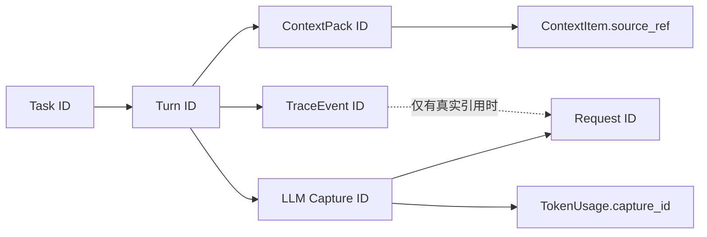

# 上下文、抓包与 Trace 检查器设计

> 状态：首期三检查器已实现；截图数据仍只用于说明交互，运行中的数字与关联由当前 SQLite 查询得到。
> 后续增强：Fiddler-like Trace Inspector 作为专项页面另行设计，见 [Trace Inspector 实施设计](./trace-inspector/2026-10-14-TraceInspector实施设计.md)。

## 文档索引信息

- 背景：项目已把 ContextPack、模型 HTTP 抓包、TraceEvent 和 TokenUsage 写入 SQLite，但缺少同屏解释入口。
- 目标：让用户沿 Session / Task / Turn / 请求链路核对模型输入、网络交互与程序行为。
- 标签：ContextPack、LLM 抓包、Trace、TokenUsage、证据关联、脱敏。
- 适用范围：可开关分析侧栏、只读投影 API、抓包安全策略和验收。
- 后续可用方向：抓包逐步解析、故障复盘、Token 优化与技术文章示例。

## 1. 三个标签回答不同问题

| 标签 | 要回答的问题 | 状态源 | 效果图 |
| :--- | :--- | :--- | :--- |
| 上下文 | 本轮候选内容是什么，哪些被纳入或排除，依据是什么？ | `context_packs`、`context_items`、压缩检查点 | [上下文视图](<../../../../figox/shots/image copy.png>) |
| 抓包 | 此次模型请求实际发送与返回了什么，状态/耗时/用量是什么？ | `llm_http_captures`、`token_usage` | [抓包视图](<../../../../figox/shots/image.png>) |
| Trace | Agent 内部按什么顺序发生了哪些可审计事件？ | `trace_events`，关联 `tool_calls`、Artifact 等 | [Trace 视图](<../../../../figox/shots/image copy 2.png>) |

ContextPack 是构建阶段产物，不等于最终 HTTP 请求全文；Tool Calling Loop 后续往返还会改变模型消息。完整请求正文以同一 `request_id` 的抓包为准。Trace 是程序事件，不是模型隐藏思维链，也不承诺还原未记录的内部推理。

## 2. 上下文标签

头部固定显示当前范围、ContextPack ID、构建时间、条目数与 `estimated_tokens`，明确标注“估算”。筛选为全部/已纳入/已排除；每条显示 `source_type`、`source_ref`、摘要、纳入状态、取舍原因和单项估算。历史 Turn 通过精确 ID 关联 `turns`，在人可读标签中显示 Task 内轮次、用户输入摘要、创建时间与短 ID；完整 ID 仍作为审计依据。当前输入也关联当前 Turn，不能把 `turn.input` 当成可辨识的轮次。展开后显示允许查看的内容预览与来源跳转；已加载的历史 Turn 可定位到聊天中的同一轮，未加载时明确提示而不提供无效跳转。点击文件来源打开只读文件；点击压缩检查点显示覆盖范围、检查点 ID 与来源 Turn。对旧库缺失的来源或内容显示“无可用记录”，不补造理由。

压缩边界由 `task_compaction_checkpoints` 的实际 `from_seq/through_seq/source_turn_ids_json` 与未覆盖 Turn 得出。不能把截图中“已压缩 Turn 1–7、保留 Turn 8–12”写死，也不能把 ContextPack 估算当作 Provider 返回的真实输入 Token。文件引用在 ContextPack 中也必须有独立来源与行范围；未纳入的引用展示排除原因。

## 3. 抓包标签

按 `request_id` 列出当前 Turn 的每一次请求，显示用途 `turn / task_compaction / round_compaction`、provider/model、HTTP 方法与目标、状态、耗时、创建时间、用量状态。请求和响应分区展示 Header 与 JSON Body，支持折叠、搜索、复制**脱敏后的**内容。`token_usage.status=unavailable` 时写“模型未提供”，不能显示实际 0；`partial` 时逐字段标出未知；估算与实测分列，不求和。

浏览器默认只接收服务端脱敏投影：Authorization、API Key 等 Header 必须掩码，请求/响应正文按敏感字段规则处理。原始抓包仍在 SQLite 中，不能因为 UI 要展示而修改原记录。查看未脱敏原文属于单独的高风险能力：在显式本机确认、短时授权、访问审计和泄漏测试完成前不开放。`code/figo-agent.config.json` 的密钥绝不经此标签返回。失败的 HTTP 请求也要保留状态与错误，不生成成功响应样式。

## 4. Trace 标签

默认按当前 Turn 展示事件流，字段为上海时间（毫秒）、事件类型、来源模块、状态与可用关联。提供全部/错误筛选和类型搜索。点击事件行后，列表继续留在分析侧栏，事件详情立即在左侧主工作区打开；详情展示事件 ID、`session_id/task_id/turn_id`、安全的结构化 payload 与确定关联的工具。切换事件时详情滚动位置回到顶部。主工作区可在文件与 Trace 详情之间切换，未保存的文件草稿保持挂载；窄屏点击后收起分析侧栏以露出详情。典型事件包括 `turn.received`、`context.build.completed`、`llm.called`、`llm.completed`、`tool.called`、`tool.completed`、`policy.denied`、`compaction.failed` 与 `turn.failed`。事件排序须稳定：新 UI 事件用持久递增序号；旧 Trace 在同毫秒时间相同时增加稳定次级键，不靠浏览器收到的先后顺序猜测。

事件可以跳到对应 Tool 调用、ContextPack、请求抓包和 Artifact，但必须有确定的关联键。新事件协议应携带 `request_id`、`tool_call_id`、`context_pack_id` 等真实引用；旧记录缺失这些键时，只能按 Turn 分组展示，并明确“无直接关联”，不得以最接近时间的记录冒充精确关联。错误事件可展开原因与阶段，敏感 payload 必须由服务端再脱敏。

## 5. 跨视图追踪规则

点击“查看实际请求”时，从当前 Turn 的抓包列表选择对应请求；同一 Turn 有多个 Tool Loop 往返，不得默认只显示第一条。手动 `/compact` 的用量归属与普通 Turn 不同；用量聚合遵循现有 `usage_turn_id` 规则，不猜测触发 Turn。任何跨 Task/Session 的跳转都要显式更新面包屑与查询范围，避免用户误以为看到的是当前 Task 数据。

## 6. 空态与复盘价值

未生成 ContextPack、无抓包、Provider 无 usage、事件仍在写入和查询失败是不同状态，分别展示，不使用空白面板代替。检查器展示的每条结论都能定位到记录 ID；这使“模型看到什么”“HTTP 实际传了什么”“程序发生了什么”可以分开核验，也为后续抓包教学和持续自优化提供事实基础。
