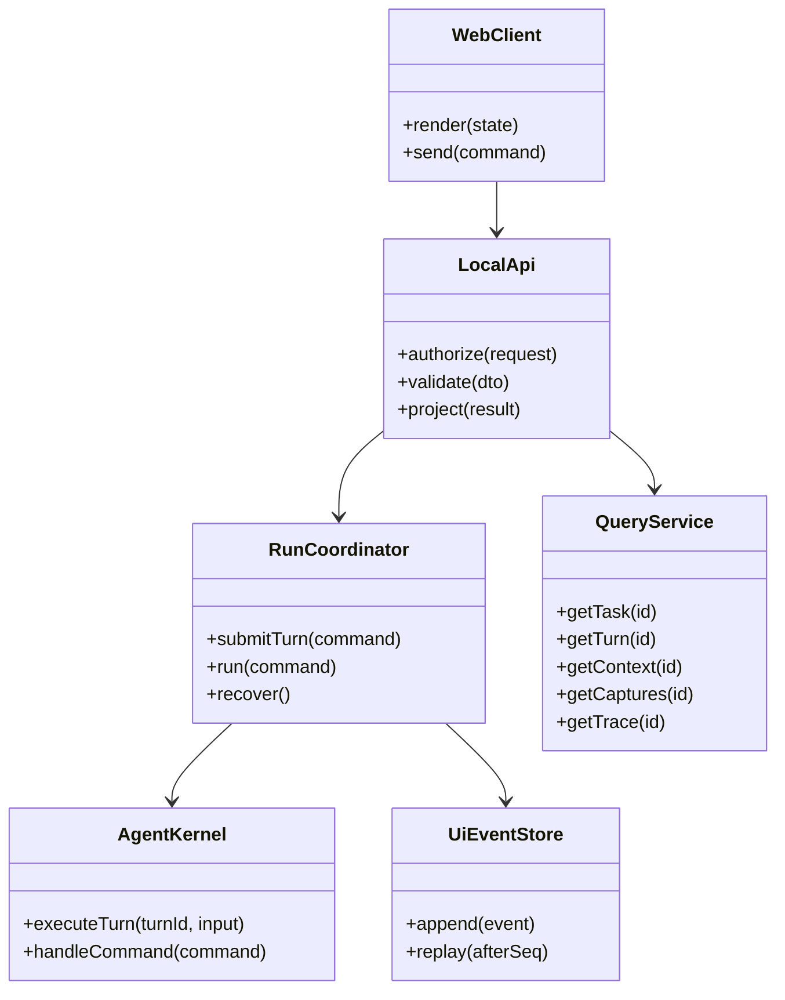
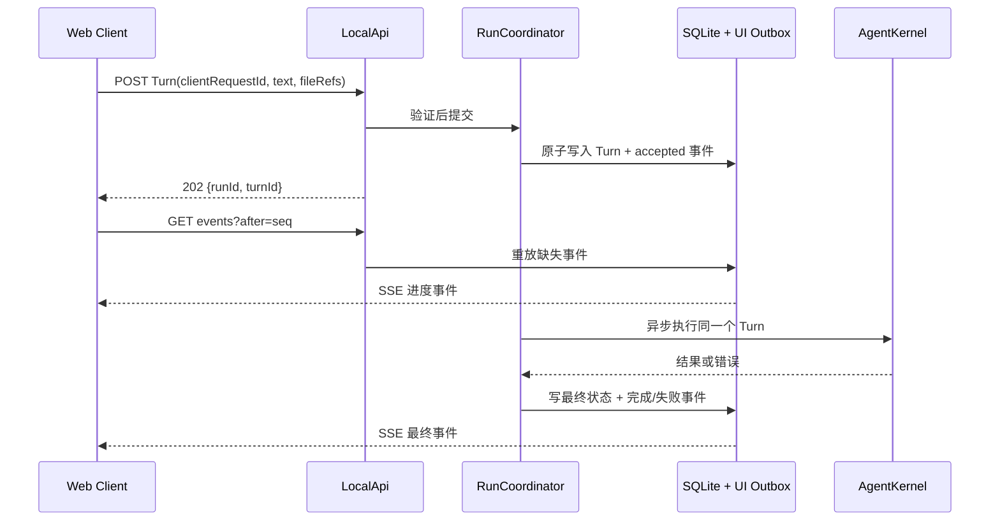

# 本地 Web 运行协议设计

> 状态：首期本地 API 与 SSE 已实现；本文件同时保留后续扩展约束，实际测试见[验收记录](./ACCEPTANCE.md)。

## 文档索引信息

- 背景：CLI 保留同步 `submitTurn()`；Web 使用独立 Run 协调器异步执行，Trace 投影到 UI 事件。
- 目标：为本地 Web 工作台提供稳定的命令、查询、事件重放和安全边界。
- 标签：Node.js、HTTP、SSE、运行协调、SQLite、Policy、本地安全、桌面封装。
- 适用范围：Web 服务、应用层重构、前后端 DTO、事件存储与测试。
- 后续可用方向：审批/取消协议、桌面容器接入、多客户端只读观察。

## 1. 分层与依赖

`LocalApi` 是传输适配器，只做认证、输入校验、DTO 映射与响应；`RunCoordinator` 拥有 Web Run 生命周期与并发控制；`AgentKernel` 继续拥有 Session/Task/Turn 与 AgentLoop；`QueryService` 只读 SQLite；`UiEventStore` 提供可重放事件。CLI 保留同步入口，但共享内核的 Turn 执行边界与工作区执行租约。浏览器只导入纯前端代码与 JSON 契约，不导入 Node 模块、SQLite、Policy 或运行配置。

## 2. 首期 API 契约

| 方法与路径 | 用途 | 约束 |
| :--- | :--- | :--- |
| `GET /api/v1/bootstrap` | 当前工作区、服务 Session、Task 列表、活动模型、能力开关与事件游标 | 不返回 API Key 或原始配置 |
| `GET /api/v1/sessions` | 列出当前工作区的历史 Session 和 Turn 总数 | 历史 Session 只读；未提供分页参数 |
| `GET /api/v1/sessions/:id/tasks` | 历史和当前 Task 列表、每个 Task 的 Turn 数 | 旧版无 `task_id` 的 Turn 投影成只读 `legacy_<sessionId>` 入口，不写入 `tasks` |
| `GET /api/v1/tasks/:id/turns` | 查询固定 Task 或旧版历史入口的 Turn 与结果 | 旧版入口只读；首期未提供分页与长文本延迟加载 |
| `POST /api/v1/tasks/:id/turns` | 提交文本和显式文件引用，立即返回 `runId/turnId` | 幂等键、同一服务单活动 Run、工作区引用校验 |
| `POST /api/v1/tasks` | 新建 Task | 不创建普通 Turn |
| `POST /api/v1/tasks/:id/actions` | 类型化 `switch/pause/resume/finish/cancel/compact` 命令 | 遵守现有 Task 状态机；控制命令不创建普通 Turn |
| `GET /api/v1/files`、`GET /api/v1/file`、`GET /api/v1/files/search` | 目录列表、搜索与受限文本读取 | 服务端路径/符号链接/大小/敏感路径校验 |
| `GET/PUT /api/v1/settings/prompts` | 读取/保存自定义系统指令与持久用户指令 | 仅返回提示词和版本指纹；写入需 CSRF，冲突返回 409；不返回模型密钥 |

文件搜索递归进入子目录，服务端达到搜索结果或目录访问上限时返回 `truncated=true`；目录列表超过 500 项也返回同一标记。UI 必须展示未查完状态，不得把部分结果表述为完整结果。Agent Tool `list_files` 的 `depth=0` 只读当前层，省略 `depth` 递归读取；非法深度拒绝执行。
| `PUT /api/v1/file` | 显式保存已有文本文件，返回新版本 | 同源与 CSRF、1 MB 上限、旧版本 SHA-256 校验、单写者租约；409 不覆盖 |
| `GET /api/v1/turns/:id/context` | ContextPack 与条目投影 | 估算与纳入原因如实展示 |
| `GET /api/v1/turns/:id/captures` | 抓包、用量与响应状态 | 默认脱敏；不返回原始密钥 |
| `GET /api/v1/turns/:id/trace` | 结构化事件与安全 payload | 稳定顺序；首期未提供分页参数 |
| `GET /api/v1/tasks/:id/activity` | Task 内过程事件与文本增量历史 | 最近 5000 条，按 `seq` 排序；历史只读 |
| `GET /api/v1/events?after=<seq>` | SSE 持续推送与补发 | 先重放后订阅；断线可续接 |

此表是资源级目标，不等于把现有 `handleCommand(string)` 原样暴露成任意命令执行接口。`POST /turns` 接收 `clientRequestId`，服务端对相同键返回同一个 `runId/turnId`，不会重新调用模型或 Tool。Turn ID 需要在开始异步执行前持久化；重构时只能有一个组件负责创建 Turn，避免 API 与 `AgentKernel.submitTurn()` 各创建一次。

## 3. Run 与事件协议

首期 Run 状态为 `accepted -> running -> completed | failed | interrupted`。`accepted` 表示 SQLite 已记录 Turn；`running` 由真实执行事件确认；`interrupted` 表示服务进程结束后无法证明执行已完成，不能自动重放带副作用的 Tool。取消与用户审批不在首期状态机中，只有内核具备可中断执行和审批恢复协议后才增加。

新增 `ui_runs` 记录 `run_id`、`turn_id`、`client_request_id`、状态、开始/终结时间，作为 HTTP 接受后至 Turn 结束的运行索引；`client_request_id` 在工作区内有唯一约束。有序 UI 事件存于 SQLite 独立 outbox，字段为 `seq INTEGER PRIMARY KEY`、`event_id`、`run_id`、`session_id`、`task_id`、`turn_id`、`kind`、`subject_id`、`payload_json`、`created_at`。`seq` 是游标，不依赖时间戳或随机 Trace ID 排序。阶段事件只保存白名单字段与事实引用；文本增量按批写入 SQLite，API 返回前做脱敏，不重复存储抓包正文或文件全文。Run/Turn 状态更新与对应 outbox 事件在同一 SQLite 事务内提交；提交成功后才推送 SSE。已有 TraceEvent 保持审计职责，新增投影桥接 Trace/LLM/Tool/Context 的事实，不把 TraceRecorder 直接变成 WebSocket 管理器。UI 文件访问审计也走此事件机制，但不创建模型 ToolCall。

CLI 的 `submitTurn()` 保持同步调用；Web 在 HTTP handler 返回 202 前原子持久化一次 Turn、Run 和 `accepted` 事件，随后异步进入同一 `AgentKernel` 执行边界。`TraceRecorder` 写 SQLite/JSONL，并把安全字段投影到 UI outbox。现已加入真实模型增量事件；工具文本分类、普通 JSON 回退和当前验收边界见[执行过程流设计](./streaming-workbench.md)。

## 4. 初始化、断线和并发

页面先读取同一数据库快照及游标，再从该游标重放 SSE；浏览器刷新只恢复视图，不重新发送上一条 Turn。SSE 断开时前端显示失联，带最后确认的 `seq` 重连；服务端按序补发，同一 `event_id` 在前端幂等应用。历史消息、ContextPack、抓包和 Trace 的查询仍以 SQLite 为准，SSE 只负责及时通知变化。

首期每个本地服务实例只运行一个 Agent Run；Task 切换、完成和新 Turn 在活动 Run 期间按明确规则拒绝，响应包含当前 `runId`，不隐式排队。CLI 与 Web 同时指向同一工作区时需要单写者约束，禁止两个进程同时执行有副作用的 Agent Run；只读历史查询不受此限制。服务启动时检查未终结 Run，标记为 `interrupted` 并保留原 Trace、抓包与工具结果；不自动重复执行 Shell/Git/网络动作。

浏览器刷新可续接**当前仍在运行的服务**；服务重启后展示历史 Session 与中断原因。跨进程恢复旧 Session/Task 的写入能力另行设计和验收，不能因页面保存 Task ID 就宣称已支持。

## 5. 本地安全

Web 服务默认只监听 `127.0.0.1`，校验 Host 与 Origin，不开放跨域 CORS。`web.requireAccessCode` 默认 `true`：读取、命令和 SSE 要求本地会话；启动时生成随机访问码，换取 `HttpOnly`、`SameSite=Strict` Cookie。当前本地配置临时设为 `false`，浏览器可直接读取工作台；写请求仍校验同源 Origin 与 CSRF，访问码不再是本机进程访问的门槛。恢复访问码只需改回 `true` 并重启。模型密钥不得写入前端包；仅绑定本机端口不构成授权，免访问码模式只用于可信单用户机器。

服务器限制请求体大小、并发数、文件预览大小和 SSE 连接数；文件 API 拒绝路径穿越、越界符号链接及配置密钥；抓包 API 默认脱敏并设置不缓存。Tool 继续经过 `ControlledToolPolicy`，浏览器请求无权绕开它。敏感原文揭示与交互式批准属于独立高风险能力，首期不提供。所有 UI 命令与拒绝结果留下结构化审计事件，但不把会话凭证写入 Trace。

## 6. 桌面封装边界

未来桌面容器负责启动/停止同一个本地服务、创建 WebView、打开本地文件选择器和分发系统通知；页面仍使用同源 API 与 SSE。桌面桥仅暴露最小受控能力，不提供通用 Shell 或任意文件系统桥。Web 与桌面共用前端组件、DTO、运行协调和 SQLite 数据；桌面封装前先用本地 Web 通过[验收门槛](./ACCEPTANCE.md)。

## 7. 可沉淀的工程经验

交互式 Agent 的“正在工作”不是前端动画，而是可恢复的运行状态与有序事实。UI 事件 outbox 与 Trace 分工后，页面断线重连、真实错误定位和事后复盘才有同一条证据链。
