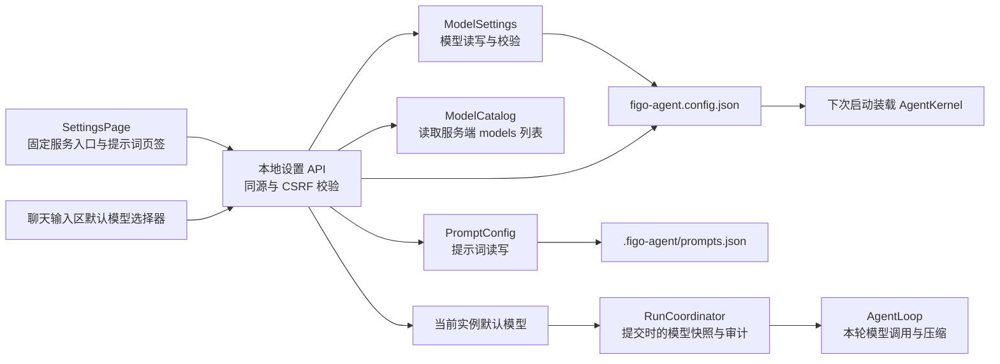
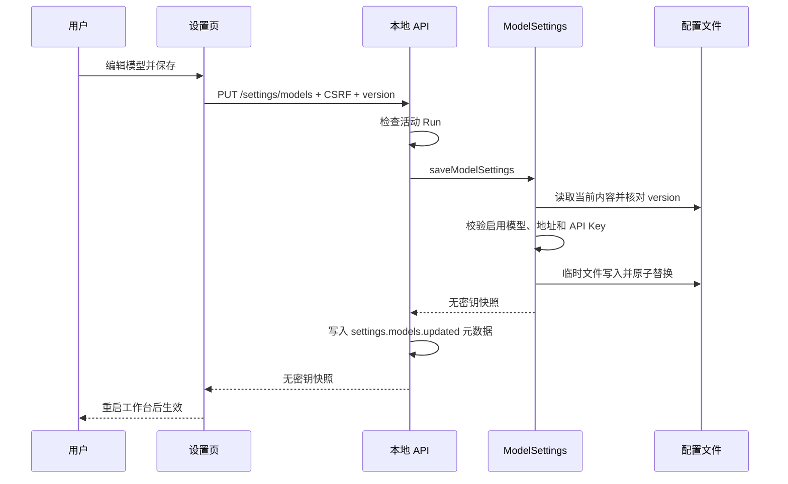
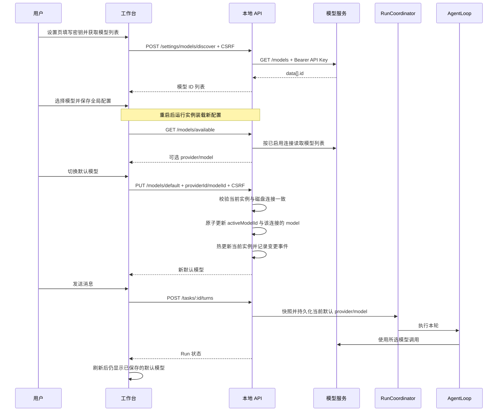

# 工作台设置页

## 目标与边界

工作台齿轮入口打开完整设置页。首批只有“模型设置”和“提示词设置”两个分类。模型设置管理 MiniMax、DeepSeek、GPT 官方接口及 GPT 中转接口；提示词设置沿用原有独立存储及保存语义。

提示词页为两个编辑框保留始终可见的作用说明，并为未填写时提供示例：系统指令进入每轮初始模型请求的 `system` 消息；持久用户指令排在本次输入之前，作为同轮 `user` 消息的一部分。说明文案来自中文资源文件，不参与提示词保存。

模型配置是全局运行配置，不属于当前工作区。Web 使用启动时的配置目录；桌面版使用应用数据目录。设置页固定展示 MiniMax、DeepSeek、GPT 官方和 GPT 中转四个服务入口；配置 ID 由程序生成，页面不要求用户填写。模型 ID 通过服务端 `/models` 接口获取并选择。保存全局配置后，当前 `AgentKernel` 不热切换，重启工作台后才使用新连接。

聊天输入区提供默认模型选择器：展示当前运行实例中已启用、已配置密钥的连接及其实时模型列表。切换时立即更新 `figo-agent.config.json` 中的 `activeModelId` 与该连接的 `model`，并热更新当前运行实例的默认值；后续 Turn 使用新默认值，已提交的 Run 保持其提交时的模型。模型列表读取失败时保留该连接的默认模型供选择，并显示失败信息。

## 模块结构

`SettingsPage` 只负责交互状态。`ModelSettings` 只负责配置读写、校验、版本冲突及密钥隔离。`ModelCatalog` 只负责连接服务端并解析模型 ID。`local-api` 负责身份和 CSRF、连接一致性检查、审计事件。`RunCoordinator` 在提交时将当前默认 provider/model 快照持久化到 `ui_runs`，`AgentLoop` 将快照用于本轮调用及自动压缩。模型调用链不读取文档，也不由页面直接改写运行中的内核。

## 保存流程

## 模型发现与默认模型切换

## 关键约束

- GET 和 PUT 响应只有 `hasApiKey`，不返回密钥正文。替换密钥时提交新值；留空且地址不变时保留旧值；显式勾选清除才能删除。
- 官方服务地址固定；中转地址由用户输入。地址变化时不得复用旧密钥，避免将密钥发送到新服务。
- 模型发现使用用户正在编辑的密钥；未输入新密钥时，仅在地址未变的情况下复用已保存密钥。模型列表请求有超时、地址校验和响应大小上限；上游错误不回显密钥或响应正文。
- 当前模型必须存在、处于启用状态且有密钥。禁用与删除当前模型前先切换当前模型。
- 快捷切换只接受当前运行实例中启用且具有密钥的连接；磁盘上的连接地址或密钥已变化时拒绝切换并提示重启，避免旧实例继续使用旧连接。
- 快捷切换与设置页保存共用配置写入队列，原子替换文件，只修改 `activeModelId` 和选中连接的 `model`，保留密钥及其他字段。切换失败时页面回退到原默认值。
- Run 在提交时快照模型，切换默认值不影响已提交的 Run；显式请求模型选择仍纳入幂等指纹。
- 保存仅覆盖 `activeModelId` 与 `llm`，其余 JSON 字段原样保留。通过版本指纹拒绝陈旧提交；同进程保存按配置目录串行化。
- 更新事件只包含配置 ID、模型 ID 和版本，不包含密钥。设置页修改连接后，现有运行实例仍使用启动时的连接；工作台快捷切换已装载连接的默认模型则立即生效。
- Web 静态资源由多个本地进程共用时，旧进程可加载新页面，但旧 API 仍返回 404。设置页将该响应转换为明确的重启提示；重启前不停止用户正在使用的旧进程。

## 验收

| 项目 | 自动化证据 |
| --- | --- |
| 多模型保存、保留其他字段、密钥不回显 | `tests/config/model-settings.test.ts` |
| 并发版本冲突、地址与服务类型校验 | `tests/config/model-settings.test.ts` |
| 同源/CSRF、响应脱敏、陈旧版本拒绝 | `tests/ui/local-api.test.ts` |
| 模型设置、提示词保留、桌面与移动端布局 | `e2e/workbench.pw.ts` |
| 四个固定服务入口、实时模型选择、切换后刷新和设置页一致 | `e2e/workbench.pw.ts` |
| 模型列表解析、超时与脱敏错误 | `tests/config/model-catalog.test.ts` |
| 默认模型切换原子持久化、密钥不回显 | `tests/config/model-settings.test.ts`、`tests/ui/local-api.test.ts` |
| Run 提交时快照模型，当前 Run 不受切换影响 | `tests/ui/run-coordinator.test.ts` |
| 新页面连接旧服务时给出重启提示 | `e2e/workbench.pw.ts` |

经验：配置页与模型执行生命周期要分开设计。设置页保存新连接需要重启工作台；对运行实例已装载的连接切换默认模型则可以热生效。Run 必须在提交时快照模型，不能在执行过程中追随可变的全局默认值。
