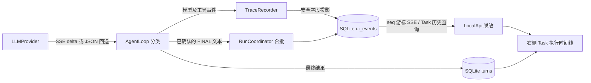

# 执行过程流与任务工作台

> 日期：2026-10-12。状态：本地模拟 SSE、工具轮次和三视口浏览器回归通过；当前 GPT 中转模型的实时增量尚未验收通过。

## 目标与边界

右侧 Task 面板按“用户请求 -> Agent 执行过程 -> 工具调用 -> 最终答复”组织；输入框留在面板底部，中间文件编辑器与 Debug Console / Terminal、可展开分析侧栏保持独立。执行过程只描述程序已记录的事实。`<think>`、Trace 原文和 HTTP 抓包不是面向用户的思维链；完整请求与响应仍由抓包存储供排查。

## 核心协议

1. `LLMProvider.complete(request, onTextDelta?)` 保留完整结果契约；Web Turn 传入回调后，OpenAI-compatible 适配器请求 `stream: true`，解析碎片化 SSE。Compaction 与 CLI 不传回调，继续使用原有完整响应路径。
2. 当前工具调用是模型文本中的 fenced JSON，不能边收边当答复展示。提示协议要求无工具调用时先输出独占一行 `FINAL`。分类器仅在看到该标记后释放正文增量；工具 JSON、未按协议输出的文本和不完整 `<think>` 前缀在分类完成前缓冲。模型不遵守标记时，完整返回后一次性展示。标记后的文本按最终答复处理，不再解析其内部 JSON 为工具命令。
3. 适配器收到无 `Content-Type` 的普通 JSON 成功响应时回退完整响应。SSE 必须以 `[DONE]` 结束；中途断流判失败。原始 SSE wire 与重建响应写入 HTTP 抓包；部分流失败也保留已读 wire 和错误。
4. `RunCoordinator` 每 100 毫秒或 512 字符合批写 `assistant.text.delta`，事件携带 `offset` 与 `sourceLength`；执行步骤通过 `trace.recorded` 的白名单字段投影。`ui_events.seq` 是重放游标，Turn 最终 `output` 是完成态的规范答案。
5. Task 历史通过 `GET /api/v1/tasks/:id/activity` 读取，页面合并历史事件与实时 SSE，以 `seq` 去重。浏览器输出按原始偏移校验，允许 API 脱敏改变显示长度；新消息只在读者接近底部时自动滚动。刷新不重放模型或 Tool。
6. 项目理解 Skill 会覆盖模型答案，因此该类 Turn 只展示运行过程，等待 Skill 的最终结果。其他 Turn 展示模型的真实文本增量；不通过定时器伪造字速。

## 已知限制与后续设计

- `FINAL` 是当前文本式工具协议的过渡方案。模型不输出标记时只能展示阶段流，最终文本完整返回后再出现；要摆脱该约束，应采用独立的结构化 ToolCall 与正文通道。
- 真实 GPT 中转模型的本次最小流式调用在等待 90 秒后仍无首段数据，已人工终止；没有证据宣布当前中转的实时推送通过。模拟 SSE 通过不等于真实模型验收通过。
- 当前 Task 历史事件接口最多返回最近 5000 条；超长 Task 的早期过程需要分页。UI 传输层做脱敏，SQLite 保留原始增量用于本机审计；敏感字符串跨批次的脱敏可靠性需要专项测试，未完成前不作为共享部署能力放行。
- UI 只展示程序阶段、工具执行事实与可用的最终答复，不展示隐藏推理。Provider 若将来正式返回推理摘要，需新增独立事件类型及模型能力声明，不复用 `<think>`。

## 验收

单元测试覆盖 SSE 分片、`[DONE]`、usage 抓包、`FINAL` 增量、工具 JSON 缓冲、前置 `<think>`、无标记回退、阶段归并与断线重复事件。浏览器 E2E 覆盖两轮工具调用、第一段答复先于完成出现、工具 JSON 不进入正文、桌面/窄屏/移动布局以及历史 Turn。真实中转首段耗时与完成状态仍为未通过项。
