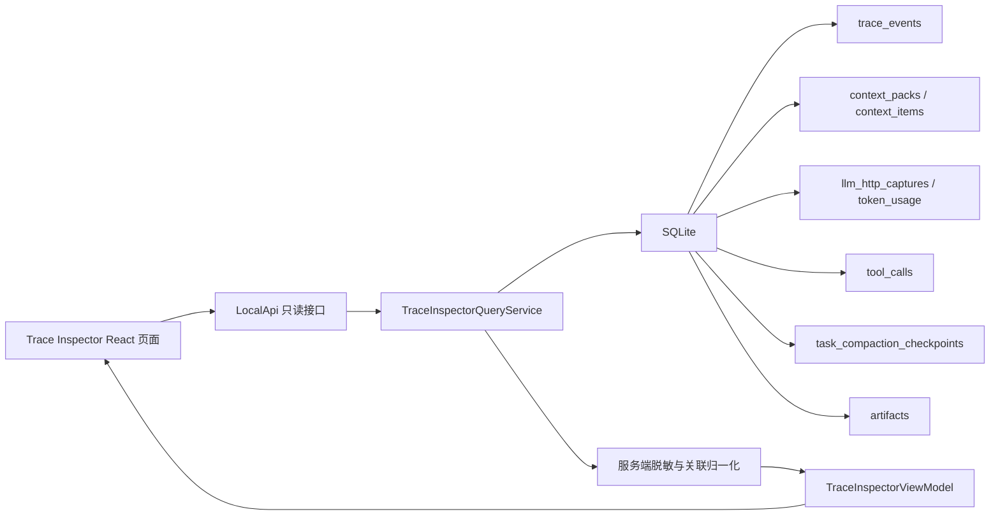

# Trace Inspector 实施设计

> 状态：待实施。本文档基于本次确认的 Fiddler-like 效果图与右侧 Inspector Tab 原型，用于指导后续实现。上下文与压缩机制正在并行调整时，本设计只固定 UI 查询契约和展示语义，不把页面写死到某个压缩算法。

## 文档索引信息

- 背景：现有工作台已有上下文、抓包和 Trace 三个检查器，但信息仍按 Turn 分散展示；用户希望新增类似 Fiddler 的 Trace Inspector 页面，用高密度事件表和右侧 Inspector 帮助复盘 Agent 执行链路。
- 目标：让用户在一个页面里看清一次 Task / Turn / Run 中的事件流水、上下文流转、模型抓包、工具调用、压缩过程、TokenUsage 和原始 JSON。
- 标签：Trace Inspector、Fiddler-like UI、Context Flow、Compaction、LLM Capture、Tool Call、TokenUsage、React、SQLite 投影。
- 适用范围：本地 Web 工作台与桌面端复用的只读调试页面；不改变 AgentLoop、ContextBuilder、CompactionService 的运行职责。
- 后续可用方向：抓包教学、上下文质量复盘、压缩策略调优、错误归因、技术文章截图素材。

## 效果图参考

以下图片用于固定本次确认过的 UI 方向，便于后续人工实现或 AI 协作时对齐布局、信息密度、视觉层级和 tab 内容。图片中的 ID、时间、token、文件路径、模型名和数据内容均为设计样例，不是运行事实，也不能作为验收证据。

实现时遵循以下优先级：

1. 本文档的功能、数据流、安全和验收约束优先。
2. 真实 SQLite、Trace、抓包和 ToolCall 数据优先。
3. 效果图用于参考页面结构、控件位置、信息密度、颜色语义和交互意图。
4. 当文字设计与截图细节冲突时，以文字设计和真实数据边界为准。

### 总览方向


重点参考：

1. 顶部工具栏的过滤入口。
2. 左侧 Fiddler-like 高密度事件表。
3. 右侧 Inspector 上下分区。
4. LLM Request / Response、TokenUsage、Artifact 的组合方式。

### Context Flow 与 Compaction 方向


重点参考：

1. 上下文来源到 `ContextPack`、再到 `LLM Messages` 的流转表达。
2. `Included Context Items` 表格的信息层级。
3. 下方 `Compaction Timeline` 与 Before / After 对比。
4. 缺失字段或派生指标需要在 UI 中明确标注来源。

### 右侧 Tab 状态方向


重点参考：

1. `Overview`、`Context Flow`、`LLM Request`、`LLM Response`、`Tool Calls`、`Compaction`、`Raw JSON` 的内容分工。
2. 每个 tab 内的主次信息关系。
3. 表格、JSON viewer、时间线、指标条的组合方式。
4. 同一视觉语言下保持不同 tab 的可扫描性。

## 1. 总体目标

Trace Inspector 要回答六个问题：

1. 当前 Task / Turn 按什么顺序发生了哪些事实事件。
2. 模型实际收到的请求和返回内容是什么。
3. Tool 是何时被调用、输入输出是什么、是否被 Policy 拒绝。
4. ContextPack 由哪些来源构成，哪些内容最终进入模型上下文。
5. Task 历史或工具轮次是否触发压缩，压缩覆盖了什么，是否成功落检查点。
6. 每条结论能否回到 SQLite 事实记录、TraceEvent、抓包或 Artifact。

页面定位是“Agent 执行链路检查器”，不是 HTTP 代理、不是网络包重放工具，也不是模型隐藏思维链查看器。

## 2. 非目标

首期不做以下能力：

1. 不做代理抓包，不接管系统网络流量。
2. 不支持修改请求后重放模型调用。
3. 不显示未脱敏 API Key、Authorization、token、secret、password。
4. 不让浏览器直接读取 SQLite、运行配置或本机文件系统。
5. 不把 TraceEvent 当作模型思维链。
6. 不在上下文和压缩机制尚未稳定前，把 Context Flow 写死为固定字段。
7. 不做复杂 FiddlerScript、AutoResponder、Composer 等高级网络调试能力。

## 3. 设计原则

1. 事实优先：页面只展示 SQLite、Trace、抓包、ToolCall、Artifact 中已有或可确定关联的事实。
2. 投影隔离：前端只依赖 `TraceInspectorViewModel`，不直接依赖表结构。
3. 语义优先：借鉴 Fiddler 的布局，不复制网络代理语义；核心标签围绕 Agent 执行链路命名。
4. 可降级：旧数据缺少 `requestId`、`contextPackId`、`toolCallId` 时按 Turn 分组展示，并明确“无直接关联”。
5. 可演进：Context Flow 与 Compaction 通过 adapter 映射上下文机制，后续字段变化只改查询层。
6. 安全默认：所有 API 返回都经过服务端脱敏；复制和导出默认导出脱敏结果。
7. 高密度但可读：页面用于调试和复盘，优先扫描、比较、定位，不做营销式大卡片。

## 4. 功能设计

### 4.1 页面入口

首期在工作台顶部或分析侧栏入口增加 `Trace Inspector` 按钮。入口打开一个全屏工作区视图，复用现有本地 Web API、认证、CSRF、SSE 和工作区切换机制。

打开时默认范围为当前 Task；如果用户从某个 Turn、Trace 事件、抓包或 ToolCall 跳转进入，则自动选中对应事件行。

### 4.2 顶部工具栏

顶部工具栏用于缩小事件范围：

| 控件 | 作用 |
| :--- | :--- |
| `Live` | 是否自动滚动到最新事件；只读观察，不触发 Agent 执行 |
| `Current Task` | 当前 Task / 历史 Task 范围切换 |
| `Failed` | 只看失败、拒绝、中断和协议修复事件 |
| `LLM` | 只看 `llm.*` 与抓包请求 |
| `Tool` | 只看 ToolCall、Policy 和工具轮次事件 |
| `Context` | 只看 ContextPack、ContextItem、Memory、文件引用相关事件 |
| `Compaction` | 只看 Task 历史压缩和工具轮次压缩事件 |
| `Search` | 搜索事件类型、Tool 名、模型名、requestId、turnId、文件路径 |
| `Export` | 导出当前筛选后的脱敏 JSON 或 Markdown 摘要 |

筛选只影响页面展示，不修改 SQLite，也不改变正在运行的 Agent。

### 4.3 左侧事件表

左侧采用 Fiddler-like 高密度表格，默认占桌面宽度约 52%。列定义如下：

| 列 | 来源 | 说明 |
| :--- | :--- | :--- |
| `#` | 查询层生成 | 当前筛选结果序号 |
| `Time` | `trace_events.created_at` / 相关记录时间 | 上海本地时间，毫秒精度 |
| `Kind` | 规范化事件类型 | 例如 `llm.completed`、`tool.completed`、`context.build.completed` |
| `Status` | 查询层归一化 | `OK`、`INFO`、`SKIPPED`、`DENIED`、`ERROR`、`INTERRUPTED` |
| `Task` | `task_id` | 短 ID 显示，悬停显示完整 ID |
| `Turn` | `turns.task_seq` 或短 ID | 首选 Task 内序号 |
| `Source` | `source` / 记录类别 | `AgentLoop`、`ContextBuilder`、`ToolRegistry`、`LLMProvider` |
| `Name` | 事件摘要 | 模型名、Tool 名、ContextPack ID、Checkpoint ID |
| `Duration` | payload 或关联表 | LLM、Tool、压缩、Context 构造耗时 |
| `Tokens` | `token_usage` 或估算 | 实测优先；估算必须标注 |

点击事件行后右侧 Inspector 更新；双击行可在现有 Task 对话或 Trace 详情中定位。表格应支持键盘上下移动、`Enter` 打开详情、`Ctrl/Cmd+C` 复制选中行摘要。

### 4.4 右侧 Inspector 标签

右侧默认占桌面宽度约 48%，上方为一级 tabs：

```text
Overview | Context Flow | LLM Request | LLM Response | Tool Calls | Compaction | Raw JSON
```

每个 tab 的职责如下：

| Tab | 回答的问题 | 主要数据源 |
| :--- | :--- | :--- |
| `Overview` | 当前选中事件是什么，和哪些事实对象有关 | `trace_events`、`turns`、`ui_runs`、关联 ID |
| `Context Flow` | 上下文从哪里来，如何进入 ContextPack 和 LLM messages | `context_packs`、`context_items`、`task_compaction_checkpoints`、抓包 request body |
| `LLM Request` | 实际请求模型的 headers/body/tools/messages 是什么 | `llm_http_captures.request_*` |
| `LLM Response` | 模型返回、状态、耗时、TokenUsage 和产物是什么 | `llm_http_captures.response_*`、`token_usage`、`artifacts` |
| `Tool Calls` | 本 Turn 内工具调用输入输出和 Policy 结果是什么 | `tool_calls`、`trace_events` |
| `Compaction` | 压缩何时触发，覆盖范围、摘要和检查点是什么 | `task_compaction_checkpoints`、`compaction.*` Trace、压缩抓包 |
| `Raw JSON` | 当前事件或关联对象的脱敏原始结构 | Trace payload、抓包 JSON、Tool JSON |

### 4.5 Overview

`Overview` 显示当前选中行的概要信息：

1. 事件类型、状态、来源模块、时间。
2. Task、Turn、Run、ContextPack、requestId、toolCallId、checkpointId 等关联。
3. 最近相邻事件小时间线。
4. 明确的跳转入口：查看 Turn、打开 Artifact、定位 ToolCall、定位抓包。
5. 无直接关联时显示“此旧记录缺少直接引用，只能按 Turn 归组”。

### 4.6 Context Flow

`Context Flow` 是本页面区别于普通 Fiddler 的核心视图。它以节点流形式展示：

```text
User Input + File References + Task History + SQLite Memory + Compaction Checkpoint
  -> Context Candidates
  -> ContextPack
  -> LLM Messages
```

首期节点含义：

| 节点 | 数据来源 | 展示字段 |
| :--- | :--- | :--- |
| `User Input` | `turns.input`、`context_items.source_type='turn'` | 输入长度、估算 tokens |
| `File References` | `context_items.source_type='file_reference'` | 文件数、行范围、版本、估算 tokens |
| `Task History` | `context_items.source_type='task_turn'` | Turn 数、序号范围、估算 tokens |
| `SQLite Memory` | `context_items.source_type='memory'` | scope、key 数量、估算 tokens |
| `Compaction Checkpoint` | `task_compaction_checkpoints`、`task_compaction` item | checkpointId、覆盖范围、摘要长度 |
| `Context Candidates` | 当前仅由已记录 item 推导 | item 总数；未记录 candidate 时标注“未采集候选全集” |
| `ContextPack` | `context_packs` | ID、创建时间、estimatedTokens |
| `LLM Messages` | 抓包 request body | message 数、实际发送长度、工具定义数 |

下方表格展示 `Included Context Items`：

| 列 | 说明 |
| :--- | :--- |
| `Source` | `sourceType` |
| `Ref` | `sourceRef` |
| `Reason` | 纳入原因 |
| `Tokens` | 估算值 |
| `Included` | 当前为 true；后续补候选/排除后显示 true/false |
| `Open` | 文件、Turn、Memory、Checkpoint 的只读定位 |

如果后续 ContextBuilder 增加 `context.item.candidate` 和 `context.item.excluded`，本视图扩展为候选全集，不需要改页面主结构。

### 4.7 LLM Request

`LLM Request` 展示一次真实模型请求：

1. provider、model、requestId、purpose、contextPackId、usageTurnId。
2. URL、method、HTTP 状态前置摘要。
3. 脱敏 headers，Authorization 只显示掩码。
4. request body JSON，默认折叠长消息。
5. `messages` 专区支持按 system/user/assistant/tool 过滤。
6. `availableTools` 专区显示工具数量和工具 schema 摘要。
7. 提供复制脱敏 JSON、复制 requestId、打开 Raw JSON。

同一 Turn 多次 LLM 调用时，事件表选中 `llm.called` 或 `llm.completed` 应定位对应 `requestId`；缺少 `requestId` 的旧事件只展示当前 Turn 的请求列表，要求用户选择。

### 4.8 LLM Response

`LLM Response` 展示响应结果：

1. HTTP status、statusText、durationMs。
2. finishReason、outputLength、是否包含 tool_calls。
3. TokenUsage：prompt、completion、total、status；未知值显示“模型未提供”。
4. 响应正文预览，长文本折叠。
5. tool_calls 原生结构预览。
6. 关联 Artifact：`context.md`、`report.md`、`task-summary.md`。
7. 错误响应按失败样式显示，不生成成功摘要。

估算 tokens 与 Provider 返回 usage 必须分列展示，不得相加冒充真实用量。

### 4.9 Tool Calls

`Tool Calls` 展示当前 Turn 或当前工具轮次的 ToolCall：

| 列 | 来源 |
| :--- | :--- |
| `Round` | `tool_calls.round` |
| `Intent` | `intent_id` |
| `Tool` | `tool_name` |
| `Status` | `status` |
| `Input Summary` | 脱敏 `input_json` 摘要 |
| `Output Preview` | 脱敏 `output_json` 摘要 |
| `Duration` | `completed_at - started_at` 或事件 payload |
| `Error` | `error_message` |

点击 ToolCall 行后，下方左右分栏显示输入 JSON 和输出 JSON。Policy 拒绝要显示为 `DENIED`，并展示 `policy.denied` 的 code 和 reason。

### 4.10 Compaction

`Compaction` 展示 Task 历史压缩和工具轮次压缩。

Task 历史压缩展示：

1. 触发模式：manual / auto。
2. 策略原因：turnThreshold、charThreshold 或手动命令。
3. fromSeq、throughSeq、sourceTurnIds。
4. baseCheckpointId、checkpointId、requestId。
5. summaryJson 长度、source validation 状态。
6. 压缩前字符数、压缩后字符数、节省比例。
7. 摘要 JSON、来源 Turn 列表和关联抓包。

工具轮次压缩展示：

1. mode=round。
2. round 序号。
3. beforeChars、afterChars、跳过或失败原因。
4. 是否实际替换 messages。

现有代码已经有 `compaction.started/completed/skipped/failed`，但 before/after 指标不总是完整；首期可从源 Turn 和 summaryJson 派生，并在 UI 标注“派生值”。后续应把关键指标补进 Trace payload，避免 UI 猜测。

### 4.11 Raw JSON

`Raw JSON` 显示当前选中对象的脱敏原始结构：

1. TraceEvent。
2. LLM Capture。
3. ToolCall。
4. ContextPack + ContextItems。
5. CompactionCheckpoint。

默认展示格式化 JSON，支持复制、下载、折叠、搜索。下载文件名包含 taskId、turnId、对象类型和短 ID。

## 5. UI / UE 设计

### 5.1 视觉方向

视觉参考 Fiddler 的信息密度和检查器结构，但不复制复古 Windows 皮肤。采用当前工作台一致的浅色主题、蓝灰分隔线、小字号表格、紧凑 toolbar 和明确状态色。

页面不使用 hero、大面积卡片、装饰渐变或说明性营销文案。主要 UI 元素是表格、tabs、分割面板、JSON viewer、时间线和小型指标条。

### 5.2 布局

桌面端布局：

```text
顶部工具栏
左侧事件表 52% | 右侧 Inspector 48%
底部状态栏
```

右侧 Inspector 内部可上下分割：

```text
一级 tabs + 主详情区
二级详情区或 JSON/时间线区域
```

用户可以拖动左右分隔条；双击恢复默认比例。布局保存到浏览器本地，不写入项目 SQLite。

窄屏布局：

1. 默认显示事件表。
2. 点击事件后进入 Inspector 视图。
3. 顶部提供返回事件列表按钮。
4. 不强行展示左右双栏，避免信息挤压。

### 5.3 状态色

| 状态 | 颜色语义 |
| :--- | :--- |
| `OK` | 绿色 |
| `INFO` | 蓝色 |
| `SKIPPED` | 琥珀色 |
| `DENIED` | 橙色 |
| `ERROR` | 红色 |
| `INTERRUPTED` | 灰红或红色边线 |
| `UNKNOWN` | 灰色 |

颜色只能辅助识别，表格中必须保留文本状态，避免只靠颜色表达。

### 5.4 交互细节

1. 单击事件行：更新右侧 Inspector。
2. 双击事件行：打开与该事件最相关的详情入口，例如 Turn 对话、Artifact 或现有 Trace 详情。
3. 右键菜单：复制 ID、复制行摘要、复制脱敏 JSON、定位关联对象。
4. 搜索框：输入时不触发后端写操作；本地过滤或后端只读查询均可。
5. 自动滚动：`Live` 开启时新事件进入视图底部；用户手动滚动历史后自动暂停。
6. 长 JSON：默认折叠大字段，提供展开按钮，避免页面卡死。
7. 长文本：默认预览前若干行，点击展开后才加载完整脱敏内容。
8. 空态：无数据、未生成 ContextPack、无抓包、Provider 未返回 usage、旧记录无关联要分别提示。
9. 错误态：查询失败显示重试按钮和错误摘要，不清空已加载数据。
10. 隐私提示：复制或导出时标注“已脱敏”。

### 5.5 可访问性与键盘

1. 表格行支持键盘焦点。
2. Tabs 支持左右键切换。
3. 搜索框支持 `Ctrl/Cmd+K` 聚焦。
4. `Esc` 清除搜索或关闭详情浮层。
5. 所有 icon 按钮必须有 tooltip 和 aria-label。

### 5.6 性能体验

1. 事件表首期限制 500 行，滚动或分页加载更多。
2. 大 JSON 分区懒加载。
3. Code/JSON viewer 只渲染当前 tab。
4. SSE 新事件只追加 ViewModel，不整页刷新。
5. 历史 Task 默认不订阅 Live，只做静态查询。

## 6. 数据流设计

### 6.1 数据源

Trace Inspector 的事实来源如下：

| 数据 | 表 / 来源 |
| :--- | :--- |
| Session / Task / Turn | `sessions`、`tasks`、`turns` |
| Trace 事件 | `trace_events` |
| UI Run | `ui_runs`、`ui_events` |
| Context | `context_packs`、`context_items` |
| LLM 抓包 | `llm_http_captures` |
| TokenUsage | `token_usage` |
| ToolCall | `tool_calls` |
| 压缩检查点 | `task_compaction_checkpoints` |
| Artifact | `artifacts` |

浏览器只能通过 LocalApi 读取这些投影结果，不能直接读 SQLite。

### 6.2 新增查询服务

新增 `TraceInspectorQueryService`，作为现有 `WorkspaceQueryService` 的专题补充。它只读 SQLite，输出 UI 专用 ViewModel。

建议文件：

```text
code/src/ui/trace-inspector-query-service.ts
code/tests/ui/trace-inspector-query-service.test.ts
```

服务职责：

1. 读取 Task 范围内的 Trace、LLM Capture、ToolCall、ContextPack、CompactionCheckpoint。
2. 归一化为左侧事件表行。
3. 根据选中行返回右侧 tab 详情 DTO。
4. 做服务端脱敏。
5. 标注直接关联、Turn 级关联和无法关联三种关系。

服务不负责：

1. 不执行 Tool。
2. 不调用 LLM。
3. 不修改 Trace。
4. 不读取运行配置密钥。
5. 不解释模型隐藏推理。

### 6.3 API 契约

建议新增只读 API：

| 方法与路径 | 用途 |
| :--- | :--- |
| `GET /api/v1/tasks/:id/trace-inspector/events` | 获取当前 Task 的统一事件表 |
| `GET /api/v1/trace-inspector/events/:eventKey` | 获取选中事件的详情总览 |
| `GET /api/v1/trace-inspector/events/:eventKey/context-flow` | 获取 Context Flow DTO |
| `GET /api/v1/trace-inspector/events/:eventKey/llm-request` | 获取 LLM 请求 DTO |
| `GET /api/v1/trace-inspector/events/:eventKey/llm-response` | 获取 LLM 响应 DTO |
| `GET /api/v1/trace-inspector/events/:eventKey/tool-calls` | 获取工具调用 DTO |
| `GET /api/v1/trace-inspector/events/:eventKey/compaction` | 获取压缩 DTO |
| `GET /api/v1/trace-inspector/events/:eventKey/raw` | 获取脱敏原始 JSON |

`eventKey` 不要求等于 TraceEvent ID。统一事件表中每行都由查询层生成稳定 key：

```text
trace:<trace_event_id>
capture:<llm_capture_id>
tool:<tool_call_id>
context:<context_pack_id>
compaction:<checkpoint_id>
ui:<ui_event_id>
```

这样可以把非 TraceEvent 的事实对象也纳入同一张表。

### 6.4 ViewModel 草案

```ts
interface TraceInspectorEventRow {
  key: string;
  time: string;
  kind: string;
  status: "ok" | "info" | "skipped" | "denied" | "error" | "interrupted" | "unknown";
  sessionId: string;
  taskId?: string;
  turnId?: string;
  turnSeq?: number;
  source: string;
  name: string;
  durationMs?: number;
  tokens?: {
    value: number;
    kind: "actual" | "estimated";
    status?: "complete" | "partial" | "unavailable";
  };
  refs: {
    traceEventId?: string;
    contextPackId?: string;
    requestId?: string;
    captureId?: string;
    toolCallId?: string;
    checkpointId?: string;
    artifactIds?: string[];
  };
}
```

```ts
interface ContextFlowView {
  contextPack?: {
    id: string;
    estimatedTokens: number;
    createdAt: string;
  };
  nodes: Array<{
    id: string;
    label: string;
    count?: number;
    estimatedTokens?: number;
    summary: string;
    confidence: "direct" | "derived" | "missing";
  }>;
  edges: Array<{ from: string; to: string; label?: string }>;
  items: Array<{
    id: string;
    sourceType: string;
    sourceRef: string;
    reason: string;
    estimatedTokens: number;
    included: boolean;
    contentPreview?: string;
  }>;
  limitations: string[];
}
```

```ts
interface CompactionView {
  checkpoints: Array<{
    id: string;
    taskId: string;
    baseCheckpointId?: string;
    fromSeq: number;
    throughSeq: number;
    sourceTurnIds: string[];
    requestId: string;
    createdAt: string;
    summaryLength: number;
    beforeChars?: number;
    afterChars?: number;
    savedRatio?: number;
    metricSource: "recorded" | "derived" | "unavailable";
  }>;
  timeline: Array<{
    time: string;
    type: string;
    status: string;
    message: string;
    refs: Record<string, string>;
  }>;
  summaryJson?: unknown;
  limitations: string[];
}
```

### 6.5 数据流图



### 6.6 关联规则

优先级从高到低：

1. 直接 ID：payload 中的 `requestId`、`contextPackId`、`toolCallId`、`checkpointId`。
2. 表关联：`turn_id`、`task_id`、`request_id`、`capture_id`。
3. Turn 级归组：同一 Turn 下的抓包、工具、ContextPack。
4. Task 级归组：手动 `/compact` 等没有普通 Turn 的事件。
5. 无关联：展示原始事件，并提示无法精确跳转。

禁止按“时间最接近”伪造精确关联；如果只做启发式排序，必须标记为 derived。

## 7. 与上下文 / 压缩机制改造的关系

另一个窗口正在调整上下文和压缩机制时，本页面按以下方式解耦：

1. UI 不直接依赖 `summary_json` 的内部语义，只把它作为结构化 JSON 展示。
2. `Context Flow` 节点由 adapter 根据当前 `ContextItem.sourceType` 和 Trace 事件归类生成。
3. `Compaction` 指标优先读取 Trace payload；没有时从检查点和 Turn 内容派生，并标注来源。
4. 如果未来新增候选项、排除项、预算裁剪或摘要质量评分，只扩展 DTO，不重写页面框架。
5. 新压缩策略不得要求前端知道具体模型厂商或压缩算法。

建议上下文/压缩机制后续补充这些观测字段：

| 字段 | 用途 |
| :--- | :--- |
| `candidateCount` | Context Flow 展示候选全集 |
| `includedCount` / `excludedCount` | 展示取舍结果 |
| `budgetChars` / `budgetTokens` | 展示预算边界 |
| `beforeChars` / `afterChars` | Compaction 对比 |
| `validationStatus` | 摘要来源校验结果 |
| `checkpointId` | ContextBuilder 使用的检查点 |
| `sourceCoverage` | 摘要覆盖和实际引用来源 |

## 8. 安全与隐私

1. API 默认只返回脱敏投影。
2. 原始 SQLite 中的抓包不因 UI 展示而被改写。
3. 导出和复制按钮默认输出脱敏内容。
4. 未脱敏查看属于独立高风险能力，首期不开放。
5. 所有路径、URL、headers、body 均经过 `redactForUi`。
6. 浏览器不接收 `code/figo-agent.config.json` 或桌面用户数据目录中的密钥。
7. 空态或错误态不能泄漏本机绝对路径之外的敏感信息。

## 9. 实施阶段

### 阶段 A：数据审计与查询服务

目标：完成 `TraceInspectorQueryService` 和测试。

任务：

1. 梳理现有表字段和关联缺口。
2. 实现统一事件表查询。
3. 实现 `eventKey` 解析。
4. 实现 Overview、Raw JSON 基础 DTO。
5. 覆盖旧数据缺少关联 ID 的降级路径。

测试：

```bash
npm --prefix code test -- --run tests/ui/trace-inspector-query-service.test.ts
```

### 阶段 B：LocalApi 只读接口

目标：暴露 Trace Inspector 专用 API。

任务：

1. 在 `local-api.ts` 添加只读路由。
2. 复用现有认证、Origin、CSRF 和脱敏规则。
3. 限制单次返回行数和 JSON 大小。
4. 查询失败返回结构化错误。

测试：

```bash
npm --prefix code test -- --run tests/ui/local-api.test.ts
```

### 阶段 C：Fiddler-like 页面骨架

目标：实现页面布局、左侧表格、筛选、搜索和右侧 tabs 框架。

建议文件：

```text
code/web/src/TraceInspectorPage.tsx
code/web/src/TraceInspectorTable.tsx
code/web/src/TraceInspectorTabs.tsx
code/web/src/trace-inspector-types.ts
```

任务：

1. 增加页面入口。
2. 实现左右分栏和可拖动分隔条。
3. 实现事件表虚拟滚动或分页。
4. 实现顶部 toolbar。
5. 实现选中行状态和 URL / 本地状态恢复。

测试：

```bash
npm --prefix code test -- --run tests/ui/trace-inspector-page.test.ts
```

### 阶段 D：稳定数据 tabs

目标：先落地受上下文机制影响小的 tabs。

范围：

1. `Overview`
2. `LLM Request`
3. `LLM Response`
4. `Tool Calls`
5. `Raw JSON`

这些 tab 主要依赖已有抓包、ToolCall 和 Trace 数据，受并行压缩机制改造影响较小。

### 阶段 E：Context Flow 与 Compaction

目标：在上下文/压缩机制字段稳定后落地核心特色 tabs。

任务：

1. 实现 Context Flow 节点归类 adapter。
2. 实现 Included Context Items 表。
3. 实现 Compaction Timeline。
4. 实现 Before / After 对比。
5. 显示字段缺失和派生指标说明。
6. 对接新增观测字段后移除不必要的派生逻辑。

### 阶段 F：验收、性能与文档回填

目标：完成端到端验证和文档留痕。

任务：

1. 补 Playwright 工作台路径测试。
2. 用真实 SQLite 运行数据人工核对。
3. 更新 `docs/agent/modules/ui/ACCEPTANCE.md`。
4. 若确认成为独立专题，补充 `docs/agent/modules/ui/trace-inspector/ACCEPTANCE.md`。
5. 把最终截图或说明纳入 `module-flows/figo-agent/` 后续流程地图。

## 10. 验收要点

实施完成后至少满足：

1. 左侧事件表能展示当前 Task 的 Trace、LLM、Tool、Context、Compaction 事实。
2. 选中事件后，右侧 tab 能展示正确关联对象。
3. 同一 Turn 多次 LLM 请求不会默认误选第一条。
4. 无直接关联的旧事件明确提示降级原因。
5. Context Flow 能展示 ContextItem 来源、纳入原因和 ContextPack。
6. Compaction 能展示检查点、来源 Turn、摘要 JSON 和可用的前后对比指标。
7. Tool Calls 能展示成功、失败和 Policy 拒绝。
8. TokenUsage 未知时显示未知，不显示 0。
9. 复制、导出和 JSON 查看都经过脱敏。
10. 页面刷新后不触发新 Turn，不重复执行 Agent。
11. 活动 Run 期间 Live 更新只追加事实事件，不伪造进度。
12. 旧数据、空数据和查询失败都有明确状态。

禁止放行：

1. 浏览器直接读取 SQLite。
2. 浏览器收到明文 API Key 或 Authorization。
3. 用时间接近关系冒充精确关联。
4. 把 ContextPack 估算 token 当作 Provider 实际 usage。
5. 把 TraceEvent 展示为模型思维链。
6. 因 UI 展示需要修改抓包原始记录。
7. Context / Compaction 字段变更导致页面大面积重写。

## 11. 可沉淀的工程观点

Trace Inspector 的价值不是“把日志列表搬到页面上”，而是把 Agent 执行链路变成可审计的产品界面。Fiddler 的启发在于高密度流水和右侧检查器；Figo Agent 的差异在于它检查的不是 HTTP 代理包，而是上下文如何被制造、压缩、发送给模型，并如何通过工具和产物留下证据。

