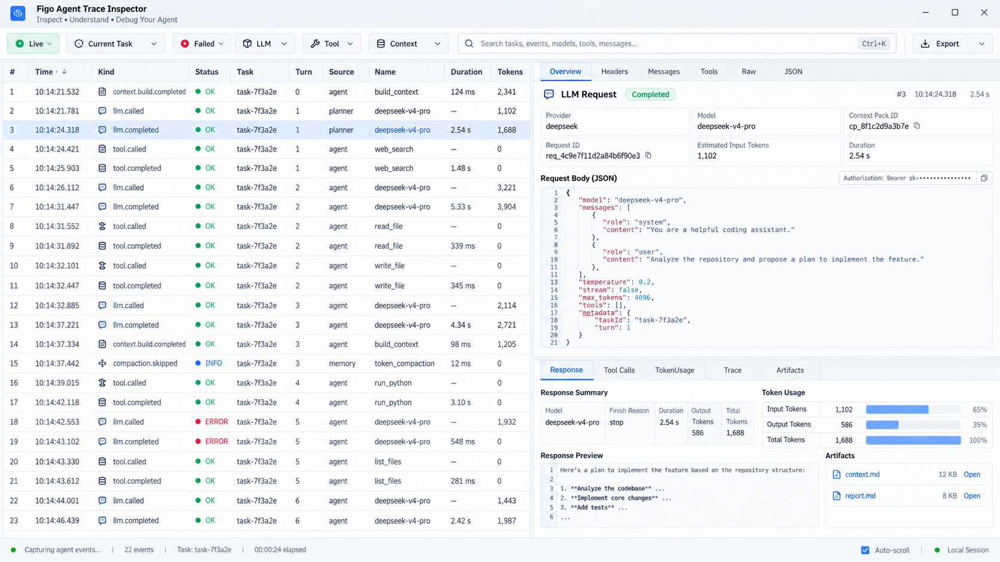
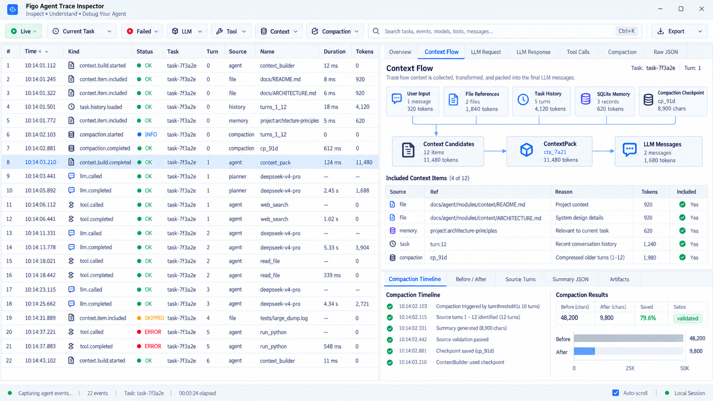
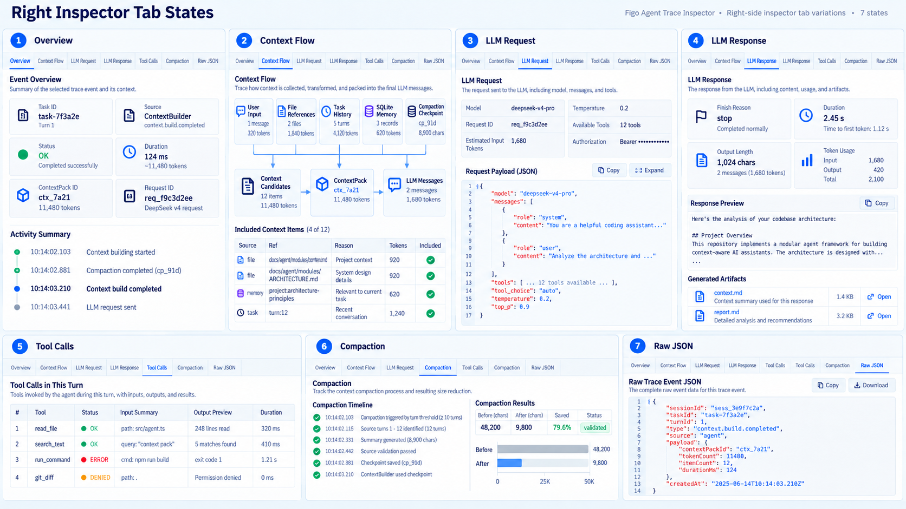
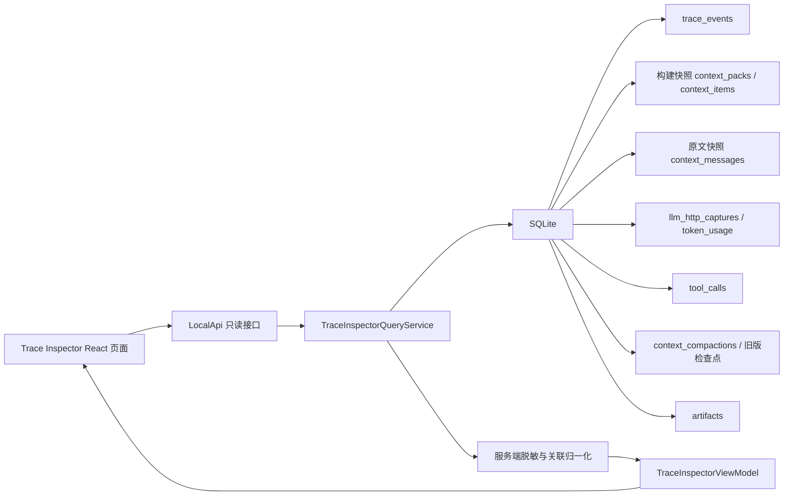

# Trace Inspector 实施设计

> 状态：Trace Inspector 待实施。2026-10-16 已对齐当前 Pi 消息级压缩实现：保留已确认的 Fiddler-like 布局与七个一级标签，更新消息来源、Markdown 摘要、请求关联和验收要求。本文只规范检查器实施，不启动已收尾的压缩算法实验或调参工作。

## 文档索引信息

- 背景：现有工作台已有上下文、抓包和 Trace 三个检查器，但信息仍按 Turn 分散展示；用户希望新增类似 Fiddler 的 Trace Inspector 页面，用高密度事件表和右侧 Inspector 帮助复盘 Agent 执行链路。
- 目标：让用户在一个页面里看清一次 Task / Turn / Run 中的事件流水、上下文流转、模型抓包、工具调用、压缩过程、TokenUsage 和原始 JSON。
- 标签：Trace Inspector、Fiddler-like UI、Context Flow、Compaction、LLM Capture、Tool Call、TokenUsage、React、SQLite 投影。
- 适用范围：本地 Web 工作台与桌面端复用的只读调试页面；不改变 AgentLoop、ContextBuilder、CompactionService 的运行职责。
- 后续可用方向：抓包教学、上下文质量复盘、压缩策略调优、错误归因、技术文章截图素材。
- 对齐依据：[Pi 上下文压缩实施计划](../../context/2026-10-15-Pi上下文压缩对齐实施计划.md)、[阶段收尾记录](../../context/2026-10-16-Pi压缩与原生工具协议阶段收尾.md)，以及当前 `context_messages`、`context_compactions`、AgentLoop 与 UI 查询源码。

### 修订留痕

| 日期 | 修订 | 实施含义 |
| :--- | :--- | :--- |
| 2026-10-14 | 确认整体布局、上下文流与七个标签效果图 | 固定视觉方向，图片只作设计参考 |
| 2026-10-16 | 对齐 Pi 消息级压缩与原生工具协议 | 新压缩以消息来源和 Markdown 为中心，旧 Turn/JSON 检查点仅作兼容；增加请求级选择与历史关联证据要求 |

## 效果图参考

以下图片用于固定本次确认过的 UI 方向，便于后续人工实现或 AI 协作时对齐布局、信息密度、视觉层级和 tab 内容。图片中的 ID、时间、token、文件路径、模型名和数据内容均为设计样例，不是运行事实，也不能作为验收证据。

实现时遵循以下优先级：

1. 本文档的功能、数据流、安全和验收约束优先。
2. 真实 SQLite、Trace、抓包和 ToolCall 数据优先。
3. 效果图用于参考页面结构、控件位置、信息密度、颜色语义和交互意图。
4. 当文字设计与截图细节冲突时，以文字设计和真实数据边界为准。

2026-10-16 图片校正规则：原图保留用于对齐视觉，不作为旧算法的实现要求。图中的 Turn 数触发改为窗口减预留量判断；`Summary JSON` 改为“摘要”并预览 Markdown；完整 Turn 范围改为消息级保留边界；`Saved` 改为“上下文缩减比例”，不表示任务费用节省。图中独立“来源校验通过”步骤不得直接套到新 Markdown 摘要，界面只能显示实际记录的生成、提交和后续请求使用证据。重复 tab、英文示例文案及演示数值不要求逐字照搬，正式中文文案进入 `code/locales/zh-CN.json`。

### 总览方向



重点参考：

1. 顶部工具栏的过滤入口。
2. 左侧 Fiddler-like 高密度事件表。
3. 右侧 Inspector 上下分区。
4. LLM Request / Response、TokenUsage、Artifact 的组合方式。

### Context Flow 与 Compaction 方向



重点参考：

1. 上下文来源、`ContextPack` 构建快照、有效消息投影与实际 `LLM Messages` 的分层表达；两者不能画成无条件等价链路。
2. `Included Context Items` 表格的信息层级。
3. 下方 `Compaction Timeline` 与 Before / After 对比。
4. 缺失字段或派生指标需要在 UI 中明确标注来源。

### 右侧 Tab 状态方向



重点参考：

1. `Overview`、`Context Flow`、`LLM Request`、`LLM Response`、`Tool Calls`、`Compaction`、`Raw JSON` 的内容分工。
2. 每个 tab 内的主次信息关系。
3. 表格、JSON viewer、时间线、指标条的组合方式。
4. 同一视觉语言下保持不同 tab 的可扫描性。

## 1. 总体目标

Trace Inspector 要回答六个问题：

1. 当前 Task / Turn 按什么顺序发生了哪些事实事件。
2. 模型实际收到的请求和返回内容是什么。
3. Tool 是何时被调用、输入输出是什么、是否被 Policy 拒绝。
4. ContextPack 由哪些来源构成，哪些内容最终进入模型上下文。
5. 统一 Pi 压缩在什么时点检查、覆盖哪些消息、保存哪个摘要条目，以及后续哪个请求实际使用了它。
6. 每条结论能否回到 SQLite 事实记录、TraceEvent、抓包或 Artifact。

页面定位是“Agent 执行链路检查器”，不是 HTTP 代理、不是网络包重放工具，也不是模型隐藏思维链查看器。

## 2. 非目标

首期不做以下能力：

1. 不做代理抓包，不接管系统网络流量。
2. 不支持修改请求后重放模型调用。
3. 不显示未脱敏 API Key、Authorization、token、secret、password。
4. 不让浏览器直接读取 SQLite、运行配置或本机文件系统。
5. 不把 TraceEvent 当作模型思维链。
6. 不通过检查器修改 Pi 的估算、阈值、安全切点、摘要或恢复行为；不自动续做已收尾的自优化和容量实验。
7. 不做复杂 FiddlerScript、AutoResponder、Composer 等高级网络调试能力。

## 3. 设计原则

1. 事实优先：页面只展示 SQLite、Trace、抓包、ToolCall、Artifact 中已有或可确定关联的事实。
2. 投影隔离：前端只依赖 `TraceInspectorViewModel`，不直接依赖表结构。
3. 语义优先：借鉴 Fiddler 的布局，不复制网络代理语义；核心标签围绕 Agent 执行链路命名。
4. 可降级：旧数据缺少 `requestId`、`contextPackId`、`toolCallId` 时按 Turn 分组展示，并明确“无直接关联”。
5. 可演进：Context Flow 与 Compaction 通过 adapter 映射上下文机制，后续字段变化只改查询层。
6. 安全默认：所有 API 返回都经过服务端脱敏；复制和导出默认导出脱敏结果。
7. 高密度但可读：页面用于调试和复盘，优先扫描、比较、定位，不做营销式大卡片。

## 4. 功能设计

### 4.1 页面入口

首期在工作台顶部增加检查器图标按钮，tooltip 为 `Trace Inspector`；分析侧栏提供带当前对象引用的跳转。入口打开一个全屏工作区视图，复用现有本地 Web API、认证、CSRF、SSE 和工作区切换机制。

打开时默认范围为当前 Task；如果用户从某个 Turn、Trace 事件、抓包或 ToolCall 跳转进入，则自动选中对应事件行。

### 4.2 顶部工具栏

顶部工具栏用于缩小事件范围：

| 控件 | 作用 |
| :--- | :--- |
| `Live` | 是否自动滚动到最新事件；只读观察，不触发 Agent 执行 |
| `Current Task` | 当前 Task / 历史 Task 范围切换 |
| `Failed` | 只看失败、拒绝、中断和协议修复事件 |
| `LLM` | 只看 `llm.*` 与抓包请求 |
| `Tool` | 只看 ToolCall、Policy 和工具轮次事件 |
| `Context` | 只看 ContextPack、ContextItem、消息追加/省略、Memory、文件引用相关事件 |
| `Compaction` | 查看统一 Pi 压缩的检查、生成、提交和恢复事件；旧版轮内事件标为历史兼容 |
| `Search` | 搜索事件类型、Tool 名、模型名、requestId、turnId、文件路径 |
| `Export` | 导出当前筛选后的脱敏 JSON 或 Markdown 摘要 |

筛选只影响页面展示，不修改 SQLite，也不改变正在运行的 Agent。

### 4.3 左侧事件表

左侧采用 Fiddler-like 高密度表格，默认占桌面宽度约 52%。列定义如下：

| 列 | 来源 | 说明 |
| :--- | :--- | :--- |
| `#` | 查询层生成 | 当前筛选结果序号 |
| `Time` | `trace_events.created_at` / 相关记录时间 | 上海本地时间，毫秒精度 |
| `Kind` | 规范化事件类型 | 例如 `llm.completed`、`tool.completed`、`context.build.completed` |
| `Status` | 查询层归一化 | `OK`、`INFO`、`SKIPPED`、`DENIED`、`ERROR`、`INTERRUPTED` |
| `Task` | `task_id` | 短 ID 显示，悬停显示完整 ID |
| `Turn` | `turns.task_seq` 或短 ID | 首选 Task 内序号 |
| `Source` | `source` / 记录类别 | `AgentLoop`、`ContextBuilder`、`ToolRegistry`、`LLMProvider` |
| `Name` | 事件摘要 | 模型名、Tool 名、ContextPack ID、Checkpoint ID |
| `Duration` | payload 或关联表 | LLM、Tool、压缩、Context 构造耗时 |
| `Tokens` | `token_usage` 或压缩观测值 | 请求实测、纯估算、usage 加新增估算分别标注；Tool 行不分摊模型实际用量 |

点击事件行后右侧 Inspector 更新；双击行可在现有 Task 对话或 Trace 详情中定位。表格应支持键盘上下移动、`Enter` 打开详情、`Ctrl/Cmd+C` 复制选中行摘要。

### 4.4 右侧 Inspector 标签

右侧默认占桌面宽度约 48%，上方为一级 tabs：

```text
Overview | Context Flow | LLM Request | LLM Response | Tool Calls | Compaction | Raw JSON
```

每个 tab 的职责如下：

| Tab | 回答的问题 | 主要数据源 |
| :--- | :--- | :--- |
| `Overview` | 当前选中事件是什么，和哪些事实对象有关 | `trace_events`、`turns`、`ui_runs`、关联 ID |
| `Context Flow` | 构建快照与请求级有效投影分别由什么构成 | `context_packs`、`context_items`、`context_messages`、`context_compactions`、抓包及来源引用 |
| `LLM Request` | 实际请求模型的 headers/body/tools/messages 是什么 | `llm_http_captures.request_*` |
| `LLM Response` | 模型返回、状态、耗时、TokenUsage 和产物是什么 | `llm_http_captures.response_*`、`token_usage`、`artifacts` |
| `Tool Calls` | 本 Turn 内工具调用输入输出和 Policy 结果是什么 | `tool_calls`、`trace_events` |
| `Compaction` | 为什么检查、如何切分、摘要如何提交和使用 | `context_compactions`、`context_messages`、`compaction.*` Trace、摘要抓包；旧表只作兼容 |
| `Raw JSON` | 当前事件或关联对象的脱敏原始结构 | Trace payload、抓包 JSON、Tool JSON |

### 4.5 Overview

`Overview` 显示当前选中行的概要信息：

1. 事件类型、状态、来源模块、时间。
2. Task、Turn、Run、ContextPack、requestId、toolCallId、checkpointId 等关联。
3. 最近相邻事件小时间线。
4. 明确的跳转入口：查看 Turn、打开 Artifact、定位 ToolCall、定位抓包。
5. 无直接关联时显示“此旧记录缺少直接引用，只能按 Turn 归组”。

### 4.6 Context Flow

`Context Flow` 分为“构建快照”和“实际请求”两个观察层。构建快照解释 ContextBuilder 当时准备的条目；实际请求解释所选 `requestId` 的消息。AgentLoop 会在 ContextPack 构建后执行自动压缩、追加工具结果并重建消息，同一个 ContextPack ID 不代表每个请求的上下文相同。

```text
用户输入 / 显式文件引用 / Memory / 历史 → ContextPack 构建快照
消息原文快照 / 先前摘要 / 本轮追加 → 按安全切点压缩 → 摘要条目＋保留原文
系统指令 / 上述有效消息投影 / 工具定义 → 所选请求的实际 messages 和 tools
```

上图表示职责关系，具体来源到某次请求的连线必须有证据。头部固定显示 Task、Turn、构建快照 ID 与请求选择器；点击 LLM 行自动选择其请求，点击只有 Turn 的事件则列出请求供选择。切换请求时同时刷新流图、消息表和 LLM Request/Response，不默认跳到第一条或最新一条。

首期节点含义与证据边界：

| 节点 | 数据来源 | 展示字段 |
| :--- | :--- | :--- |
| `User Input` | `turns.input`、`context_items.source_type='turn'` | 输入长度、估算 tokens |
| `File References` | `context_items.source_type='file_reference'` | 文件数、行范围、版本、估算 tokens |
| `Task History` | `task_turn` item、消息快照 | Turn 分组下的具体消息，不把部分保留表述成完整 Turn |
| `SQLite Memory` | 纳入时的 memory item 内容 | 当时纳入的 key、内容、估算；当前 memory 表只能作为现状补充 |
| `消息原文` | `context_messages` | `source_ref`、role、工具调用引用、停止原因、记录的 omitted 标记 |
| `摘要条目` | `context_compactions` | ID、seq、baseEntryId、firstKeptSourceRef、覆盖来源、Markdown |
| `旧版检查点` | `task_compaction_checkpoints` | 旧 Turn 范围和 JSON，明确历史兼容格式 |
| `上下文条目` | `context_items` | 实际记录的条目数；未采集候选全集时不称为候选总数 |
| `ContextPack` | `context_packs` | 构建时 ID、时间、估算，与实际请求独立显示 |
| `有效消息投影` | 消息顺序、摘要边界及请求级关联证据 | 摘要、保留原文、追加反馈和所选请求中的省略状态 |
| `LLM Messages` | 所选抓包 request body | 实际发送的消息及工具定义；内容以抓包为准 |

下方表格展示 `Included Context Items`：

| 列 | 说明 |
| :--- | :--- |
| `Source` | `sourceType` |
| `Ref` | `sourceRef` |
| `Reason` | 纳入原因 |
| `Tokens` | 估算值 |
| `Included` | 本构建快照中是否纳入；不等于后续每次请求都原文发送 |
| `Open` | 文件、Turn、Memory、Checkpoint 的只读定位 |

另设“请求消息”表，按实际请求顺序展示 role、来源引用、所属 Turn、工具调用 ID、消息状态和内容。状态为原文、摘要、已压缩覆盖、已从后续投影省略、来源未知；同一 Turn 可同时包含已覆盖前缀和保留后缀。文字相同的两次独立结果不得合并。

点击来源先打开执行时的脱敏快照；文件的当前版本作为独立入口，版本不一致时明确标记。Memory 同样先显示纳入时的内容，不拿当前值覆盖历史。只读浏览不创建 Turn，不自动引用文件。

消息快照是原文来源，抓包是实际传输来源，Trace 只连接引用。旧库缺失消息快照时显示“兼容重建，原始预览预算未知”；不能用 ToolCall 全量输出冒充当时模型收到的裁剪结果。请求级关联无法证明时显示来源未知，仍允许查看实际请求正文。

### 4.7 LLM Request

`LLM Request` 展示一次真实模型请求：

1. provider、model、requestId、purpose、contextPackId、usageTurnId。
2. URL、method、HTTP 状态前置摘要。
3. 脱敏 headers，Authorization 只显示掩码。
4. request body JSON，默认折叠长消息。
5. `messages` 专区支持按 system/user/assistant/tool 过滤。
6. `availableTools` 专区显示工具数量和工具 schema 摘要。
7. 提供复制脱敏 JSON、复制 requestId、打开 Raw JSON。

同一 Turn 多次 LLM 调用时，事件表选中 `llm.called` 或 `llm.completed` 应定位对应 `requestId`；缺少 `requestId` 的旧事件只展示当前 Turn 的请求列表，要求用户选择。

一次压缩可能产生历史摘要和 Turn 前缀摘要多个请求。请求列表保留每个 `requestId`，按条目 `details.requestIds` 关联，主 `request_id` 不能代替全部请求。按已记录用途显示，不能仅因当前仍使用 `purpose=task_compaction` 就认定属于整 Turn 历史压缩。显示实际请求的输出上限字段；缺失 contextPackId 保持缺失。

### 4.8 LLM Response

`LLM Response` 展示响应结果：

1. HTTP status、statusText、durationMs。
2. finishReason、outputLength、是否包含 tool_calls。
3. TokenUsage：prompt、completion、total、status；未知值显示“模型未提供”。
4. 响应正文预览，长文本折叠。
5. tool_calls 原生结构预览。
6. 关联 Artifact：`context.md`、`report.md`、`task-summary.md`。
7. 错误响应按失败样式显示，不生成成功摘要。

估算 tokens 与 Provider 返回 usage 必须分列展示，不得相加冒充真实用量。

合法原生响应可以同时含过程正文和 `tool_calls`；界面两者都展示，附带正文不标作任务最终完成。文本 JSON 协议按现有排他规则解释，错误、长度终止和恢复前失败尝试保留各自状态。Artifact 只能标明实际记录的 Turn/Task 关联，不能暗示由某次摘要请求生成。

### 4.9 Tool Calls

`Tool Calls` 展示当前 Turn 或当前工具轮次的 ToolCall：

| 列 | 来源 |
| :--- | :--- |
| `Round` | `tool_calls.round` |
| `Intent` | `intent_id` |
| `Tool` | `tool_name` |
| `Status` | `status` |
| `Input Summary` | 脱敏 `input_json` 摘要 |
| `Output Preview` | 脱敏 `output_json` 摘要 |
| `Duration` | `completed_at - started_at` 或事件 payload |
| `Error` | `error_message` |

点击 ToolCall 行后，下方左右分栏显示输入 JSON 和输出 JSON。Policy 拒绝要显示为 `DENIED`，并展示 `policy.denied` 的 code 和 reason。

### 4.10 Compaction

`Compaction` 以统一 Pi 消息级机制为主，支持 `auto / manual / recovery`。自动检查发生于追加新用户输入前，以及工具返回且确需继续助手调用时；当前用户输入可能尚未进入该次检查量。手动命令不创建普通 Turn。旧 `mode=round`、字符阈值和 Turn 检查点放在历史兼容区域。

头部显示所选尝试和已关联成功条目，下方使用“过程 / 摘要 / 来源消息 / 前后对比 / 元数据”二级标签。

| 区域 | 展示内容 | 依据 |
| :--- | :--- | :--- |
| 触发依据 | mode、原因、provider/model、contextWindow、reserveTokens、keepRecentTokens、contextTokens 及估算来源 | 当次 `compaction.requested/skipped`，缺失参数显示未记录 |
| 切点 | firstKeptSourceRef、isSplitTurn、历史/Turn 前缀/保留消息数 | `compaction.started` 与条目元数据 |
| 摘要条目 | ID、seq、baseEntryId、覆盖消息、Markdown、读过/修改过的文件 | `context_compactions`，覆盖范围不要求在 Markdown 中复述 |
| 摘要调用 | 全部 requestIds、请求/响应、输出上限和逐请求 usage | details、抓包及 token_usage |
| 前后对比 | tokensBefore、tokensAfter、摘要字符量、保留消息数和上下文缩减比例 | 当次 Trace 与条目，说明口径与来源 |
| 使用证据 | 哪次后续请求使用了该条目、消息投影关联状态 | 请求级引用或可核对的抓包；无证据显示未确认 |

触发公式按已记录参数显示 `contextTokens > contextWindow - reserveTokens`。窗口未知、窗口采用参考值、低于阈值、无可总结前缀分别展示；历史记录不套用当前运行配置。`tokensBefore/tokensAfter` 是压缩判断和重建的观测量，可能结合有效 usage 与新增估算，不能标成两个 Provider 实测值。缩减比例只在两个数值均可用且 before 大于零时计算 `1 - after / before`；允许为负，不画成正收益。

过程时间线分别展示：检查 → 准备切点 → 摘要调用 → 成功条目提交 → 后续请求使用。检查跳过、请求失败、取消、落库冲突都是独立分支。只有成功条目才证明落库；完成 Trace 缺失但条目存在时显示“已保存，完成事件缺失”。没有独立事件的内部步骤不补造时间戳或“校验通过”状态；新 Markdown 不采用旧 JSON 来源校验。

恢复路径保留原失败请求、恢复摘要调用及重试请求，按确定引用连接。`omitted` 表示后续投影省略，不代表原消息、抓包、ToolCall 或成本被删除；当前省略标记不能反推更早请求也省略。已成功执行的工具不能被页面重放。

旧格式独立显示 fromSeq/throughSeq/sourceTurnIds/summaryJson，缺少消息级边界时保持兼容状态。摘要生成成功、来源元数据齐全、摘要进入下一请求、语义质量和任务费用收益是不同结论，页面分别表达。只有完整原输入与重建口径可用时才派生字符对比；不从旧 Turn 拼接猜算历史请求大小，不把上下文缩短写成省钱。

### 4.11 Raw JSON

`Raw JSON` 显示当前选中对象的脱敏原始结构：

1. TraceEvent。
2. LLM Capture。
3. ToolCall。
4. ContextPack + ContextItems。
5. 新版 ContextCompactionEntry 与旧版 CompactionCheckpoint，明确格式类型。
6. 脱敏 ContextMessage 快照、请求关联证据与省略状态；Markdown 正文作为 JSON 字符串原样保留，阅读预览放在“摘要”。

默认展示格式化 JSON，支持复制、下载、折叠、搜索。下载文件名包含 taskId、turnId、对象类型和短 ID。

## 5. UI / UE 设计

### 5.1 视觉方向

视觉参考 Fiddler 的信息密度和检查器结构，但不复制复古 Windows 皮肤。采用当前工作台一致的浅色主题、蓝灰分隔线、小字号表格、紧凑 toolbar 和明确状态色。

页面不使用 hero、大面积卡片、装饰渐变或说明性营销文案。主要 UI 元素是表格、tabs、分割面板、JSON viewer、时间线和小型指标条。

### 5.2 布局

桌面端布局：

```text
顶部工具栏
左侧事件表 52% | 右侧 Inspector 48%
底部状态栏
```

右侧 Inspector 内部可上下分割：

```text
一级 tabs + 主详情区
二级详情区或 JSON/时间线区域
```

用户可以拖动左右分隔条；双击恢复默认比例。布局保存到浏览器本地，不写入项目 SQLite。

窄屏布局：

1. 默认显示事件表。
2. 点击事件后进入 Inspector 视图。
3. 顶部提供返回事件列表按钮。
4. 不强行展示左右双栏，避免信息挤压。

### 5.3 状态色

| 状态 | 颜色语义 |
| :--- | :--- |
| `OK` | 绿色 |
| `INFO` | 蓝色 |
| `SKIPPED` | 琥珀色 |
| `DENIED` | 橙色 |
| `ERROR` | 红色 |
| `INTERRUPTED` | 灰红或红色边线 |
| `UNKNOWN` | 灰色 |

颜色只能辅助识别，表格中必须保留文本状态，避免只靠颜色表达。

### 5.4 交互细节

1. 单击事件行：更新右侧 Inspector。
2. 双击事件行：打开与该事件最相关的详情入口，例如 Turn 对话、Artifact 或现有 Trace 详情。
3. 右键菜单：复制 ID、复制行摘要、复制脱敏 JSON、定位关联对象。
4. 搜索框：输入时不触发后端写操作；本地过滤或后端只读查询均可。
5. 自动滚动：`Live` 开启时新事件进入视图底部；用户手动滚动历史后自动暂停。
6. 长 JSON：默认折叠大字段，提供展开按钮，避免页面卡死。
7. 长文本：默认预览前若干行，点击展开后才加载完整脱敏内容。
8. 空态：无数据、未生成 ContextPack、无抓包、Provider 未返回 usage、旧记录无关联要分别提示。
9. 错误态：查询失败显示重试按钮和错误摘要，不清空已加载数据。
10. 隐私提示：复制或导出时标注“已脱敏”。
11. 请求与压缩条目选择独立：看摘要请求时提供“查看后续使用请求”，不自动选择时间最近的一次调用；存在多个使用请求时列出选择。
12. 跨标签保留所选 requestId、compactionEntryId 与来源消息；新 Live 事件不能抢走历史选择。切换 Task/工作区时取消旧查询，丢弃迟到响应，缓存键包含工作区、Task、请求和 tab。
13. 压缩过程默认突出真实已发生步骤；`below_threshold` 可折叠为检查记录，不能显示成功标记。无抓包、无成功条目、已有条目但未确认后续使用分别展示。
14. 消息边界采用按 Turn 分组的有序行；切点线落在具体消息前，工具调用与反馈能相互定位。跨 Turn 的摘要覆盖通过来源引用展示。
15. 上下文缩减量与调用用量放在独立区域。费用、长期收益和摘要无损不从条形图推断；未知用量显示未知。

### 5.5 可访问性与键盘

1. 表格行支持键盘焦点。
2. Tabs 支持左右键切换。
3. 搜索框支持 `Ctrl/Cmd+K` 聚焦。
4. `Esc` 清除搜索或关闭详情浮层。
5. 所有 icon 按钮必须有 tooltip 和 aria-label。

### 5.6 性能体验

1. 事件表首期限制 500 行，滚动或分页加载更多。
2. 大 JSON 分区懒加载。
3. Code/JSON viewer 只渲染当前 tab。
4. SSE 新事件只追加 ViewModel，不整页刷新。
5. 历史 Task 默认不订阅 Live，只做静态查询。
6. SSE 作为变化通知，合并后重新读取受影响事实投影；完整列表和详情以 SQLite 查询为准，不把白名单事件 payload 当作完整正文。

## 6. 数据流设计

### 6.1 数据源

Trace Inspector 的事实来源如下：

| 数据 | 表 / 来源 |
| :--- | :--- |
| Session / Task / Turn | `sessions`、`tasks`、`turns` |
| Trace 事件 | `trace_events` |
| UI Run | `ui_runs`、`ui_events` |
| Context | `context_packs`、`context_items` |
| 运行时消息原文 | `context_messages`；旧数据由兼容读取器标明可重建范围 |
| LLM 抓包 | `llm_http_captures` |
| TokenUsage | `token_usage` |
| ToolCall | `tool_calls` |
| 消息级压缩条目 | `context_compactions`，包括 Markdown、首个保留来源、覆盖引用与 details |
| 旧版压缩检查点 | `task_compaction_checkpoints`，只作存量兼容 |
| Artifact | `artifacts` |

浏览器只能通过 LocalApi 读取这些投影结果，不能直接读 SQLite。

### 6.2 新增查询服务

新增 `TraceInspectorQueryService`，作为现有 `WorkspaceQueryService` 的专题补充。它只读 SQLite，输出 UI 专用 ViewModel。

建议文件：

```text
code/src/ui/trace-inspector-query-service.ts
code/tests/ui/trace-inspector-query-service.test.ts
```

服务职责：

1. 读取 Task 范围内的 Trace、LLM Capture、ToolCall、ContextPack、ContextMessage、新旧压缩条目。
2. 归一化为左侧事件表行。
3. 根据选中行返回右侧 tab 详情 DTO。
4. 做服务端脱敏。
5. 标注直接关联、Turn 级关联和无法关联三种关系。
6. 分别适配消息级 Markdown 与旧 Turn/JSON 格式；同一 Task 可以同时存在两种记录。
7. 将 sourceRef 作为稳定引用处理。复用现有消息来源解释规则，区分 ToolCall 记录 ID 与模型 intent/tool_call ID，支持文本协议的一条反馈覆盖多个工具结果。
8. 查询快照与纯展示计算分开；不调用带持久化副作用的运行态服务，不用当前 `latestEntry()` 直接重建历史请求。

服务不负责：

1. 不执行 Tool。
2. 不调用 LLM。
3. 不修改 Trace。
4. 不读取运行配置密钥。
5. 不解释模型隐藏推理。

### 6.3 API 契约

建议新增只读 API：

| 方法与路径 | 用途 |
| :--- | :--- |
| `GET /api/v1/tasks/:id/trace-inspector/events` | 获取当前 Task 的统一事件表 |
| `GET /api/v1/trace-inspector/events/:eventKey` | 获取选中事件的详情总览 |
| `GET /api/v1/trace-inspector/events/:eventKey/context-flow` | 获取 Context Flow DTO |
| `GET /api/v1/trace-inspector/events/:eventKey/llm-request` | 获取 LLM 请求 DTO |
| `GET /api/v1/trace-inspector/events/:eventKey/llm-response` | 获取 LLM 响应 DTO |
| `GET /api/v1/trace-inspector/events/:eventKey/tool-calls` | 获取工具调用 DTO |
| `GET /api/v1/trace-inspector/events/:eventKey/compaction` | 获取压缩 DTO |
| `GET /api/v1/trace-inspector/events/:eventKey/raw` | 获取脱敏原始 JSON |

详情接口统一支持可选 `requestId`、`compactionEntryId`，并复核与 eventKey 所属工作区、Task 的关系；不相关引用拒绝，不静默切到其他 Task。`context-flow` 的实际请求层必须明确选中 requestId，否则只返回构建快照和可选请求列表。`compaction` 可返回无成功条目的失败/跳过尝试，不要求伪造条目 ID。

列表采用 keyset 游标，每页默认 200 条、最多 500 条，返回 `nextCursor/hasMore/truncated`。排序为上海时间、固定来源类型顺序、原表 rowid；游标是服务端编码的数据，不接受 SQL 片段。同毫秒顺序只保证稳定展示，不声明跨表因果顺序。若行数或响应大小受限必须返回未查完标记；导出也必须声明范围与截断，不能把当前页标成完整 Task。

`eventKey` 不要求等于 TraceEvent ID。统一事件表中每行都由查询层生成稳定 key：

```text
trace:<trace_event_id>
capture:<llm_capture_id>
tool:<tool_call_id>
context:<context_pack_id>
compaction:<context_compaction_id>
legacy-compaction:<legacy_checkpoint_id>
message:<encoded_source_ref>
ui:<ui_event_id>
```

这样可以把非 TraceEvent 的事实对象也纳入同一张表。

sourceRef 和 eventKey 通过 URL 参数传递时必须编码，不按冒号或路径片段随意拆分。已有 Trace 和关联实体保留各自记录身份，UI 明确区分事件行与对象行；对象行不伪装成新 TraceEvent，实体挂载的 usage 不参与事件表逐行累加。

### 6.4 ViewModel 契约草案

以下为待实现的 UI DTO，不表示底层已保存全部字段。未知事实使用 null 或明确 availability；新增字段由 adapter 投影，前端不解析 SQLite JSON 列名。

```ts
interface EvidenceRef {
  kind: "trace" | "capture" | "message" | "compaction" | "legacy_compaction" | "context" | "tool";
  id: string;
}

interface ObservedNumber {
  value: number | null;
  kind: "provider_actual" | "estimate" | "usage_plus_estimate" | "count" | "chars";
  availability: "recorded" | "derived" | "unavailable";
  evidence: EvidenceRef[];
}

interface TraceInspectorEventRow {
  key: string;
  time: string;
  kind: string;
  status: "ok" | "info" | "skipped" | "denied" | "error" | "interrupted" | "unknown";
  sessionId: string;
  taskId?: string;
  turnId?: string;
  turnSeq?: number;
  source: string;
  name: string;
  durationMs?: number;
  tokens?: ObservedNumber;
  refs: {
    traceEventId?: string;
    contextPackId?: string;
    requestId?: string;
    captureId?: string;
    toolCallId?: string;
    compactionEntryId?: string;
    legacyCheckpointId?: string;
    requestIds?: string[];
    sourceRefs?: string[];
    artifactIds?: string[];
  };
}
```

```ts
interface ContextFlowView {
  taskId: string;
  selectedRequestId: string | null;
  projectionStatus: "recorded" | "compatibility" | "unavailable";
  requestAssociation: "direct" | "verified" | "unavailable";
  compactionEntryId: string | null;
  legacyCheckpointId: string | null;
  contextPack?: {
    id: string;
    estimatedTokens: number;
    createdAt: string;
  };
  nodes: Array<{
    id: string;
    label: string;
    count?: number;
    estimatedTokens?: number;
    summary: string;
    evidence: EvidenceRef[];
    availability: "recorded" | "derived" | "unavailable";
  }>;
  edges: Array<{
    from: string; to: string; label?: string;
    relation: "direct" | "verified" | "scope_only" | "unavailable";
    evidence: EvidenceRef[];
  }>;
  items: Array<{
    id: string;
    sourceType: string;
    sourceRef: string;
    reason: string;
    estimatedTokens: number;
    included: boolean;
    contentPreview?: string;
  }>;
  messages: Array<{
    position: number;
    sourceRef: string | null;
    turnId: string | null;
    role: "system" | "user" | "assistant" | "tool";
    state: "raw" | "summary" | "covered" | "omitted" | "unknown";
    stateScope: "selected_request" | "current_record";
    toolCallIds: string[];
    contentPreview: string;
    evidence: EvidenceRef[];
  }>;
  limitations: string[];
}
```

```ts
interface CompactionView {
  attempts: Array<{
    // 检查/失败可能没有已持久化条目；key 来自证据记录。
    key: string;
    mode: "auto" | "manual" | "recovery" | "legacy_round" | "unknown";
    status: "skipped" | "running" | "failed" | "interrupted" | "committed" | "unknown";
    reason: string | null;
    entryId: string | null;
    requestIds: string[];
    contextTokens: ObservedNumber;
    contextWindow: number | null;
    reserveTokens: number | null;
    keepRecentTokens: number | null;
    parameterEvidence: EvidenceRef[];
  }>;
  entries: Array<{
    id: string;
    taskId: string;
    seq: number;
    baseEntryId?: string;
    firstKeptSourceRef: string;
    coveredSourceRefs: string[];
    summaryMarkdown: string;
    readFiles: string[];
    modifiedFiles: string[];
    isSplitTurn: boolean | null;
    omittedSourceRefs: string[];
    requestId: string;
    requestIds: string[];
    createdAt: string;
    tokensBefore: ObservedNumber;
    tokensAfter: ObservedNumber;
    contextReductionRatio: number | null;
    useEvidence: Array<{ requestId: string; evidence: EvidenceRef[] }>;
  }>;
  legacyCheckpoints: Array<{
    id: string; baseCheckpointId?: string;
    fromSeq: number; throughSeq: number; sourceTurnIds: string[];
    summaryJson: unknown; requestId: string; createdAt: string;
  }>;
  timeline: Array<{
    time: string;
    type: string;
    status: string;
    message: string;
    refs: Record<string, string>;
    evidence: EvidenceRef[];
  }>;
  limitations: string[];
}
```

### 6.5 数据流图



### 6.6 关联规则

优先级从高到低：

1. 直接 ID：payload 中的 `requestId`、`contextPackId`、`toolCallId`、`checkpointId`。
2. 表关联：`turn_id`、`task_id`、`request_id`、`capture_id`。
3. Turn 级归组：同一 Turn 下的抓包、工具、ContextPack。
4. Task 级归组：手动 `/compact` 等没有普通 Turn 的事件。
5. 无关联：展示原始事件，并提示无法精确跳转。

关联键还包括 sourceRef、compactionEntryId、baseEntryId 和 details.requestIds。Task/Turn 归组只说明范围，不能自动升格为“本请求使用了本摘要”。禁止按时间接近或正文相同伪造关联；排序启发式不进入因果连线。

### 6.7 请求级投影证据与缺口

| 当前事实 | 已有支持 | 检查器实施要求 |
| :--- | :--- | :--- |
| 消息原文 | context_messages 保存实际追加消息、usage scope、停止原因和 omitted | 服务端脱敏后按 sourceRef 展示；消息顺序复用历史读取规则 |
| 新版摘要 | context_compactions 保存 seq/base、边界、覆盖来源、Markdown、details、tokensBefore、request_id | 展开 details.requestIds，支持一次压缩多个请求；不按旧 JSON 校验 |
| 构建快照 | UI 查询已能返回 kind=messages 的基础边界 | 扩展为构建快照与请求投影两层，不能仅扩充原 checkpoint 字段就声称完成 |
| 检查/完成指标 | Trace 已有 mode、原因、token 判断量、边界及部分前后值 | 按实际 payload 返回，缺失字段保持未知 |
| 每次请求使用哪个摘要及有序来源 | 当前 llm.called 有 requestId/contextPackId，未完整记录摘要 ID 和有序来源清单 | 需要最小引用留痕才能稳定实现精确历史连线；此前数据只作可核对或缺失展示 |
| 恢复尝试的完整关联 | 当前保留失败抓包、省略引用和恢复事件，个别事件无完整请求键 | 关联不足时展示 Task/Turn 事件，不拼成虚构的成功恢复链 |

待实现的最小观测补点：在普通模型请求前记录与 `requestId` 绑定的摘要条目 ID、按发送顺序的来源引用、provider/model、usageScope 指纹；在同一次压缩尝试的检查/开始/完成/失败事件共享 `compactionAttemptId`，恢复时补失败 requestId 与重试 requestId 的引用。新引用进入现有 Trace/存储扩展点，必须落 SQLite 后可查询；不新建另一套状态源，不复制正文到 Trace。

此补点只观察现有运行路径，不改变估算、切点、阈值或重试次数。具体字段接入需补契约测试；上线前无此证据的记录继续降级。摘要来源清单不能代替完整 HTTP messages；脱敏后的文本比较只能供核对，不能独自证明原始消息身份。

查询历史请求时以其抓包固定正文；结合当时的请求引用、明确的条目 ID 和消息来源读取原文。当前最新条目与当前 omitted 标记只描述当前状态，禁止回填到旧请求。只有完整引用与顺序可验证时，才展示“该请求保留了这些原文”的结论。历史参数或观测快照缺失时不借当前配置补齐，更不读取整个配置发送到浏览器。

## 7. 与已收尾的 Pi 压缩机制对接

截至 2026-10-16，Pi 压缩与原生协议专项已阶段完结。本页面基于现有能力继续实施，不再将“等待另一个窗口稳定”作为阶段 E 前置条件。数据解释与观测缺口按下列边界处理：

1. 用消息级 adapter 读取 context_messages/context_compactions，用独立 legacy adapter 读取旧 JSON 检查点；前端依赖 DTO 的格式判别与证据状态。
2. Markdown 只负责可读摘要，来源范围从存储元数据读取；不得新增必须复述来源或旧版 JSON 结构的校验要求。
3. `contextTokens` 可以是纯估算或有效 usage 加新增估算；Provider 请求实际 usage、压缩判断量、ContextPack 估算三者分开。
4. 接入只读查询、脱敏和必要引用补点；不新增阈值学习、质量评分平台、大窗口实验或自动调参。
5. 新窗口参数可能是端点声明、参考值或未知；界面遵从当次证据，不能把官方参考值说成中转容量实测。

字段处理约定：

| 字段 | 用途 |
| :--- | :--- |
| `sourceRefs` / `firstKeptSourceRef` | 新版覆盖与保留边界，不能替换成 Turn 区间 |
| `requestIds` / `baseEntryId` | 多摘要请求与滚动更新链 |
| `tokensBefore` / `tokensAfter` | 标注估算口径和证据；缺失时不反算历史 |
| `omittedSourceRefs` / `stopReason` | 展示后续投影省略，原始失败事实保留 |
| `candidateCount` / `excludedCount` | 仅已有真实采集时显示；不为效果图虚构预算裁剪阶段 |
| `compactionAttemptId` / 请求投影引用 | 本页所需的观测补点，按第 6.7 节实施，旧记录不补造 |

原实验只证明测试窗口中的功能与来源核对范围。Inspector 的成功样式不代表摘要无损、实际大窗口放行或普遍省钱；单次上下文减少不能与 Task 累计成本混用。

## 8. 安全与隐私

1. API 默认只返回脱敏投影。
2. 原始 SQLite 中的抓包不因 UI 展示而被改写。
3. 导出和复制按钮默认输出脱敏内容。
4. 未脱敏查看属于独立高风险能力，首期不开放。
5. 所有路径、URL、headers、body 均经过 `redactForUi`。
6. 浏览器不接收 `code/figo-agent.config.json` 或桌面用户数据目录中的密钥。
7. 空态或错误态不能泄漏本机绝对路径之外的敏感信息。

## 9. 实施阶段

实施前先建立本目录固定名称 `ACCEPTANCE.md`，将第 10 节用例转为逐阶段清单；每阶段通过后再进入下一阶段。当前修订只更新设计，不表示任何新增测试或功能已执行。

### 阶段 A：数据审计与查询服务

目标：完成 `TraceInspectorQueryService` 和测试。

任务：

1. 梳理现有表字段和关联缺口。
2. 实现统一事件表查询。
3. 实现 `eventKey` 解析。
4. 实现 Overview、Raw JSON 基础 DTO。
5. 覆盖旧数据缺少关联 ID 的降级路径。
6. 建立纯测试夹具：无压缩、新 Markdown 条目、旧 JSON 检查点、同 Task 新旧共存、同 Turn 内切点、省略失败消息、多摘要请求、缺失完成事件。
7. 为 sourceRef、Token 口径、请求级关联与新旧格式定义共享 DTO；明确“当前状态”和“选定请求时状态”的差别。
8. 检查每次请求的摘要/来源引用和压缩尝试键，记录实际缺口，不把建议补点写成已有字段。

**放行点：** 查询夹具能区分两代数据、范围归组与直接关联；未知值不补零，历史结果不随当前最新摘要变化。

测试：

```bash
npm --prefix code test -- --run tests/ui/trace-inspector-query-service.test.ts
```

### 阶段 B：LocalApi 只读接口

目标：暴露 Trace Inspector 专用 API。

任务：

1. 在 `local-api.ts` 添加只读路由。
2. 复用现有认证、Origin、CSRF 和脱敏规则。
3. 限制单次返回行数和 JSON 大小。
4. 查询失败返回结构化错误。
5. 实现分页游标、请求/条目选择校验、大小限制和明确的未查完标记；跨工作区缓存隔离。

**放行点：** API 测试覆盖未认证、引用归属错误、长 sourceRef、截断、旧数据和脱敏；不得开放任意 SQL 或文件路径读取。

测试：

```bash
npm --prefix code test -- --run tests/ui/local-api.test.ts
```

### 阶段 C：Fiddler-like 页面骨架

目标：实现页面布局、左侧表格、筛选、搜索和右侧 tabs 框架。

建议文件：

```text
code/web/src/TraceInspectorPage.tsx
code/web/src/TraceInspectorTable.tsx
code/web/src/TraceInspectorTabs.tsx
code/web/src/trace-inspector-types.ts
```

任务：

1. 增加页面入口。
2. 实现左右分栏和可拖动分隔条。
3. 实现事件表虚拟滚动或分页。
4. 实现顶部 toolbar。
5. 实现选中行状态和 URL / 本地状态恢复。
6. 固定入口采用工作台顶部的检查器图标按钮，tooltip 为“Trace Inspector”；分析侧栏保留带具体对象引用的跳转入口。返回工作台恢复草稿、Task 与滚动位置。
7. 实现共享 requestId 选择状态、窄屏返回与标签切换、Live 保留历史选择；使用现有 ResizeHandle 和 lucide 图标。
8. 控件可见名称以中文资源为准。二元筛选用开关/复选框，类型用分段或菜单；复制、导出、定位用带 tooltip 的图标按钮。

**放行点：** 桌面/窄屏不存在文字遮挡，拖动不引起内容错位，切换请求不会显示旧异步响应，返回工作台不丢草稿。

测试：

```bash
npm --prefix code test -- --run tests/ui/trace-inspector-page.test.ts
```

### 阶段 D：稳定数据 tabs

目标：先落地受上下文机制影响小的 tabs。

范围：

1. `Overview`
2. `LLM Request`
3. `LLM Response`
4. `Tool Calls`
5. `Raw JSON`

这些 tab 复用已有抓包、ToolCall 和 Trace；补多摘要请求选择、原生 content 与 tool_calls 同屏、失败尝试与未知 usage。Artifact 关系只按已有 Turn/Task 证据展示。

**放行点：** 请求与响应始终属于同一 requestId，原生工具过程正文不误标最终答复，失败与恢复记录均可查。

### 阶段 E：Context Flow 与 Compaction

目标：按现有 Pi 契约落地核心特色 tabs，并补齐精确历史关联所需的最小观测引用。

任务：

1. 为新旧条目实现只读 adapter，保留构建快照层；查询消息快照时复用稳定来源与排序约定。
2. 先用契约测试约束第 6.7 节的请求投影与 compactionAttemptId 补点；只补观察引用，验证模型请求正文、工具执行次数和 Pi 决策保持原行为。
3. 实现请求消息表、切点线、Turn 内前缀/后缀、来源快照与当前文件分开查看；兼容数据明确降级。
4. 实现 Compaction Timeline、Markdown 安全预览、读过/修改过的文件和 baseEntryId 链；默认禁止渲染原始 HTML。
5. 实现已记录的前后 token 对比及独立的摘要请求用量；缺失后值保持未知，负缩减比保持真实。
6. 实现恢复前失败、省略消息、成功条目和后续使用请求定位；缺失关联时显示未确认，不按时间补连线。

建议变更与测试位置：`code/src/ui/trace-inspector-query-service.ts`、专用纯 adapter、`code/src/loop/agent-loop.ts` 与 `code/src/context/compaction-service.ts` 的引用补点；测试包含 `tests/ui/trace-inspector-query-service.test.ts`、`tests/context/compaction-service.test.ts` 和 `tests/loop/agent-loop-tool-calling.test.ts`。具体字段不新建平行配置，不修改 Pi 算法和运行参数。

**放行点：** 所选历史请求的原文/摘要关系有可查证据，旧记录清晰降级；成功条目与使用证据分开，消息内容不进 Trace，任何工具不因查看或恢复展示而重复执行。

### 阶段 F：验收、性能与文档回填

目标：完成端到端验证和文档留痕。

任务：

1. 补 Playwright 工作台路径测试。
2. 用真实 SQLite 运行数据人工核对。
3. 更新 `docs/agent/modules/ui/ACCEPTANCE.md`。
4. 回填本目录 `ACCEPTANCE.md` 的实际命令、fixture、截图、失败原因与放行状态。
5. 把最终截图或说明纳入 `module-flows/figo-agent/` 后续流程地图。

**放行点：** 专项清单、适用回归和 UI 截图全部完成；失败阶段不得跳过，不要求重开已收尾的三模型大窗口实验。

## 10. 验收要点

实施完成后至少满足：

1. 左侧事件表能展示当前 Task 的 Trace、LLM、Tool、Context、Compaction 事实。
2. 选中事件后，右侧 tab 能展示正确关联对象。
3. 同一 Turn 多次 LLM 请求不会默认误选第一条。
4. 无直接关联的旧事件明确提示降级原因。
5. Context Flow 能展示 ContextItem 来源、纳入原因和 ContextPack。
6. Compaction 能分别展示新版 Markdown 消息级条目与旧 JSON 检查点，包含真实来源边界和可用指标。
7. Tool Calls 能展示成功、失败和 Policy 拒绝。
8. TokenUsage 未知时显示未知，不显示 0。
9. 复制、导出和 JSON 查看都经过脱敏。
10. 页面刷新后不触发新 Turn，不重复执行 Agent。
11. 活动 Run 期间 Live 更新只追加事实事件，不伪造进度。
12. 旧数据、空数据和查询失败都有明确状态。

### 10.1 Pi 对齐专项用例

| 场景 | 必须看到的行为 | 验收依据 |
| :--- | :--- | :--- |
| 同 Turn 压缩前后多个请求 | 切换 requestId 展示各自消息，不共用最新摘要 | 不同抓包正文及请求引用夹具 |
| 同 Turn 内切点 | 旧前缀与保留原文分开，边界定位到消息 | firstKeptSourceRef、覆盖引用及消息快照 |
| 滚动摘要 | 可跳 baseEntryId，历史请求显示当时条目 | 两条以上新摘要与中间请求 |
| 新旧共存 | 旧 JSON 独立预览，新 Markdown 正常展示 | 两代表记录，未知边界不补造 |
| 一次压缩多摘要请求 | 展示所有 requestIds，逐请求用量不遗漏、不重复 | details.requestIds、抓包及 token_usage |
| below_threshold / 未知窗口 | 显示当次参数和跳过原因，没有成功压缩样式 | skipped Trace；当前配置不同的回归夹具 |
| 手动压缩 | 无普通触发 Turn 时仍可按 Task 查询，抓包锚点不冒充触发 Turn | Task 事件及 usageTurnId 规则 |
| 超限恢复 | 失败、摘要、省略和重试分别可查；工具调用次数不变 | 失败抓包、恢复引用和 ToolCall 记录 |
| 取消或提交冲突 | 无成功条目不显示已保存；失败事件不被后续成功覆盖 | failed/interrupted Trace 与条目查询 |
| 提交后完成事件缺失 | 显示条目已保存与事件缺失，后续使用仍独立确认 | 已提交条目、缺失 completed 夹具 |
| 原生正文附带工具调用 | 正文和调用同时可见，不按文本协议误判 | native 抓包及后续工具反馈 |
| 消息快照不全 | 提示兼容重建/来源未知，实际请求正文仍可查 | 无 context_messages 的旧记录 |
| 当前 omitted 后来变化 | 早期请求保持其实际内容，当前标记独立展示 | 同一来源在早期请求与恢复后的夹具 |
| 指标不全或负缩减 | 未知保持未知，负值不变成节省；不推断费用 | 缺失 usage/tokensAfter 与增长夹具 |
| 大列表与工作区切换 | 明确未查完，游标无重复漏行，迟到详情不串工作区 | 分页、同毫秒、并发切换 API/UI 测试 |

### 10.2 UI / UE 验收

用隔离 fixture 服务完成 Playwright 截图与交互验证，覆盖 1440×900、1920×1080、390×844。以本文件三张效果图核对整体布局和信息密度，以当前文字规则核对消息级语义。七个一级 tab 和压缩二级 tab 均有截图；长 ID、中文长路径、大 JSON、空态、失败态、无直接关联态均无重叠。拖动、键盘选行、请求切换、来源定位、Live 暂停/恢复、返回工作台和脱敏导出均需实测。

专项测试文件创建后运行对应 Vitest 与 Playwright 用例，再执行 `npm --prefix code test`、`npm --prefix code run typecheck`、`npm --prefix code run build`、`npm --prefix code run web:typecheck`、`npm --prefix code run web:build`。以隔离数据核对查询和 DTO；本地真实记录只读抽查，不修改工作区数据库，也不为检查器验收发送新的付费模型请求。

### 10.3 禁止放行

1. 浏览器直接读取 SQLite。
2. 浏览器收到明文 API Key 或 Authorization。
3. 用时间接近关系冒充精确关联。
4. 把 ContextPack 估算 token 当作 Provider 实际 usage。
5. 把 TraceEvent 展示为模型思维链。
6. 因 UI 展示需要修改抓包原始记录。
7. Context / Compaction 字段变更导致页面大面积重写。
8. 用当前最新摘要、当前参数或当前 omitted 标记解释历史请求，且未标明证据缺失。
9. 对新 Markdown 执行旧 JSON 来源校验，或把旧字符/Turn 阈值显示成当前触发机制。
10. 只见到摘要响应就宣称条目提交、后续请求使用或语义无损。
11. 漏掉前缀摘要、失败或修复请求用量，或把 token 缩减标为任务费用收益。

## 11. 可沉淀的工程观点

Trace Inspector 的价值不是“把日志列表搬到页面上”，而是把 Agent 执行链路变成可审计的产品界面。Fiddler 的启发在于高密度流水和右侧检查器；Figo Agent 的差异在于它检查的不是 HTTP 代理包，而是上下文如何被制造、压缩、发送给模型，并如何通过工具和产物留下证据。

