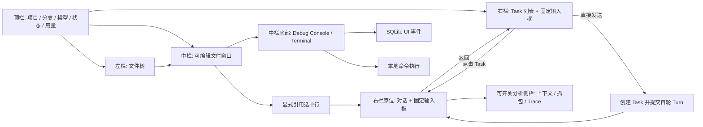
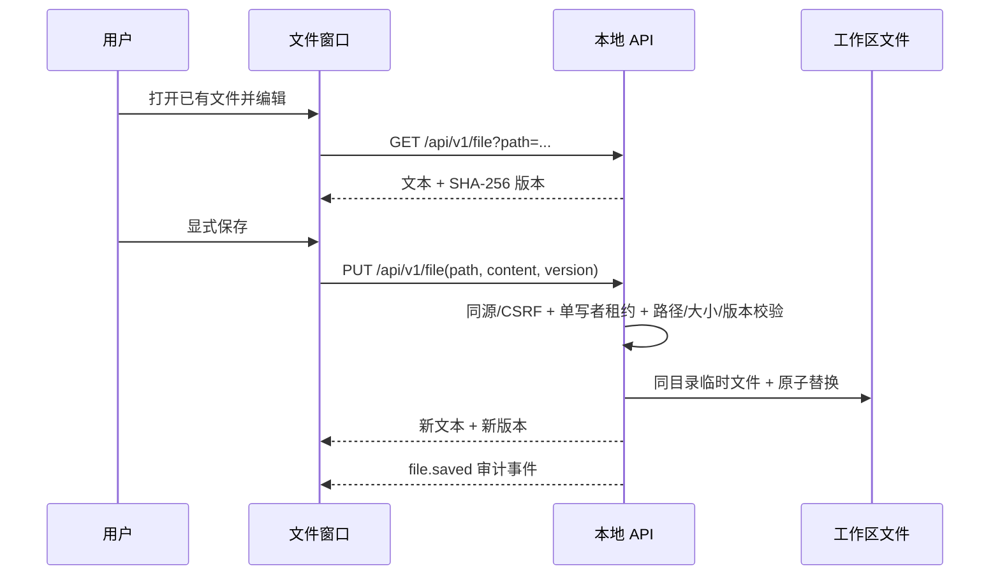
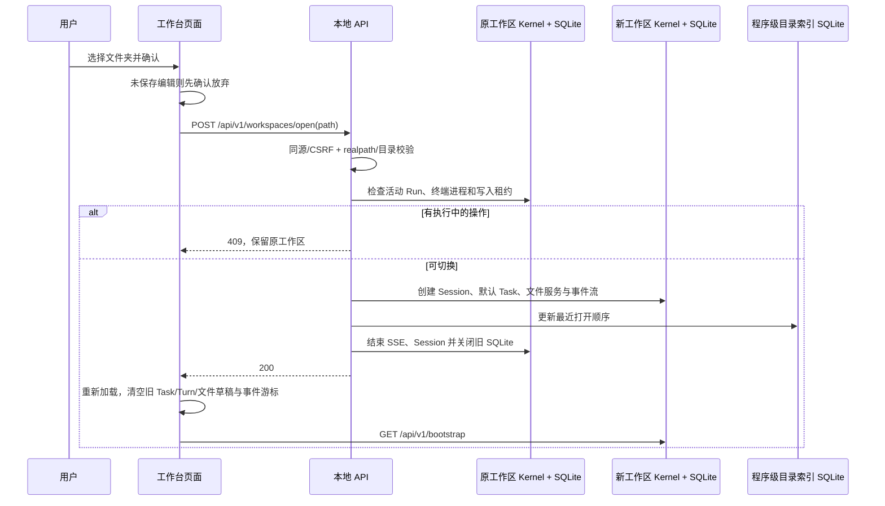

# 工作台与文件编辑设计

> 状态：左文件树、中间编辑器、右侧 Task 列表/对话一体面板与分析侧栏已实现。任务目录现按工作区跨 Session 聚合，标题取首条用户对话，并恢复刷新前的有效视图；专项记录见 [任务窗口优化实施与验收](./2026-10-17-任务窗口优化实施与验收.md)，总体验收见 [ACCEPTANCE.md](./ACCEPTANCE.md)。

## 1. 信息架构

桌面左侧文件树与中间编辑器组成文件工作区；右侧固定为一个 Task 面板，列表与对话互斥显示，输入框始终固定在底部。中间列底部工具区可在 Debug Console 和 Terminal 间切换、收起及拖动高度。文件树/编辑器、编辑器/Task 面板、分析侧栏左缘三条边界可拖动，方向键每次微调 16px，按住 Shift 微调 48px，双击分隔条恢复该区域默认宽度。布局限制文件树至少 120px、Task 面板至少 320px、编辑器至少 320px、分析侧栏至少 300px；浏览器变窄时自动收敛到这些边界。宽度和工具区高度仅保存在浏览器 `localStorage`，不写入 Agent 配置或 SQLite。分析侧栏从编辑器右缘弹出，不遮住 Task 对话。宽度不足 900px 时，顶部“文件/任务”切换两个工作区并隐藏列分隔条；任务视图内部仍可在列表与对话间返回。三张 [效果图](../../../../figox/shots/)是视觉基线，布局以本次确认的结构为准。

| 区域 | 职责 | 不负责 |
| :--- | :--- | :--- |
| 顶栏 | 展示并切换工作区、分支、当前模型、连接状态、已知用量 | 在线修改 Agent 配置 |
| 右侧 Task 面板 | 列表与对话共用底部输入框；列表发送创建 Task 和首轮 Turn，对话发送继续当前 Task | 将浏览过的文件自动送入模型 |
| 文件树 | 按需查询可见目录和文件 | 运行模型 Tool |
| 文件窗口 | 直接编辑文本、显式保存、Markdown 预览、选中行引用 | 隐式保存、创建文件 |
| Task 列表视图 | 选择 Task、新建和执行明确的状态操作 | 仅靠 UI 状态推断 Task 完成 |
| 分析侧栏 | 只读查询当前 Turn 的 ContextPack、抓包和 Trace | 修改执行事实 |
| Debug Console | 回放 SQLite UI 事件，并通过现有 SSE 实时刷新 | 伪造模型逐字流或替代逐 Turn Trace |
| Terminal | 在本机服务进程中逐条执行 Shell 命令，显示输出、状态和退出码，支持停止及 `cd` | PTY、交互式 TUI、Agent Tool 审批 |

## 2. Task 与运行反馈

选择右侧 Task 后，任务列表在同一面板切换为该 Task 的执行时间线；返回列表只改变 UI 视图，不暂停或结束 Task。输入框不随切换卸载，草稿和文件引用保留。列表中直接发送先以首行生成 Task 持久标题，再提交首轮 Turn 并进入对话；有 Turn 后，列表和对话标题以首条用户消息作为显示标题，不回写原始 Task 名称。对话中仅允许向当前 Session 的当前 active Task 继续发送，历史 Task 只读。新建 Task 直接进入其对话；刷新通过工作区隔离的浏览器偏好恢复 Session、Task 和列表/对话视图，服务端归属校验失败则回退当前会话列表，不迁移历史。中间已打开文件与未保存草稿在列表/对话切换时保持原样，文件草稿不作为刷新恢复内容。新建、暂停、恢复、完成、取消通过显式命令执行。浏览文件、保存文件、切换侧栏和查看用量都不创建 Turn。运行反馈来自 SQLite 和有序 UI 事件；模型只在有真实增量并确认是最终正文后逐段显示，刷新后重新查询状态并按事件游标续接。细节见[执行过程流设计](./streaming-workbench.md)。

任务目录默认显示整个当前工作区最近 8 个 Task，不再要求先切换 Session；“查看全部（总数）”进入每页 30 个条目的搜索与分页视图，按最近活动稳定排序。分页与筛选由同一 SQLite 查询提供总数，参数由 `web.taskList` 配置。没有 Turn 的自动 default Task 不占列表，命名空 Task 保留；旧版未归属 Turn 以只读合成入口参加列表。Session 历史入口不再使用长 ID 作为主标题，而显示该 Session 的第一条用户消息；无消息回退“未命名会话”。时间以刚刚、分、时、天、周、月、年简写显示，完整上海时间在悬停提示中保留。

选择历史 Session 时，界面优先打开最近一个包含 Turn 的 Task；返回列表后展示当前工作区的统一任务目录，不按刚选中的 Session 限定范围，对话标题栏可直接返回当前 Session。Session 列表显示该会话第一条用户消息和 Turn 总数，避免空会话与加载失败混淆。v1.1 之前的 Turn 没有 `task_id`，查询层为这些 Turn 构造只读的 `legacy_<sessionId>` 历史对话入口，并按原 Session/创建时间查询原始 Turn、工具记录；该入口不是 SQLite `tasks` 行，也不允许提交新 Turn。此兼容逻辑不回填或重写旧数据。对于确实没有 Turn 的历史 Session，保留只读空态。

## 3. 底部工具区与权限边界

Debug Console 的历史来自 `GET /api/v1/debug-events`，实时刷新沿用 `/api/v1/events` 的有序 SSE。它展示事件类型、时间、关联 ID 与有限状态，不把 HTTP 抓包或隐藏思维链当成调试日志。Terminal 使用 `GET/POST /api/v1/terminal` 与 `POST /api/v1/terminal/stop`，同一服务进程一次只运行一条命令，120 秒超时，单条输出最多 128 KiB，仅保留最近 30 条内存记录；服务重启后输出记录清空。`cd` 更新该终端会话的工作目录，普通命令由本机 Shell 执行。当前是逐条命令执行器，不支持 PTY、交互式程序与后台进程会话。

Terminal 是用户直接操作本机工作区，不经过 Agent 的 `ControlledToolPolicy`，也不向模型上下文注入输出。接口沿用本地监听、访问码配置、Host/Origin 与 CSRF 校验；在当前免访问码配置下，只能作为个人本机研究工作台使用。命令开始/结束写入 SQLite UI 事件，事件只持久化命令 SHA-256、目录、退出码和截断标志，不持久化命令正文与输出。Terminal 的浏览器视图能查看本进程内执行记录；不要在命令行输入密钥。

## 4. 文件安全与保存

服务端过滤 `.git/`、`node_modules/`、构建目录、隐藏项、凭据文件和 `code/figo-agent.config.json`，并用规范化路径、`lstat` 和 `realpath` 限定工作区边界。符号链接、目录伪装、二进制、非 UTF-8 和超过 1 MB 的文本不进入编辑器。文件查询与模型 `read_file` Tool 分开，UI 行为记录为 UI 事件，不冒充 ToolCall。

保存只覆盖已有可预览文件；版本不一致返回 409，不覆盖磁盘上的新内容。前端在关闭或切换文件前提示未保存修改，离开页面时使用浏览器原生提醒。保存失败保留编辑草稿。审计只写路径、大小、版本和失败原因，不写文件正文。当前版本不提供文件创建、图片预览、分页读取或自动保存。

## 5. 显式引用与上下文

编辑器里选中行并点击引用，引用结构包含工作区相对路径、起止行和已保存文件的版本。存在未保存修改时禁用引用。提交 Turn 时，服务端重读文件并校验路径、版本、行数和内容大小；只有通过 ContextBuilder 的引用进入模型上下文。待发送引用只存在于前端草稿，未发送不落 SQLite。文件在预览后变化则拒绝，不能默默引用另一版内容。

## 6. 失败与验收边界

页面明确显示无 Task、无 Turn、运行中、连接中断、保存冲突、敏感路径拒绝和大文件等状态。键盘可操作编辑器、Task、侧栏和输入区；图标按钮有中文名称。桌面、窄屏和移动视口无整体横向溢出，代码与分析侧栏独立滚动。浏览器端到端测试验证编辑后的真实磁盘内容、刷新持久性、引用来源，以及行号与代码内容的像素对齐。

## 7. 工程经验

人的文件编辑与 Agent 的工具执行共享工作区安全边界，但事件语义不同：`file.saved` 不是 ToolCall，预览也不是 ContextItem。版本化保存把界面上的草稿与磁盘事实区分开，避免 UI 对模型上下文做无证据的隐式承诺。

## 8. 打开文件夹与工作区切换

顶栏文件夹按钮打开目录选择窗口：macOS 可调用系统文件夹选择器，也可输入本机绝对路径或从最近打开列表选择。最近目录保存在程序配置目录下的 `.figo-agent/workspaces.db`，仅记录路径、打开时间与确定性的访问顺序；`figo-agent.config.json` 仍只负责模型和运行配置。重新启动 Web 服务时按最近目录顺序恢复首个仍可访问的目录，全部失效则退回启动目录的上一级。路径通过 `realpath` 规范化并确认是目录，列表不把路径当作权限凭证。

切换的是整个 Agent 工作区，不是单独替换文件树：每个目录独立保存 `.figo-agent/figo-agent.db`、Session、Task、Turn、文件和 Terminal 状态。模型配置仍读取程序配置目录。成功切换分别写 `workspace.closed` 和 `workspace.opened` UI 事件；旧 Session 结束，新 Session 开始。页面整页重载使旧工作区的 SSE 游标、引用、编辑器、历史列表和任务选择不会混用。返回旧目录时会建立新的 Session，旧 Session 可在该目录的历史列表中查阅。运行中的 Agent Run 或终端命令必须先结束，不能被切换暗中终止。浏览器无权绕过 Host、Origin、访问码配置与 CSRF 校验。

工程经验：工作区路径是运行作用域，模型配置是程序作用域，布局是浏览器作用域。把三者分开后，切换目录无需复制配置或重写历史数据库，也能明确界定哪些状态必须重建。
