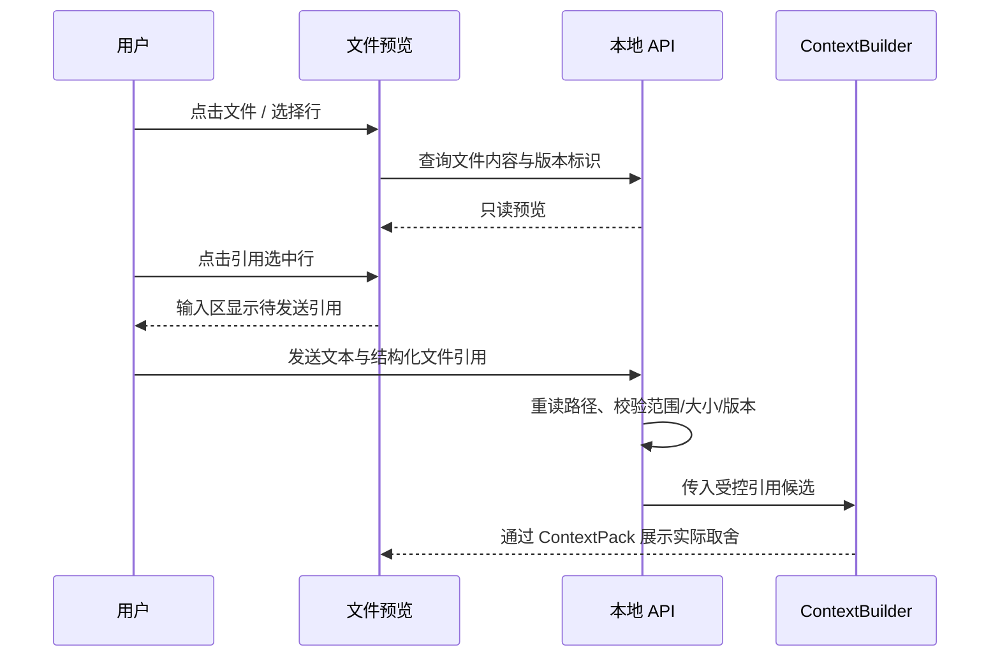

# 工作台与文件浏览设计

> 状态：首期工作台已实现；本文仍保留完整设计边界，实际覆盖与未实现范围见[验收记录](./ACCEPTANCE.md)。

## 文档索引信息

- 背景：三张 UI 效果图确认了左侧 Task + 文件树、中间对话 + 文件预览的结构。
- 目标：使 Task 切换、运行反馈、文件查看与显式上下文引用在一个工作台内闭环。
- 标签：工作台、Task、文件树、只读预览、文件引用、响应式布局。
- 适用范围：Web 前端、文件查询 API、运行状态投影与交互验收。
- 后续可用方向：组件拆分、交互测试、文件引用 ContextSource 设计。

## 1. 布局与组件边界

```text
顶栏       项目 / 分支 / 当前模型 / 运行状态 / 用量
左栏       Task 列表（上） + 文件树（下）
中栏       对话标签 / 文件标签 -> 对话或只读预览 -> 输入区
右栏       上下文 / 抓包 / Trace（见 inspector.md）
```

桌面三栏采用可拖拽但有下限的宽度：左栏 240–300px，右栏 360–440px，中栏至少 520px。窗口不足以满足下限时，右栏改为可打开的抽屉；窄屏下左栏也改为抽屉，中栏始终保留可用阅读宽度。分栏宽度可在浏览器本地记忆，但不得写入 Agent 配置。小屏文件预览占中栏全宽，输入区不遮挡代码最后一行。工具栏、标签、行号、长路径和长 ID 都不得改变列宽或互相覆盖。

| 区域 | 单一职责 | 不负责 |
| :--- | :--- | :--- |
| 顶栏 | 显示当前工作区、Git 分支、当前配置模型、运行状态 | 修改 Agent 内核运行配置 |
| Task 导航 | 选择 Task、展示真实状态、触发明确的 Task 命令 | 从页面推测 Task 完成状态 |
| 文件树 | 浏览当前工作区内允许展示的路径 | 将文件自动写入模型上下文 |
| 文件预览 | 只读查看文本、搜索、选择行、发起引用意图 | 写文件、执行模型 Tool |
| 对话区 | 展示用户输入、Agent 输出、工具摘要和 Run 状态 | 根据模型文本直接批准工具 |

截图里的模型选择下拉在首期**只展示当前已启用模型**；现有配置在启动时选定模型，在线切换模型要等运行时重配置协议通过验收后才启用。分支与工作区同理，首期展示当前值，不假装已经支持切换仓库或 worktree。

## 2. Task 与对话

Task 列表按状态和最近更新时间组织，显示 `active / paused / completed / cancelled / archived` 的真实状态。选择 Task 时，中栏展示该 Task 的 Turn，右栏查询范围切换为该 Task；折叠或隐藏列表项不改变 SQLite 中的 Task 状态。新建、暂停、恢复、完成、取消使用显式命令与结果确认；普通文本才创建 Turn，查看文件、切换标签、检索日志和查看 `/usage` 不创建 Turn。

对话区的运行卡片以事件投影更新：已接收、运行中、工具调用、成功、失败、连接中断。当前 Provider 未提供逐字流；首期只展示**真实阶段进度**，不能用打字动画伪装模型流。每个运行卡片提供跳转到相应 Tool、LLM 抓包和 Trace 的关联入口。提交期间同一服务实例只允许一个活动 Run；重复提交明确拒绝或幂等返回，不静默创建重复 Turn。服务重启后旧 Session 的历史可查看；自动续接旧 Session 不在首期范围。

## 3. 文件树与只读预览

文件树按需加载目录，不递归读取整个仓库。默认过滤 `.git/`、`node_modules/`、`dist/`、`build/`、`coverage/`、`.figo-agent/` 及配置中的敏感路径；服务端执行过滤，不能只在前端隐藏。`code/figo-agent.config.json` 因可存本地 API Key，首期不提供原文预览。服务端用规范化路径和 `realpath` 校验工作区边界，拒绝路径穿越、越界符号链接、目录伪装文件和过大的请求。文件树权限与模型 `read_file` Tool 权限分开；共享路径安全能力，不把 UI 浏览记为 Tool 调用。成功打开与拒绝访问都记录仅含路径摘要、结果和原因的 UI 审计事件，不记录文件正文。

文件预览支持文本语法高亮、行号、文件内搜索、行区间选择、复制工作区相对路径和 Markdown 源码/预览切换。图片、二进制文件只展示元信息或受限预览，不按 UTF-8 强行解码；大文件先显示大小与截断状态，按需分页读取。预览标签与对话标签并存，切换 Task 不会改变已打开文件的内容；文件在磁盘上变化时显示“文件已变化”，重新读取后更新版本标识。

## 4. 显式文件引用

“查看”和“引用”是两个不同事件：



引用结构至少包含工作区相对路径、起止行和预览时内容版本标识；引用不是把浏览器里的字符串直接拼接进 system prompt。发送时服务端重新读取、核对路径与版本；文件变更则拒绝并让用户刷新，不静默引用另一份内容。引用成功后在 ContextItem 中记录来源、行区间、内容摘要、纳入或排除原因与估算量。未点击发送的待引用项只存在于前端草稿，不进入 SQLite 或模型请求。首期引用大小、行数、文件数量由服务端配置限制，不能由前端绕过。

## 5. 状态、无障碍与失败处理

| 场景 | 页面行为 |
| :--- | :--- |
| 无 Task 或无历史 Turn | 保持工作台布局，提供创建 Task / 输入区；不填充虚构记录 |
| 运行中刷新页面 | 重新查询状态并按事件游标续接；不再提交一遍用户输入 |
| SSE 断开 | 标记“连接中断”，停止宣称执行进度；重连后回放缺失事件 |
| 文件不存在或被修改 | 预览给出明确状态；已失效的引用不能发送 |
| 权限拒绝或敏感路径 | 显示“访问被拒绝”及原因，不回显本机绝对路径或密钥 |
| 二进制或超大文件 | 展示类型与大小，限制读取；输入区与其他标签可继续使用 |

键盘可遍历 Task、文件树、标签和输入区；状态同时有文字与图标，不只靠颜色。图标按钮须有中文名称/Tooltip；单个文件、目录或 Task 标题过长时省略显示并可查看全称。代码预览与检查器分别滚动，页面整体不出现难以控制的横向滚动。

## 6. 可沉淀的工程经验

文件浏览属于人的观察行为，Tool 调用属于 Agent 的执行行为，二者复用安全边界但不共享事件语义。只有显式引用并通过 ContextBuilder 后，文件内容才成为模型上下文；这让“界面看过”与“模型看过”有可验证的区别。
