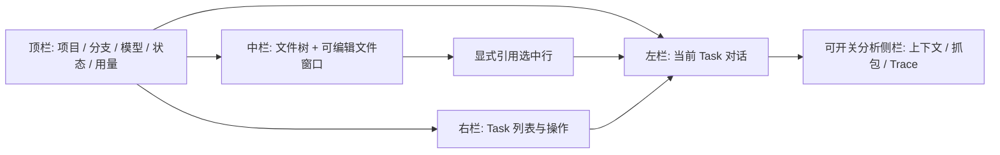
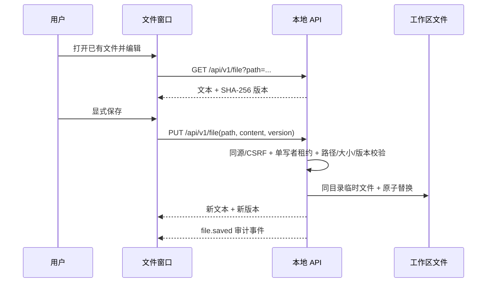

# 工作台与文件编辑设计

> 状态：左对话、中间文件、右任务与分析侧栏已实现；验收证据见 [ACCEPTANCE.md](./ACCEPTANCE.md)。

## 1. 信息架构

桌面三栏采用受约束的响应式宽度；分析侧栏覆盖右侧并可关闭。宽度不足 1080px 时，对话和文件由顶部视图切换，Task 列表成为右侧抽屉。当前版本没有拖拽分栏或持久化列宽。三张 [效果图](../../../../figox/shots/)是视觉基线，布局以本次确认的结构为准。

| 区域 | 职责 | 不负责 |
| :--- | :--- | :--- |
| 顶栏 | 展示工作区、分支、当前模型、连接状态、已知用量 | 在线修改 Agent 配置 |
| 对话 | 展示所选 Task 的 Turn、工具摘要和 Run 阶段；提交新 Turn | 将浏览过的文件自动送入模型 |
| 文件树 | 按需查询可见目录和文件 | 运行模型 Tool |
| 文件窗口 | 直接编辑文本、显式保存、Markdown 预览、选中行引用 | 隐式保存、创建文件 |
| Task 列表 | 选择 Task、新建和执行明确的状态操作 | 仅靠 UI 状态推断 Task 完成 |
| 分析侧栏 | 只读查询当前 Turn 的 ContextPack、抓包和 Trace | 修改执行事实 |

## 2. Task 与运行反馈

选择右侧 Task 后，左栏展示该 Task 的 Turn，分析侧栏随当前 Turn 更新；中间已打开文件保持原样。新建、暂停、恢复、完成、取消通过显式命令执行。浏览文件、保存文件、切换侧栏和查看用量都不创建 Turn。运行反馈来自 SQLite 和有序 UI 事件，不伪装模型逐字流；刷新后重新查询运行状态并按事件游标续接。

## 3. 文件安全与保存

服务端过滤 `.git/`、`node_modules/`、构建目录、隐藏项、凭据文件和 `code/figo-agent.config.json`，并用规范化路径、`lstat` 和 `realpath` 限定工作区边界。符号链接、目录伪装、二进制、非 UTF-8 和超过 1 MB 的文本不进入编辑器。文件查询与模型 `read_file` Tool 分开，UI 行为记录为 UI 事件，不冒充 ToolCall。

保存只覆盖已有可预览文件；版本不一致返回 409，不覆盖磁盘上的新内容。前端在关闭或切换文件前提示未保存修改，离开页面时使用浏览器原生提醒。保存失败保留编辑草稿。审计只写路径、大小、版本和失败原因，不写文件正文。当前版本不提供文件创建、图片预览、分页读取或自动保存。

## 4. 显式引用与上下文

编辑器里选中行并点击引用，引用结构包含工作区相对路径、起止行和已保存文件的版本。存在未保存修改时禁用引用。提交 Turn 时，服务端重读文件并校验路径、版本、行数和内容大小；只有通过 ContextBuilder 的引用进入模型上下文。待发送引用只存在于前端草稿，未发送不落 SQLite。文件在预览后变化则拒绝，不能默默引用另一版内容。

## 5. 失败与验收边界

页面明确显示无 Task、无 Turn、运行中、连接中断、保存冲突、敏感路径拒绝和大文件等状态。键盘可操作编辑器、Task、侧栏和输入区；图标按钮有中文名称。桌面、窄屏和移动视口无整体横向溢出，代码与分析侧栏独立滚动。浏览器端到端测试验证编辑后的真实磁盘内容、刷新持久性、引用来源，以及行号与代码内容的像素对齐。

## 6. 工程经验

人的文件编辑与 Agent 的工具执行共享工作区安全边界，但事件语义不同：`file.saved` 不是 ToolCall，预览也不是 ContextItem。版本化保存把界面上的草稿与磁盘事实区分开，避免 UI 对模型上下文做无证据的隐式承诺。
