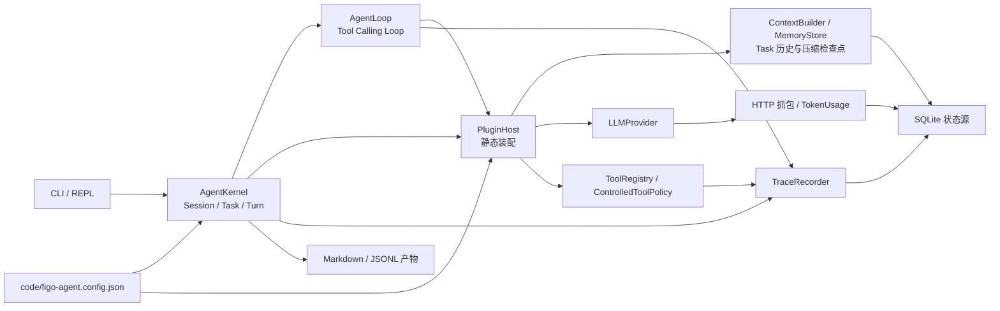
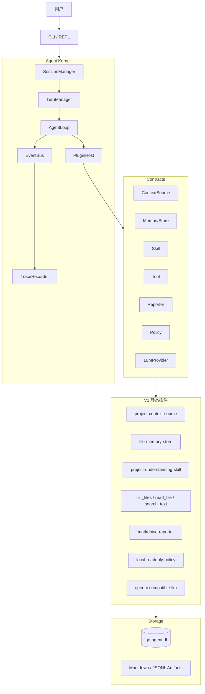
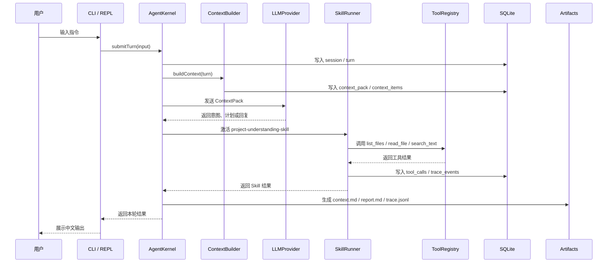

# Figo Agent V1 架构设计

> 日期：2026-10-10
> 阶段：V1 架构设计
> 状态：V1 基线已实施；当前进度更新于 2026-10-11

> 阅读约定：第 1～18 节保留 2026-10-10 的 V1 初版设计边界，文中的“V1 不做”不是当前程序的能力清单。现行实现与待办以本节“当前实施进度”、[项目 README](../../readme.md)及各模块验收记录为准；运行时流程只由代码和 `code/figo-agent.config.json` 控制，本文档不参与执行。

## 文档索引信息

- 背景：本文档位于 `docs/agent/`，用于沉淀 `figo-agent` V1 第一版架构设计。
- 目标：明确 V1 的目标、非目标、模块边界、运行流程、数据结构、存储模型和验收标准。
- 标签：coding agent、agent harness、CLI、上下文工程、记忆体系、插件架构、SQLite、Trace。
- 适用范围：V1 历史设计基线、版本进度对照、模块拆分、接口定义、复盘检查。
- 后续可用方向：对照代码与验收记录复盘设计取舍，沉淀 agent harness 方法论。

## 当前实施进度（2026-10-11）

| 阶段 | 状态 | 已落地范围 | 证据 |
| :--- | :--- | :--- | :--- |
| V1 小内核 | 已落地 | CLI / REPL、Session / Turn、AgentKernel / AgentLoop、静态 PluginHost、ContextPack、SQLite Memory 读取、Skill、只读 Tool、Trace 与 Markdown / JSONL 产物 | [模块索引](./modules/README.md)、[V1 实施状态](../../AGENTS.MD) |
| V1.1 Task | 已落地 | `Session -> Task -> Turn`；Task 创建、切换、暂停、恢复、完成、取消；同一 Task 历史与完成摘要 | [Task 设计](./modules/task/README.md)、[Task 验收](./modules/task/ACCEPTANCE.md)、`code/src/task/task-manager.ts` |
| V1.2 Tool Calling | 已落地 | 模型工具调用循环、ToolResult 回填、轮次上限；受控写文件、Shell、Git、网络、浏览器 Tool 与 Policy | [Tool Calling Loop](./modules/agent-loop/TOOL_CALLING_LOOP.md)、[Tool 验收](./modules/tool/ACCEPTANCE.md)、`code/src/loop/tool-calling-runtime.ts` |
| 上下文压缩 | Pi代码与三模型配对功能通过，实际容量未全放行 | 固定Pi估算、窗口阈值、安全切点、Markdown滚动摘要、消息级来源、手动关注点与一次恢复；原生正文误判已修复；18/18配对后续通过，中转窗口未知，未证明普遍净收益 | [Pi 压缩验收第九节](./modules/context/2026-10-15-Pi上下文压缩对齐测试验收.md)、`code/src/context/compaction-service.ts` |
| V2 TokenUsage 首期 | 已验收 | 请求级实际用量、未知状态、旧抓包回填、上下文估算、`/usage` 与报告汇总；普通请求和压缩请求均记录用途 | [TokenUsage 验收记录](./modules/token-usage/ACCEPTANCE.md)、`code/src/token-usage/token-usage-store.ts` |

上述“已落地”只表示对应代码路径存在；具体测试结论以链接中的验收记录为准。TokenUsage 验收记录载明全量 38 个测试文件、117 项测试以及类型检查、构建通过，并含 GPT 中转与 MiniMax 的真实短请求用量核查；这不是对后续能力的验收结论。

仍未落地：Goal / Verifier、自动长期 Memory 写入、动态插件加载、压缩阈值自优化、Token 价格成本与单 Tool / Skill 实际用量归因、抓包可视化界面。压缩自优化目前只有[设计方案](./modules/context/COMPACTION_SELF_OPTIMIZATION.md)和[待实施计划](./modules/context/COMPACTION_SELF_OPTIMIZATION_PHASE1_IMPLEMENTATION.md)，不得标为已实现。

当前运行关系如下；下文第 5、7 节的图保留 V1 设计快照，不应据此推断现行代码仍使用 EventBus 或只读 Policy：



## 1. 设计结论

Figo Agent V1 是一个本地 CLI 交互式 coding agent harness。V1 的目标不是做完整通用型 coding agent，而是验证小内核闭环：

```text
CLI / REPL
  -> Session / Turn
  -> ContextPack
  -> Skill
  -> Tool
  -> TraceEvent
  -> SQLite
  -> Markdown / JSONL Artifact
```

V1 采用“架构完整、功能克制”的建设原则：

1. 架构上保留长期演进需要的核心抽象。
2. 功能上只实现最小可运行闭环。
3. 内核保持小，能力通过静态插件接入。
4. Context、Memory、Trace、Skill 从 V1 进入核心设计。
5. V1 做关键链路结构化 Trace，不做完整全链路日志平台。

## 2. 直接证据

本设计来自 V1 设计时的项目资料和已确认协作规则：

1. 根目录 `readme.md` 明确项目用于从零搭建个人 coding agent，重点研究 agent harness、上下文工程、工具调用、记忆设计和执行闭环。
2. 根目录 `AGENTS.MD` 明确 V1 先做命令行交互模式，使用 `Session + Turn + Trace + PluginHost + AgentLoop` 作为小内核。
3. 根目录 `AGENTS.MD` 明确 V1 必须包含上下文体系、记忆体系、Skill 插件体系和关键链路结构化 Trace。
4. 根目录 `AGENTS.MD` 明确 V1 **初版**暂不实现 Goal、`apply_patch`、`run_command`、Git 操作、Verifier、动态插件加载、TokenUsage 和持续自优化；后续版本已实现其中的 Tool 与请求级 TokenUsage，见上方进度表。

## 3. V1 目标

V1 目标是实现一个可以运行、可以追踪、可以复盘的本地 CLI agent harness。

V1 必须完成：

1. 启动 CLI / REPL。
2. 创建和维护 Session。
3. 记录每一轮 Turn。
4. 构造最小 ContextPack。
5. 静态注册插件。
6. 激活一个内置 Skill。
7. 调用最小 Tool 集。
8. 写入 SQLite 状态源。
9. 写入关键链路 TraceEvent。
10. 生成 Markdown 报告和 JSONL 审计流水。

## 4. V1 非目标

V1 不做以下能力：

1. Goal。
2. `apply_patch`。
3. `run_command`。
4. Git 操作。
5. 浏览器工具。
6. 外部 API 工具。
7. Verifier。
8. 复杂 Policy。
9. 动态插件加载。
10. 多 Skill 编排。
11. 自动 Memory 写入。
12. TokenUsage 统计。
13. 持续自优化。
14. OpenTelemetry。
15. Span 嵌套树。
16. 日志可视化 UI。
17. 完整全链路日志平台。

## 5. 总体架构（V1 设计快照）



## 6. 核心模块边界

> 说明：本节只给模块总览。每个子模块的详细讲解放在 `docs/agent/modules/<module-name>/` 独立目录中，包含设计动机、职责边界、流程图、UML、失败处理和文章观点。

模块详解索引：

1. [CLI / REPL](./modules/cli-repl/)
2. [Agent Kernel](./modules/agent-kernel/)
3. [AgentLoop](./modules/agent-loop/)
4. [PluginHost](./modules/plugin-host/)
5. [Context](./modules/context/)
6. [Memory](./modules/memory/)
7. [Skill](./modules/skill/)
8. [Tool](./modules/tool/)
9. [Trace](./modules/trace/)
10. [Storage](./modules/storage/)
11. [Reporter](./modules/reporter/)
12. [LLM / Policy](./modules/llm-policy/)
13. [TokenUsage](./modules/token-usage/)
14. [Task](./modules/task/)

### 6.1 CLI / REPL

职责：

1. 启动交互式命令行。
2. 接收用户输入。
3. 展示 agent 输出。
4. 识别基础命令，例如 `/exit`、`/context`、`/memory`、`/report`。

不负责：

1. 不直接读项目文件。
2. 不直接构造上下文。
3. 不直接调用模型。
4. 不直接执行 Tool。

### 6.2 Agent Kernel

职责：

1. 管理 Session。
2. 管理 Turn。
3. 驱动 AgentLoop。
4. 分发事件。
5. 调用 PluginHost。
6. 记录 TraceEvent。

不负责：

1. 不绑定具体 LLM。
2. 不绑定具体 Tool。
3. 不绑定具体 ContextSource。
4. 不绑定具体 MemoryStore。
5. 不绑定具体 Reporter。

### 6.3 PluginHost

职责：

1. 静态注册 V1 插件。
2. 按能力类型查询插件。
3. 执行插件生命周期。
4. 向 AgentLoop 暴露统一调用入口。

V1 不做动态插件加载。动态插件加载进入 V3。

### 6.4 Context

职责：

1. 从 ContextSource 收集候选上下文。
2. 构造 ContextItem。
3. 形成 ContextPack。
4. 记录上下文来源、原因、优先级和取舍决策。
5. 写入 SQLite。
6. 生成 `context.md` Artifact。

V1 上下文来源：

1. 当前 Turn。
2. 最近对话。
3. `AGENTS.MD`。
4. `readme.md`。
5. 目录结构。
6. 最小 Memory 读取结果。

### 6.5 Memory

职责：

1. 保存项目级、用户级、agent 级和知识级稳定信息。
2. 从 SQLite 查询结构化 MemoryRecord。
3. 从 Markdown 生成可读记忆文档。
4. 为 ContextPack 提供检索结果。

V1 只做手动写入或初始化写入，不做自动 Memory 写入判断。

### 6.6 Skill

职责：

1. 表达可复用任务方法。
2. 声明触发场景。
3. 声明需要的上下文。
4. 声明可用 Tool。
5. 声明输出结构。
6. 写入 TraceEvent。

V1 只实现一个 Skill：

```text
project-understanding-skill
```

该 Skill 负责读取项目规则、README、目录结构和已有记忆，输出项目理解报告。

### 6.7 Tool

职责：

1. 提供原子动作。
2. 接受结构化输入。
3. 返回结构化结果。
4. 记录调用摘要、耗时、错误和结果摘要。

V1 最小 Tool 集：

1. `list_files`
2. `read_file`
3. `search_text`

### 6.8 Trace

职责：

1. 记录关键链路结构化事件。
2. 写入 SQLite。
3. 追加 JSONL 审计流水。
4. 为 Markdown Report 提供事实来源。

V1 Trace 是结构化事件记录，不是完整全链路日志平台。

### 6.9 Reporter

职责：

1. 从 SQLite 和 TraceEvent 生成 Markdown。
2. 输出 `context.md`。
3. 输出 `report.md`。
4. 保证报告来自结构化事实。

Markdown 不是状态源。

## 7. V1 运行流程（设计快照）



## 8. 数据模型

### 8.1 Session

```ts
interface Session {
  id: string;
  workspacePath: string;
  status: "active" | "ended" | "failed";
  startedAt: string;
  endedAt?: string;
  summary?: string;
}
```

### 8.2 Turn

```ts
interface Turn {
  id: string;
  sessionId: string;
  role: "user" | "assistant" | "system";
  content: string;
  status: "received" | "processing" | "completed" | "failed";
  createdAt: string;
  completedAt?: string;
}
```

### 8.3 ContextPack

```ts
interface ContextPack {
  id: string;
  sessionId: string;
  turnId: string;
  items: ContextItem[];
  decisions: ContextDecision[];
  createdAt: string;
}
```

### 8.4 ContextItem

```ts
interface ContextItem {
  id: string;
  contextPackId: string;
  type: "rule" | "user_input" | "conversation" | "project_doc" | "workspace" | "memory" | "tool_result";
  source: string;
  content: string;
  reason: string;
  priority: number;
  included: boolean;
}
```

### 8.5 ContextDecision

```ts
interface ContextDecision {
  id: string;
  contextPackId: string;
  itemId?: string;
  action: "include" | "exclude" | "summarize";
  reason: string;
  createdAt: string;
}
```

### 8.6 MemoryRecord

```ts
interface MemoryRecord {
  id: string;
  scope: "project" | "user" | "agent" | "knowledge";
  title: string;
  content: string;
  evidence: string[];
  tags: string[];
  createdAt: string;
  updatedAt: string;
}
```

### 8.7 SkillManifest

```ts
interface SkillManifest {
  id: string;
  name: string;
  description: string;
  triggers: string[];
  requiredContext: string[];
  allowedTools: string[];
  outputs: string[];
}
```

### 8.8 TraceEvent

```ts
interface TraceEvent {
  id: string;
  sessionId: string;
  turnId?: string;
  type: string;
  source: string;
  payload: Record<string, unknown>;
  createdAt: string;
}
```

### 8.9 LLMRequest

```ts
interface LLMRequest {
  id: string;
  sessionId: string;
  turnId: string;
  contextPackId: string;
  messages: LLMMessage[];
  model: string;
}
```

### 8.10 LLMResponse

```ts
interface LLMResponse {
  id: string;
  requestId: string;
  content: string;
  finishReason: string;
  raw?: unknown;
}
```

## 9. SQLite 设计

V1 SQLite 是状态源。Markdown 和 JSONL 从 SQLite 与 TraceEvent 生成。

```sql
CREATE TABLE sessions (
  id TEXT PRIMARY KEY,
  workspace_path TEXT NOT NULL,
  status TEXT NOT NULL,
  summary TEXT,
  started_at TEXT NOT NULL,
  ended_at TEXT
);

CREATE TABLE turns (
  id TEXT PRIMARY KEY,
  session_id TEXT NOT NULL,
  role TEXT NOT NULL,
  content TEXT NOT NULL,
  status TEXT NOT NULL,
  created_at TEXT NOT NULL,
  completed_at TEXT,
  FOREIGN KEY (session_id) REFERENCES sessions(id)
);

CREATE TABLE context_packs (
  id TEXT PRIMARY KEY,
  session_id TEXT NOT NULL,
  turn_id TEXT NOT NULL,
  created_at TEXT NOT NULL,
  FOREIGN KEY (session_id) REFERENCES sessions(id),
  FOREIGN KEY (turn_id) REFERENCES turns(id)
);

CREATE TABLE context_items (
  id TEXT PRIMARY KEY,
  context_pack_id TEXT NOT NULL,
  type TEXT NOT NULL,
  source TEXT NOT NULL,
  content TEXT NOT NULL,
  reason TEXT NOT NULL,
  priority INTEGER NOT NULL,
  included INTEGER NOT NULL,
  FOREIGN KEY (context_pack_id) REFERENCES context_packs(id)
);

CREATE TABLE context_decisions (
  id TEXT PRIMARY KEY,
  context_pack_id TEXT NOT NULL,
  item_id TEXT,
  action TEXT NOT NULL,
  reason TEXT NOT NULL,
  created_at TEXT NOT NULL,
  FOREIGN KEY (context_pack_id) REFERENCES context_packs(id)
);

CREATE TABLE memory_records (
  id TEXT PRIMARY KEY,
  scope TEXT NOT NULL,
  title TEXT NOT NULL,
  content TEXT NOT NULL,
  evidence_json TEXT NOT NULL,
  tags_json TEXT NOT NULL,
  created_at TEXT NOT NULL,
  updated_at TEXT NOT NULL
);

CREATE TABLE skill_runs (
  id TEXT PRIMARY KEY,
  session_id TEXT NOT NULL,
  turn_id TEXT NOT NULL,
  skill_id TEXT NOT NULL,
  status TEXT NOT NULL,
  started_at TEXT NOT NULL,
  completed_at TEXT,
  result_summary TEXT,
  FOREIGN KEY (session_id) REFERENCES sessions(id),
  FOREIGN KEY (turn_id) REFERENCES turns(id)
);

CREATE TABLE tool_calls (
  id TEXT PRIMARY KEY,
  session_id TEXT NOT NULL,
  turn_id TEXT,
  skill_run_id TEXT,
  tool_name TEXT NOT NULL,
  input_summary TEXT NOT NULL,
  output_summary TEXT,
  status TEXT NOT NULL,
  error_message TEXT,
  started_at TEXT NOT NULL,
  completed_at TEXT,
  FOREIGN KEY (session_id) REFERENCES sessions(id),
  FOREIGN KEY (turn_id) REFERENCES turns(id),
  FOREIGN KEY (skill_run_id) REFERENCES skill_runs(id)
);

CREATE TABLE trace_events (
  id TEXT PRIMARY KEY,
  session_id TEXT NOT NULL,
  turn_id TEXT,
  type TEXT NOT NULL,
  source TEXT NOT NULL,
  payload_json TEXT NOT NULL,
  created_at TEXT NOT NULL,
  FOREIGN KEY (session_id) REFERENCES sessions(id),
  FOREIGN KEY (turn_id) REFERENCES turns(id)
);

CREATE TABLE artifacts (
  id TEXT PRIMARY KEY,
  session_id TEXT NOT NULL,
  turn_id TEXT,
  type TEXT NOT NULL,
  path TEXT NOT NULL,
  source_event_id TEXT,
  created_at TEXT NOT NULL,
  FOREIGN KEY (session_id) REFERENCES sessions(id),
  FOREIGN KEY (turn_id) REFERENCES turns(id)
);
```

## 10. 文件产物设计

```text
.figo-agent/
  figo-agent.db
  artifacts/
    sessions/
      <session-id>/
        context.md
        report.md
        trace.jsonl
  memory/
    project.md
    user.md
    agent.md
    knowledge.md
```

职责边界：

1. `figo-agent.db` 是状态源。
2. `trace.jsonl` 是完整审计流水。
3. `context.md` 是本轮上下文复盘产物。
4. `report.md` 是本轮或本次 Session 的中文报告。
5. `memory/*.md` 是人类可读的稳定记忆。

## 11. 插件契约

### 11.1 Plugin

```ts
interface Plugin {
  id: string;
  name: string;
  version: string;
  setup(context: PluginContext): Promise<void>;
}
```

### 11.2 ContextSource

```ts
interface ContextSource {
  id: string;
  collect(input: ContextCollectInput): Promise<ContextItemCandidate[]>;
}
```

### 11.3 Tool

```ts
interface Tool {
  name: string;
  description: string;
  inputSchema: unknown;
  execute(input: unknown, context: ToolExecutionContext): Promise<ToolResult>;
}
```

### 11.4 Skill

```ts
interface Skill {
  manifest: SkillManifest;
  canHandle(input: SkillMatchInput): Promise<boolean>;
  run(input: SkillRunInput): Promise<SkillRunResult>;
}
```

### 11.5 MemoryStore

```ts
interface MemoryStore {
  search(query: MemoryQuery): Promise<MemoryRecord[]>;
  save(record: MemoryRecord): Promise<void>;
}
```

### 11.6 Reporter

```ts
interface Reporter {
  generate(input: ReportInput): Promise<Artifact>;
}
```

### 11.7 LLMProvider

```ts
interface LLMProvider {
  id: string;
  complete(request: LLMRequest): Promise<LLMResponse>;
}
```

## 12. V1 内置 Skill 设计

### 12.1 project-understanding-skill

职责：

1. 读取当前项目协作规则。
2. 读取项目 README。
3. 读取目录结构。
4. 检索已有项目记忆。
5. 生成项目理解报告。
6. 写入 TraceEvent。
7. 生成 Markdown Report。

触发方式：

1. 用户输入“读取当前项目”。
2. 用户输入“分析项目”。
3. 用户输入“生成项目理解报告”。
4. CLI 首次启动时用户确认执行项目理解。

允许 Tool：

1. `list_files`
2. `read_file`
3. `search_text`

输出：

1. 项目定位。
2. 直接证据。
3. 当前结构。
4. V1 相关判断。
5. 后续建议。

## 13. V1 关键 TraceEvent 类型

```text
session.started
session.ended
session.failed
turn.received
turn.processing
turn.completed
turn.failed
context.build.started
context.item.candidate
context.item.included
context.item.excluded
context.build.completed
memory.search.started
memory.search.completed
plugin.registered
plugin.ready
plugin.failed
capability.registered
capability.lookup.failed
skill.activated
skill.skipped
skill.completed
skill.failed
tool.called
tool.completed
tool.failed
tool.denied
policy.evaluated
policy.denied
llm.called
llm.completed
llm.failed
artifact.created
error.occurred
```

## 14. V1 命令设计

V1 CLI 使用交互式 REPL：

```bash
figo-agent
```

V1 支持命令：

```text
/exit       退出当前 Session
/context    查看当前 ContextPack 摘要
/memory     查看当前 Memory 摘要
/report     生成当前 Session 报告
/help       查看命令帮助
```

普通文本输入作为一个 Turn 进入 AgentLoop。

## 15. SOLID 映射

1. 单一职责：CLI 只负责交互，AgentLoop 只负责编排，TraceRecorder 只负责事件记录。
2. 开闭原则：新增 Tool、Skill、ContextSource、MemoryStore 通过插件扩展。
3. 里氏替换：不同 LLMProvider、MemoryStore、Reporter 实现同一接口。
4. 接口隔离：Skill、Tool、ContextSource、MemoryStore、Reporter、Policy 独立定义。
5. 依赖倒置：Kernel 依赖 contracts，不依赖具体插件。

## 16. V1 验收标准

V1 完成时必须满足：

1. 可以通过 `figo-agent` 启动 REPL。
2. 用户输入一轮项目分析请求后，系统创建 Session 和 Turn。
3. SQLite 写入 `sessions`、`turns`、`context_packs`、`context_items`、`trace_events`。
4. 系统能够读取 `AGENTS.MD`、`readme.md` 和目录结构。
5. 系统能够激活 `project-understanding-skill`。
6. 系统能够调用 `list_files`、`read_file`、`search_text`。
7. 系统生成 `.figo-agent/artifacts/sessions/<session-id>/context.md`。
8. 系统生成 `.figo-agent/artifacts/sessions/<session-id>/report.md`。
9. 系统生成 `.figo-agent/artifacts/sessions/<session-id>/trace.jsonl`。
10. Markdown 报告能说明读取了什么、依据是什么、输出了什么结论。
11. 失败时 SQLite 和 JSONL 中保留错误事件。
12. V1 不包含 Goal、TokenUsage、`apply_patch`、`run_command` 和 Verifier。

## 17. V2/V3 延后项（原始规划）

以下是 V1 设计时的排期记录，不表示目前尚未实现。`apply_patch`、`run_command`、Git、受控 Policy 和 TokenUsage 请求级统计已在后续阶段落地；现行差异见文首进度表。

V2 增加受控开发执行：

1. Goal。
2. `apply_patch`。
3. `run_command`。
4. Git 工具。
5. Verifier。
6. Policy 权限分级。
7. Memory 候选写入和人工确认。
8. 第二批 Skill。
9. TokenUsage。

V3 增加持续演进和生态扩展：

1. 动态插件加载。
2. 多 Skill 编排。
3. 多 Agent。
4. 长期 Memory 治理。
5. 向量检索或混合检索。
6. 持续自优化。
7. Web UI 或 TUI。
8. MCP / 外部知识库连接。
9. 插件市场或共享 Skill 生态。

## 18. 设计取舍

### 18.1 保留架构骨架

V1 保留 Context、Memory、Trace、Skill、PluginHost，是因为这些模块是 coding agent harness 的基础输入、能力和复盘系统。

### 18.2 压低实现深度

V1 不实现 Goal、patch、command、Verifier、TokenUsage 和动态插件，是为了让第一版聚焦小内核闭环。

### 18.3 SQLite 作为状态源

Session、Turn、Context、Trace、Memory、SkillRun、ToolCall 都进入 SQLite。Markdown 只负责人类阅读。

### 18.4 Skill 和 Tool 分离

Tool 是原子动作。Skill 是任务方法。二者分离后，后续可以复用相同 Tool 组合出不同 Skill。

## 19. 后续动作

1. 按[压缩自优化实施计划](./modules/context/COMPACTION_SELF_OPTIMIZATION_PHASE1_IMPLEMENTATION.md)逐阶段开发和验收；当前仅有文档，尚未实施。
2. 为 Goal / Verifier、自动 Memory 写入等后续能力单独定义边界与验收，保持 Task 上下文边界和执行目标边界分离。
3. TokenUsage 后续扩展价格成本、压缩前后对照；单 Tool / Skill 用量归因须先建立可验证口径，不按总量猜测。
4. 建设抓包分析界面时复用 SQLite 中的请求、响应、Trace 和用量事实；不以 Markdown 文档驱动运行流程。
