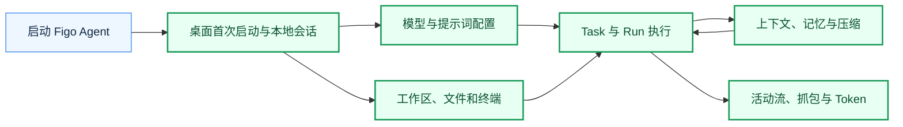

# Figo Agent 业务流程地图

> 当前版本：v1.0.0
> 最后更新：2026-10-13
> 范围：当前项目 CLI、本地 Web 工作台与 macOS 桌面自测版

本目录按用户目标与数据所有权划分模块，不按代码文件夹机械分组。阅读顺序：先看桌面/工作区入口，再看模型配置与 Task 执行，最后看上下文和运行证据。CLI 与 Web 复用 AgentKernel；桌面为同一工作台增加启动和本地认证边界。历史 Session 在当前工作台只读；本地图不是未来设计的承诺。

2026-10-16 增量：[Trace Inspector 实施与验收入口](./observability/2026-10-16-TraceInspector实施与验收入口.md)。该入口索引消息级上下文流与实际浏览器截图，不改写历史图示的版本含义。

| 模块 | HTML | 责任 | 入口 |
| --- | --- | --- | --- |
| [桌面首次启动](./desktop/desktop.md) | [预览](./desktop/index.html) | 从打开 App 到完成模型设置、选择工作区与本地认证。 | macOS App、首次设置页、打开工作区 |
| [模型与提示词](./models/models.md) | [预览](./models/index.html) | 管理模型连接、发现模型 ID、保存默认选择和提示词。 | 设置页、聊天页模型选择、提示词设置 |
| [Task 与 Agent 执行](./tasks/tasks.md) | [预览](./tasks/index.html) | 创建任务、管理生命周期、提交 Turn，并运行工具调用循环。 | Task 列表、固定输入框、CLI/REPL、活动流 |
| [工作区操作](./workspace/workspace.md) | [预览](./workspace/index.html) | 切换工作区、浏览与编辑文件、执行本地终端命令。 | 打开文件夹、文件树与搜索、文件窗口、终端 |
| [上下文与记忆](./context/context.md) | [预览](./context/index.html) | 按 Task 重建历史、选择压缩时机并组装每轮模型输入。 | 新 Turn、手动 /compact、Turn 上下文检查 |
| [运行证据](./observability/observability.md) | [预览](./observability/index.html) | 按 Turn 查看活动、上下文、HTTP 抓包、Trace、工具记录和 Token。 | Task 活动流、Turn 分析侧栏、Debug Console |

## 跨模块闭环

用户打开工作区并配置模型 -> 创建/选择 Task -> 提交 Turn -> ContextBuilder 组合该 Task 历史 -> AgentLoop 调用模型和工具 -> RunCoordinator 发布活动与结果 -> 分析侧栏按 Turn 读取上下文、抓包和 Trace。模型切换只改变下一次 Run 的选择，不把历史 Session 迁移到当前 Task。

## 维护约定

- 每个模块的 `diagrams/*.mmd` 是流程图源；更新后运行 `node module-flows/figo-agent/build.mjs` 同步 Markdown、HTML 与版本记录。
- 修改字段、接口或主流程时先核对代码、调整版本号并补充变更说明；生成结果必须通过浏览器渲染和真实点击验收。
- [Easy Code Flow Skill](https://gitee.com/hfqf1234/easy-code-flow-skill) 是本轮工作规范；本目录的 HTML 预览资源独立保存在 `assets/`。
