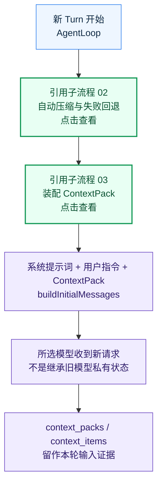
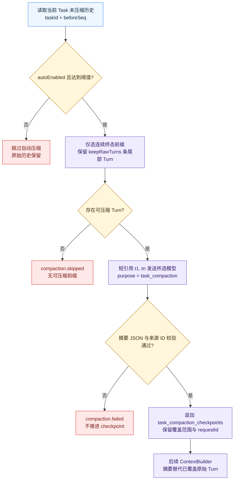
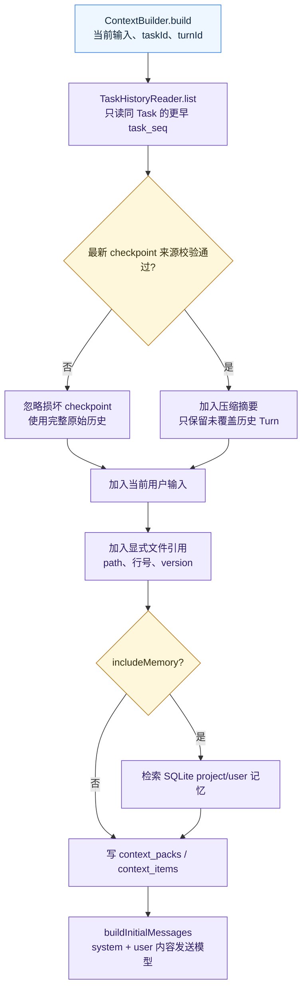

# 上下文与记忆

> 当前版本：v1.0.0
> 最后更新：2026-10-13
> 代码依据：code/src/context/context-builder.ts；code/src/context/compaction-service.ts；code/src/context/task-history-reader.ts；code/src/loop/llm-message-builder.ts

按 Task 重建历史、选择压缩时机并组装每轮模型输入。

## 边界与入口

上下文由程序构造，不是模型的隐式会话。Task 历史、压缩检查点、文件引用和 SQLite 记忆必须可追溯。

入口：新 Turn、手动 /compact、Turn 上下文检查。

- 自动压缩由程序内部的 autoEnabled、turnThreshold 和 charThreshold 控制；只压缩连续终态前缀，并保留指定数量的原始尾部 Turn。
- 压缩摘要使用短引用映射并校验来源 Turn ID。失败时不推进 checkpoint；ContextBuilder 发现损坏 checkpoint 时忽略它，退回原始历史。
- 每轮从同一 Task 的更早 task_seq 读取用户输入、工具结果和助手回答，加入当前输入、显式文件引用与可选 project/user 记忆，写入 context_packs/context_items 再发送模型。换模型不会迁移旧 Session。

## 关键字段

- taskId/task_seq：历史边界
- autoEnabled/turnThreshold/charThreshold：触发参数
- keepRawTurns：保留尾部
- checkpoint.throughSeq：压缩覆盖终点
- context_items.sourceRef/included：输入来源和选择状态

## 接口与服务

- ContextBuilder.build
- CompactionService.compactIfNeeded
- TaskHistoryReader.list
- buildInitialMessages
- GET /api/v1/turns/:id/context

## 错误出口

- 压缩响应或来源校验失败：保持原始历史
- checkpoint 损坏：忽略并回退完整历史
- 不同 Task 或历史 Session：不自动拼接对话

## 代码依据

- [`code/src/context/context-builder.ts`](../../../code/src/context/context-builder.ts)
- [`code/src/context/compaction-service.ts`](../../../code/src/context/compaction-service.ts)
- [`code/src/context/task-history-reader.ts`](../../../code/src/context/task-history-reader.ts)
- [`code/src/loop/llm-message-builder.ts`](../../../code/src/loop/llm-message-builder.ts)

## 流程图

### 上下文总览

[源图](diagrams/01-overview.mmd) · [交互预览](./index.html)

### 压缩与失败回退

[源图](diagrams/02-compaction.mmd) · [交互预览](./index.html)

### ContextPack 装配

[源图](diagrams/03-build.mmd) · [交互预览](./index.html)

## 版本记录

| 日期 | 版本 | 类型 | 改动与原因 | 影响范围 | 代码依据 | 验证 |
| --- | --- | --- | --- | --- | --- | --- |
| 2026-10-13 | v1.0.0 | 初建 | 按当前代码建立 上下文与记忆 主流程和子流程；原因：执行全项目业务流梳理 | 01-overview、02-compaction、03-build | `code/src/context/context-builder.ts`、`code/src/context/compaction-service.ts`、`code/src/context/task-history-reader.ts`、`code/src/loop/llm-message-builder.ts` | Mermaid 浏览器渲染、点击与源图同步检查 |
