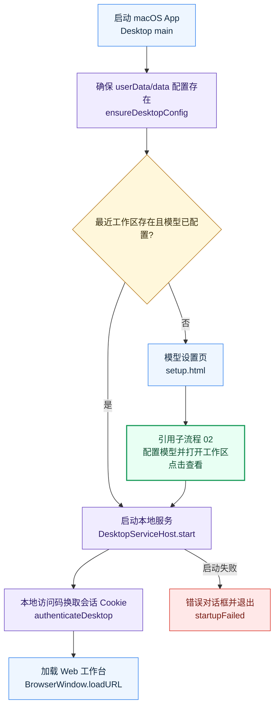
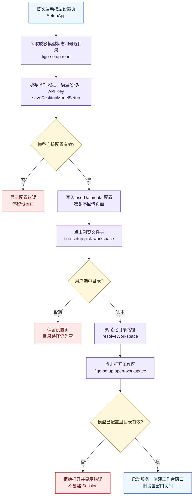

# 桌面首次启动

> 当前版本：v1.0.0
> 最后更新：2026-10-13
> 代码依据：code/src/desktop/main.ts；code/src/desktop/model-setup.ts；code/web/src/SetupApp.tsx

从打开 App 到完成模型设置、选择工作区与本地认证。

## 边界与入口

桌面首次启动有独立的配置门槛、窗口生命周期和本地会话边界，不能并入普通工作区操作。

入口：macOS App、首次设置页、打开工作区。

- 启动时配置放在 Electron userData/data，而不是源码目录。没有工作区或没有可用模型时先显示设置页；未主动打开工作区前不创建会话。
- 主进程启动独立服务后用本地访问码换取 HttpOnly Cookie，工作台窗口禁用 Node 集成并限制导航。
- 启动服务失败会显示错误对话框并退出；设置页取消选目录后继续停留。

## 关键字段

- configRoot：桌面用户配置根
- workspaceRoot：规范化后的用户目录
- configured：当前模型具备连接信息和 Key
- session Cookie：本地服务认证状态

## 接口与服务

- IPC figo-setup:read/save-model/pick-workspace/open-workspace
- DesktopServiceHost.start
- POST /api/v1/auth
- GET /api/v1/bootstrap

## 错误出口

- 模型未配置或目录无效：拒绝打开工作区，不创建 Session
- 服务启动失败：错误对话框并退出
- 目录选择取消：路径保持为空

## 代码依据

- [`code/src/desktop/main.ts`](../../../code/src/desktop/main.ts)
- [`code/src/desktop/model-setup.ts`](../../../code/src/desktop/model-setup.ts)
- [`code/web/src/SetupApp.tsx`](../../../code/web/src/SetupApp.tsx)

## 流程图

### 启动主流程

[源图](diagrams/01-overview.mmd) · [交互预览](./index.html)

### 模型设置与打开工作区

[源图](diagrams/02-setup.mmd) · [交互预览](./index.html)

## 版本记录

| 日期 | 版本 | 类型 | 改动与原因 | 影响范围 | 代码依据 | 验证 |
| --- | --- | --- | --- | --- | --- | --- |
| 2026-10-13 | v1.0.0 | 初建 | 按当前代码建立 桌面首次启动 主流程和子流程；原因：执行全项目业务流梳理 | 01-overview、02-setup | `code/src/desktop/main.ts`、`code/src/desktop/model-setup.ts`、`code/web/src/SetupApp.tsx` | Mermaid 浏览器渲染、点击与源图同步检查 |
