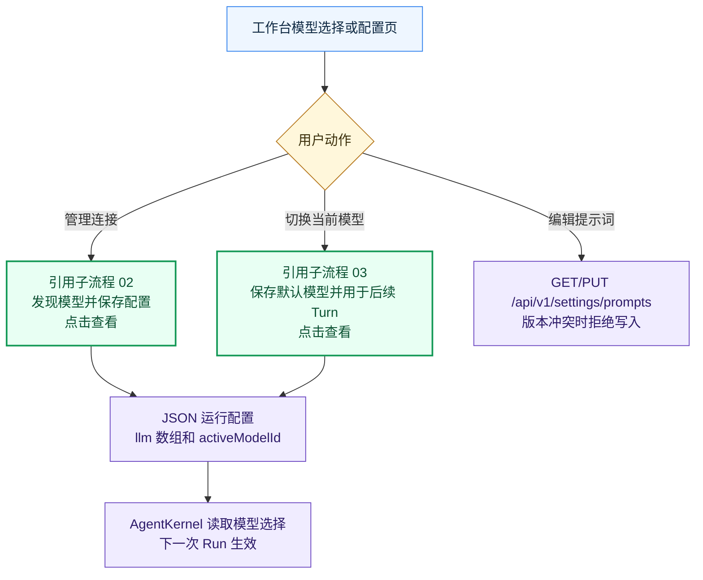
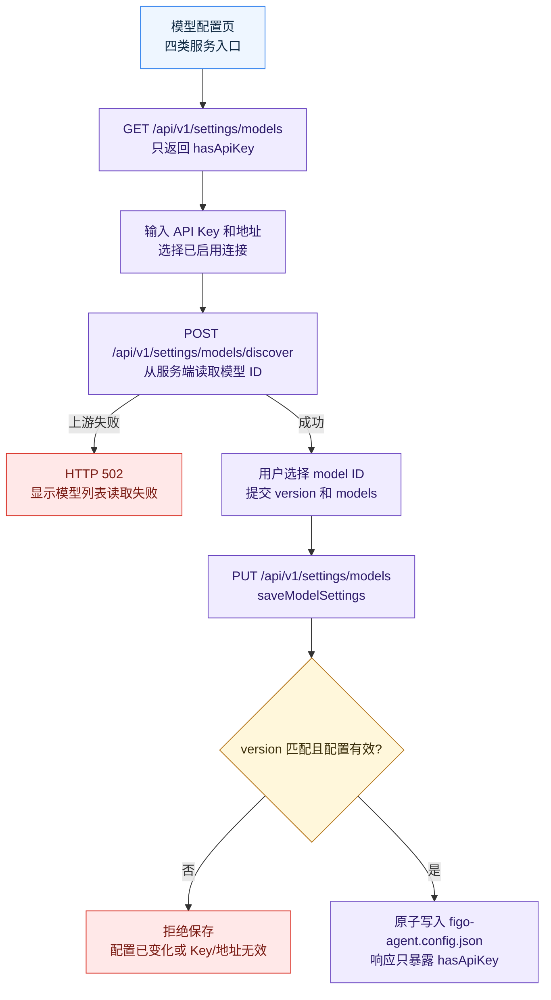
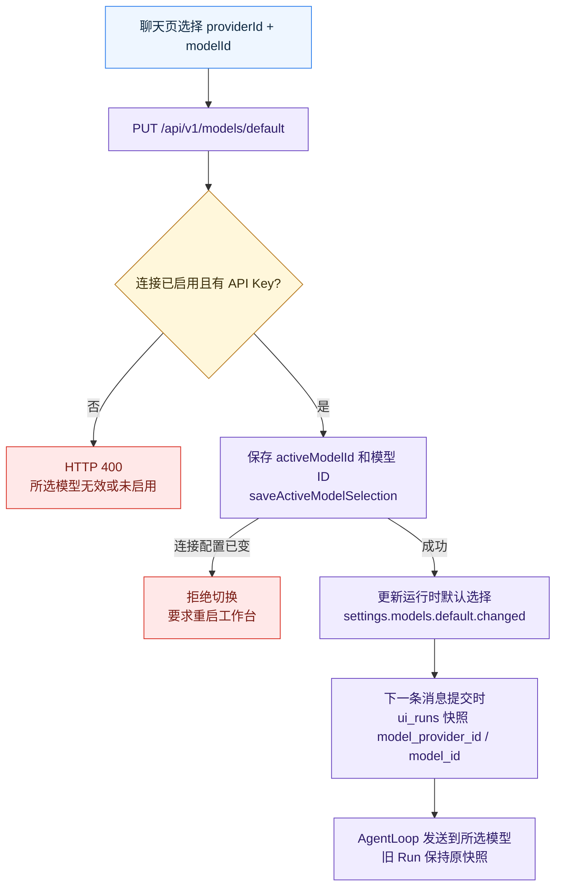

# 模型与提示词

> 当前版本：v1.0.0
> 最后更新：2026-10-13
> 代码依据：code/src/config/model-settings.ts；code/src/ui/local-api.ts；code/web/src/SettingsPage.tsx；code/web/src/App.tsx

管理模型连接、发现模型 ID、保存默认选择和提示词。

## 边界与入口

模型连接与默认选择是运行配置的所有者；它决定下一条消息发往何处，但不拥有 Task 历史。

入口：设置页、聊天页模型选择、提示词设置。

- 配置页呈现 MiniMax、DeepSeek、GPT 官方和 GPT 中转四类服务。发现接口读取服务端模型 ID；设置读取只返回 hasApiKey，不回传 Key。
- 保存使用 version 指纹检测并发修改，配置写入 JSON。切换默认模型立即保存 activeModelId 和所选模型 ID，下一条 Run 在提交时快照。
- 系统提示词和用户指令通过独立提示词配置读写；正在执行的 Run 保持提交时所选模型。

## 关键字段

- llm[].id/enabled/baseUrl/model/apiKey：模型连接
- activeModelId：全局默认连接
- providerId/modelId：某次 Run 的模型快照
- version：配置内容指纹

## 接口与服务

- GET/PUT /api/v1/settings/models
- POST /api/v1/settings/models/discover
- GET /api/v1/models/available
- PUT /api/v1/models/default
- GET/PUT /api/v1/settings/prompts

## 错误出口

- 模型发现上游失败：HTTP 502
- 版本冲突或启用连接缺少 Key：拒绝保存
- 连接在切换期间变化：要求重启工作台
- 活动 Run 时不能修改模型连接或提示词

## 代码依据

- [`code/src/config/model-settings.ts`](../../../code/src/config/model-settings.ts)
- [`code/src/ui/local-api.ts`](../../../code/src/ui/local-api.ts)
- [`code/web/src/SettingsPage.tsx`](../../../code/web/src/SettingsPage.tsx)
- [`code/web/src/App.tsx`](../../../code/web/src/App.tsx)

## 流程图

### 模型模块总览

[源图](diagrams/01-overview.mmd) · [交互预览](./index.html)

### 发现并保存连接

[源图](diagrams/02-settings.mmd) · [交互预览](./index.html)

### 默认模型切换

[源图](diagrams/03-switch.mmd) · [交互预览](./index.html)

## 版本记录

| 日期 | 版本 | 类型 | 改动与原因 | 影响范围 | 代码依据 | 验证 |
| --- | --- | --- | --- | --- | --- | --- |
| 2026-10-13 | v1.0.0 | 初建 | 按当前代码建立 模型与提示词 主流程和子流程；原因：执行全项目业务流梳理 | 01-overview、02-settings、03-switch | `code/src/config/model-settings.ts`、`code/src/ui/local-api.ts`、`code/web/src/SettingsPage.tsx`、`code/web/src/App.tsx` | Mermaid 浏览器渲染、点击与源图同步检查 |
