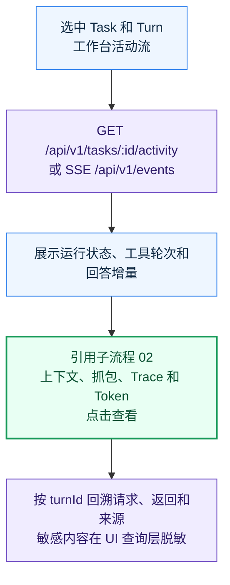
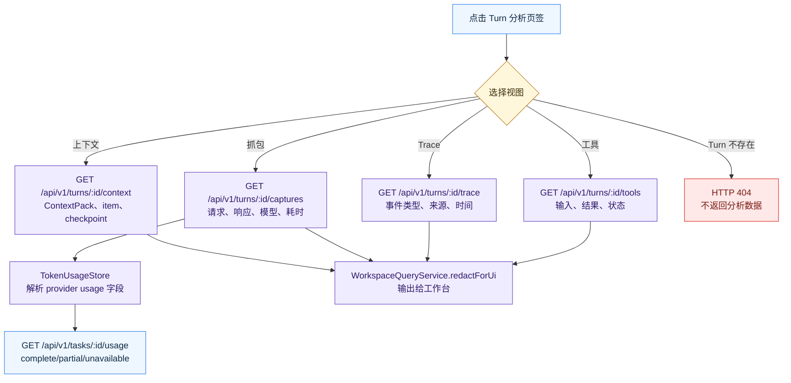

# 运行证据

> 当前版本：v1.0.0
> 最后更新：2026-10-13
> 代码依据：code/src/ui/local-api.ts；code/src/ui/workspace-query-service.ts；code/src/llm/llm-http-capture-store.ts；code/src/token-usage/token-usage-store.ts

按 Turn 查看活动、上下文、HTTP 抓包、Trace、工具记录和 Token。

## 边界与入口

运行证据服务于排查和后续复盘，读取的是执行时落库的事实；它不参与模型流程控制。

入口：Task 活动流、Turn 分析侧栏、Debug Console。

- RunCoordinator 发布 accepted/running/completed 等事件与回答增量；页面通过 SSE 游标回放和订阅后续事件。
- 每次模型调用的请求与响应保存在 llm_http_captures，TokenUsageStore 从响应 usage 读取数值并标识 complete、partial 或 unavailable。
- WorkspaceQueryService 按 Turn 查询 ContextPack、抓包、Trace 和工具调用，在返回 UI 前做密钥与工作区路径脱敏。原始抓包仍保留在 SQLite 中供本地排查。

## 关键字段

- event.seq：SSE 游标
- runId/turnId：执行关联键
- capture.requestId/purpose：模型请求身份
- usage.status：complete/partial/unavailable
- trace.type/source/payload：事件证据

## 接口与服务

- GET /api/v1/events
- GET /api/v1/tasks/:id/activity
- GET /api/v1/tasks/:id/usage
- GET /api/v1/turns/:id/context|captures|trace|tools

## 错误出口

- 不存在的 Turn：HTTP 404
- SSE 游标无效：HTTP 400；连接数超限：HTTP 429
- 上游不返回 usage：标记 unavailable，不伪造 Token 值

## 代码依据

- [`code/src/ui/local-api.ts`](../../../code/src/ui/local-api.ts)
- [`code/src/ui/workspace-query-service.ts`](../../../code/src/ui/workspace-query-service.ts)
- [`code/src/llm/llm-http-capture-store.ts`](../../../code/src/llm/llm-http-capture-store.ts)
- [`code/src/token-usage/token-usage-store.ts`](../../../code/src/token-usage/token-usage-store.ts)

## 流程图

### 运行证据总览

[源图](diagrams/01-overview.mmd) · [交互预览](./index.html)

### 按 Turn 检查证据

[源图](diagrams/02-inspect.mmd) · [交互预览](./index.html)

## 版本记录

| 日期 | 版本 | 类型 | 改动与原因 | 影响范围 | 代码依据 | 验证 |
| --- | --- | --- | --- | --- | --- | --- |
| 2026-10-13 | v1.0.0 | 初建 | 按当前代码建立 运行证据 主流程和子流程；原因：执行全项目业务流梳理 | 01-overview、02-inspect | `code/src/ui/local-api.ts`、`code/src/ui/workspace-query-service.ts`、`code/src/llm/llm-http-capture-store.ts`、`code/src/token-usage/token-usage-store.ts` | Mermaid 浏览器渲染、点击与源图同步检查 |
