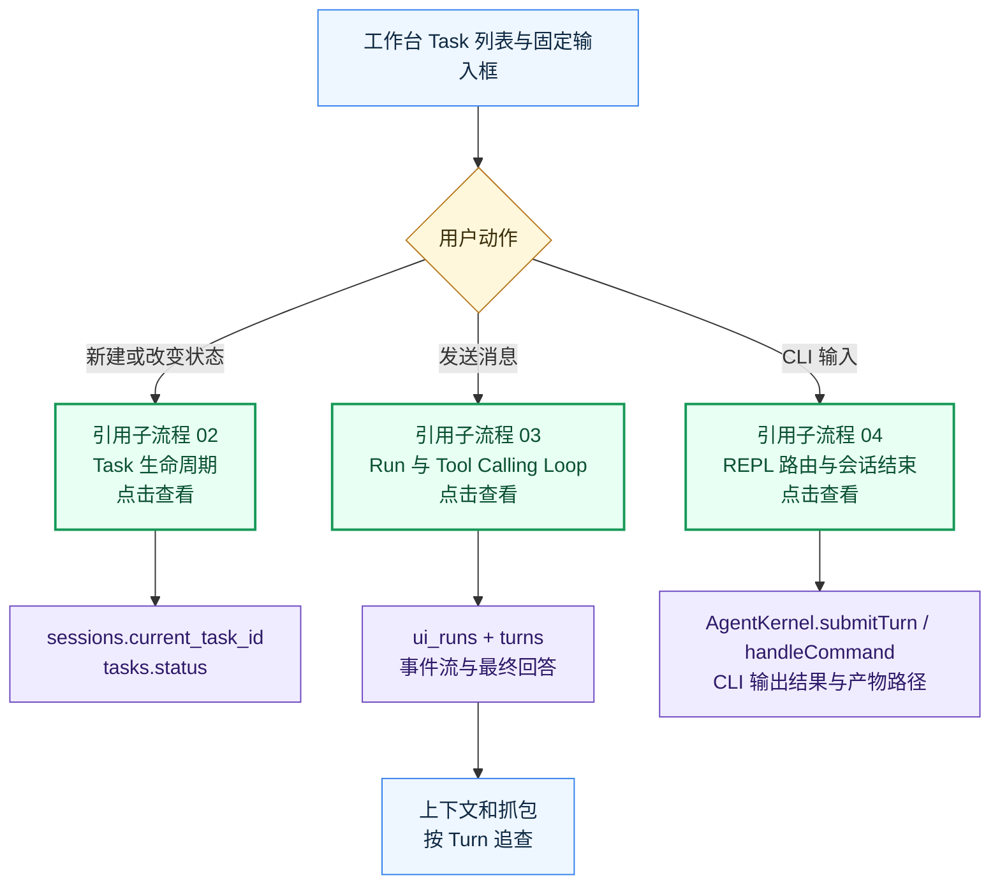
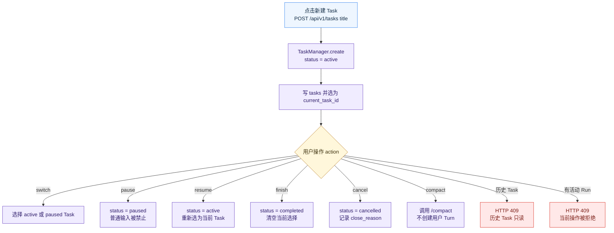
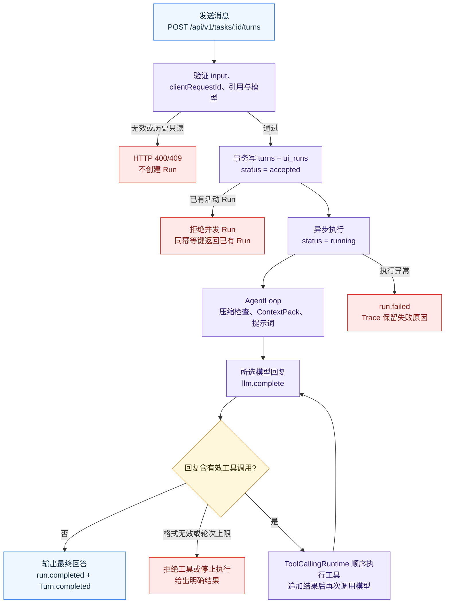
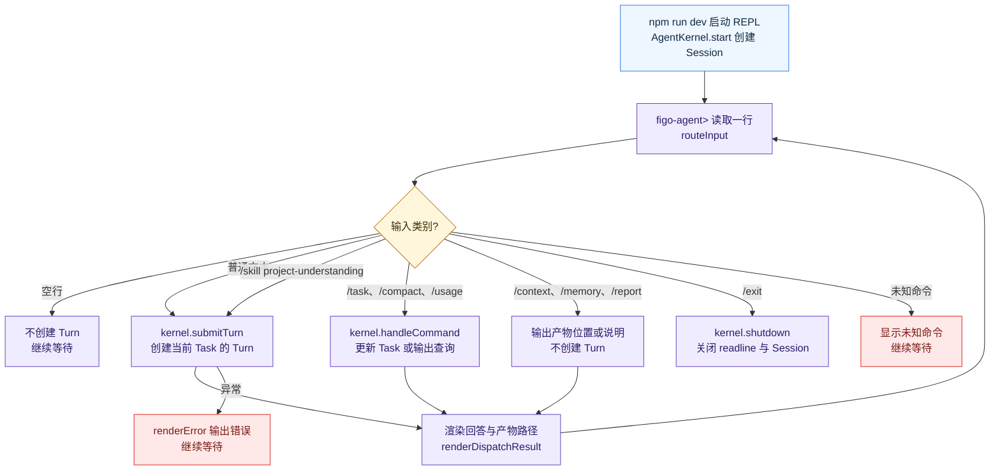

# Task 与 Agent 执行

> 当前版本：v1.0.0
> 最后更新：2026-10-13
> 代码依据：code/src/task/task-manager.ts；code/src/ui/run-coordinator.ts；code/src/loop/agent-loop.ts；code/src/ui/local-api.ts；code/src/cli/input-router.ts

创建任务、管理生命周期、提交 Turn，并运行工具调用循环。

## 边界与入口

Task 拥有对话边界和生命周期，Run 拥有异步执行状态；两者不能与模型连接或 UI 面板混为一个模块。

入口：Task 列表、固定输入框、CLI/REPL、活动流。

- Session 下可有多个 Task，当前选中的 Task 记录在 sessions.current_task_id。状态包括 active、paused、completed 和 cancelled；历史 Session 的 Task 在工作台只读。
- 发送消息提交 clientRequestId。RunCoordinator 在事务中创建 Turn 和 ui_runs，再异步运行 AgentLoop；相同幂等键返回原 Run，不并发执行第二个 Run。
- AgentLoop 先构造上下文并选模型，然后在有工具调用时顺序执行工具、追加结果、再次调用模型，直到最终回答或达到轮次上限。
- CLI 入口通过 routeInput 将普通文本送入 submitTurn，将 /task、/compact、/usage 送入 handleCommand；/exit 关闭 Session。

## 关键字段

- tasks.status：active/paused/completed/cancelled
- sessions.current_task_id：当前 Task
- turns.task_seq：Task 内顺序
- ui_runs.status：accepted/running/completed/failed/interrupted
- clientRequestId：幂等键

## 接口与服务

- POST /api/v1/tasks
- POST /api/v1/tasks/:id/actions
- GET/POST /api/v1/tasks/:id/turns
- GET /api/v1/runs/:id
- GET /api/v1/events

## 错误出口

- 历史 Task 只读：HTTP 409
- 活动 Run 时拒绝切换 Task 或并发提交
- 工具格式无效：拒绝执行工具并给出原因
- 轮次上限：停止继续执行并返回提示
- 服务重启后孤立 Run 标记 interrupted，不自动重放

## 代码依据

- [`code/src/task/task-manager.ts`](../../../code/src/task/task-manager.ts)
- [`code/src/ui/run-coordinator.ts`](../../../code/src/ui/run-coordinator.ts)
- [`code/src/loop/agent-loop.ts`](../../../code/src/loop/agent-loop.ts)
- [`code/src/ui/local-api.ts`](../../../code/src/ui/local-api.ts)
- [`code/src/cli/input-router.ts`](../../../code/src/cli/input-router.ts)

## 流程图

### Task 模块总览

[源图](diagrams/01-overview.mmd) · [交互预览](./index.html)

### Task 生命周期

[源图](diagrams/02-lifecycle.mmd) · [交互预览](./index.html)

### Turn 和工具调用循环

[源图](diagrams/03-run.mmd) · [交互预览](./index.html)

### CLI/REPL 输入路由

[源图](diagrams/04-cli.mmd) · [交互预览](./index.html)

## 版本记录

| 日期 | 版本 | 类型 | 改动与原因 | 影响范围 | 代码依据 | 验证 |
| --- | --- | --- | --- | --- | --- | --- |
| 2026-10-13 | v1.0.0 | 初建 | 按当前代码建立 Task 与 Agent 执行 主流程和子流程；原因：执行全项目业务流梳理 | 01-overview、02-lifecycle、03-run、04-cli | `code/src/task/task-manager.ts`、`code/src/ui/run-coordinator.ts`、`code/src/loop/agent-loop.ts`、`code/src/ui/local-api.ts`、`code/src/cli/input-router.ts` | Mermaid 浏览器渲染、点击与源图同步检查 |
