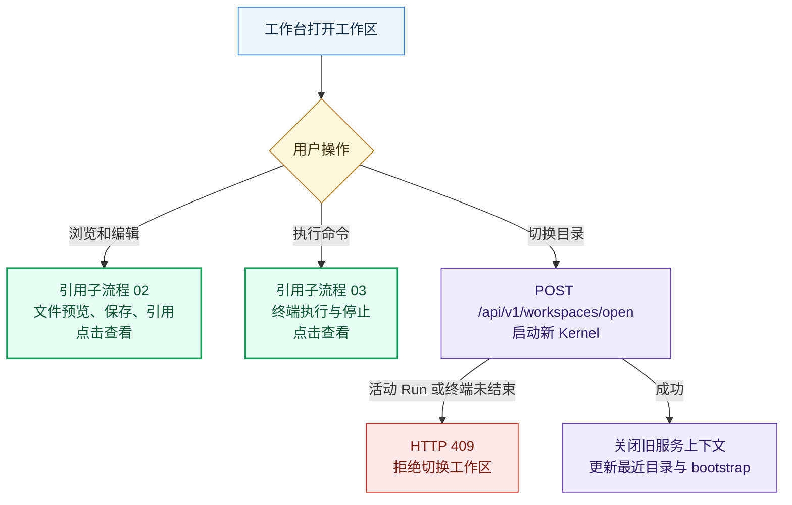
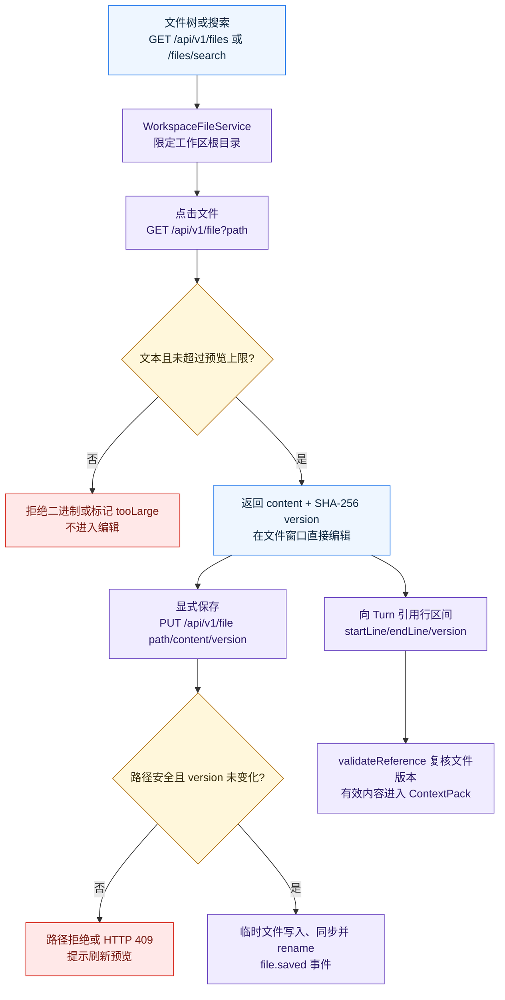
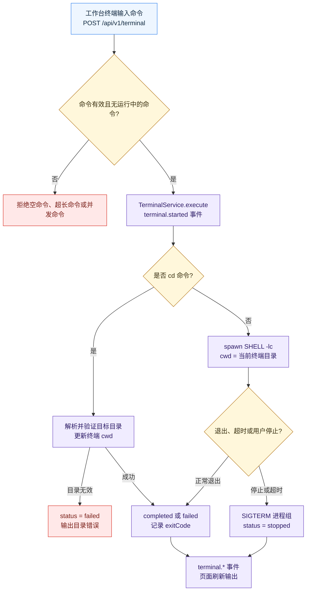

# 工作区操作

> 当前版本：v1.0.0
> 最后更新：2026-10-13
> 代码依据：code/src/ui/local-api.ts；code/src/ui/workspace-files.ts；code/src/ui/terminal-service.ts；code/web/src/FilePreviewPane.tsx

切换工作区、浏览与编辑文件、执行本地终端命令。

## 边界与入口

工作区是文件与命令的权限边界；它与 Task 对话相关，但其路径校验、版本控制和进程生命周期独立。

入口：打开文件夹、文件树与搜索、文件窗口、终端。

- 工作区切换先验证绝对目录。若有活动 Run、终端命令或模型切换，服务返回 409；成功后停止旧 Kernel，创建新 Kernel 并刷新 bootstrap。
- 文件搜索按目录队列递归，但受访问目录数和结果数限制。预览只接受安全路径和 UTF-8 文本；保存需提交预览时的 SHA-256 version，并用临时文件原子替换。
- 终端一次只运行一条命令，记录运行状态与 exitCode；cd 更新终端 cwd，停止和超时终止命令进程组。

## 关键字段

- path：工作区内相对路径
- version：文件 SHA-256
- startLine/endLine：引用范围
- terminal.status：running/completed/failed/stopped
- terminal.exitCode：命令退出码

## 接口与服务

- GET /api/v1/workspaces
- POST /api/v1/workspaces/pick|open
- GET /api/v1/files/search
- GET /api/v1/files
- GET/PUT /api/v1/file
- GET/POST /api/v1/terminal
- POST /api/v1/terminal/stop

## 错误出口

- 路径逃逸、隐藏敏感文件或符号链接：拒绝访问
- 版本变化：拒绝覆盖，要求刷新
- 二进制或过大文件：不可编辑
- 终端并发命令或无效命令：拒绝运行

## 代码依据

- [`code/src/ui/local-api.ts`](../../../code/src/ui/local-api.ts)
- [`code/src/ui/workspace-files.ts`](../../../code/src/ui/workspace-files.ts)
- [`code/src/ui/terminal-service.ts`](../../../code/src/ui/terminal-service.ts)
- [`code/web/src/FilePreviewPane.tsx`](../../../code/web/src/FilePreviewPane.tsx)

## 流程图

### 工作区操作总览

[源图](diagrams/01-overview.mmd) · [交互预览](./index.html)

### 文件查看、编辑与引用

[源图](diagrams/02-files.mmd) · [交互预览](./index.html)

### 终端执行与停止

[源图](diagrams/03-terminal.mmd) · [交互预览](./index.html)

## 版本记录

| 日期 | 版本 | 类型 | 改动与原因 | 影响范围 | 代码依据 | 验证 |
| --- | --- | --- | --- | --- | --- | --- |
| 2026-10-13 | v1.0.0 | 初建 | 按当前代码建立 工作区操作 主流程和子流程；原因：执行全项目业务流梳理 | 01-overview、02-files、03-terminal | `code/src/ui/local-api.ts`、`code/src/ui/workspace-files.ts`、`code/src/ui/terminal-service.ts`、`code/web/src/FilePreviewPane.tsx` | Mermaid 浏览器渲染、点击与源图同步检查 |
