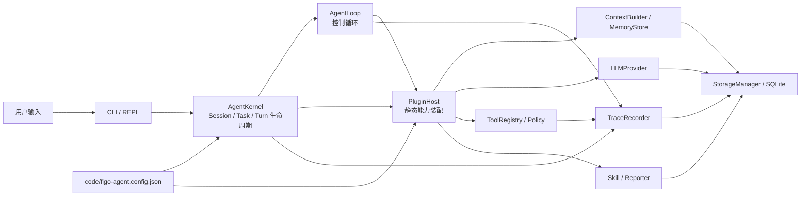
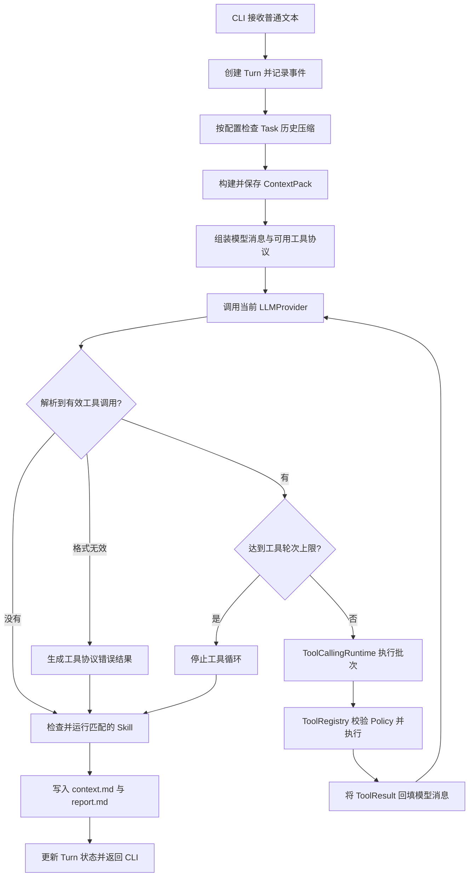
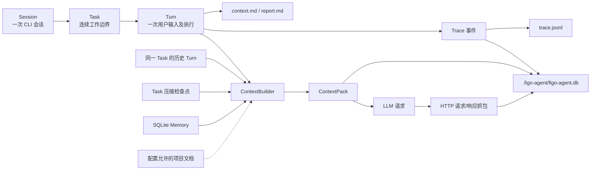

# Figo Agent

Figo Agent 是用于研究 coding agent 设计细节的本地 CLI 项目。目标不只是完成代码任务，还要把 AgentLoop、上下文与记忆、工具权限、模型交互及执行证据做成可观察、可复盘的系统，为后续技术文章提供真实案例。

当前实现采用单 Agent、小内核、静态插件装配。运行时配置来自 `code/figo-agent.config.json`，研发文档保留在 `docs/`；文档不参与程序流程控制。代码遵循高内聚、低耦合与 SOLID 原则，模块通过明确的能力接口协作。

## 快速开始

在仓库根目录执行：

```bash
npm --prefix code install
npm --prefix code run dev
```

CLI 入口和依赖位于 `code/`，工作区仍是仓库根目录。首次运行会在根目录创建 `.figo-agent/`。没有配置 API Key 时，模型调用返回本地占位响应，不会发起远程请求。

普通文本创建一个 Turn；斜杠命令管理 Session 内的任务或查看产物：

| 命令 | 作用 |
| :--- | :--- |
| `/task current`、`/task list` | 查看当前或可继续的 Task |
| `/task new <标题>`、`/task switch <id>` | 创建或切换 Task |
| `/task pause`、`/task resume <id>` | 暂停或恢复 Task |
| `/task finish`、`/task cancel [原因]` | 完成 Task 并生成摘要，或取消 Task |
| `/compact` | 手动压缩当前 Task 历史 |
| `/usage` | 查看当前 Task 和 Session 的模型请求用量及缺失情况 |
| `/context`、`/report`、`/memory` | 查看上下文/报告产物位置或记忆说明 |
| `/help`、`/exit` | 查看帮助或结束 Session |

## 运行架构



`AgentKernel` 负责启动装配与生命周期，`AgentLoop` 负责单轮控制，`PluginHost` 提供能力发现。工具只能经 `ToolRegistry` 进入执行路径，`ControlledToolPolicy` 负责权限判定；模型的工具调用文本不是执行授权。当前内置能力包含上下文、模型、工具、记忆、Skill 和 Markdown Reporter，插件在启动时静态注册。

模块拆解、职责边界及 UML 见 [子模块架构索引](docs/agent/modules/README.md)，核心循环另见 [AgentLoop 设计](docs/agent/modules/agent-loop/README.md)。

## 单轮执行流程



每次工具执行后都会把结果回填给模型，再次调用模型；配置项 `tools.maxToolRounds` 限制工具执行轮次。模型返回普通答复、格式无效或触及轮次上限时退出循环。LLM、解析、Policy、工具、产物与状态迁移会留下 Trace；失败的 Turn 返回错误结果。详细协议和状态机见 [Tool Calling Loop](docs/agent/modules/agent-loop/TOOL_CALLING_LOOP.md)。

## 上下文与数据流



Task 是多轮上下文的边界：新的 Turn 读取当前 Task 的未压缩历史、已有检查点以及启用的 Memory，不读取其他 Task 的历史。项目文档仅在 `context.includeProjectDocs=true` 时按配置路径纳入；`AGENTS.MD` 和 `docs/**` 本身不控制运行逻辑。Task 历史和工具轮内消息均有压缩流程，触发阈值由 agent 配置控制，不绑定特定模型。

SQLite 保存 Session、Task、Turn、ContextPack、记忆、压缩检查点、Trace 和 LLM HTTP 抓包；Markdown 是便于阅读的产物，JSONL 是 Trace 审计流水。HTTP 抓包保存请求/响应正文，鉴权请求头会脱敏；本地运行数据应按敏感数据管理。当前 Memory 从 SQLite 读取，尚不自动写入长期记忆。

```text
code/                               CLI、源码、测试、依赖与运行配置
docs/agent/modules/                 各子模块架构、实施与验收文档
.figo-agent/figo-agent.db           SQLite 状态源及模型交互抓包
.figo-agent/artifacts/sessions/<session-id>/trace.jsonl
.figo-agent/artifacts/sessions/<session-id>/<turn-id>/context.md
.figo-agent/artifacts/sessions/<session-id>/<turn-id>/report.md
.figo-agent/artifacts/sessions/<session-id>/tasks/<task-id>/task-summary.md
```

Task 完成时会生成 `task-summary.md`。上下文细节见 [Context 模块](docs/agent/modules/context/README.md)，数据表和产物边界见 [Storage 模块](docs/agent/modules/storage/README.md)，事件记录见 [Trace 模块](docs/agent/modules/trace/README.md)。

## 运行配置

唯一运行时配置文件是 `code/figo-agent.config.json`：

| 配置项 | 作用 |
| :--- | :--- |
| `llm[]`、`activeModelId` | 声明可用模型、启用状态，并显式选择当前模型 |
| `context` | 控制项目文档、Task 历史、Memory 和自动压缩 |
| `tools.allowed`、`tools.maxToolRounds` | 控制注册的工具及单 Turn 工具轮次上限 |

版本库中的 `apiKey` 必须保持为空。本地填写目标模型密钥、将该模型 `enabled` 设为 `true`，并把 `activeModelId` 设为其 `id`；修改配置后重启 CLI。填写真实密钥后，提交前必须清空并核对暂存差异，不能把密钥推送到仓库。

## 验收

```bash
npm --prefix code test
npm --prefix code run typecheck
npm --prefix code run build
node -e 'const c=require("./code/figo-agent.config.json"); if(c.llm.some(m=>m.apiKey)) { console.error("配置文件包含非空 apiKey"); process.exit(1) }'
! git grep -l -E '(^|[^[:alnum:]_])sk-[[:alnum:]_-]{16,}' -- .
```

测试、类型检查、构建与密钥扫描全部通过后才放行；密钥检查需要在清空本地配置中的真实密钥后运行。各模块还有独立的实施和验收文档，见 [模块索引](docs/agent/modules/README.md)。
