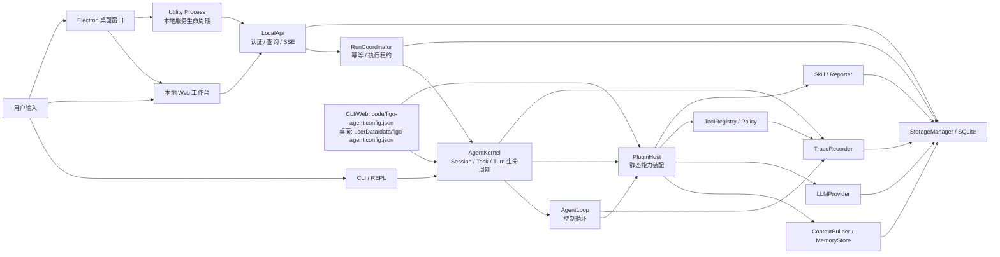
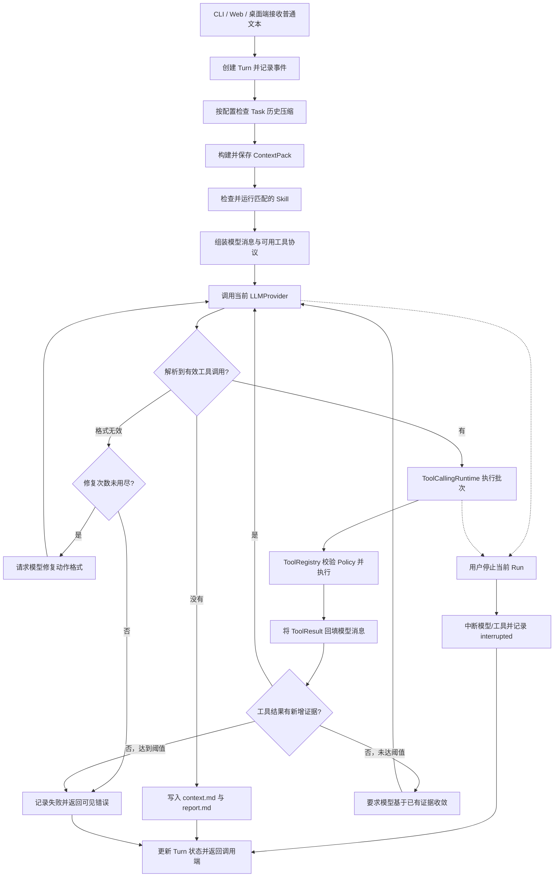
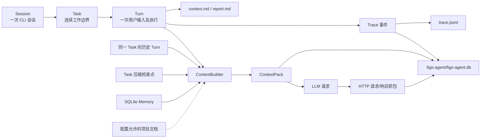

# Figo Agent

Figo Agent 是用于研究 coding agent 设计细节的本地 Agent 项目，提供 CLI、本地 Web 工作台和 macOS 桌面内部自测版。目标不只是完成代码任务，还要把 AgentLoop、上下文与记忆、工具权限、模型交互及执行证据做成可观察、可复盘的系统，为后续技术文章提供真实案例。

当前实现采用单 Agent、小内核、静态插件装配。CLI/Web 的运行配置来自 `code/figo-agent.config.json`，桌面端使用独立的用户数据目录；研发文档保留在 `docs/`，不参与程序流程控制。代码遵循高内聚、低耦合与 SOLID 原则，模块通过明确的能力接口协作。

本仓库不依赖外部知识库或 Git 子模块即可安装、测试和运行。个人资料只有在用户明确提供时才作为任务输入，不参与默认上下文构建。

从用户操作追踪完整业务链路，可直接打开[交互式流程地图](module-flows/figo-agent/index.html)，或阅读[中文模块说明](module-flows/figo-agent/README.md)。图源、字段判断、失败出口和代码依据按模块归档。

## 功能进度（截至 2026-10-16）

**本轮已收尾，进入用户实际使用阶段。** Pi 压缩与原生工具协议的开发及测试窗口功能验收已完成；后续根据用户反馈再确认优化，不自动续做策略改造或大窗口实验。进度恢复、配置基线、证据路径和未验证边界统一见 [阶段收尾记录](docs/agent/modules/context/2026-10-16-Pi压缩与原生工具协议阶段收尾.md)。最近代码回归为 75 文件、721 项通过，类型检查与构建通过；不是实际百万窗口、净收益或桌面新包验收。

### 已完成

| 状态 | 阶段 | 功能 | 实现与验收依据 |
| :---: | :--- | :--- | :--- |
| ✅ | V1 基线 | CLI / REPL、Session / Turn、AgentKernel / AgentLoop、静态 PluginHost、ContextPack、SQLite Memory 读取、内置 Skill、只读 Tool、Trace、Markdown / JSONL 产物 | [架构进度](docs/agent/v1-architecture-design.md)、[模块索引](docs/agent/modules/README.md) |
| ✅ | V1.1 | Task 生命周期与同一 Task 的多轮上下文；支持创建、切换、暂停、恢复、完成、取消和完成摘要 | [Task 设计与验收](docs/agent/modules/task/ACCEPTANCE.md) |
| ✅ | V1.2 | Tool Calling Loop：工具结果回填模型，持续调用直到最终答复、明确失败或用户中断；对重复且无新增证据的调用显式收敛。包含受控文件写入、Shell、Git、网络和浏览器 Tool | [循环设计](docs/agent/modules/agent-loop/TOOL_CALLING_LOOP.md)、[Tool 验收](docs/agent/modules/tool/ACCEPTANCE.md) |
| ✅ | 上下文压缩代码 | 固定版本 Pi 算法：窗口减预留量触发、消息级安全切点、Markdown 滚动摘要、`/compact [关注点]` 与一次超限恢复；三模型测试窗口功能验收通过，实际大窗口容量未完整验收 | [Pi 实施与验收](docs/agent/modules/context/2026-10-15-Pi上下文压缩对齐测试验收.md) |
| ✅ | 模型交互与追踪 | 多模型配置、显式选用一个启用模型、LLM HTTP 请求/响应抓包 | [LLM 模块](docs/agent/modules/llm-policy/README.md)、[Trace 模块](docs/agent/modules/trace/README.md) |
| ✅ | V2 TokenUsage 首期 | 请求级实际用量入库、旧抓包回填、上下文估算、`/usage` 及报告汇总 | [TokenUsage 验收记录](docs/agent/modules/token-usage/ACCEPTANCE.md) |
| ✅ | 本地 Web 工作台首期 | 左侧文件树、中间可编辑文件窗口、右侧 Task 执行时间线与固定输入框、可开关 Context/抓包/Trace 分析侧栏；版本化显式保存与文件引用、真实模型增量事件、SSE 恢复与本地访问控制 | [UI 设计](docs/agent/modules/ui/design.md)、[流式交互设计](docs/agent/modules/ui/streaming-workbench.md)、[实测记录](docs/agent/modules/ui/ACCEPTANCE.md) |
| ✅ | macOS arm64 桌面内部自测版 | Electron 独立服务进程复用现有 Web/Agent 内核；本地鉴权、工作区数据、模型配置导入、ZIP 解压运行及桌面窗口 E2E 已验证。未签名，不作为公开发行版 | [桌面实施](docs/agent/modules/ui/desktop/IMPLEMENTATION.md)、[桌面验收](docs/agent/modules/ui/desktop/ACCEPTANCE.md) |

TokenUsage 只把模型返回的用量记为实际值；模型未提供 `usage` 时标记为未知，上下文估算单独展示。当前 Memory 参与读取，不会自动写入长期记忆。各项测试范围和放行条件见对应验收文档。

2026-10-16 [工作台真实使用验收](docs/agent/modules/ui/2026-10-16-工作台实际使用链路验收.md)：当前默认 DeepSeek 的读文件、连续追问、长命令启动、刷新后停止、停止后继续和重启历史回放六节点通过；修复关闭期间 SSE 重连及半截正文准入、取消命令误记完成和 `read_file` 参数契约缺失。全仓 75 文件 714 测试通过，不据此宣称三模型或压缩性能整体放行。

### 未完成

| 状态 | 方向 | 当前边界 |
| :---: | :--- | :--- |
| ⬜ | Pi 压缩实际容量整体放行 | 最新三模型三次配对18/18后续分支通过，14条摘要注入与可见原文保留通过，GPT原生正文误判已修复。中转实际窗口未知，最终partial；当前样本开启后的累计输入与耗时中位数增加，不宣称性能净收益。详见验收记录第九节。 |
| ⬜ | Goal / Verifier | Task 已负责上下文边界；执行目标管理和测试、构建等验证闭环尚未实现。 |
| ⬜ | Memory 治理 | 自动候选写入、人工确认、去重与长期治理尚未实现。 |
| ⬜ | 压缩策略自优化 | 当前使用配置阈值；阈值自优化只有[设计方案](docs/agent/modules/context/COMPACTION_SELF_OPTIMIZATION.md)和[待实施计划](docs/agent/modules/context/COMPACTION_SELF_OPTIMIZATION_PHASE1_IMPLEMENTATION.md)，未进入运行代码。 |
| ⬜ | TokenUsage 深化 | 价格成本、压缩前后效果对照、缓存/推理细项以及单 Tool / Skill 的可验证实际用量归因尚未实现。 |
| ⬜ | 交互深化与生态 | 当前 GPT 中转的真实流式推送验收、抓包逐步解析教学、取消执行/审批恢复、Diff、动态插件加载、多 Skill 编排、多 Agent、MCP / 外部知识库连接尚未完成。 |
| ⬜ | 桌面公开发行 | macOS 签名/公证、原生文件选择人工验收、异常退出与升级恢复、Windows/Linux 终端适配及各平台安装验证尚未完成。 |

V1 原始设计中的“非目标”是当时的版本边界，不等于当前未完成清单；完整的版本对照见[架构设计总览](docs/agent/v1-architecture-design.md)。

## 快速开始

在仓库根目录执行：

```bash
npm --prefix code install
npm --prefix code run dev
```

CLI 入口和依赖位于 `code/`，工作区仍是仓库根目录。首次运行会在根目录创建 `.figo-agent/`。没有配置 API Key 时，模型调用返回本地占位响应，不会发起远程请求。

本地 Web 工作台单独启动（不要和同一工作区的 CLI 同时执行 Turn）：

```bash
npm --prefix code run web:dev
```

当前本地配置 `web.requireAccessCode: false`，打开终端输出的地址即可进入工作台，无需登录。恢复访问码时将该项改为 `true` 并重启，默认值也是 `true`。服务只监听 `127.0.0.1`，始终校验 Host/Origin，写请求仍需 CSRF；免访问码模式允许本机其他进程读取工作台数据，不适合共享主机。前端由服务同源提供；`web:dev` 先构建再启动，修改前端后需要重启。工作台复用 `code/figo-agent.config.json` 选择的模型，不向浏览器发送 API Key。需要重跑验收时执行 `npm --prefix code run web:test:e2e`（需本机 Chrome；也可设置 `CHROME_EXECUTABLE`）。

macOS Apple Silicon 的桌面内部自测版可从源码启动或打包：

```bash
npm --prefix code run desktop:dev
ELECTRON_MIRROR=https://npmmirror.com/mirrors/electron/ npm --prefix code run desktop:make
npm --prefix code run desktop:verify:package
```

ZIP 位于 `code/out/make/zip/darwin/arm64/`，目前未经 Apple 正式签名与公证，**不作为公开发行包**。首次启动直接显示模型设置页，可填写 API 地址、模型名称和密钥；只有用户主动打开工作区后才启动 Agent 服务，不会在打开 App 时弹出目录选择框或创建假 Session。运行配置在 Electron `app.getPath('userData')/data/figo-agent.config.json`，与源码内 CLI/Web 配置隔离。进入工作台后，菜单“文件 → 打开模型配置”仍可编辑 JSON，“导入旧配置...”会备份桌面配置并导入旧 JSON、提示词和最近目录；手工修改 JSON 后需重启应用。未填写当前模型的 API Key 时，桌面端不启动工作区服务；原有服务端无密钥保护仍保留。桌面模式始终要求本地会话，即使 Web 配置关闭访问码。首次启动验收运行 `npm --prefix code run desktop:test:first-run:package`，安装包窗口回归运行 `npm --prefix code run desktop:test:e2e:package`，活动 Run 退出验收运行 `npm --prefix code run desktop:test:active-exit:package`；真实模型自测分别运行 `npm --prefix code run desktop:test:real`（开发态）和 `npm --prefix code run desktop:test:real:package`（先构建 ZIP）。真实模型测试读取本机配置，使用临时工作区并在结束后删除测试数据。若安装 Electron 后提示缺少二进制，可在 `code/` 执行 `ELECTRON_MIRROR=https://npmmirror.com/mirrors/electron/ node node_modules/electron/install.js`。

工作台左侧浏览文件，中间打开文件后可直接编辑，底部可切换 Debug Console 和 Terminal；右侧先显示任务列表，点击任务在同一面板进入对话，输入框始终固定在任务列底部。列表直接发送会创建 Task 和首轮 Turn，返回列表不结束任务。三条区域边界可拖动，双击分隔条恢复默认宽度；工具区可收起或拖动高度，布局只保存在浏览器本地。Debug Console 回放 SQLite 执行事件；Terminal 逐条执行本机 Shell 命令并显示输出、退出码，支持停止，但暂不支持 PTY/TUI。终端命令不经过 Agent Tool Policy，免访问码模式仅限个人本机使用。顶栏按钮打开分析侧栏。文件编辑需显式保存（支持 `Cmd/Ctrl+S`），保存时校验磁盘版本，发生冲突不会覆盖新内容。浏览文件与保存文件不触发 Agent Turn；只有显式引用已保存的行并发送消息，文件内容才进入上下文。窄屏使用“文件/任务”切换，任务视图内部仍支持列表与对话往返。

历史 Session 列表显示 Turn 数；点选后直接打开最近有对话的 Task。旧版没有 Task 归属的 Turn 会显示为只读“历史对话（未归属 Task）”，原始数据保持不变。

普通文本创建一个 Turn；斜杠命令管理 Session 内的任务或查看产物：

| 命令 | 作用 |
| :--- | :--- |
| `/task current`、`/task list` | 查看当前或可继续的 Task |
| `/task new <标题>`、`/task switch <id>` | 创建或切换 Task |
| `/task pause`、`/task resume <id>` | 暂停或恢复 Task |
| `/task finish`、`/task cancel [原因]` | 完成 Task 并生成摘要，或取消 Task |
| `/compact [关注点]` | 按 Pi 安全切点手动压缩当前 Task 历史；不创建普通 Turn |
| `/usage` | 查看当前 Task 和 Session 的模型请求用量及缺失情况 |
| `/context`、`/report`、`/memory` | 查看上下文/报告产物位置或记忆说明 |
| `/help`、`/exit` | 查看帮助或结束 Session |

## 运行架构



`AgentKernel` 负责启动装配与生命周期，`AgentLoop` 负责单轮控制，`PluginHost` 提供能力发现。Web 的 `LocalApi` 只处理传输与查询，`RunCoordinator` 管理异步 Run；CLI、Web 和桌面端最终都进入同一个内核。工具只能经 `ToolRegistry` 进入执行路径，`ControlledToolPolicy` 负责权限判定；模型的工具调用文本不是执行授权。当前内置能力包含上下文、模型、工具、记忆、Skill 和 Markdown Reporter，插件在启动时静态注册。

模块拆解、职责边界及 UML 见 [子模块架构索引](docs/agent/modules/README.md)，核心循环另见 [AgentLoop 设计](docs/agent/modules/agent-loop/README.md)。

## 单轮执行流程



每次工具执行后都会把结果回填给模型，再次调用模型；不按固定轮数主动停止。模型返回最终答复、协议修复失败、工具结果连续没有新增证据、用户停止 Run 或执行失败时退出循环。工作台可手动停止当前 Run；LLM、解析、Policy、工具、产物与状态迁移会留下 Trace。详细协议和状态机见 [Tool Calling Loop](docs/agent/modules/agent-loop/TOOL_CALLING_LOOP.md)。

### ReAct 式循环的定位与取舍

Figo Agent 是**单智能体 Coding Agent，采用工具调用驱动的 ReAct 式反馈循环**：模型选择动作，程序经 Policy 校验并执行工具，将结果回填后再由模型决定下一步。这里的“ReAct 式”指行动与观察交替；当前同时支持原生 Tool Calling 和严格文本协议，**不要求模型显式输出原论文的 Thought / Action / Observation 思维轨迹**。[ReAct 原论文](https://arxiv.org/abs/2210.03629)描述的是推理轨迹与行动交替的范式；本项目的实际状态机以[循环实现](code/src/loop/agent-loop.ts)为准。

这种模型、工具、结果往复的循环，在 [OpenAI Agents SDK](https://openai.github.io/openai-agents-python/running_agents/)、[Claude 工具使用文档](https://platform.claude.com/docs/en/agents-and-tools/tool-use/how-tool-use-works)和 [LangChain Deep Agents](https://docs.langchain.com/oss/javascript/deepagents/overview) 中均是基础执行设计。这些资料**不能证明 ReAct 原论文格式的市场占有率第一**，因此不以“最主流的唯一方案”描述本项目。

| 优点 | 对应代价 | 当前控制方式 |
| :--- | :--- | :--- |
| 工具结果回来后可以调整下一步，适合边读代码、边验证的探索性任务 | 多轮模型调用增加延迟与费用 | 记录请求级 Trace、抓包与 TokenUsage，便于复盘实际消耗 |
| 不依赖任务开始时就生成完整计划，小内核可以复用不同工具 | 局部决策不能代替复杂任务的全局规划与最终验收 | Task 提供连续工作边界；独立 Goal / Verifier 仍在未完成清单，不能把 Task 当成计划 |
| 模型动作、工具结果与最终答复可以分别核对 | 工具结果持续回填会增加上下文体积 | 工具结果总预算、Task 历史与轮内压缩 |
| 工具可通过能力接口扩展 | 重复调用会空转；模型提出动作不等于获得执行权限 | 无新增证据检测、协议修复、ToolRegistry 与 Policy 校验 |

因此默认保留反馈循环；复杂任务若要采用 [Plan-and-Execute](https://www.langchain.com/blog/planning-agents)，需要另行定义可持久化的计划、步骤状态、重规划及验收协议，不能只给现有 Task 增加一个“计划”名称。

## 上下文与数据流



Task 是多轮上下文的边界：新的 Turn 读取当前 Task 的保留消息、已有摘要以及启用的 Memory，不读取其他 Task。项目文档只有用户显式引用或 Tool 读取后才进入上下文；`AGENTS.MD` 和 `docs/**` 本身不控制运行逻辑。压缩由 Agent 内部按 `contextTokens > contextWindow - reserveTokens` 判断，不按厂商名称分支；窗口来自所选模型的 JSON 元数据，未知时记录 `model_context_unknown` 并停用阈值判断，手动压缩仍可用。

2026-10-16，经用户授权，当前 GPT 中转在本机配置中参考同名官方 GPT-6.1 Sol：`contextWindow=1050000`、`maxTokens=128000`。沿用预留 16384 时，超过 1033616 Token 触发自动压缩；这是官方参考配置，不表示中转实际容量已验证。来源和边界见 [Context 模块](docs/agent/modules/context/README.md#当前-gpt-中转容量配置2026-10-16)。

`context.compaction` 当前默认 `enabled=true`、`reserveTokens=16384`、`keepRecentTokens=20000`、`summaryToolResultMaxChars=2000`，`modelOverrides` 按 `providerId/modelId` 精确覆盖。原 `turnThreshold/charThreshold/summaryMaxChars/maxTaskHistoryTurns` 不再控制新流程。普通摘要输出上限为 `floor(0.8 × reserveTokens)`，分割交互的辅助摘要为 `floor(0.5 × reserveTokens)`，再受已知模型最大输出夹紧。详细机制、来源和证据见 [Context 模块](docs/agent/modules/context/README.md)。

SQLite 保存 Session、Task、Turn、ContextPack、记忆、精确消息快照 `context_messages`、消息级压缩条目 `context_compactions`、Trace 和 LLM HTTP 抓包；旧 JSON 检查点只读兼容。Markdown 是便于阅读的产物，JSONL 是脱敏审计流水，不作为原始对话回放源。HTTP 抓包保存请求/响应正文，鉴权请求头会脱敏；本地运行数据应按敏感数据管理。当前 Memory 从 SQLite 读取，尚不自动写入长期记忆。

```text
code/                               CLI、源码、测试、依赖与运行配置
docs/agent/modules/                 各子模块架构、实施与验收文档
.figo-agent/figo-agent.db           SQLite 状态源及模型交互抓包
.figo-agent/artifacts/sessions/<session-id>/trace.jsonl
.figo-agent/artifacts/sessions/<session-id>/<turn-id>/context.md
.figo-agent/artifacts/sessions/<session-id>/<turn-id>/report.md
.figo-agent/artifacts/sessions/<session-id>/tasks/<task-id>/task-summary.md
```

Task 完成时会生成 `task-summary.md`。上下文细节见 [Context 模块](docs/agent/modules/context/README.md)，数据表和产物边界见 [Storage 模块](docs/agent/modules/storage/README.md)，事件记录见 [Trace 模块](docs/agent/modules/trace/README.md)。

## 运行配置

每种启动方式只读取一个运行时 JSON：CLI/Web 使用 `code/figo-agent.config.json`；桌面使用 `app.getPath('userData')/data/figo-agent.config.json`。配置结构一致：

| 配置项 | 作用 |
| :--- | :--- |
| `llm[]`、`activeModelId` | 声明可用模型、启用状态，并显式选择当前模型 |
| `llm[].toolCallingMode` | `text` 使用模型文本 JSON 协议；`native` 使用 Chat Completions 原生 `tools`/`tool_calls`，当前 GPT 中转设置为 `native` |
| `context` | 控制 Memory 与 Pi 压缩开关、预留量、近期保留量及模型覆盖 |
| `storage.sqliteBusyTimeoutMs` | SQLite 写锁等待时间，默认 5000 毫秒 |
| `tools.allowed` | 控制注册的工具；工具调用没有固定轮次上限 |
| `agent.toolResultPreviewChars`、`agent.toolResultBatchChars`、`tools.defaults` | 控制单项/整批模型结果预览和工具缺省限制；完整脱敏结果仍写入 SQLite |
| `web.fileBrowser`、`web.terminal` | 控制工作台文件浏览与终端缺省限制 |
| `locale` | 当前只接受 `zh-CN` |
| `acceptance.piCompaction` | 仅真实验收脚本读取：正常测试窗口、独立压力窗口、配对次数、超时与源码分段；不控制CLI/Web的Agent运行 |

固定界面文案和 Agent 固定提示模板保存在 `code/locales/zh-CN.json`，不混入运行参数。工作台自定义系统指令和持久用户指令属于用户数据：CLI/Web 使用本机 `code/.figo-agent/prompts.json`，桌面使用 `userData/data/.figo-agent/prompts.json`；旧配置中的 `prompts` 只作读取兼容，新保存写入独立文件。配置分类与剩余硬编码审计见 [配置与文案边界](docs/agent/modules/agent-kernel/configuration.md)。

版本库中的 `apiKey` 必须保持为空。本地填写目标模型密钥、将该模型 `enabled` 设为 `true`，并把 `activeModelId` 设为其 `id`；修改配置后重启 CLI。填写真实密钥后，提交前必须清空并核对暂存差异，不能把密钥推送到仓库。

## 验收

```bash
npm --prefix code test
npm --prefix code run typecheck
npm --prefix code run build
node -e 'const c=require("./code/figo-agent.config.json"); if(c.llm.some(m=>m.apiKey)) { console.error("配置文件包含非空 apiKey"); process.exit(1) }'
! git grep -l -E '(^|[^[:alnum:]_])sk-[[:alnum:]_-]{16,}' -- .
```

测试、类型检查、构建与密钥扫描全部通过后才放行；密钥检查需要在清空本地配置中的真实密钥后运行。各模块还有独立的实施和验收文档，见 [模块索引](docs/agent/modules/README.md)。
