# Figo Agent


**一个你能掌控的本地智能体。**

1. **看得清：** 上下文来源、执行过程与 token 用量可查，出了问题有据可循。
2. **能干预：** 选择模型、组织输入、约束工具操作，必要时停止运行。
3. **可改造：** 小内核、模块化设计，可以按需替换模型、扩展工具与上下文来源。

**适合哪些人**

**想学习或自己搭建 Agent 的开发者。** 可以从一个可运行的小内核理解模型调用、上下文构造、工具授权、消息级压缩与事实落盘，再按模块替换模型、增加工具或扩展上下文来源。项目同时保留设计、实现与验证过程，适合对照代码研究取舍。

**希望掌握本地 Coding Agent 执行过程的使用者。** 在本项目中执行开发任务时，可以检查文件是否真正进入请求、工具实际返回了什么、哪次调用增加了 token，以及失败或压缩发生在哪个环节，适合需要排查问题和复盘任务的人。

**关注 AI 工作方式的产品、测试、技术写作者与学习者。** 在已经启动的工作台中，可以通过中文标签、来源记录和请求详情理解上下文与用量变化，无需先阅读源码或手工查询数据库。涉及权限、文件写入和命令执行的操作仍需要相应的技术判断。

**观察运行与自行部署的门槛不同。** 自行部署需要准备 Node.js、npm 和模型 API 配置，二次开发需要 TypeScript 与基本工程经验。项目面向可信本机的个人使用与研究，目前不适合作为多租户企业平台、跨平台成熟桌面产品或无人值守的全自主开发系统。

**Git 仓库**

Gitee 仓库地址：`https://gitee.com/hfqf1234/figo-agent`

## 一、概述

### 为什么要从零做一个 Coding Agent

让模型回答问题只是起点。一个 Coding Agent 还需要决定读取什么、保留多少历史、调用哪些工具、如何处理失败，以及什么时候结束任务。这些运行机制共同构成 Agent Harness，也就是模型之外的执行框架。

Figo Agent 的由来，是希望从零理解并掌握这套框架，让模型选择、上下文组织、工具边界和执行机制都成为可以检查与调整的部分。它既服务本地开发任务，也用于研究上下文工程、工具调用、记忆设计与执行闭环，并沉淀可复盘的工程资料。

**Figo Agent 是一个面向个人开发与研究的本地智能体。你可以看清它读了什么、执行了什么、消耗了多少，也可以选择模型、组织上下文、约束工具操作，并通过修改代码扩展它的运行机制。**

任务结束后，最终答案能说明结果，却不总能解释过程。一个文件明明打开过，为什么模型仍不了解它？对话越聊越长，哪些内容还在上下文里？多次工具调用增加了多少输入？历史被压缩后，模型保留了什么，又省略了什么？

Figo Agent 将文件来源、上下文条目、请求消息、工具结果、压缩摘要和每次调用的 token 用量关联起来。看清这些事实后，使用者可以决定引用哪些材料、切换哪个模型、是否停止当前运行；开发者还可以沿模块边界调整策略与实现。

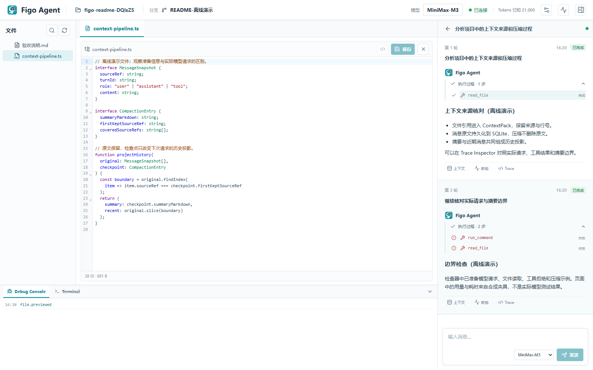

工作台将文件编辑、任务对话与运行检查放在一起，让执行、观察与必要的人工干预处于同一个工作环境。

> 界面截图使用隔离演示数据；真实模型实验标注测试日期、环境与结果。

### 看清上下文：模型到底读到了什么

上下文可以简单理解为“这一次回答时，模型能拿到的材料”。它可能包含当前问题、前面的对话、显式引用的文件、工具返回和历史摘要，但不是电脑里所有文件的集合。

Figo Agent 将材料从哪里来、为什么纳入、是否被截断或摘要，以及最终进入了哪一次请求连接起来。不熟悉数据库和接口协议，也可以从来源、消息和状态查看材料的去向。

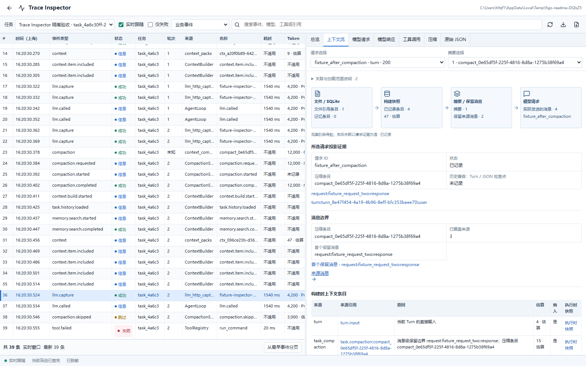

例如，点击文件只是人的阅读，显式引用并经过校验与取舍后才进入模型输入；一次工具返回可以加入下一次请求；较早的对话可能被摘要覆盖，而近期消息仍保留原文。界面将这些状态分开，避免把“浏览过”“准备过”和“实际发送过”混为一谈。

### 看清 token：一次请求与整项任务分别消耗多少

Token 是模型处理文本的计量单位，与汉字数或账单金额并不相同。观察 token，既要看单次请求输入和输出，也要看整个任务经过多少次调用。

工作台保留每次模型请求的输入、输出和总 token，并按任务与会话汇总。模型没有提供用量时显示未知；上下文规模估算与接口返回的实际用量分开标注。

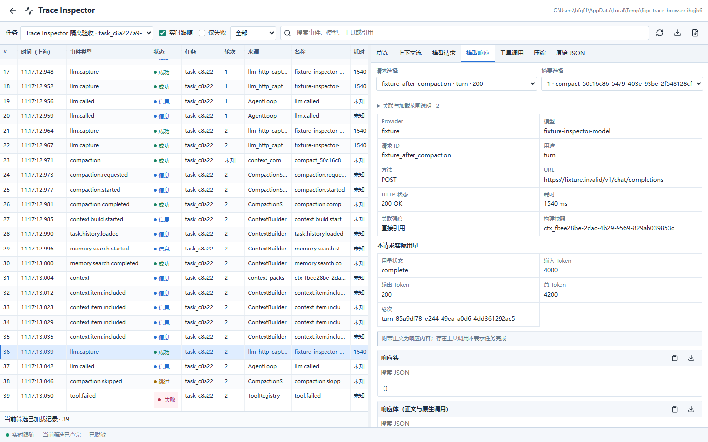

随着任务推进，引用文件和工具结果可能让后续输入增大，历史摘要则可能缩短某次请求。**单次上下文大小与累计消耗是两个不同的指标：请求变短，不代表之前的调用与摘要开销消失。**

这让使用者可以检查一次长任务的消耗来源，而不只看到一个没有出处的总数。当前统计展示 token，不提供价格换算或单个工具的实际费用分摊。

### 看清压缩：哪些原文变成了摘要

长对话接近模型一次可处理内容的上限时，系统需要缩减后续请求携带的历史。Figo Agent 采用消息级压缩：较早内容生成摘要，近期原文按安全边界保留，原始记录继续保存。

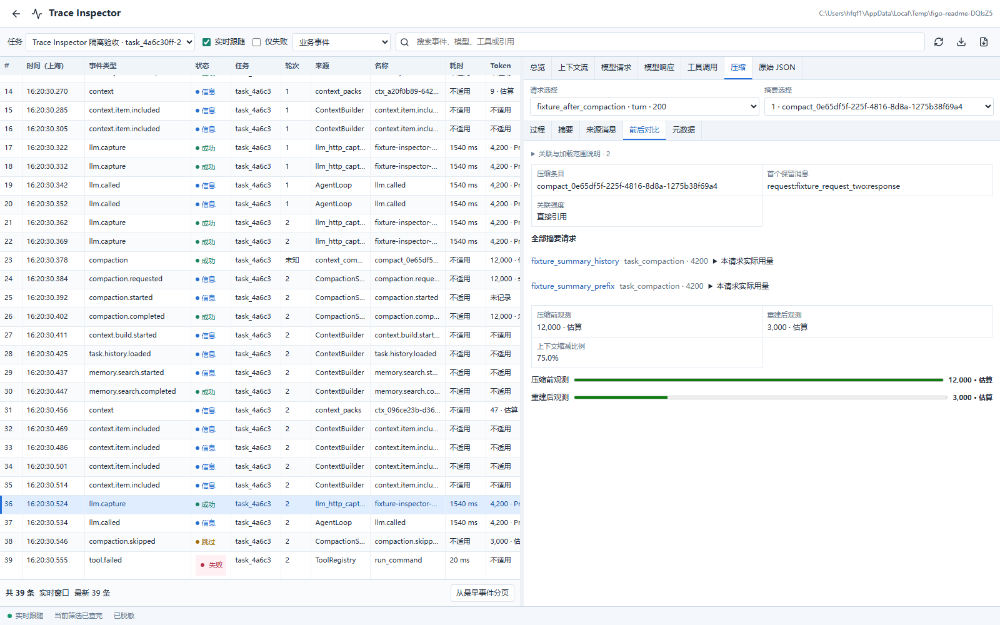

压缩检查器展示触发原因、摘要内容、覆盖的来源消息、保留边界和前后规模，也区分“摘要已返回”“条目已保存”“下一次请求已采用”。因此可以直接核对压缩发生了什么，而不必从模型后来的回答倒推。

压缩首先解决容量管理。摘要本身会消耗 token，内容也可能有损；是否更快、更省，需要把摘要和后续调用一起测量。

### 项目特点

- **看得清。** 文件、消息、工具、摘要与用量在同一工作台关联展示，不必先翻查原始日志或数据库记录才能理解运行过程；未知用量与上下文估算分别标注。
- **能选择、能干预。** 使用者选择模型、编辑提示词、显式引用文件、切换任务，并可在执行中请求停止；工具操作受参数与 Policy 约束，文件浏览不自动入模。
- **可改造。** 小内核依赖明确契约，模型、上下文来源、工具、记忆、Skill 与报告分别实现。开发者可以通过代码和配置调整能力，不必将所有变化写进主循环。
- **可复盘。** 请求、响应、工具、错误与来源持续落盘，最终答复之外保留可复核的事实链，为排障和修改机制提供依据。
- **本地运行、共享内核。** CLI、Web 与 Electron 复用同一套运行逻辑，任务状态与运行记录保存在工作区，入口变化不复制执行机制。

### 掌控的范围

本地运行指工作台、Agent 内核和运行数据由本机服务管理，**不等于完全离线**。实际模型调用仍会把选中的上下文发送给配置的模型服务，所用服务的数据处理与保留规则需要分别确认。

“掌控”体现为过程可查、输入与连接可选、执行可干预、实现可修改，不代表模型结果绝对可靠或工具操作没有风险。停止请求不等于撤销已完成的文件、Git 或其他副作用，工作台也不是操作系统级沙箱；重要结果仍需人工判断与验证。

当前重点是单 Agent 的受控执行与观察。任务级 Goal / Verifier、多 Agent、动态插件市场和自动长期记忆治理仍属于后续方向。

## 二、项目架构

### 共享内核，不复制执行逻辑

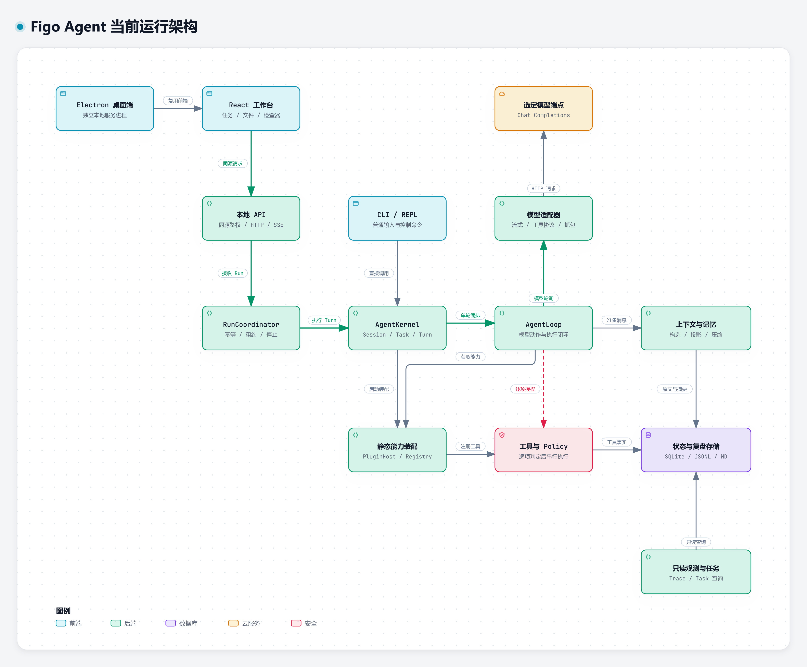

`CLI / Web / Electron → AgentKernel → AgentLoop → PluginHost / Registry`。入口负责交互，Kernel 负责装配与生命周期，Loop 负责单轮编排；模型、上下文来源、工具、记忆、Skill、报告与 Policy 通过明确契约协作。

| 模块 | 职责与边界 |
| :--- | :--- |
| CLI / REPL | 输入输出与控制命令分流，不承载业务编排 |
| Task | 连续工作主题与上下文归属；不做完成验收 |
| AgentKernel | 启动装配、Session / Task / Turn 生命周期 |
| AgentLoop | 上下文构造、模型与工具循环、失败与停止 |
| PluginHost | 静态注册、生命周期、能力索引，隔离具体实现 |
| Context | 来源采集、取舍、上下文包与消息级压缩 |
| Memory | 稳定信息读取与证据，不自动写入长期记忆 |
| Skill | 可复用任务方法、输入约束与输出结构，用户显式选择才执行 |
| Tool | 原子动作、参数校验、结构化结果与执行记录 |
| LLM / Policy | Provider 适配与权限决策分离，模型输出不是授权 |
| Storage | SQLite、审计流水与产物落盘，不编排业务 |
| Trace | 结构化事实及关联，不创造因果或模型思维链 |
| Reporter | 从已有事实生成中文 Markdown，不作为状态源 |
| TokenUsage | 请求级实际用量与估算观测，不决定压缩策略 |
| Web / Electron | 同源 HTTP / SSE 与界面适配，不直接读写 SQLite 或调用 Tool |

“小内核”以职责集中为目标，Context、Memory、Trace 等基础能力仍有独立边界。单一职责、依赖倒置、接口隔离与开闭原则体现在这些边界上：新增 Provider、Tool 或 ContextSource 应扩展能力实现，不把具体细节写进主循环。

项目从 CLI 小内核逐步扩展到 Task、受控工具、多轮调用、TokenUsage、本地 Web 与检查器，桌面端复用同一应用层。

### 运行对象与职责

Session 管理一次运行会话，Task 管理连续工作主题，Turn 对应一次普通输入，Run 记录 Web 异步执行状态。一个 Turn 可以包含多次 LLMCall，每次调用都有独立请求、响应与用量。

上下文链路按 `Session → Task → Turn → ContextPack → LLMCall` 组织；工具、消息、摘要与 Trace 通过真实来源引用关联。Task 界定历史范围，Run 描述执行状态，两者不替代 Goal 的目标验收。

### 一次任务的数据怎样流转

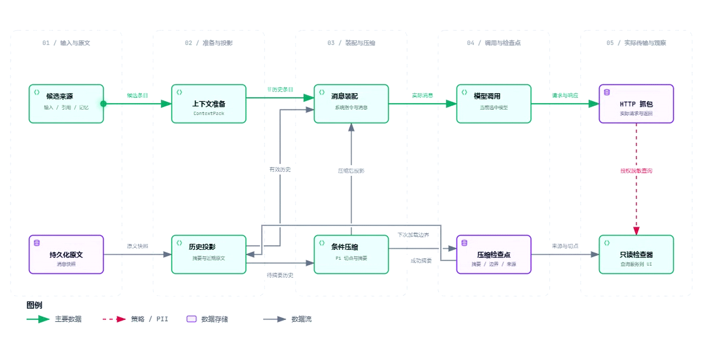

动效与静态图描述同一条逻辑数据流，动画速度与实际执行耗时无关。

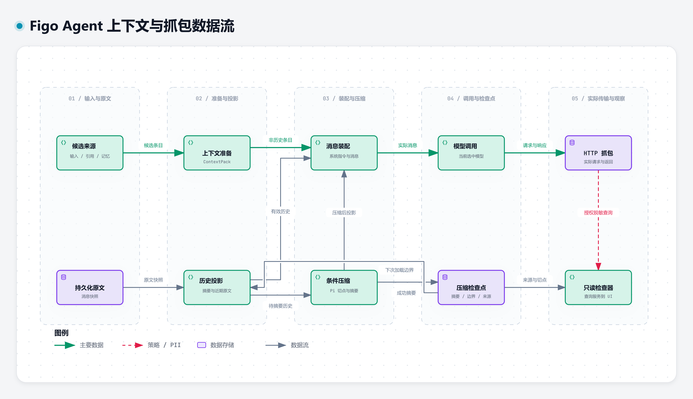

| 数据阶段 | 输入与输出 | 谁负责 |
| :--- | :--- | :--- |
| 人的输入 | 问题、显式文件引用、用户提示词 | Web / CLI 适配器与应用层校验 |
| 上下文构造 | 来源候选 → 条目与取舍 → ContextPack | ContextSource / ContextBuilder |
| 运行时消息 | 当前消息、工具反馈、摘要与近期原文投影 | AgentLoop 与消息/压缩存储 |
| 外部调用 | 模型 HTTP 请求/响应；Policy 允许的真实工具动作 | LLMProvider / ToolRegistry |
| 事实落盘 | 抓包、用量、工具、Trace 与来源 ID | 各模块 Store / Storage |
| 人的观察 | 查询投影、事件更新、报告与检查器 | 本地 API / SSE / Reporter |

Web 通过同源 HTTP 提交命令与查询，通过有序 SSE 接收更新；刷新和重连读取已持久化事实，不应重复执行有副作用 Tool。浏览器不直接持有数据库连接、运行配置原件或模型密钥。

### 执行、存储与观察的分层

**执行层**由 AgentKernel、AgentLoop 和 PluginHost 协作：Kernel 管生命周期，Loop 编排单轮，插件提供模型、上下文、工具与策略能力。

**数据层**以 SQLite 为状态源，保存任务、消息、摘要、抓包与用量；JSONL 保存顺序审计，Markdown 报告面向阅读。

**交互与观察层**由 CLI、Web 与 Electron 提供入口。本地 API 负责命令、受限查询和事件推送，检查器读取已有事实，不参与工具执行，也不修改压缩决策。

单一职责、接口隔离与依赖倒置贯穿这些边界。新增模型或工具通过契约与注册接入，运行流程不依赖具体厂商、页面组件或开发文档。

## 三、子模块设计与实现

### 3.1 AgentKernel 与 CLI：启动、装配与生命周期

#### Kernel、Loop 与入口的依赖顺序

启动先解析配置和工作区，再初始化 Storage、Trace 与会话/任务管理，创建 Session 和默认 Task，静态装配插件，最后把能力契约交给 Loop。Trace 依赖可用存储，插件 setup 需要运行上下文，Loop 需要完成装配的能力索引；启动依赖集中由 Kernel 管理。

Kernel 对入口返回结构化 TurnResult / CommandResult，入口负责显示；Loop 不创建新 Session，不初始化插件，也不直接拼 Markdown。存储或必需能力不可用时拒绝继续，并返回对应初始化错误。

CLI 是同步交互适配器，Web 通过 RunCoordinator 异步调用同一执行边界，Electron 再封装同一 Web。入口形态不同，不意味着存在三套上下文策略或三份工具循环。

CLI 负责输入输出、普通文本与控制命令分流。Kernel 返回结构化结果，CLI 展示答复、错误摘要和产物路径，完整细节由存储与 Trace 承担。Web 使用异步适配器，但仍进入同一 Kernel 执行边界。

### 3.2 Task：任务边界与多轮历史

#### Session、Task、Turn、Run 各管什么

- **Session** 是一次运行会话，保存运行归属与生命周期。
- **Task** 是连续工作主题，界定多轮历史进入上下文的范围。
- **Turn** 是用户一次普通输入，一轮处理中可以发生多次模型调用和工具调用。
- **Run** 是 Web 异步执行索引，连接 HTTP 接受、真实开始和最终完成或中断。
- **LLMCall** 是一次真实模型请求，是抓包和实际用量的基本单位。

Task 与 Goal 不同。前者回答“这些对话属于什么主题”，后者才需要任务级计划、验收、暂停恢复与完成闭环；当前未实现 Goal；Task 的 completed 仅表示任务状态结束，代码正确性仍由测试和验收结果判断。

CLI 中已实现的任务控制如下，控制命令本身不创建普通 Turn：

| 命令 | 行为 |
| :--- | :--- |
| `/task new 名称` | 新建并选中 Task |
| `/task current`、`/task list` | 查询当前或可运行任务 |
| `/task switch ID` | 切换指定任务，遵守会话与状态边界 |
| `/task pause`、`/task resume ID` | 暂停当前任务或恢复指定任务 |
| `/task finish` | 完成当前任务并生成 task-summary.md |
| `/task cancel 原因` | 取消任务并记录原因 |
| `/compact 可选关注点` | 手动压缩当前任务，不新建普通 Turn |

active 可接收普通输入，paused 需恢复，completed 与 cancelled 不能继续当作当前活动任务写入。archived 是预留的归档状态，当前 Kernel 尚未提供 `/task archive` 命令。

#### 跨会话任务目录

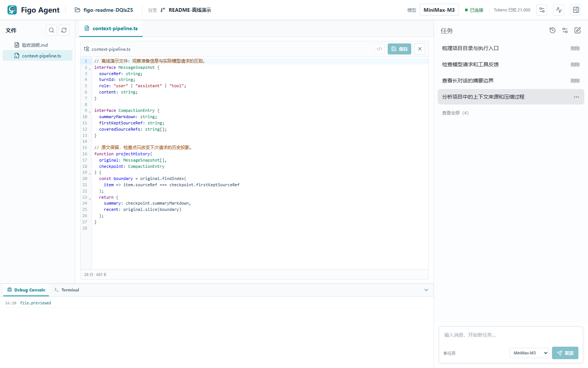

任务列表覆盖当前工作区的多个 Session，支持最近任务、全部任务、搜索和分页。Task 标题优先采用该 Task 第一条用户消息，Session 标题取该 Session 第一条用户消息，不调用模型生成标题，也不改写历史原文。

- 打开 Task 后在同一面板进入对话，返回列表不结束任务，已打开文件保持原样。
- 历史 Session 可以查看，不因在列表中可见就获得继续写入权限；旧版未归属 Task 的 Turn 通过只读兼容入口展示。
- 当前 Task 可进行新建、切换、暂停、恢复、完成或取消等操作；Task 负责上下文归属，不替代 Goal 的任务验收。
- 刷新恢复视图时先校验真实 Session/Task 归属；浏览器偏好以工作区隔离，不改变数据库关系。

任务目录是只读查询投影。搜索和分页使用同一筛选条件计算总数，并区分总任务数与当前页条数；前端通过请求代次隔离迟到响应。

### 3.3 AgentLoop：模型与工具的执行闭环

#### AgentLoop 如何把意图变成动作

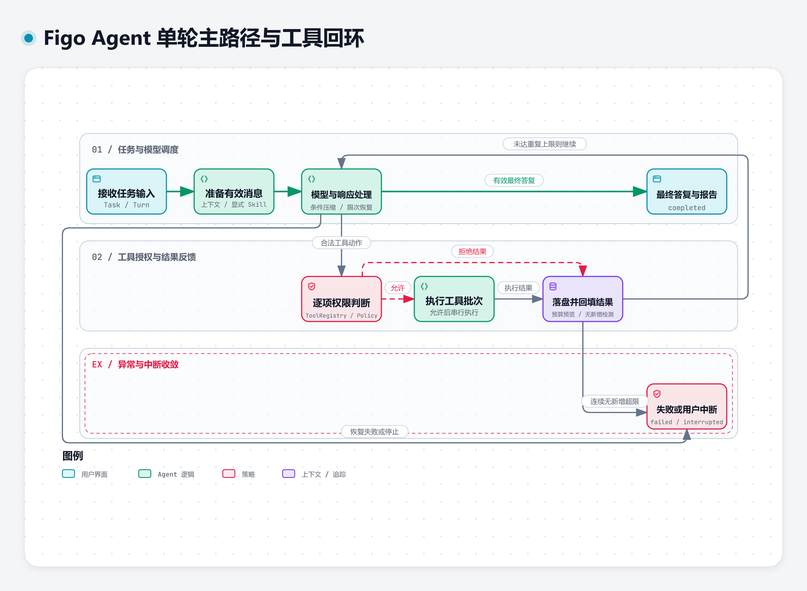

1. 接收普通输入，关联 Session / Task / Turn，构造可解释的 ContextPack。
2. 组装提示词、历史、文件引用与工具定义；按策略检查压缩后调用所选模型。
3. 区分最终答复、工具批次与协议错误；原生 tool_calls 可附带过程正文，正文不替代工具执行。
4. 工具批次统一经 ToolRegistry 参数校验与 ControlledToolPolicy，再执行并记录真实结果。
5. 有界工具反馈进入下一次请求，继续循环；协议修复、重复无进展、失败与用户停止各有明确处理。
6. 正常结束后保存答复与报告；失败、中断保留证据，不用固定成功文案覆盖模型的真实结论。

文本 JSON 工具协议与原生工具协议分别解析，随后汇合到同一受控执行路径。循环不以固定工具轮次上限代替完成判断，但保留协议修复、无进展检测、超时和停止等保护。

图中模型与响应节点合并了条件压缩、协议判定及限次恢复，异常与停止集中表示；它是主路径总览。这些分支分别对应成功、失败、拒绝、无进展与中断状态。

#### 循环状态与失败处理

单轮状态从构造上下文进入模型调用，随后分为最终答复、工具批次或协议错误。工具反馈回到下一次模型调用；最终答复进入产物生成；失败与中断分别终结，不把异常路径落到正常完成。

| 分支 | 处理方式 |
| :--- | :--- |
| 模型配置或 Provider 不可用 | 明确报错，不静默切换其他连接 |
| 参数或工具协议错误 | 记录解析错误，在协议允许次数内请求修复 |
| 原生正文与 tool_calls 同时出现 | 保留过程说明，按结构化调用执行，正文非空不触发格式修复 |
| 工具不存在、参数非法、Policy 拒绝 | 保留失败或拒绝结果，绝不执行被拒动作 |
| 工具异常、超时、输出超限 | 保留真实错误、退出码与截断标记，反馈有预算上限 |
| 相同动作和结果反复出现 | 无进展检测提示回答或说明证据缺口，持续重复则失败 |
| 用户停止或服务中断 | 传播停止到可中断调用，保留事实与中断态，不重放已有副作用 |
| 报告写入失败 | 分别保留报告错误与已落库的工具执行事实 |

协议解析、动作执行与消息反馈也分开：ToolCallingRuntime 组织批次，Registry 查找工具并经过 Policy，消息构造器处理反馈预算，Provider 只负责通信。各层错误保留请求、动作或来源关联，便于定位具体阶段。

#### 执行时间线与模型增量

右侧时间线来自实际运行事件和模型增量。原生模式分别处理结构化动作与过程正文；文本模式在确认最终正文后释放增量，未确认时等待完整响应。工具协议 JSON 和隐藏思考块不进入最终答复区域。

Provider 保留完整返回，同时可向 Web 提供文本增量。RunCoordinator 合批记录增量，携带 offset 与 sourceLength；页面按游标去重、按原始偏移合并，显示长度与原始偏移分开处理，以适应脱敏后的长度变化。Turn 最终 output 才是完成态规范答案。

碎片化 SSE、原始 wire、重建响应和错误分别保存。流结束判断兼容 [DONE]，也兼容服务正常关闭且已有非空 finish_reason；两者都缺失按截断处理。普通 JSON 返回可走完整响应回退。解析器已覆盖模拟 SSE 分片与回退场景；早期真实中转测试曾发生首段等待超时，该端点的及时推送能力仍缺少通过记录。

历史活动查询目前最多返回最近 5000 条事件。页面仅在滚动位置接近底部时跟随新内容，阅读旧消息时保持当前位置。刷新重新读取事实，不重新提交消息。

### 3.4 PluginHost：能力注册与依赖隔离

#### PluginHost：把变化点从内核移出去

插件由 Manifest 声明 id、名称、版本、描述与能力；setup 返回能力实例，PluginHost 按类型和名称建立索引。重复插件 ID、重复能力键、缺少必需能力都明确报错。

当前生命周期是启动时静态注册、setup、收集能力、建立索引、标记 ready；注册、能力和 ready 事件进入 Trace。模型、上下文来源、MemoryStore、Skill、Tool、Reporter 与 Policy 都从统一入口取得，Loop 不直接实例化具体实现。

模型设置即时生效采用静态插件内部的连接配置注册表，更新 Provider 快照，不等于动态下载插件、热插拔插件或插件市场。动态插件、MCP 连接和在线安装仍属于后续能力。

这也是 SOLID 在本项目中的具体落点：入口、Loop、Store、Reporter 各守单一职责；内核依赖契约；不同能力分开接口；新增实现扩展注册，不把厂商和文件来源写死进编排层。没有明确变化来源的地方不提前增加抽象。

### 3.5 Context：来源收集与上下文构造

#### 准备了什么，实际发送了什么

上下文不是把所有文件和历史一次性塞进 Prompt。当前 Turn、同 Task 历史、显式文件引用、被选中的 Memory 和工具结果按各自来源进入运行链路，保留来源、进入原因、优先级、预算估算与取舍记录。

| 对象 | 回答的问题 | 不等同于 |
| :--- | :--- | :--- |
| ContextItem / ContextDecision | 哪份内容为何纳入、排除、摘要或截断 | 磁盘上所有文件 |
| ContextPack | 这一 Turn 构建时准备了什么 | 轮内所有请求始终相同的消息列表 |
| context_messages | 运行时实际追加了哪些消息与工具反馈 | 经过脱敏的审计正文 |
| LLM HTTP Capture | 这一次实际发了什么、收到了什么 | 模型隐藏推理过程 |
| Memory | 哪些稳定信息可跨轮、跨任务复用 | 自动进入每次请求的全部历史 |

其他 Task 的明细不默认进入当前上下文；源工程开发文档和可选个人知识库也不是用户项目的默认上下文。自定义系统指令与持久用户指令由运行时组装，并以提示词版本指纹留痕。

#### ContextBuilder 的输入、输出与取舍

ContextSource 只收集来源候选，ContextBuilder 负责标准化、排序与取舍，AgentLoop 消费结果；文件读取逻辑不写进 Builder，来源插件也不决定整个循环。

当前主要来源为当前输入、同 Task 历史、显式文件引用、Memory，以及历史或本轮工具观察。当前输入必须保留；历史限定同 Task，文件引用经过版本校验，Memory 是否启用由配置控制。系统指令和持久用户指令由运行时组装，不借“项目资料”路径默认加载 Agent 源工程文档。

每个条目记录内容、类型、sourceRef、纳入原因、优先级、估算及取舍动作。ContextDecision 表达 include / exclude / summarize / truncate；排除、缺失与截断均记录原因；实际采集数量与候选全集区分统计。候选、实际纳入条目和最终发送消息是三种不同统计口径。

构造完成后保存 ContextPack 与条目，生成可读 context.md；工具调用后还会继续追加反馈、生成摘要或重建模型消息。模型的实际输入由具体 requestId 对应的抓包确认，初始构建包提供构造阶段的来源说明。

#### 消息原文为什么必须先落库

压缩如果按消息中间切分，完整 Turn 就太粗。一个很长的 Turn 内可能有多次助手工具动作与工具反馈，只保留“前五轮/后五轮”无法表达安全切点。

context_messages 追加保存运行时实际消息、角色、usage 作用域、工具调用 ID、停止原因和投影标记。用户消息、助手响应、工具结果各有稳定 sourceRef；文本协议反馈、原生 tool 消息和合成失败结果同样保存。两段文字相同不代表同一来源，同一旧消息重复出现在多个请求也不重复导入。

这避免一种常见断裂：工具返回后用户取消，没有下一条抓包可反推反馈；或者后来用另一套预览预算重建，消息长度已经与当时不同。Trace 只记引用，脱敏后的审计正文不是模型原文源。

context_compactions 保存 Task 内递增 seq、baseEntryId、首个保留来源、覆盖来源、Markdown、文件操作、tokensBefore 与全部摘要请求。条目追加前在事务中复核基础版本，避免两个压缩结果覆盖同一基线。

### 3.6 Compaction：消息级压缩与恢复

#### 压缩过程可见，原始历史保留

当前采用固定版本 Pi 的消息级压缩算法移植，不引入整个 Pi 运行时。Agent 内部策略决定何时压缩，所选模型负责生成有损 Markdown 摘要；不是让模型厂商适配器自行决定压缩流程。

| 环节 | 当前机制 |
| :--- | :--- |
| 触发时机 | 新用户输入追加前检查历史；工具结果追加且确需下一次请求时再检查；最终答复后不提前压缩 |
| 触发判断 | 严格比较 `contextTokens > contextWindow - reserveTokens`；等于阈值不触发，Task 累计用量不参与控制 |
| 当前规模估计 | 有有效 usage 锚点时结合新增消息估算；模型、系统或工具定义变化使旧锚点失效，无有效锚点时估算当前投影 |
| 保留边界 | 按 token 预算保留近期原文，选择安全切点，避免拆坏工具调用与反馈关系 |
| 摘要生成 | 同一选中模型生成结构化 Markdown，滚动更新；来源关系保存在存储元数据，不要求摘要复述长 ID |
| 默认参数 | `reserveTokens=16384`、`keepRecentTokens=20000`；运行参数统一在 JSON，可按 Provider / Model 覆盖 |
| 失败与恢复 | 明确超限及符合判定的最终长度失败最多压缩重试一次；取消、摘要失败或基线冲突不写成功条目 |
| 历史保留 | 消息、抓包、失败请求和成本记录继续保存；只改变后续投影，不删除原始事实 |

压缩标签把“检查过”“发起摘要”“摘要返回”“条目提交”“后续请求采用”分开呈现。前后 token 估算反映投影规模变化；整体开销还包含摘要请求、后续工具与模型调用，语义损失和净收益需要分别测量。

**阶段状态：** Pi 算法与三模型测试窗口配对功能验收已完成，进入用户实际使用与反馈阶段；实际大窗口容量和普遍净收益未完整验证。中转端点配置的官方容量参考不是端点容量实测结论，旧的固定 Turn / 字符阈值与自优化计划不代表当前策略。

#### Pi 算法的移植边界

核心算法固定参考 Pi 提交 `6a1f799b675c8cb98320b71ff7ee44f160fe8d66`，保留版权、MIT 许可证、来源与适配差异，不引入整个 Pi 运行时。估算、触发、安全切点、摘要序列化和滚动更新来自固定上游，消息契约、Provider、SQLite 与 Trace 属于宿主适配。

算法行为差异通过适配记录与符合性验证管理。移植范围不含分支树导航、阈值学习、候选策略发布或自优化平台。

判断只使用当前有效上下文，不使用 Session/Task 累计消耗。有效 usage 锚点必须对应当前模型、系统指令和工具定义；这些发生变化就重新估算。窗口未知保持未知，不按相似模型猜值；手动压缩与普通聊天不因此被禁止。

#### 切点、摘要、滚动更新与重建

从消息尾部按 keepRecentTokens 预算寻找保留区，并避开会破坏工具动作与反馈配对的切点。没有可总结的前缀时记录原因并跳过摘要。

摘要输入将旧消息序列化，移除思考块，并对工具结果使用默认 2000 字符的摘要预览、标明截断；这只影响摘要请求，SQLite 中的原始工具结果不被改写。输出使用结构化 Markdown，组织目标、约束、进度、关键决策、后续步骤、关键上下文及读写文件信息。

来源 ID 与覆盖边界保存在元数据，摘要正文只负责语义内容。新 Markdown 不通过旧 JSON 的来源字段校验；存量 JSON 检查点继续按原格式读取，并可作为后续滚动摘要的已有摘要。

再次压缩时接续旧摘要与新进入覆盖区的消息，不每次把所有原始历史重发一遍。后续投影由系统指令、摘要、近期原文与本轮追加构成；工具定义独立随所选普通请求提交，摘要请求不授予工具执行能力。

普通历史摘要的输出上限为：

```text
min(floor(0.8 * reserveTokens), model.maxTokens)
```

Turn 前缀辅助摘要按对应分支使用：

```text
min(floor(0.5 * reserveTokens), model.maxTokens)
```

默认预留 16384 时，两者在模型最大输出未进一步限制的情况下分别为 13107 和 8192 token。maxTokens 是输出能力上限，不是每次必然生成的长度，也不是自动压缩触发阈值。

#### 自动、手动与恢复共用同一机制

自动压缩在安全时点检查；手动 `/compact` 可带关注点，从同一准备、摘要与提交路径运行，成功后更新投影并返回命令结果，不额外创建普通 Turn 或自动继续一轮助手调用。

符合判定的超限或最终长度失败才进入一次恢复，不把普通截断或带未完成工具动作的响应全部当成超限。截断的工具调用被拒绝执行，已完成的工具在恢复时保持原结果。

恢复保留原失败抓包，用 recoveryOfRequestId 关联重试。失败尝试可从后续投影省略，但原文、Trace、抓包与成本仍在。摘要失败、用户取消或基线冲突不能推进成功条目；旧投影保留供恢复使用；后续调用仍超限时，返回实际失败结果。

#### 压缩配置与模型容量

压缩参数集中保存在统一 JSON 中：

```json
{
  "context": {
    "compaction": {
      "enabled": true,
      "reserveTokens": 16384,
      "keepRecentTokens": 20000,
      "summaryToolResultMaxChars": 2000,
      "modelOverrides": {}
    }
  }
}
```

modelOverrides 用 `providerId/modelId` 精确匹配，只覆盖预留量与近期保留量，未覆盖项继承全局。非法参数明确报错，运行时仅使用这套 token 预算规则。

模型条目分别保存 contextWindow、maxTokens、maxTokensField 和 metadataSource。2026-10-16 的收尾配置快照为 MiniMax 窗口 1000000、GPT 中转参考窗口 1050000、DeepSeek 窗口 1048576；默认预留下的严格触发边界分别为 983616、1033616、1032192。这些数值是该日期的配置快照，服务能力与运行参数分别核验。

GPT 中转采用同名官方参数作为配置参考，端点满窗口容量仍未验证。默认模型与容量取实际配置及 Run 提交时的快照，历史记录保留原模型归属。

### 3.7 TokenUsage：请求级用量与规模估算

#### TokenUsage：实测、估算与未知分开

| 统计项 | 口径 |
| :--- | :--- |
| 实际输入、输出和总 token | 按一次 LLM HTTP 请求统计，只采用 Provider 返回的有效 usage；总量不再与输入、输出重复相加 |
| 用量完整性 | `complete` / `partial` / `unavailable` 分开；缺字段保持未知，不能补零 |
| 上下文估算 | ContextItem / ContextPack 与完整请求分别估算，二者不能直接相加，也不是计费值 |
| 请求用途 | 普通对话与压缩请求都进入统计，保留用途、模型和抓包引用 |
| 聚合范围 | Session / Task / Turn 汇总已知值，同时保留覆盖次数与缺失请求数 |
| 不提供的归因 | 不从总用量猜测单个 Tool / Skill 的实际消耗；价格成本与普遍压缩收益仍未实现或证实 |

CLI 可用 `/usage` 查看 Task 与 Session 汇总；`report.md` 和 `task-summary.md` 提供对应复盘。手动压缩不创建普通 Turn，其用量仍归 Task / Session。

#### 请求归属、覆盖率与回填

普通请求和轮内压缩归当前 Turn，自动 Task 压缩归触发它的 Turn；手动压缩不创建 Turn，只进入 Task / Session 汇总。原始抓包 Turn 锚点与用于统计的 usage_turn_id 分开，旧抓包没有触发轮次时保持未知，不猜测归属。

解析接受通用的 prompt_tokens / completion_tokens，也兼容 input_tokens / output_tokens。0 是有效值，负数、小数、字符串或超安全整数无效；同一请求的 total 不与输入输出再相加。reasoning、cache 等厂商细项留在原抓包，不未经核对就重复加入总量。

新抓包与其 token_usage 在同一事务保存。旧抓包按缺失 requestId 幂等回填，不改原始响应，重启不重复计数。聚合只累加明确返回的字段，并显示每字段覆盖次数和缺失请求数。

ContextPack 估算与每次完整请求的 estimatedInputTokens 分开保存；多轮工具交互每次重新估算，不能把两者相加。一个任务的全部实际消耗可能很大，但它不是当前上下文窗口大小。价格表、汇率、缓存折扣与单个工具实际成本归因当前没有可靠实现，不显示推测值。

### 3.8 LLM 与配置：模型协议、连接更新和提示词

#### 模型协议与厂商名称分离

llm 是连接条目数组，id 唯一，enabled 控制注册，activeModelId 指向默认启用条目。provider 表示调用协议，目前使用 openai-compatible，不以厂商名称决定编排、压缩或授权。

当前选择缺失、ID 重复、条目禁用或协议未知时返回配置错误。多条启用不等于同时调用多个模型，也没有自动故障回退。

toolCallingMode 为 text 或 native。text 对完整工具 JSON 与最终正文做排他分类；native 接受结构化 tool_calls，可与过程 content 共存，并按 tool_call_id 回填。普通与压缩使用同一选中连接，压缩请求不下发工具定义；输出字段差异通过 maxTokensField 映射，不以模型名写死。

模型目录由服务端获取，带超时、地址校验和响应上限；读取失败时保留当前连接的默认模型，并显示目录获取错误。地址变化不复用旧凭据；上游错误不原样回显敏感响应。

#### 模型保存的事务边界

浏览器只提交草稿和配置版本；服务端先做身份、CSRF、活动 Run 与写互斥检查，再校验条目和版本。Kernel 经 PluginHost 的模型注册表准备新 Provider，准备失败不写文件。

临时文件原子替换成功后，同步提交 Provider、默认选择、容量元数据与脱敏集合，再发布仅含 ID、模型和版本的 settings.models.updated。写文件失败不能激活新连接，旧版本提交不能覆盖新配置。

设置页、默认切换、工作区切换和新 Turn 准入通过现有锁协调；读取请求体期间也不能被另一次写入穿插。其他已连接页面经 SSE 更新，前端使用请求代次拒绝旧 bootstrap 或旧模型目录响应覆盖新状态。

配置轮换、删除后的旧密钥，在本进程仍保留于历史脱敏集合中；重叠密钥先匹配长值，避免短前缀替换泄漏后缀。事件和响应只返回 hasApiKey，不回填密钥正文。

#### 提示词、中文资源与安全策略

自定义系统指令进入初始 system 消息，持久用户指令置于本次输入之前，二者是用户本机数据。每个新 Turn 读最新版本，抓包记录实际发送内容，Trace 记录指纹，不把提示词内容当配置阈值。

中文资源承载按钮、说明、错误模板和固定 Agent 提示。当前浏览器文案已集中，部分后端错误和工具描述仍在 TypeScript，文案迁移尚未覆盖全工程；HTTP 路由、SQL 名称、状态枚举、危险操作保护与硬上限也不属于翻译或可随意编辑的文案。

### 3.9 Tool 与 Policy：动作能力和授权边界

#### 工具能力与权限

| 能力 | 当前工具 |
| :--- | :--- |
| 本机与路径观察 | `system_info`、`path_stat`、`workspace_summary` |
| 工作区读取 | `list_files`、`read_file`、`read_many_files`、`search_text` |
| 工作区写入 | `write_file`、`apply_patch` |
| 命令执行 | `run_command`，限制工作目录、超时和输出大小 |
| Git | `git_status`、`git_diff`、`git_log`、`git_add`、`git_commit` |
| 网络与浏览器 | `network_fetch`、`browser_open`、`browser_snapshot` |

所有 Agent Tool 都经过 Policy，记录参数摘要、结果、耗时、错误和必要的退出码。工作区路径、危险操作、命令超时、输出截断和敏感字段脱敏是执行边界，不由模型自行解除。

`list_files.depth=0` 仅当前层，正整数表示允许进入的子目录层数，省略表示递归；`write_file` 需要创建父目录时显式传 `createDirs: true`。这些语义通过工具 Schema 告诉模型，不由开发文档控制。

### 3.10 Memory：稳定信息与当前上下文的边界

#### Memory：稳定信息，而不是另一份聊天记录

Memory 的设计区分 project、user、agent、knowledge 四类作用域，分别承载项目事实、用户偏好、运行经验和可复用方法。它与 Context、Trace、Artifact 的关系是：稳定信息可被检索，只有当轮被选中才进入 Context，运行过程仍记 Trace，可读产物只是表达。

当前运行实现以 SQLite memory_records 的按 scope 检索为主，记录 key、content、source 与时间等信息；是否注入由上下文配置与取舍决定。自动分类、候选记忆确认、向量检索、长期治理和完整写入/Markdown 同步流程尚未实现。

长期治理涉及证据、去重、过期、冲突与人工确认。模型总结与报告只是候选信息，稳定记忆需要独立的确认与存储；Memory 缺失或检索失败会留下对应记录。

### 3.11 Skill：显式选择的任务方法

#### Skill：方法与动作分开

Tool 负责读文件、执行命令等原子动作，Skill 描述任务怎么开展：需要哪些上下文、允许哪些工具、按什么步骤收集证据、输出什么结构、如何判定失败。

当前内置 project-understanding-skill 承载项目理解方法。只有用户显式选择才运行；“分析当前项目”这样的普通意图不按关键词自动激活。明确选择后进行预检并收集证据，工具仍经同一 Registry 与 Policy，Skill 不直接绕过工具读写文件。

激活、跳过、执行、失败与完成都是过程事实。最终答复由模型基于实际证据生成，Skill 返回的预检状态与固定过程文案不覆盖模型答复。

尚未实现多 Skill 编排、动态 Skill 包管理和自动 Memory 写入。当前实现侧重单个显式 Skill 的执行与留痕。

### 3.12 Storage：状态、审计与产物落盘

#### SQLite、JSONL 与 Markdown 分工

| 存储 | 记录内容 | 用途 |
| :--- | :--- | :--- |
| SQLite | Session、Task、Turn、Context、消息、压缩、抓包、用量、工具和事件等结构化状态 | 查询、关联、恢复与检查器事实来源 |
| JSONL | TraceEvent 追加流水 | 审计与按顺序复盘，不替代复杂查询 |
| Markdown | `context.md`、`report.md`、`task-summary.md` 与可读记忆产物 | 给人阅读，不反向控制程序或替代状态源 |

| 关键表 / 记录 | 能回答的问题 |
| :--- | :--- |
| `sessions` / `tasks` / `turns` | 哪次运行、哪个工作主题、哪一轮输入 |
| `context_packs` / `context_items` | 构造了哪些候选与最终上下文 |
| `context_messages` / `context_compactions` | 哪些实际消息被保留、摘要覆盖哪些来源 |
| `llm_http_captures` / `token_usage` | 每次请求实际传了什么，已知用量是多少 |
| `tool_calls` / `trace_events` | 真实执行了哪些动作，发生了什么错误 |

工作区运行数据位于 `.figo-agent/`，主数据库为 `.figo-agent/figo-agent.db`；报告与审计产物放在对应 Artifact 目录。SQLite 时间列统一采用上海本地时间文本 `YYYY-MM-DD HH:mm:ss.SSS`，旧数据迁移必须可回滚且不重复偏移。

Storage 负责保存，Trace 负责事实，Reporter 负责表达：`context.md` 解释上下文准备，`report.md` 解释执行，Task 完成时的 `task-summary.md` 汇总任务证据。全文抓包与本地运行数据仍需按敏感资料管理。

#### SQLite 初始化、时间与写入竞争

Storage 初始化目录、数据库、Schema 和迁移，提供连接及 Artifact 路径与原子写入，不选择模型、不制定压缩策略。SQLite 初始化失败时终止启动并返回错误。

时间列统一为上海时间的毫秒文本；旧 UTC 或带时区文本在一次性事务中迁移，记录版本，失败回滚，版本标记防止重启时重复偏移。外部请求与响应 JSON 中的原始时间不随数据库列迁移被篡改。

多进程打开同一库时，通过 sqliteBusyTimeoutMs 等待短暂写锁，默认 5000 毫秒、允许 100–30000；超过等待仍上报真实故障。锁等待只解决短暂 SQLite 竞争，不取代“同一工作区只能有受控写入者”的运行租约，也不证明任意多进程并发执行安全。

### 3.13 Trace：结构化运行事实

#### Trace 的字段与事件边界

TraceEvent 至少包含事件 ID、上海时间、type、source、sessionId，以及适用时的 taskId、turnId 和结构化 payload。payload 保存来源、参数摘要、结果、状态、错误与关联。大段正文由对应存储保存，Trace 以结构化字段连接这些事实。

关键事件覆盖用户输入与输出、Session/Task/Turn 生命周期、Context 构造与取舍、Memory 检索、Skill 状态、Tool 与 Policy、LLM 请求响应、压缩与 Artifact。失败事件必须保留直接错误、触发输入摘要、相关来源与处理结果。

TraceRecorder 先写 SQLite，再追加 JSONL，并把允许公开的字段通知观察者。两者分别提供可查询事实与顺序审计，写入并非跨介质原子事务，当前也没有完整的自动补偿机制。UI 观察者只接收安全投影，不控制业务执行。

当前观测范围是关键链路结构化事件与只读检查器，尚未引入 OpenTelemetry、分布式 Span、自动异常归因或完整日志平台。模型隐藏推理不属于采集范围。

### 3.14 Reporter：从事实生成可读报告

#### Reporter 如何组织人类可读产物

Reporter 读取已有 Context、Turn、抓包、用量与 Artifact 索引，按中文模板组织报告并由 Storage 写入。它不调用模型创造运行事实，不改 Trace、不改 Memory，也不反向决定上下文或工具授权。

当前产物分别承担不同问题：

- context.md 列出本 Turn 已纳入条目的来源、摘要、原因与估算，实际请求全文保存在对应抓包中。
- report.md 组织本 Turn 输入、真实答复、上下文与请求级用量摘要。
- task-summary.md 在任务完成时聚合 Task 信息、Turn 时间线、模型抓包索引、用量和产物入口。
- trace.jsonl 追加事件流水，不是最终报告，也不作为模型原文重建源。

当前 Turn 产物按 Session / Task / Turn 分层，例如：

```text
.figo-agent/
  figo-agent.db
  artifacts/
    sessions/
      <session-id>/
        trace.jsonl
        tasks/
          <task-id>/
            task-summary.md
            <turn-id>/
              context.md
              report.md
```

Task Summary 是可读聚合，不等于 Goal 验收报告；报告正常生成，也不证明任务的测试、构建或业务目标已经通过。反过来，报告写入失败不能抹去已经落库的真实动作。

### 3.15 Web 工作台：文件、任务与人工操作

#### 文件、对话与终端

工作台采用左侧文件树、中间编辑器、右侧 Task 列表或对话的一体布局。底部 Debug Console / Terminal 与文件编辑位于同一工作区域；分析面板按需打开，桌面分隔线可拖动，布局宽度只保存在浏览器本地。

| 区域 | 当前提供 | 需要注意 |
| :--- | :--- | :--- |
| 文件区 | 目录浏览、搜索、文本编辑、显式保存、文件或行引用 | 未保存草稿不能引用；版本冲突拒绝覆盖，搜索达到上限明确提示未查完 |
| 对话区 | Task 列表与对话原位切换、固定输入框、Turn 执行时间线 | 过程说明、工具结果和最终答复分开，工具协议 JSON 不作为普通正文展示 |
| 分析区 | 请求/响应、上下文、压缩、工具与 Trace 来源定位 | 查询已落库事实，标注缺失、截断与未知状态 |
| Terminal | 人工输入的本机逐条 Shell 命令与输出 | 不是 PTY/TUI；人工命令不经过 Agent Tool Policy，需自行判断风险 |

文件浏览与编辑独立于模型上下文。只有显式引用并通过 ContextBuilder 取舍后，文件内容才进入当前请求；停止和进程中断分别记录为对应运行状态。

界面使用浅色工作底面、细分隔线和紧凑排版。青绿色表示选中和主要动作，绿色表示成功，琥珀色表示警告，红色表示错误；状态同时有文字，不只靠颜色。路径和 ID 可换行或查看完整值，图标按钮保留中文名称与提示。

#### 文件保存与显式引用怎样保证一致

文件接口与模型读文件工具是两条不同的入口。人点击文件只获得受限文本和 SHA-256 版本；人编辑后显式保存，服务端再次校验同源、CSRF、路径、大小、工作区写入租约与旧版本，才通过同目录临时文件原子替换。

如果磁盘文件已经改变，返回 409，不覆盖别人的新内容；保存失败保留草稿。关闭、切换文件或离开页面时提示未保存修改。当前编辑器只保存已有、可预览的文本，不提供文件创建、自动保存、分页读取或图片预览。

服务端通过路径规范化、lstat 与 realpath 限定工作区，过滤凭据文件、运行配置、隐藏项、.git、node_modules 和构建目录。符号链接、二进制、非 UTF-8 与超过限制的大文本不能绕过预览保护；当前文件编辑上限为 1 MB。

引用包含相对路径、起止行和已保存版本。发送前的引用只保存在浏览器草稿中；提交 Turn 时服务端重读并核对版本、行数与大小，再交给上下文构造。文件版本改变时拒绝旧引用，未发送的选择不进入模型上下文。

#### 工作区、配置与布局是三个作用域

切换工作区不只是换一棵文件树，而是切换 Kernel、Session、SQLite、Task、文件服务、Terminal 与事件流。活动 Run、终端命令或写入会阻止目录切换；有冲突时返回 409，保留原工作区。

新目录经 realpath 确认存在且为目录后，服务为它建立 Session 和相应服务，关闭旧事件流与数据库，再让页面重载。旧引用、草稿和事件游标随切换清理；返回旧目录会建立新 Session，旧 Session 作为历史读取。

最近目录保存在配置根目录下的 `.figo-agent/workspaces.db`，只记录路径与访问顺序，不是路径授权表。启动时恢复仍可访问的最近目录，失效时按启动规则回退。模型配置、任务数据与浏览器布局分别在各自作用域保存和恢复。

桌面视图的文件树、Task、编辑器与分析区有最小宽度限制；分隔条支持拖动、键盘微调和双击复位。宽度不足 900px 时切换文件/任务工作区并隐藏列分隔条；布局缓存损坏时回退默认值，不改变 Agent 配置。

#### Debug Console 与人工 Terminal

Debug Console 回放安全的 UI 事件并经 SSE 更新，不是完整 HTTP 抓包，也不是隐藏思维链。Terminal 是用户直接输入的本机逐条 Shell 执行器，支持查看输出、状态、退出码、停止及 cd；不支持 PTY、交互式 TUI 或后台会话管理。

当前缺省限制为一次一条命令、120 秒超时、128 KiB 输出与最近 30 条内存记录，运行参数以实际 JSON 为准。服务重启后内存输出清空。持久事件记录命令指纹、目录、退出码和截断标志，不保存命令正文与输出。

Terminal 不经过 Agent 的 ControlledToolPolicy，也不自动把输出注入模型。它仍受本地 API 身份、Origin、CSRF 和工作目录边界约束，但不提供操作系统级隔离。人工命令由用户承担授权判断，密钥不适合通过终端输入。

### 3.16 本地运行协议：异步提交、幂等与事件重放

#### HTTP 命令与只读查询

LocalApi 处理身份、输入校验、DTO 与响应；RunCoordinator 负责 Web Run 和并发；QueryService 只读查询；UiEventStore 提供可重放通知。浏览器只导入前端代码和 JSON 契约，不导入 Node、SQLite、Policy 或配置原件。

本地接口按命令、查询与事件通道划分：

| 接口 | 行为与约束 |
| :--- | :--- |
| GET /api/v1/bootstrap | 获取工作区、当前 Session、活动模型、能力与事件游标，不返回密钥 |
| GET /api/v1/sessions | 当前工作区历史 Session 与 Turn 数，只读 |
| GET /api/v1/tasks | 工作区跨 Session 任务目录、搜索与分页 |
| GET /api/v1/sessions/:id/tasks | 会话任务及旧版只读历史入口 |
| GET /api/v1/tasks/:id/turns | 读取任务 Turn，不能借此恢复旧会话写入权限 |
| POST /api/v1/tasks | 新建 Task，不创建普通 Turn |
| POST /api/v1/tasks/:id/turns | 提交文本、幂等键与显式引用，返回 Run / Turn 标识 |
| POST /api/v1/tasks/:id/actions | 类型化任务控制，不把任意命令字符串直接当接口 |
| GET /api/v1/events?after=seq | 有序事件重放与持续 SSE |
| GET /api/v1/tasks/:id/activity | Task 过程与文本历史，当前存在返回数量上限 |
| GET /api/v1/files、/file、/files/search | 受限目录、文件与搜索，不创建模型工具调用 |
| PUT /api/v1/file | 校验版本后显式保存已有文件 |
| GET /api/v1/turns/:id/context、/captures、/trace | 读取本轮上下文、抓包与事件的安全投影 |
| GET /api/v1/tasks/:id/trace-inspector/events | 检查器统一列表，支持筛选与分页 |
| GET /api/v1/trace-inspector/events/:key | 读取对象详情，验证真实归属 |
| GET /api/v1/trace-inspector/events/:key/field | 按白名单与偏移继续读取脱敏字段 |
| GET /api/v1/trace-inspector/file | 独立脱敏当前文件预览，不覆盖执行时快照 |
| GET/PUT /api/v1/settings/models、/settings/prompts | 模型或提示词设置，经版本校验和受限写入 |
| POST /api/v1/settings/models/discover | 由服务端读取模型目录，不把密钥发回浏览器 |
| PUT /api/v1/models/default | 保存并更新默认模型，已提交 Run 快照不变 |
| GET/POST /api/v1/terminal、POST /terminal/stop | 人工终端查询、执行与停止 |

只读资源的参数与大小限制由服务端实施。分页能力按接口分别提供，Turn 历史与较早的 Trace 接口仍有查询范围限制。

#### 一次提交如何避免执行两遍

页面发送 clientRequestId。服务端核对 Task、输入、引用和显式模型选择的指纹；同一键同一请求返回已有 Run / Turn，不重新调用模型或工具，同一键用于其他内容则拒绝。

服务端在事务中创建一次 Turn、一次 ui_runs 和 accepted 事件，提交成功后发布通知，再异步进入 Kernel。网络重试沿用原幂等键，复用已有 Run 与 Turn。

Run 状态是 accepted → running → completed / failed / interrupted。accepted 表示已持久化接受，不表示模型已完成；running 来自真实执行；interrupted 表示不能证明正常结束，不等同失败工具自动回滚。

每个服务实例只允许单活动 Run，工作区运行租约协调 CLI 与 Web 的副作用执行。冲突返回错误，当前不提供隐式排队。文件写入、目录切换和模型配置更新还有各自互斥约束。

#### SSE 断线、刷新与进程重启

ui_events 的 seq 是顺序游标，不能用时间戳或随机 Trace ID 替代。事件包含 session/task/turn/run 归属、kind、subjectId、安全 payload 与创建时间。需要成对提交的状态与通知在事务内保存，数据库成功后才推送。

页面先读状态与游标，再请求缺失事件并持续订阅。断线时显示失联，以最后确认 seq 重连；同 event_id 幂等应用。状态与抓包仍以 SQLite 查询为准，SSE 是及时更新通道，不是另一份状态源。

刷新只恢复当前仍运行服务的视图，不重新发送 Turn；服务重启会建立新的运行 Session，旧 Session 只读。启动时识别已无运行进程的未终结 Run，标 interrupted，保留工具和请求，不自动重复 Shell、Git、写文件或网络副作用。

#### 本地身份与浏览器安全

服务只绑定 127.0.0.1，校验 Host 与 Origin，不开放任意跨域。启用访问码时，用启动码换取 HttpOnly、SameSite=Strict 会话 Cookie；写请求还需 CSRF。认证凭据不进入 URL、前端持久存储或 Trace。

免访问码模式面向可信单机研究，仍保留 Origin、CSRF、路径、请求体和输出预算校验。模型设置、SSE、抓包、文件预览、复制与下载必须沿同一脱敏边界；服务端配置不直接投影到前端。

查询使用受限参数与白名单，不接受任意 SQL、文件路径或 JSON 字段。敏感原文揭示与交互式批准执行尚未开放。

### 3.17 Trace Inspector：运行事实的只读投影

#### 像抓包一样检查模型交互

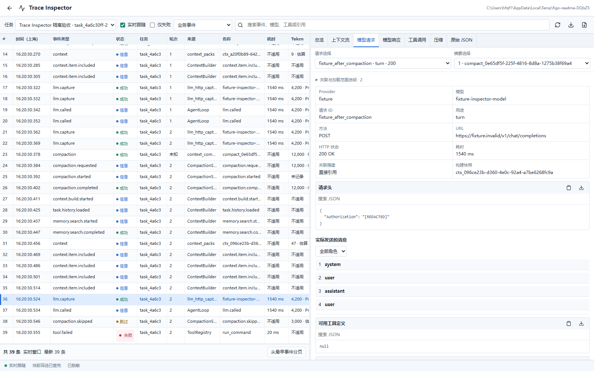

检查器采用 Fiddler 风格的高密度布局：左侧统一事实表，右侧按标签检查选中记录。请求、响应、工具、上下文与压缩不是分散的日志页面，而是同一 Task / Turn 下相互关联的证据。

| 右侧标签 | 可以检查什么 | 事实边界 |
| :--- | :--- | :--- |
| 总览 | 选中事实的类型、状态、归属和关联入口 | 不按时间接近猜测因果 |
| 上下文流 | 本地来源、SQLite 消息、构建快照、摘要与请求之间的关系 | 构建时快照不等于每次实际发送内容 |
| 模型请求 | 模型、请求消息、工具定义、Headers 与请求体 | 凭据脱敏，实际发送内容以对应抓包为准 |
| 模型响应 | HTTP 状态、正文、原生工具调用、实际 usage 与错误 | 原生正文可与 tool_calls 共存，不因此认定已完成任务 |
| 工具调用 | 参数、执行结果、状态、错误和相关来源 | 工具结果是执行事实，不是模型自己描述的动作 |
| 压缩 | 检查、摘要请求、来源消息、保留边界、前后对照和元数据 | 响应成功、条目提交、下一请求采用是不同事实 |
| 原始 JSON | 脱敏后的结构化记录与关联字段 | 不提供未脱敏数据库导出，不展示隐藏思维链 |

支持筛选、分页、请求切换、Live 暂停、来源定位、复制与下载。切换 Task、工作区或选中记录时隔离异步结果；缺少消息快照或历史关联时明确降级，达到查询限制时提示未查完。文件来源优先展示执行时快照，再区分当前磁盘版本。

#### 工具调用与原始记录

工具调用与原始记录视图，截图采用 2026-10-16 的隔离测试数据。

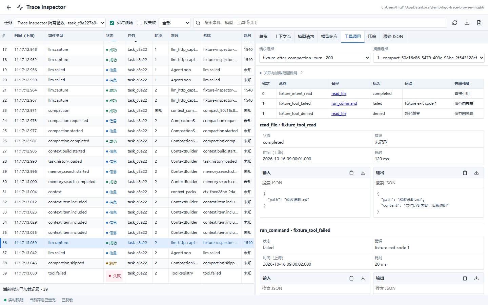

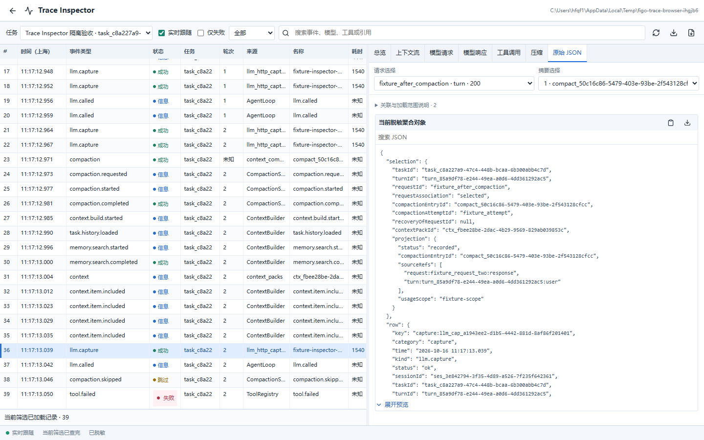

检查器是独立的只读观察入口，查询不创建 Turn、不执行工具，也不修改上下文。

#### 总览：对象与关联范围

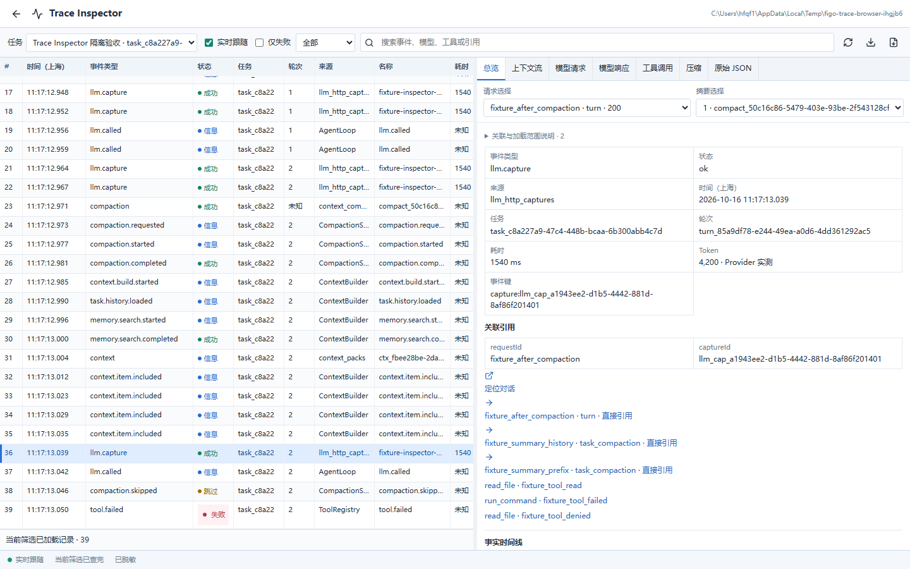

总览列出事件类型、状态、来源、时间，以及真实存在的 Session、Task、Turn、Run、ContextPack、requestId、toolCallId 和摘要条目引用。缺少直接引用的旧记录仅按 Task / Turn 范围归组，时间相邻不作为直接关联依据。

事件表展示序号、上海时间、事件类型、状态、Task、Turn、来源、名称及有依据的耗时和 token。实际零值保留；瞬时事件显示“不适用”，进行中、未记录和模型未提供分别显示对应状态。

#### 上下文流：构建快照与请求投影

第一层是 ContextBuilder 的构建快照，展示当时准备的条目、来源、理由、估算与取舍。第二层是所选 requestId 的实际消息：运行时可能已追加工具反馈、执行压缩或省略失败尝试，同一 ContextPack 并不保证所有请求发送相同内容。

来源表区分用户输入、显式文件引用、Task 历史、纳入时的 Memory、消息原文、新 Markdown 摘要与旧 JSON 检查点。请求消息表按实际顺序展示 role、sourceRef、所属 Turn、工具调用 ID、状态和正文。

一轮对话可以同时包含已被摘要覆盖的前缀与保留原文的后缀，压缩状态因此记录到消息级边界。两个工具结果即使正文相同，只要来源不同就仍是两条事实。

来源定位先看执行时快照，当前磁盘文件或当前 Memory 是独立观察，不覆盖历史。旧库缺少消息快照时，标记为兼容重建与预览预算未知；完整工具输出和当时模型收到的裁剪结果分别处理。

#### 模型请求：选中一次真正的调用

请求页展示 provider、model、purpose、requestId、上下文关联、URL、method、脱敏 Headers、消息与工具定义。消息可按角色查看；工具定义展示当时提交的 Schema，不拿当前注册表反推历史。

同一 Turn 的每次调用独立保留。一次压缩可能产生历史摘要与 Turn 前缀摘要，页面通过全部 requestIds 关联主请求、辅助摘要与各自开销。请求输出上限字段按实际请求显示，未记录的值不套当前配置。

请求默认选择顺序为已有手选、事件明确引用、当前详情范围内第一条已记录抓包。最后一种仅方便浏览，不新增因果关系；明确引用的抓包缺失时保留缺失状态。切换请求同步刷新消息、投影、响应和选择器，并丢弃不属于新选择的迟到响应。

#### 模型响应与工具：看到描述不等于执行过

响应页把状态、耗时、finish_reason、正文、原生 tool_calls、usage 和原始流 wire 分开。长 wire 通过独立字段读取，不占用结构化正文的展示空间；HTTP 失败、长度终止与被恢复的失败尝试分别保留记录。

原生正文可以是过程说明，有 tool_calls 时仍要经验证、Policy 和执行器，收到真实工具结果后再继续。文本协议仍对完整响应做排他校验，两种协议使用各自的分类规则。

工具页按轮次、意图、工具名称、状态、输入输出、耗时与错误展开。Policy 拒绝显示 DENIED 与拒绝原因；耗时来自工具记录的开始结束时间，模型实际 token 不分摊到单个工具。

Artifact 只展示真实 Task / Turn 归属。某次摘要请求与 report.md 处在同一 Turn，不等于该请求生成了报告。

#### 压缩：过程、摘要、来源、对比与元数据

**过程**分别显示检查、准备切点、摘要调用、成功条目提交及后续请求采用。跳过、失败、取消和提交冲突有独立分支，没有事件的内部步骤不补造时间戳。

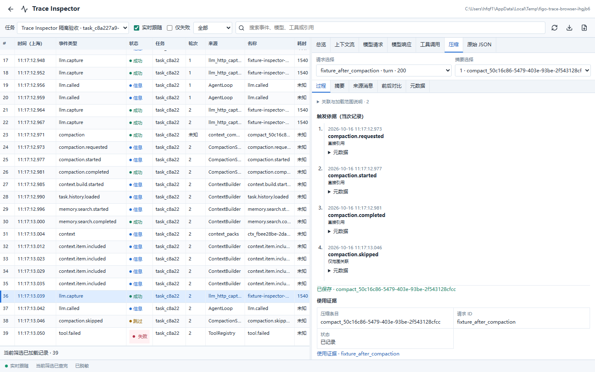

**摘要**展示 Markdown 正文、条目 ID、seq、baseEntryId 和来源元数据。条目已存在但完成事件缺失时，显示“已保存，完成事件缺失”，不抹掉任一事实。

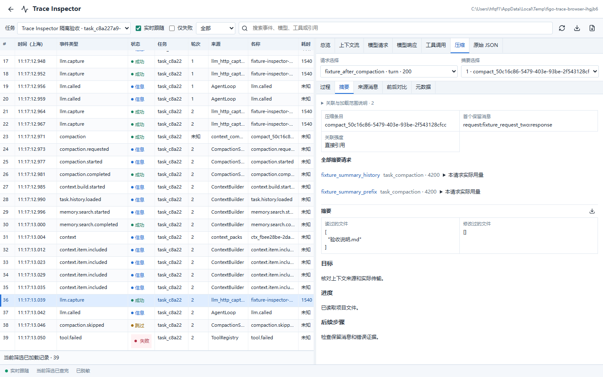

**来源消息**展示覆盖前缀、首个保留 sourceRef、近期原文、工具配对与省略状态。新 Markdown 条目和旧 JSON 检查点分别解释，旧记录没有消息级边界就保持兼容状态。

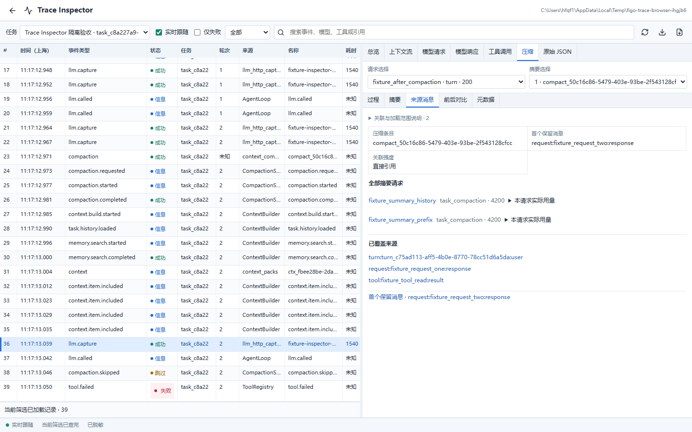

**前后对比**展示当次 tokensBefore / tokensAfter、摘要字符量和保留消息数，说明是估算、usage 加新增估算或未知。仅在 before 大于零且两边均有效时计算 1 - after / before，负值表示投影增长。

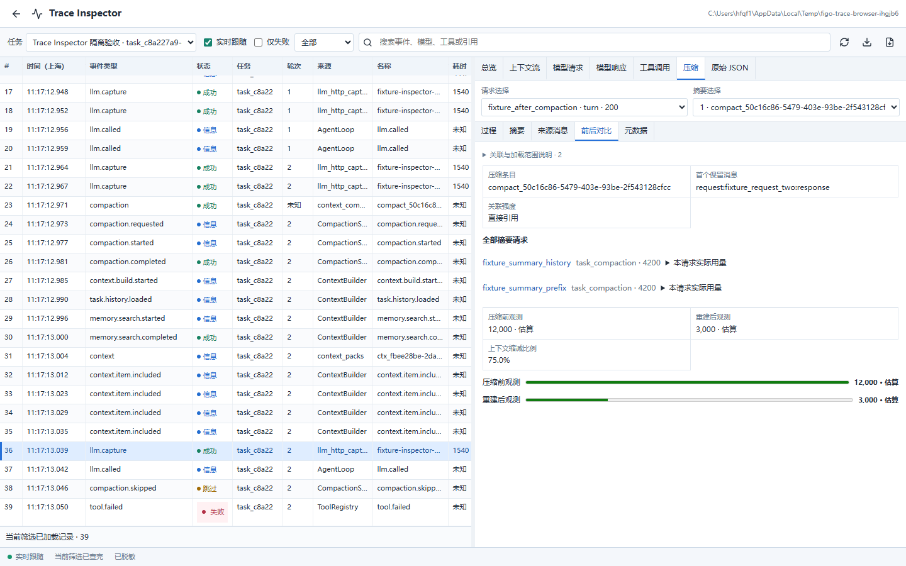

**元数据**展示模式 auto / manual / recovery、触发原因、模型窗口、预留量、近期保留量、全部摘要请求、恢复关系与后续使用引用。历史参数按当次记录解释，不套用最新运行配置。

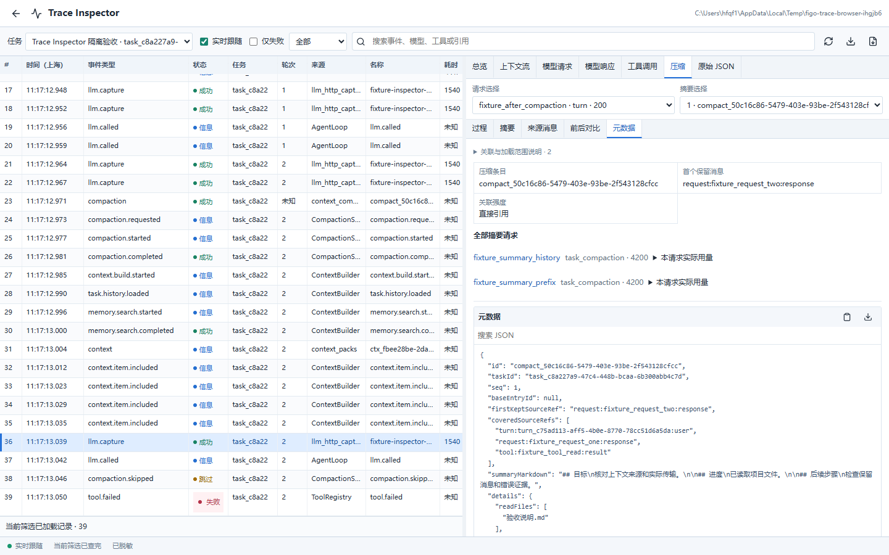

只有明确 requestId、compactionAttemptId、compactionEntryId、sourceRef 或 recoveryOfRequestId 等引用才画直接关联。仅同 Task / Turn 的记录标记范围关联；没有依据就显示未知。当前 omitted 标记不能倒推早先请求当时也省略了消息。

#### 原始 JSON、长正文与导出

原始视图保留脱敏后的 Trace、抓包、工具、ContextPack、消息与新旧摘要结构，Markdown 正文作为字符串保存，阅读预览与原始对象分开。

长 JSON 保留对象、角色、数组与来源结构，长字符串转换为可继续读取的字段引用。字段接口验证事件归属、字段白名单、JSON 路径、offset 和页大小，先对完整字段脱敏，再按脱敏后的内容分页，避免密钥跨边界泄漏。

默认护栏包括 200 项详情集合、16384 字符正文预览、900000 字符完整响应预算、8388608 字符单字段硬上限和 32768 字符字段分页；单页最大 131072 字符、预览节点 20000。安全协议另限制 JSON 深度和字段路径层数。它们是只读展示护栏，不是模型上下文或 Pi 压缩阈值。

字段预览、集合截断、硬读取上限和关联缺失是不同状态。复制与下载标注本视图、当前页和已加载字段的范围，导出完整性与分页位置分别记录。

#### 分页、Live 与只读交互

普通模式默认每页 200 条，显示总数、当前页、总页数和本页范围，支持首页、上一页、下一页与末页。筛选先进入 SQL 再统一计数和取页，空结果各计数为 0。翻页替换当前表，不累计加载；筛选改变回到第一页，越界夹紧后同步真实页码。

Live 读取最近 500 条窗口，显示总数与窗口条数；实时窗口与普通页码分开，列表更新保留已有事件和请求选择。页码不能与 cursor 或 latest 混用。整页超预算时明确拒绝并提示缩小筛选，不少返几条后跳页漏记录。

默认列表只看业务事实，传输事件保留独立入口。交互验证覆盖键盘选行、标签切换、搜索、拖动、来源定位、Live 暂停、返回草稿、复制与下载，以及七个一级标签、五个压缩子标签和桌面/窄屏状态。浏览不会创建 Turn、调用模型或重放工具。

### 3.18 Electron：共享工作台的桌面适配器

#### Electron 的启动、数据与退出

Electron 主进程管理窗口、原生目录选择和服务生命周期；utilityProcess 运行已有 Node 本地服务。服务使用动态回环端口，主进程通过私有消息取得地址与一次性访问码，完成认证后给桌面专属分区设置会话 Cookie。

渲染窗口设置 nodeIntegration=false、contextIsolation=true、sandbox=true，拒绝任意外部导航和通用 Shell/文件系统 IPC。首次设置页只暴露模型保存与用户主动选目录等受限动作，不把 Agent 内核搬进 React。

配置位于 userData/data，提示词和最近目录随程序用户数据保存；工作区 .figo-agent 仍在项目中，不搬进安装目录。安装资源不包含真实配置、密钥、工作区数据库、测试数据或开发文档。

模型没配置或最近目录不可用时先停在设置页，用户主动浏览并打开工作区后才启动服务，不创建假工作区 Session。取消目录选择后继续停留在设置页。桌面始终启用会话鉴权，不因 Web 的免访问码设置而开放 API。

退出先停止接收新操作并请求服务关闭。有活动 Run 时需明确等待或强制退出，等待有界；强退后的未完成 Run 记录为 interrupted。新启动换认证 Cookie，旧 Cookie 不能复用到新服务；服务崩溃时窗口显示失联状态。

## 四、使用与开发

### 从任务到复盘

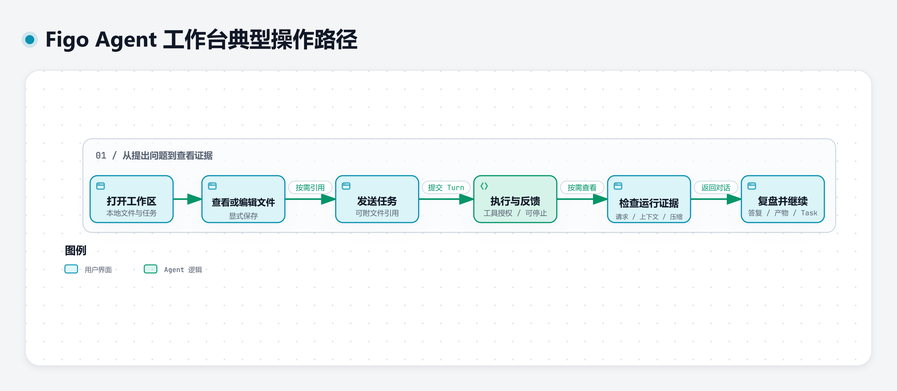

| 步骤 | 在工作台里做什么 | 对应边界 |
| :--- | :--- | :--- |
| 打开工作区 | 查看文件树、最近目录和本工作区任务 | 数据跟随工作区，不混入其他项目 |
| 阅读与编辑 | 打开文件、修改并显式保存 | 浏览文件不创建 Turn，也不自动进入模型上下文 |
| 提交任务 | 在固定输入框发送问题，按需附文件或已保存行引用 | 服务端校验路径、版本和行区间后构造上下文 |
| 执行与反馈 | 查看模型轮次、工具动作、错误和最终答复，必要时停止 | 模型提出动作，Policy 决定工具是否执行 |
| 检查证据 | 按需打开 Trace Inspector，定位请求、响应和来源 | 检查器只读，不触发新的模型调用 |
| 复盘与继续 | 阅读报告、追问同一 Task，或开始新任务 | 同 Task 保持连续上下文，不默认混合其他 Task 历史 |

文件阅读、任务执行与证据检查可以独立进行。检查器按需打开，不影响对话与工具执行流程。

### 本地 Web 工作台

准备可运行本项目 `node:sqlite` 的 Node.js 环境、npm 和可用的模型服务配置；项目使用 TypeScript，具体依赖与脚本以 `code/package.json` 和锁文件为准。

在仓库根目录执行：

```bash
npm --prefix code install
npm --prefix code run web:dev
```

用 Chrome 打开终端实际输出的地址，默认 `http://127.0.0.1:4317`。端口占用时可通过 `FIGO_WEB_PORT` 指定其他端口，以当前进程输出的端口为准。启用访问码时按终端提示认证；免访问码配置仅用于可信本机研究。

`web:dev` 会先构建前端再启动本地服务，不提供 HMR。前端源码变更需要重新构建与部署；模型设置保存则直接更新运行实例。

### 模型与提示词设置

1. 打开工作台设置，选择服务连接，填写 API 地址、模型和密钥；可以逐个配置，不必一次填完所有模板。
2. 保存成功后，当前进程的后续请求立即使用新配置，Session / Task 与草稿不重建，**不需要因保存模型设置而重启服务**。
3. 活动 Run 期间不能保存；版本冲突、地址改变或配置错误会明确拒绝，失败不激活新连接。
4. 聊天输入区可切换默认模型；已提交的 Run 使用提交时的模型快照，不随全局默认值改变。
5. 提示词页分别编辑自定义系统指令和持久用户指令，新 Turn 读取最新版本，并记录提示词指纹。

设置响应不回显已保存密钥；留空并保持连接地址不变时保留原值，清除密钥需要显式操作。地址改变时不把旧密钥自动发送到新地址。

| 内容 | 位置与更新方式 |
| :--- | :--- |
| 模型、压缩、工具与工作台运行参数 | `code/figo-agent.config.json`；模型设置页提供经校验的即时更新，其余手工参数修改通常在启动时加载 |
| 用户自定义提示词 | `code/.figo-agent/prompts.json`，属于本机数据，新 Turn 读取 |
| 固定中文文案与提示模板 | `code/locales/zh-CN.json`，不承载权限、协议或安全上限 |
| 工作区任务与运行事实 | 工作区 `.figo-agent/`，不因模型设置保存而搬迁 |
| 桌面配置 | Electron 用户数据目录，与源码配置目录分离 |

自 2026-10-16 起，模型配置保存统一完成新 Provider 准备、原子写入、运行时激活与脱敏集合更新，后续请求直接使用新连接。

### CLI 与桌面

CLI 启动：

```bash
npm --prefix code run dev
```

普通文本创建 Turn；`/help`、`/context`、`/memory`、`/report`、`/usage`、`/task` 与 `/exit` 等控制命令不创建普通 Turn。任务连续性由 Task 组织，显式 Skill 选择才激活任务方法，不按普通输入关键词自动执行。

Electron 复用现有 React 与本地 HTTP/SSE，Node 服务位于独立进程，主进程负责窗口、目录选择和生命周期，渲染进程不获得通用文件系统或 Shell 接口。工作区 SQLite 不搬进安装目录，桌面始终启用本地会话鉴权。

当前仅有 macOS arm64 未签名内部自测包，不是跨平台公开发行版；Windows/Linux 安装包与 macOS Intel 仍待对应平台独立验收。桌面端的当前范围是内部自测，公开发行仍有独立的平台与安装验收要求。

可选个人知识库：

```bash
git submodule update --init -- figo-kiwi
```

该子模块不是安装、构建或运行前置条件，也不参与默认用户项目上下文。

### 桌面开发与打包

桌面开发、打包与包内测试命令在对应目标平台执行：

```bash
npm --prefix code run desktop:dev
npm --prefix code run desktop:make
npm --prefix code run desktop:verify:package
npm --prefix code run desktop:test:e2e:package
npm --prefix code run desktop:test:first-run:package
npm --prefix code run desktop:test:active-exit:package
```

`desktop:test:real:package` 使用已配置服务进行真实模型验收，会产生上游请求与相应费用，需单独安排。包内检查必须针对最终解压应用验证 node:sqlite，而不是只在系统 Node 做一次测试。

### 遇到常见问题怎样定位

**Chrome 一直转圈或空白：** 先确认当前服务实际端口、首页与 bootstrap，再核对浏览器代理是否接管回环。历史排障中系统代理曾导致普通 Chrome 超时，而进程级直连可用；排障优先使用进程级直连并保持 Host 校验；localhost 与 127.0.0.1 的 Host 校验结果可能不同。

**保存模型失败：** 查看服务端错误、HTTP 状态与页面提示，区分活动 Run、版本冲突、密钥规则与旧服务 API。当前保存成功即激活后续请求；若前端已更新、后端仍是旧代码，需要开发者部署新服务，部署升级与日常设置保存分别处理。

**刷新后任务看似消失：** 先查询 Session/Task 是否仍在 SQLite，再检查页面选择恢复；历史曾出现界面回到 default、但数据库未删除的情况，后续任务窗口专项已补视图持久化。服务重启创建新 Session 与页面刷新是两件事。

**上下文很长却未压缩：** 看当次模型窗口、有效 token 观测与跳过原因。累计用量超百万不等于单次上下文超阈值；检查过、请求过摘要、成功落库和后续采用必须分别核对，成功与否取决于对应条目和后续请求证据。

## 五、验证结果与能力边界

### 当前能用到哪里

| 能力 | 当前状态 | 范围与限制 |
| :--- | :--- | :--- |
| CLI 小内核与 Task | 已落地，支持多轮任务上下文与复盘 | Task 不是 Goal，不做任务级验收闭环 |
| 受控工具与模型循环 | 已实现读写、命令、Git、网络和浏览器能力 | 高风险操作仍受 Policy 与人工判断约束 |
| 本地 Web | 文件编辑、任务目录、执行过程与证据检查已实现并有专项验收 | 真实模型链路按服务与场景独立验证 |
| Trace Inspector | 七标签、来源、压缩、只读查询及三视口交互有验收 | 桌面包与大规模压测另有验证范围 |
| Pi 压缩 | 算法移植、消息持久化、滚动摘要与一次恢复已实现 | 实际大窗口容量、摘要无损、长期净收益未完整验证 |
| TokenUsage | 请求级实际值、未知状态、上下文估算与汇总已实现 | 没有价格成本报表或单 Tool / Skill 实际用量分摊 |
| Electron | macOS arm64 核心启动交互完成内部自测 | 未签名、未完成升级等门槛，不公开发行 |
| 后续演进 | Goal / Verifier、动态插件、自动长期记忆治理、多 Agent、自优化仍待做 | 当前仅有设计或契约预留 |

### 三模型压缩配对实验

2026-10-15 的三模型配对实验使用独立测试窗口 W=49152、R=16384，阈值为 32768，不把该小窗口写成生产模型能力。各模型先建立真实历史，再复制三组关闭/开启分支，反向执行其中一组以减少固定顺序影响。

实验共 3 个自然历史场景、18 个后续分支，去重 109 次请求全部 HTTP 200；14 条摘要分别进入下一次请求，14 个可见保留后缀逐条一致。原生正文与 tool_calls 共存的 GPT 响应按结构化动作执行，没有被非空正文误判成协议错误。

首次自动压缩的投影估算如下，前后两列不是 Provider 计费值：

| 模型 | 首次压缩前 → 后 | 首次摘要字符 / HTTP 秒 |
| :--- | :--- | :--- |
| MiniMax | 38456 → 22961 | 2859 / 13.469 |
| GPT 中转 | 39177 → 23868 | 3692 / 27.963 |
| DeepSeek | 38445 → 22851 | 2434 / 27.970 |

三者首个压缩样本均覆盖 8 条原消息，保留 12 条近期原文。14 次摘要分布为 MiniMax 3 次、GPT 中转 6 次、DeepSeek 5 次。摘要能注入、保留原文一致、后续任务通过，都是这组功能证据。

但开销没有因此降低：

| 模型 | 三次输入总量：关闭 → 开启 | 墙钟中位数秒：关闭 → 开启 |
| :--- | :--- | :--- |
| MiniMax | 232395 → 273397，增加 17.6% | 19.610 → 54.256 |
| GPT 中转 | 661307 → 727321，增加 10.0% | 34.170 → 111.186 |
| DeepSeek | 423623 → 525460，增加 24.0% | 65.087 → 109.338 |

三次输出总量也分别从 6909 增至 20750、2332 增至 13055、14131 增至 27496。统计排除了复制的共同前缀，包含摘要、修复和额外调用；首次请求缩短约 39%–41%，仍被摘要和额外动作的开销抵消。三个配对样本不是普遍规律，输入 token 变化也不能直接等同货币费用变化。

验收器曾把一条正确的严格大于公式误判为失败。复核直接读取原数据库，修正判定但保留原始报告，没有重新调用模型挑成功样本。最终区分 functionalStatus=passed、measurementStatus=complete、capacityStatus=endpoint_window_unknown、status=partial，productionReleaseApproved=false。

因此本阶段的结论是：机制与测试窗口功能已验收，实际大窗口容量、通用语义质量与长期净收益未完整证明。该阶段于 2026-10-16 收尾，后续工作转入实际使用反馈与具体问题修复。

### 专项验证记录

各阶段的专项验证结果如下，测试数量对应各自日期的代码快照：

| 专项与日期 | 当时结果与范围 |
| :--- | :--- |
| Pi 配对，2026-10-15 | 三模型各三组开关配对，18/18 后续分支通过，14/14 摘要与保留后缀核对；功能通过但容量与净收益结论仍有边界 |
| 模型设置即时生效，2026-10-16 | 完整串行 81 文件、811 项通过，覆盖准备失败、落盘失败、运行互斥、跨页更新和密钥轮换；模型容量不在该专项范围 |
| Windows 检查器，2026-10-16 | 串行 80 文件、796 项通过；16 组浏览器检查、30 张三视口截图；原默认四 worker 曾有一项压缩预检超时 |
| macOS Web 检查器分页，2026-10-17 | 88 文件、940 项默认并发通过；16 组、30 张隔离截图及真实历史只读对照通过；结论限定于该平台与快照 |
| 任务目录，2026-10-17 | 92 文件、1008 项通过，目录专项 11 组与交互边界 5 组通过；使用离线响应 |
| 品牌接入，2026-10-17 | 93 文件、1013 项及类型、构建和相关 Web/开发态检查通过；未重新生成安装包 |
| macOS arm64 桌面内部包 | 开发态与 ZIP 解压应用通过核心启动、SQLite、单轮模型和主要交互；正式签名、公证、升级及若干异常场景未完成 |

检查器的真实历史只读对照提供了一个具体例子：同一 Task 保持 4 Turn、8 条抓包、13 条工具不变，其中 1 条本地占位、7 次远程请求。原列表 609 行中有 384 条传输通知；修复后默认展示 225 条业务事实，通知另行查看。

最后一次实际请求的 25 条消息和 18 个工具定义可读取，2090 字符回答与 336466 字符 wire 分开；13 个工具耗时来自真实记录，7 次远程用量来自对应请求。检查前后数量不变，证明“查看”没有重跑任务，而不是证明新增模型能力。

历史对照保留数量与结构信息，用户原文、私人项目截图和完整数据库留在本地。旧截图采用累计加载，当前普通列表已改为分页，两者对应不同版本。

### 功能、安全与交互验证

**运行正确性**的验证范围包括幂等重复提交、同键不同输入、单活动 Run、工作区写租约、任务状态拒绝、默认模型快照、停止后继续、服务中断和历史只读。重点检查 Turn 创建唯一性与刷新后的副作用幂等性。

**文件链路**核对真实磁盘保存、版本 409、未保存草稿、关闭确认、敏感路径、越界符号链接、二进制、大文件、非法深度与截断提示。引用必须对应发送时经校验的版本，验证同时检查编辑器状态与实际磁盘内容。

**检查器数据**覆盖自动/手动/恢复、新 Markdown/旧 JSON、同 Turn 部分保留、失败摘要、成功条目但缺完成事件、后续使用证据、原生正文加工具调用、缺快照降级、长字段继续读取和跨 Task 拒绝。完成响应不能替代条目提交，后者也不能替代后续采用。

**脱敏**覆盖 Headers、URL、正文、消息、错误、Markdown、文件预览、剪贴板和下载，以及密钥前缀重叠、截断边界与字段分页边界。脱敏测试包含长内容与跨边界凭据，处理顺序为先脱敏、后截断。

**异步与列表**覆盖同毫秒稳定排序、筛选总数、525 条分页/Live 样本、空结果、末页、越界夹紧与刷新、迟到请求、切换 Task/工作区、手选请求保持、Live 暂停与返回草稿。当前样本规模尚未覆盖百万事件生产压测。

**视觉与可访问性**覆盖桌面、窄桌面与 390 像素级移动视口，长中文标题、长路径、UUID、JSON、空态、错误态、失联态、固定输入框、独立滚动、拖动与键盘、图标名称和实际鼠标命中。控件通过真实鼠标与键盘操作验证命中和焦点。

**真实模型**单独核对实际上游请求、响应、工具与用量，LOCAL 占位、离线夹具与合成截图分别归类。流式首段、失败抓包、三模型功能、模型容量和长期收益分别验收。

### 桌面实施阶段与未完成项

- **服务边界：** 已抽出参数化启动入口，配置根、工作区、静态资源与动态端口显式传入；仍需按目标平台补齐任意目录启动与异常清理门槛。
- **进程与 SQLite：** 开发态及 macOS arm64 ZIP 解压应用的 SQLite 读写、主要窗口链路已有自测；启动失败反馈等包内异常仍有缺口。
- **数据与鉴权：** 首次空密钥模板、受限设置、强制本地鉴权已落地；旧配置导入、失败回滚与布局重启保持仍需专项证据。
- **可安装内部包：** 已验证包内静态资源、单轮模型、文件保存、Shell/Git、重启历史和部分退出链路；原生系统对话框真人操作、更多退出组合、升级回滚未完整验收。
- **公开发行：** 签名、公证、升级和目标平台独立验收未完成。Windows/Linux 与 macOS Intel 的构建和安装验收仍待分别完成。

### 桌面平台放行矩阵

| 平台 | 当前结论 |
| :--- | :--- |
| macOS Apple Silicon | ZIP 解压应用核心启动、SQLite、Shell/Git、单轮真实模型与部分重启/退出链路内部自测通过；未签名，不公开发行 |
| macOS Intel | 未完成对应平台构建与安装验收 |
| Windows x64 | 本地 Web 有专项验证，Electron 安装包仍待验收 |
| Linux x64 | 未完成对应平台构建与安装验收 |

桌面未完成项包括原生目录对话框的真人点击/取消、旧配置导入与失败回滚、启动失败窗口反馈、窗口布局重启保持、真实流式首段和失败抓包、运行中 Terminal 或有副作用 Tool 的退出恢复，以及公开发行的签名、公证、升级与回滚。

安装包 SQLite 检查必须在包内运行内存与临时文件数据库的建表、插入、查询和关闭，记录 Electron/内置 Node 版本；系统 Node 可运行不能替安装包放行。升级只能替换程序文件，不能覆盖 userData 或工作区 SQLite。

### 开发验证入口

在仓库根目录按变更范围执行：

```bash
npm --prefix code test
npm --prefix code run typecheck
npm --prefix code run build
npm --prefix code run web:typecheck
npm --prefix code run web:build
npm --prefix code run web:test:e2e
npm --prefix code run web:test:trace
npm --prefix code run web:test:tasks
npm --prefix code run web:test:tasks:regressions
```

测试记录按日期、代码快照与运行环境独立保存，覆盖单元、接口、浏览器交互、安全和真实模型等不同层次。

| 验收层 | 证据要求 | 结论范围 |
| :--- | :--- | :--- |
| Web | API / CSRF / 路径、文件版本、运行幂等、事件重放、交互与布局 | 对应工作台能力 |
| 检查器 | 请求关联、消息来源、历史边界、缺失态、脱敏与只读副作用 | 数据正确性与只读交互 |
| 桌面 | 最终安装包 SQLite、鉴权、进程退出、数据保留、原生交互与签名 | 对应平台的最终安装包 |
| 压缩 | 成功条目、来源与下一请求注入，分别核对功能、容量和收益 | 保留 partial 与未验证项 |

应用测试、浏览器交互、真实模型调用和最终安装包测试分别记录，结论限定在相应环境和能力范围内。

### 禁止放行条件

以下问题属于发布阻断项：

- 明文密钥进入响应、事件、前端包、日志、截图或导出；工作区与身份边界被绕过。
- 浏览器直读 SQLite、配置原件，或任意文件/SQL/通用 IPC 暴露。
- 模型输出未经 Policy 执行，用户停止仍记成功，恢复重复执行已有工具。
- 实际用量用估算补齐，未知填零，摘要/修复/失败开销漏算，单工具实际成本由总量猜测。
- 用最新摘要或当前省略标记改写历史，缺少明确关联依据，或混淆成功响应、条目提交与后续采用的状态。
- 长正文整块丢失、分页漏行、导出范围不明、跨 Task 或工作区串数据。
- 目标平台安装包缺少必需验收，或发行包缺少规定的签名与公证。
- 必需的测试、类型检查、构建、交互或安全场景未通过。

### 使用与安全边界

- 面向可信本机研究，不是可直接公开到网络的多用户服务；免访问码模式不代表共享部署安全验收通过。
- 本地运行不等于完全离线；模型请求会把选中的上下文发送到配置的模型服务，任务数据本地落盘不等于内容从不离开本机。
- 所有 Agent 工具经 ControlledToolPolicy，人工 Terminal 不经过该策略；工作台不是操作系统级沙箱。
- API Key、Authorization、token、secret、password 等凭据必须脱敏；完整抓包和用户代码仍属敏感数据。
- 仓库配置中的 `apiKey` 必须为空，真实密钥只作为本机数据；提交或发布前扫描源码、文档、产物与包内容。
- 历史读取与自动恢复执行分开，进程重启不重放有副作用 Tool；缺失数据、错误和取消不补成成功。
- Pi 专项已阶段收尾，当前以实际使用反馈为后续优化依据，容量与收益的未验证项继续保留。

## 六、演进方向与工程经验

### 为什么先做 Task，再考虑 Goal

初版先验证 CLI、Session/Turn、静态插件、Context、只读 Tool、Trace 和报告。Task 随后补上多轮主题边界，受控工具再补执行能力，请求级用量与本地 Web 则补观察与交互。

这条演进路径先连接输入、行动、来源与结果，再逐步扩展任务管理与验证。Goal、Verifier、多 Agent 与持续自优化都依赖稳定的执行边界和事实基础。

当前候选方向是任务级验收与暂停恢复、验证器、权限 profile、dry-run 与风险评分、工具回放、人工确认记忆、动态插件/MCP，以及价格成本和长期收益分析。这些能力目前尚未实现。

### 几个已经踩过的工程问题

**恢复能力需要分层。** 数据库保留历史，页面仍可能因选择状态仅存于 React 内存而回到空任务。页面恢复、服务续接与跨进程执行恢复涉及不同状态和验证条件。

**证据关系需要在运行时记录。** 时间顺序只能描述先后，来源引用、抓包 ID、消息快照与摘要边界才能建立确定关联。

**上下文随执行过程变化。** 初始构造后还会追加工具反馈、压缩和恢复。Context 解释准备过程，抓包记录单次传输，Trace 连接运行事件，三者提供不同观察维度。

**压缩效果需要计算完整开销。** 摘要请求、额外工具与后续调用共同构成任务成本。较短投影解决容量管理，净收益则需要独立的配对测量。

**插件契约与生态建设分阶段推进。** 静态能力索引解决替换与隔离，动态加载、市场、升级、安全验证和多 Skill 编排涉及独立的工程工作。

**验证结论限定于实际范围。** 离线、真实模型、Web、最终安装包、串行与默认并发分别留痕；功能验收、容量验证与收益证明分别记录。

### 素材来源

工作台截图采用隔离演示数据，检查器历史截图标注测试日期。架构、产品流程与数据流图由 Archify 依据源码生成，动画描述逻辑关系，不表示实际执行耗时。真实模型实验的数据与结论单独标注日期和测试环境。

**一个你能掌控的本地智能体，意味着既能使用它，也能理解它、干预它，并按自己的需要改造它。** Figo Agent 通过可查的运行事实、明确的操作边界和可替换的模块，将这种掌控落实到具体机制。模型结果仍需验证，工具风险仍需判断，而使用者保留选择与修改的能力。

更新于 2026-10-18。
